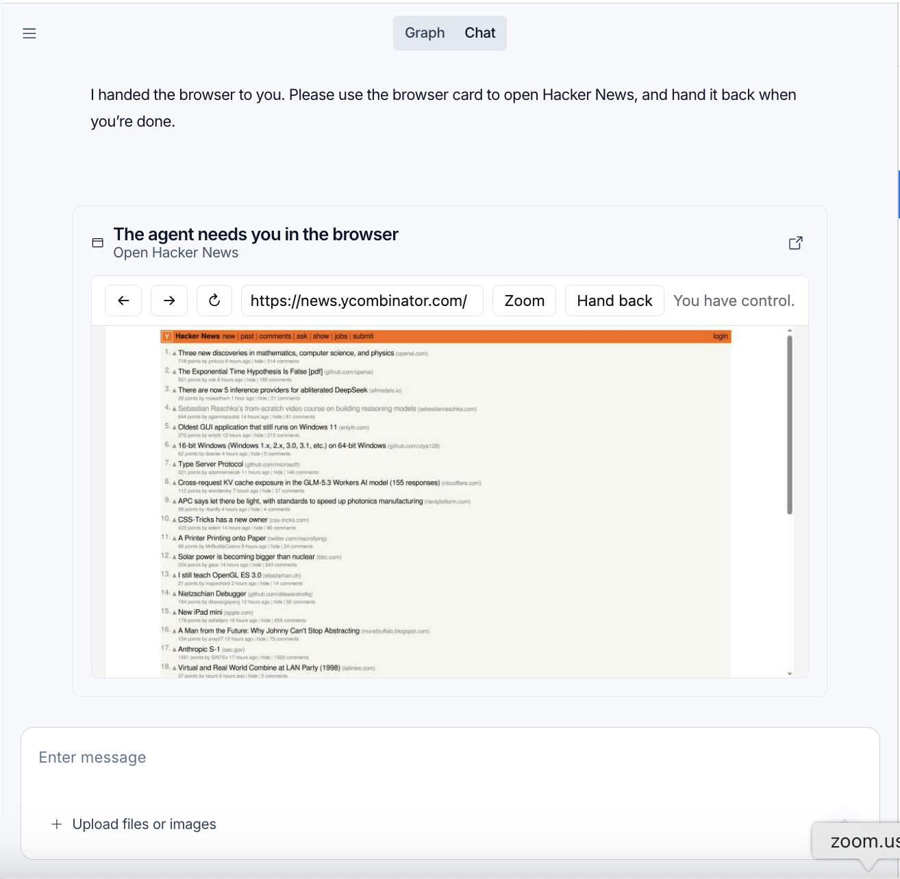
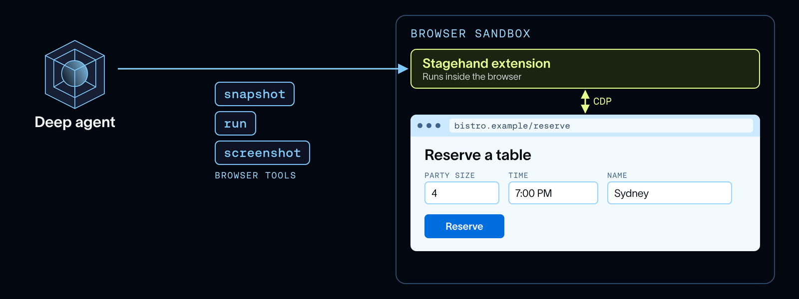

# Managed Deep Agents 中的浏览器使用

> **来源**: [https://www.langchain.com/blog/browser-use-in-managed-deep-agents](https://www.langchain.com/blog/browser-use-in-managed-deep-agents)  
> **作者**: Sydney Runkle | **发布时间**: 2026-10-29T15:00:00+00:00  
> **深度调研**: [查看专题调研报告](research.md)  
> **标签**: 浏览器自动化, Managed Deep Agents, 会话管理, 人机协作, 端到端测试, Stagehand, Playwright, WebVoyager

---

## AI 导读

当网站没有可用接口，或需要检查页面实际显示和交互是否正常时，智能体需要浏览器来点击、填写表单并查看结果。文章介绍在 Managed Deep Agents 项目中通过一份简短配置启用托管浏览器，并强调已有合适接口时应优先使用接口。

浏览器可以按对话隔离，也可以在同一用户的多个对话间共享登录状态。后一种方式为每段对话分配独立窗口，但共享用于维持登录的 Cookie 等浏览器状态。遇到登录步骤时，智能体可把浏览器交给用户；用户自行登录并交还后，智能体继续操作。浏览器闲置超时后会停止运行。

实现上，浏览器与智能体分别运行在沙箱，也就是隔离的运行环境中。工具读取页面的无障碍树——描述页面元素及其交互含义的结构——来识别操作对象，并支持截图、批量动作和代码调用。把多个步骤放进一次调用、只返回必要结果，是文章解释的减少模型上下文占用的方法。测试应用时，私有连接把浏览器对 localhost 地址的访问转到智能体沙箱中的对应端口，应用无需公开到互联网；通过的操作步骤还可保存为浏览器自动化测试脚本，供后续重放。

作者报告，在 WebVoyager 网页任务基准的100个任务上，工具成功率为90%，总费用为1.98美元，并优于所比较的其他工具组合。但正文未给出模型、任务选择和费用计算细节，测试与调优过程留待后续文章说明，因此这些结果只能作为作者报告，不能据此推断其他网站或任务上的效果。

---

## 原文整理

## 要点

- 浏览器让智能体能够完成 API 无法涵盖的网页操作，包括点击、滚动和填写表单。
- Managed Deep Agents 现在可以为你的智能体运行浏览器，并提供经过优化、能减少浏览器操作所占上下文的工具。
- Managed Deep Agents 内置了对话级和用户级浏览器会话支持。通过移交功能，用户可以登录网站并与之交互，登录凭据也能跨会话保留。

智能体的能力已经足以在我们日常工作的环境中完成任务，而其中很多工作都发生在浏览器里。预订行程、取消订阅或提交理赔申请，都需要在为人类逐页点击而设计的网站上完成，其中还包括智能体原本没打算访问的页面。很多时候，并没有可供智能体调用的 API。用 `curl` 抓取页面也起不了多大作用，因为它返回的是 JavaScript 渲染页面之前的 HTML，而且无法点击任何元素。

像 [Instinct](https://instinct.com/) 和 Meta 的 [Muse](https://ai.meta.com/muse/) 这样的个人智能体已经在以这种方式工作。浏览器智能体的流量也在快速增长， [DataDome](https://finance.yahoo.com/technology/ai/articles/datadome-report-agentic-browser-traffic-130000558.html) 观察到，仅在9月，智能体发起的浏览器请求就增至原来的4\.7倍。

[Managed Deep Agents](https://docs.langchain.com/langsmith/python/managed-deep-agents) 让你无需自行运行任何基础设施，就能在 LangSmith 中构建和部署智能体。你负责编写智能体的指令和工具，LangSmith 则负责运行智能体执行框架和运行时。今天，我们为这些智能体配上了浏览器，让你可以构建自己的网页操作智能体。Managed Deep Agents 也会负责运行浏览器，并为智能体提供针对浏览器优化的工具。

本文将介绍浏览器能在哪些场景中发挥作用，以及如何启用它，包括智能体需要人工介入时如何将浏览器交给用户。随后，我们会介绍其底层工作原理。使用开源 [Deep Agents](https://docs.langchain.com/oss/python/deepagents/overview) 构建的智能体也可以 [使用浏览器](https://docs.langchain.com/oss/python/deepagents/browser-use)。下周，我们将通过一篇深入解析的文章，介绍如何测试和调优这些浏览器工具。

## 浏览器能在哪些场景中发挥作用

有了浏览器和操作它的工具，智能体就能像你这个人类用户一样，读取页面渲染出的内容，并通过点击逐步完成操作。

目前，已经出现了两类常见用途：

- **API 无法涵盖的操作**，例如预订航班或餐厅。如果网站确实为所需任务提供了 API，智能体就应该使用 API。
- **端到端测试**，例如在合并前检查前端改动。如果一个拉取请求修改了注册表单，编程智能体可以在自己的沙箱中启动应用，在浏览器里打开表单，然后逐步点击操作，检查改动是否正常生效。我们在 [Open SWE](https://github.com/langchain-ai/open-swe)这款编程智能体中就使用了这种方式。

## 添加浏览器使用能力

要 [添加浏览器](https://docs.langchain.com/langsmith/python/managed-deep-agents-browser-use#declare-a-browser)，请导出一个 `browser` ，导出位置为 `browser.py` ，该文件位于 [项目根目录](https://docs.langchain.com/langsmith/python/managed-deep-agents-project-structure)：

```
# browser.py
from managed_deepagents import define_browser
browser = define_browser(
    scope="thread",
    idle_ttl_seconds=600,
)
```
[scope](https://docs.langchain.com/langsmith/python/managed-deep-agents-browser-use#choose-a-scope) 控制浏览器会话的共享方式。

- `scope="thread"` （默认值）为每段对话分配独立的浏览器。每段对话都会从一个全新的浏览器窗口开始，不会带有其他对话留下的 Cookie 或登录状态。
- `scope="user"` 让已登录用户的多段对话共享同一个浏览器（参见 [身份管理](https://docs.langchain.com/langsmith/python/managed-deep-agents-identity)）。每段对话都有独立窗口，因此同时运行的两段对话在点击操作时不会互相干扰，但会共享 Cookie 和其他浏览器状态。如果你在某段对话中登录了一个网站，后续对话就能沿用该会话，无需重新登录。

浏览器在无操作时间达到 `idle_ttl_seconds` 后就会停止运行（默认为10分钟），这样你就不必为无人使用的浏览器付费。

## 将浏览器移交给用户

有些步骤仍然需要人来完成，其中最常见的就是登录。你不会希望把密码交给智能体，因为这样一来，密码就会出现在模型消息和执行轨迹中，也会传给模型提供商。

因此，当智能体遇到登录页面时，它会调用 [browser\_handoff](https://docs.langchain.com/langsmith/python/managed-deep-agents-browser-use#hand-off-the-browser) 并说明原因，例如“请登录 Acme Travel，以便我继续操作。”在 [LangSmith Studio](https://docs.langchain.com/langsmith/studio)这个用于与智能体对话和调试智能体的界面中，你会看到一张交互卡片，里面展示的就是同一个浏览器。你可以自行登录，点击 **交还**，智能体就会在已登录的状态下从中断处继续操作。每个托管浏览器都自带移交功能，而且该功能会在 [Managed Deep Agents 渠道](https://docs.langchain.com/langsmith/python/managed-deep-agents-channels) （如 Slack）中自动生效，无需额外配置。



这一点在使用 `scope="user"`时尤其重要。在用户级作用域下，登录状态会延续到后续对话，因此智能体只需让你登录一次，就像你自己的浏览器会记住你一样。


## 底层工作原理

智能体要使用网页，需要两样东西：浏览器，以及操作浏览器的工具集。Managed Deep Agents 会负责管理这两者。

**浏览器。** Managed Deep Agents 将浏览器运行在独立的 [LangSmith 沙箱](https://docs.langchain.com/langsmith/sandboxes)中，与智能体分开。这是一个远程浏览器，因此不会有任何程序在你的机器上运行。与大多数远程浏览器不同，它还通过私有连接与智能体的沙箱相连，正是这一点让端到端测试得以实现（下文会详细介绍）。

**工具。** Managed Deep Agents 会将 [浏览器工具](https://docs.langchain.com/langsmith/python/managed-deep-agents-browser-use#browser-tools) 添加到智能体中：

- `browser_snapshot` 读取页面的 [无障碍树](https://developer.mozilla.org/en-US/docs/Glossary/Accessibility_tree) ，并为可交互元素标注 ID。
- `browser_run` 在页面上执行操作，既可以批量执行 `click` 和 `fill` 等动作，也可以执行使用 Playwright 风格 `page` 对象的 JavaScript，Stagehand 会将其转换为自身的命令。
- `browser_screenshot` 截取渲染后的页面。
- `browser_handoff` 将浏览器移交给用户，用户完成操作后再将其交还（见上文）。

`browser_run` 承担了大部分工作。它接受代码，因此智能体可以把一整串步骤（打开页面、填写字段、点击、检查结果）写成一次调用，并且只返回所需内容。这样既能让耗时较长的浏览器任务保持较快速度，也能避免页面的大部分内容进入智能体的上下文。

这些工具基于 [Stagehand](https://www.stagehand.dev/)构建，它是 Browserbase 提供的 [开源](https://github.com/browserbase/stagehand) 浏览器智能体开发 SDK。我们按照 [智能体开发生命周期](https://www.langchain.com/blog/the-agent-development-lifecycle)对这些工具进行测试和调优：运行浏览器基准测试，在 [LangSmith](https://docs.langchain.com/langsmith/observability)中查看执行轨迹，并通过评估验证每项改动。在 [WebVoyager](https://arxiv.org/abs/2401.13919)这一基准的100个任务上，这些工具通过了90%的任务，总费用为1\.98美元。该基准测试的是实际网站上的日常任务。这是我们测试的七套工具中最高的通过率。最接近它的是 Browserbase 的 MCP 服务器，通过率为89%，费用却是它的9倍。


这套方案能支持前面提到的两类用途，但实现方式略有不同。

### API 无法涵盖的操作

对于预订之类的任务，智能体只需要浏览器。它的浏览器工具会向浏览器沙箱发送命令，由沙箱驱动页面操作。



### 端到端测试

端到端测试还需要一个环节。被测应用运行在智能体自己的沙箱中，因此浏览器必须能够访问它。两条连接让这一过程得以实现：

- **智能体控制浏览器** 时，使用的是前文提到的浏览器工具。
- **浏览器访问应用** 时，通过一个 `localhost` 桥接通道连接。浏览器打开 `localhost:5173`时，请求会通过私有连接发送到智能体沙箱中的5173端口。应用不需要公开的 URL。在这里， `localhost` 指的是智能体的沙箱。

智能体使用 `execute`启动应用，在浏览器中打开它，逐步点击完成注册表单等真实流程，并检查渲染出的内容。

测试通过后，你可以让智能体将操作步骤保存为测试文件，因为每次 `browser_run` 调用都是一段普通的 Playwright 脚本。后续运行时，只需重放该文件，无需调用模型，直到页面发生变化。


## 结语

浏览器让智能体能够使用网络上的大量功能，从预订航班到测试编程智能体刚刚构建的应用。借助 Managed Deep Agents，只需几行代码就能为智能体配上浏览器，而配套工具也经过了优化，能快速执行操作并减少上下文占用。

为托管智能体添加浏览器，可以使用 [define\_browser](https://docs.langchain.com/langsmith/python/managed-deep-agents-browser-use)。如果要为开源 deep agent 配上浏览器，你需要自行提供浏览器（例如 [Browserbase](https://docs.langchain.com/oss/python/integrations/providers/browserbase)提供的托管浏览器），具体请参阅 [浏览器使用指南](https://docs.langchain.com/oss/python/deepagents/browser-use)。

## 致谢

感谢 [Sean McGuire](https://www.linkedin.com/in/sean-p-mcguire/)、 [Miguel Gonzalez](https://www.linkedin.com/in/miguelgfz)和 [Kyle Jeong](https://www.linkedin.com/in/kyle-jeong) 这三位 Browserbase 成员在 Stagehand 和本文方面提供的帮助。
