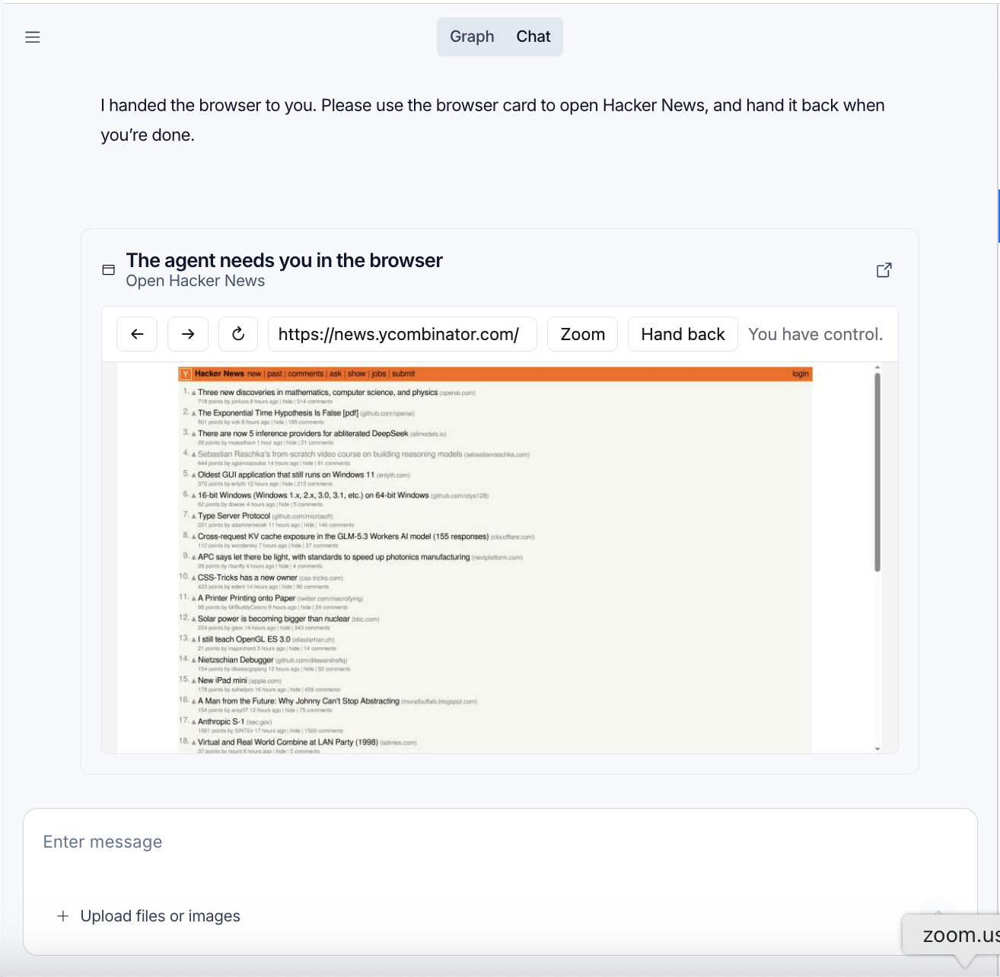
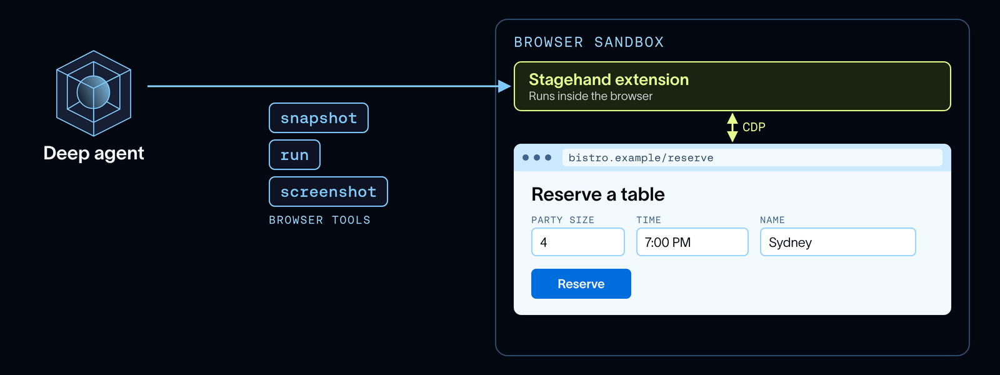

# Browser Use in Managed Deep Agents

> **来源**: [https://www.langchain.com/blog/browser-use-in-managed-deep-agents](https://www.langchain.com/blog/browser-use-in-managed-deep-agents)  
> **作者**: Sydney Runkle | **发布时间**: 2026-10-29T15:00:00+00:00  
> **深度调研**: [查看专题调研报告](research.md)  
> **标签**: 浏览器自动化, Managed Deep Agents, 会话管理, 人机协作, 端到端测试, Stagehand, Playwright, WebVoyager

---

## AI 导读

当网站没有可用接口，或需要检查页面实际显示和交互是否正常时，智能体需要浏览器来点击、填写表单并查看结果。文章介绍在 Managed Deep Agents 项目中通过一份简短配置启用托管浏览器，并强调已有合适接口时应优先使用接口。

浏览器可以按对话隔离，也可以在同一用户的多个对话间共享登录状态。后一种方式为每段对话分配独立窗口，但共享用于维持登录的 Cookie 等浏览器状态。遇到登录步骤时，智能体可把浏览器交给用户；用户自行登录并交还后，智能体继续操作。浏览器闲置超时后会停止运行。

实现上，浏览器与智能体分别运行在沙箱，也就是隔离的运行环境中。工具读取页面的无障碍树——描述页面元素及其交互含义的结构——来识别操作对象，并支持截图、批量动作和代码调用。把多个步骤放进一次调用、只返回必要结果，是文章解释的减少模型上下文占用的方法。测试应用时，私有连接把浏览器对 localhost 地址的访问转到智能体沙箱中的对应端口，应用无需公开到互联网；通过的操作步骤还可保存为浏览器自动化测试脚本，供后续重放。

作者报告，在 WebVoyager 网页任务基准的100个任务上，工具成功率为90%，总费用为1.98美元，并优于所比较的其他工具组合。但正文未给出模型、任务选择和费用计算细节，测试与调优过程留待后续文章说明，因此这些结果只能作为作者报告，不能据此推断其他网站或任务上的效果。

---

## 原文整理

## Key Takeaways

- A browser lets agents do work on the web that APIs can't cover, including clicking, scrolling, and filling out forms.
- Managed Deep Agents now runs a browser for your agent, with tools tuned for context-efficient browser use.
- Managed Deep Agents ships with support for thread and user scoped browser sessions. Handoffs allow users to log into and interact with websites with credentials persisted across sessions.

Agents have gotten good enough to work where we work, and a lot of that work happens in a browser. Booking travel, canceling a subscription, or filing a claim all happen on sites built for people clicking through pages, including ones the agent didn't plan to visit. Often there's no API an agent can call. Fetching the page with `curl` doesn't get far either, since it returns the HTML before any JavaScript renders the page and can't click anything.

Personal agents like [Instinct](https://instinct.com/) and Meta's [Muse](https://ai.meta.com/muse/) already work this way. Browser agent traffic is growing fast too, and [DataDome](https://finance.yahoo.com/technology/ai/articles/datadome-report-agentic-browser-traffic-130000558.html) saw agentic browser requests jump 4.7x in September alone.

[Managed Deep Agents](https://docs.langchain.com/langsmith/python/managed-deep-agents) lets you build and deploy agents in LangSmith without running any infrastructure. You write the agent's instructions and tools, and LangSmith runs the harness and runtime. Today, we're giving these agents a browser, so you can build your own agents that work on the web. Managed Deep Agents runs the browser too, and gives your agent tools tuned for it.

In this post, we cover where a browser helps and how to turn it on, including handing the browser to a person when the agent needs one. Then we walk through how it works under the hood. Agents built with open source [Deep Agents](https://docs.langchain.com/oss/python/deepagents/overview) can [use a browser too](https://docs.langchain.com/oss/python/deepagents/browser-use). We'll cover how we tested and tuned the browser tools in a deep dive next week.

## Where a browser helps

With a browser and tools to drive it, an agent can read what renders on a page and click through it, the same way you (a human) would.

So far, two common use cases have emerged:

- **Actions an API can't cover**, like booking a flight or a restaurant reservation. When a site does have an API for the task, the agent should use the API.
- **End-to-end testing**, like checking a frontend change before it merges. When a pull request changes a signup form, a coding agent can start the app in its sandbox, open the form in a browser, and click through it to check that the change works. We use this in [Open SWE](https://github.com/langchain-ai/open-swe), our coding agent.

## Adding browser use capabilities

To [add a browser](https://docs.langchain.com/langsmith/python/managed-deep-agents-browser-use#declare-a-browser), export a `browser` from `browser.py` at the [project root](https://docs.langchain.com/langsmith/python/managed-deep-agents-project-structure):

```
# browser.py
from managed_deepagents import define_browser
browser = define_browser(
    scope="thread",
    idle_ttl_seconds=600,
)
```
[scope](https://docs.langchain.com/langsmith/python/managed-deep-agents-browser-use#choose-a-scope) controls how browser sessions are shared.

- `scope="thread"` (the default) gives each thread its own browser. Every conversation starts with a fresh browser window, with no cookies or logins left over from another thread.
- `scope="user"` shares one browser across a signed-in user's threads (see [Identity](https://docs.langchain.com/langsmith/python/managed-deep-agents-identity)). Each thread gets its own window, so two conversations running at once don't click over each other, but they share cookies and other browser state. If you sign in to a site in one thread, a later thread can pick up that session instead of starting over.

The browser stops after `idle_ttl_seconds` without activity (10 minutes by default), so you don't pay for a browser nobody is using.

## Hand off the browser to a user

Some steps still need a person, and signing in is the most common one. You don't want to give the agent your password, where it would end up in the model's messages, in traces, and with a model provider.

So when the agent hits a login page, it calls [browser\_handoff](https://docs.langchain.com/langsmith/python/managed-deep-agents-browser-use#hand-off-the-browser) with a reason, like "Please sign in to Acme Travel so I can continue." In [LangSmith Studio](https://docs.langchain.com/langsmith/studio), the UI where you chat with and debug your agent, you get an interactive card with the same browser. You sign in yourself, click **Hand back**, and the agent picks up where it left off, already signed in. Handoff comes with every managed browser and works automatically in [Managed Deep Agents channels](https://docs.langchain.com/langsmith/python/managed-deep-agents-channels) like Slack, so there's nothing extra to set up.



This matters most with `scope="user"`. With user scope, the sign-in carries over to your later threads, so the agent asks you to log in once, the same way your own browser remembers you.


## How it works under the hood

An agent needs two things to use the web: a browser, and a toolset to drive it. Managed Deep Agents manages both.

**The browser.** Managed Deep Agents runs the browser in its own [LangSmith sandbox](https://docs.langchain.com/langsmith/sandboxes), separate from the agent. It's a remote browser, so nothing runs on your machine. Unlike most remote browsers, it also has a private link to the agent's sandbox, which is what makes end-to-end testing work (more below).

**The tools.** Managed Deep Agents adds the [browser tools](https://docs.langchain.com/langsmith/python/managed-deep-agents-browser-use#browser-tools) to the agent:

- `browser_snapshot` reads the page's [accessibility tree](https://developer.mozilla.org/en-US/docs/Glossary/Accessibility_tree) and labels interactive elements with IDs.
- `browser_run` acts on the page, either with a batch of actions like `click` and `fill` or with JavaScript that uses a Playwright-style `page` object, which Stagehand translates into its own commands.
- `browser_screenshot` captures the rendered page.
- `browser_handoff` passes the browser to a person, who hands it back when they're done (see above).

`browser_run` does most of the work. It takes code, so the agent can write a whole chain of steps (open a page, fill a field, click, check the result) as one call and return only what it needs. That keeps long browser tasks fast, and it keeps most of the page out of the agent's context.

The tools are built on [Stagehand](https://www.stagehand.dev/), Browserbase's [open source](https://github.com/browserbase/stagehand) SDK for building browser agents. We tested and tuned them with the [agent development lifecycle](https://www.langchain.com/blog/the-agent-development-lifecycle): running browser benchmarks, reading the traces in [LangSmith](https://docs.langchain.com/langsmith/observability), and validating each change with evals. On 100 tasks from [WebVoyager](https://arxiv.org/abs/2401.13919), a benchmark of everyday tasks on live websites, they passed 90% of tasks for $1.98 in total. That was the highest pass rate of the seven toolsets we tested. The closest, Browserbase's MCP server, passed 89% at 9x the cost.


This setup supports both use cases, in slightly different ways.

### Actions an API can't cover

For tasks like booking a reservation, the agent only needs the browser. Its browser tools send commands to the browser sandbox, which drives the page.



### End-to-end testing

End-to-end testing needs one more piece. The app under test runs in the agent's own sandbox, so the browser has to reach it. Two connections make that work:

- **The agent controls the browser** through its browser tools, as above.
- **The browser reaches the app** through a `localhost` bridge. When the browser opens `localhost:5173`, the request travels over a private link to port 5173 in the agent sandbox. The app doesn't need a public URL. Here, `localhost` means the agent's sandbox.

The agent starts the app with `execute`, opens it in the browser, clicks through real flows like a signup form, and checks what renders.

Once a test passes, you can ask the agent to save its steps as a test file, since each `browser_run` call is a piece of an ordinary Playwright script. Later runs replay that file with no model calls until the page changes.


## Conclusion

Browsers open up a huge part of the web to agents, from booking a flight to testing the app a coding agent just built. With Managed Deep Agents, giving your agent a browser takes a few lines of code, and the tools behind it are tuned to be fast and context-efficient.

Add a browser to a managed agent with [define\_browser](https://docs.langchain.com/langsmith/python/managed-deep-agents-browser-use). To give an open source deep agent a browser, where you bring your own (like a hosted one from [Browserbase](https://docs.langchain.com/oss/python/integrations/providers/browserbase)), see the [browser use guide](https://docs.langchain.com/oss/python/deepagents/browser-use).

## Acknowledgements

Thanks to [Sean McGuire](https://www.linkedin.com/in/sean-p-mcguire/), [Miguel Gonzalez](https://www.linkedin.com/in/miguelgfz), and [Kyle Jeong](https://www.linkedin.com/in/kyle-jeong) from Browserbase for their help with Stagehand and this post.
