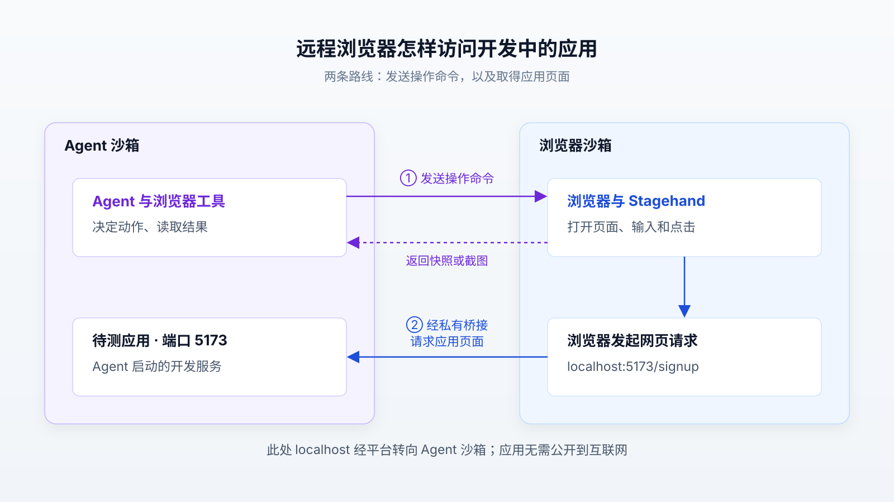

# 给 Agent 配上浏览器之后：LangChain 如何让它操作网页、请人登录并验证代码

让 AI 帮你查询餐厅信息，与让它在网站上选人数、填表、完成预约，是两种不同的能力。后者需要网页真正运行起来，还要处理登录和页面跳转。LangChain 在 2026 年 10 月 29 日发布的 Managed Deep Agents 浏览器功能，把远程浏览器、操作工具和人工接管接进了同一套托管服务。如果你关心没有开放接口的网站自动化，或希望编程助手亲自打开应用检查修改，这项进展值得关注。[原文：Browser Use in Managed Deep Agents](https://www.langchain.com/blog/browser-use-in-managed-deep-agents)

这里的 Agent，指能够围绕目标调用工具、观察结果并继续行动的 AI 程序；Managed Deep Agents 则由 LangChain 的 LangSmith 平台负责运行它。这次更新主要推进了工具与运行环境的整合。它没有提出新的基础模型，也没有证明任意网页任务都已能可靠自动完成。

## 先看一个任务：找到空位之后，还得能继续操作

假设你要求助手：“找一家周五晚上七点有两人位的餐厅，把预约信息准备好，提交前让我检查。”这是用来解释机制的假设场景，不是本文实测。

如果餐厅提供适用的 API——供程序直接调用的接口——助手可以发送结构化请求查询空位、准备预约。若只有面向人的网站，它就需要打开页面、选择日期、读取可选时段，再填写表单。直接下载网页源文件可能拿不到这些内容：有些页面要先运行 JavaScript，随后向服务器取数据，才显示空位。

浏览器能运行页面脚本，并保留点击、输入、跳转之后的状态。Agent 因而可以反复执行“观察页面—选择动作—检查结果”，而不只是读取一份静态文档。原文也明确建议：有适用 API 时优先使用 API；浏览器主要补足接口覆盖不到的部分。

接下来通常会遇到登录。新功能允许 Agent 把正在使用的浏览器窗口交给用户；用户直接在网站输入凭据，再交回控制权。助手继续读取登录后的页面，不必让用户把密码发进聊天框。这个交接过程，才让“在真实账户里继续做事”有了连贯的操作路径。

## 新意在哪里：把已有能力接成一条可持续的任务流程

浏览器自动化本身已有成熟工具。微软的 Playwright MCP 就能向模型提供结构化网页快照和浏览器操作；MCP 是让 AI 客户端接入外部工具的一种协议。因此，“模型能点击网页”不是这篇发布文章首次实现的能力。[Playwright MCP 官方仓库](https://github.com/microsoft/playwright-mcp)

这次更新的价值，在于开发者声明需要浏览器之后，平台同时处理了几件原本要分别连接的事：启动远程浏览器，让 Agent 读取和操作页面，按用户或对话复用登录状态，在必要时把窗口交给人，以及让浏览器访问 Agent 正在开发的应用。它属于 Agent 产品与工具设计的进展，而非浏览器控制算法的首次突破。

其中，操作工具建立在 Browserbase 的开源 Stagehand 之上。Stagehand 提供控制浏览器的软件工具包，Managed Deep Agents 再把它接入托管任务与用户交互。这也意味着：Stagehand、开源 Deep Agents 和托管产品是相关但不同的层次，不能把某一层的能力自动视为其他层都已具备。

## 它怎样看懂页面，又为什么能少调用几次模型

### 先把页面变成可操作的文字结构

Agent 不必每次都对整张截图猜坐标。`browser_snapshot` 会读取页面的“无障碍树”：浏览器为读屏器等辅助技术提供的页面结构，其中包含元素的名称、角色和状态。例如，一个元素可以被描述为“名称是预约的按钮”，另一个是“当前未选中的复选框”。这比把全部网页源码交给模型更接近当前任务需要的信息。[MDN：无障碍树](https://developer.mozilla.org/en-US/docs/Glossary/Accessibility_tree)

工具还会为可交互元素分配编号。回到假设的餐厅页面，Agent 可以从快照得知哪个编号对应人数输入框、哪个对应时段选项，再用编号指定动作，减少自己编写页面定位规则的需要。

编号有使用期限：它只对应当前页面的最新快照。跳转后，旧编号可能已失效，Agent 需要重新观察，不能把编号当成网站永久不变的元素名称。Stagehand 的工具说明明确写出了这一限制。[Stagehand：Agent 工具约定](https://docs.stagehand.dev/v4/integrations/agent-frameworks/overview)

### 把已经确定的连续动作交给工具执行

`browser_run` 支持两种输入：一批基于快照编号的动作，或一段通过 `page` 等对象操作网页的 JavaScript。于是，选人数、填姓名等已经确定的步骤，可以放进一次工具调用；代码执行完，只把需要的结果交回模型。

这减少了两类开销。第一，模型不必为每个细小动作都重新生成一轮回答。第二，工具不必在每一步之后把大量页面内容塞回“上下文”，也就是模型本次推理能够读取的信息。长任务因此有机会减少等待和模型用量，但实际节省多少仍取决于页面与任务，不能由这个机制直接推导出固定收益。

批量操作也有边界。如果选择日期后，网站重新生成了时段列表，后续动作就需要依据新页面决定。合理做法是在这种分支处重新观察，而不是预先写好整条路径。工具能连续执行动作，并不等于它能预知网页接下来会显示什么。

### 截图补充文字结构看不到的东西

`browser_screenshot` 保留渲染后的视觉信息。文字结构适合找输入框和按钮，但不能据此确认弹窗是否遮住按钮、排版是否错乱，或画布中的内容是否正确。原文提供了截图工具，但没有证明这些视觉问题都能被自动准确判断。实际检查仍需要明确的目标，例如“错误提示是否出现”，而不只是“页面看起来正常”。

更底层的优化来自 Stagehand v4。其官方介绍说明，它把页面、框架及执行环境的跟踪，以及浏览器控制指令的分发，移到了随浏览器运行的扩展里。CDP，即 Chrome DevTools Protocol，是程序向 Chromium 浏览器发送控制命令的协议。让这些工作靠近浏览器执行，可以减少远程查询与状态同步的往返；这与上面减少模型调用的优化发生在不同层。官方也承认，v4 尚未消除所有客户端状态，不能把它理解成彻底解决页面变化带来的问题。[Stagehand v4 官方介绍](https://www.browserbase.com/blog/stagehand-v4)

## 人登录一次之后，哪些状态会被留下

原文提供了两种浏览器共享方式。这里的“会话范围”决定哪些对话可以复用浏览器状态，而不是模型记住了哪些聊天内容。

| 设置 | 状态怎样复用 | 适合的任务 |
| --- | --- | --- |
| `scope="thread"`，默认值 | 每段对话独享浏览器；同一对话内继续使用已有状态 | 反复检查一次前端修改，使用独立测试账户 |
| `scope="user"` | 同一已认证用户的多个对话共享登录状态，每段对话各有窗口 | 用户登录一次后，在后续对话继续办理网站事务 |

登录后，网站通常通过 Cookie 等浏览器状态识别用户。Cookie 是网站让浏览器保存、后续请求时带回的小段数据，其中可能包含会话标识。因此，登录可以跨对话延续，不需要模型保存密码。

独立窗口解决的是两个对话争抢同一页面的问题，无法隔离共享账户状态。例如，在一个窗口退出登录或切换账户，可能影响另一个对话。官方文档还说明，用户范围依据已验证的调用者身份，而不是提示词里自报的用户名；空闲超时停止浏览器，也不等于退出网站账户，网站过期或浏览器替换仍可能让登录失效。[Managed Deep Agents 浏览器文档](https://docs.langchain.com/langsmith/python/managed-deep-agents-browser-use)

人工接管也需要区分“交回了控制权”和“任务已经成功”。`browser_handoff` 让用户接手当前窗口；交回后，Agent 应重新检查页面，确认是否已经登录，再继续操作。官方文档说明，用户控制窗口期间，Agent 的浏览器工具不能操作它；如果开发者使用自定义客户端，还需要显示接管产物，才能让用户打开相应窗口。[人工接管说明](https://docs.langchain.com/langsmith/python/managed-deep-agents-browser-use#hand-off-the-browser)

这种设计避免了主动把密码写进模型消息，但不意味着 Agent 无法接触敏感信息。登录后的页面仍然可能被它读取，登录状态也赋予了操作账户的能力。“不传密码”和“账户只能执行哪些动作”是两个需要分别理解的问题。

## 为什么分开的远程浏览器，能检查刚写好的应用

第二个值得关注的用途是端到端测试：从用户界面走完整条流程，例如打开注册页、输入信息、提交并检查反馈，而不只测试一个内部函数。

这里有个容易忽略的障碍。原文中，Agent 的代码与应用运行在一个沙箱里，浏览器运行在另一个沙箱里；沙箱是受隔离的运行环境。普通情况下，浏览器访问 `localhost`，找的是浏览器所在环境，不会自动找到另一个环境里的应用。

Managed Deep Agents 加了一条私有连接，把浏览器对特定本地地址的请求转到 Agent 沙箱。例如，浏览器打开 `localhost:5173/signup`，请求会被送到 Agent 沙箱的 5173 端口，无须先把开发中的应用发布到公网。这是该托管环境提供的桥接能力，不是远程浏览器天然具备的特性。[原文中的测试机制](https://www.langchain.com/blog/browser-use-in-managed-deep-agents)

下图先看上方控制路线，再看下方网页请求路线。实线表示命令或请求的发送方向；虚线表示页面观察结果返回给 Agent。

假设编程助手修改了注册表单，它先在自己的沙箱启动应用，再命令浏览器访问注册页。浏览器经桥接取得页面，执行输入和点击；Agent 读取操作结果，判断错误提示或成功反馈是否符合要求。这个过程补上了“代码改完、测试函数通过，但用户界面是否真的可用”的一部分检查。

原文称，LangChain 已在其编程 Agent Open SWE 中使用这种方式。这是作者披露的应用经验，不是本文独立验证过的交付质量提升；原文没有提供因此减少了多少缺陷或人工检查时间的数据。

### 一次探索能否直接变成永久可用的测试

原文提出，可把成功的浏览器步骤保存成测试文件，后续不再调用模型，直接重放。这一方向有价值：先让 Agent 探索陌生页面，再把明确的操作路径固定下来，能减少每次从头推理的需要。

但“像 Playwright 的代码”不等于“完整兼容 Playwright 的测试”。Stagehand v4 官方迁移文档明确说明，它没有 Playwright 依赖，也不是测试框架；完整测试执行器、断言和相关能力不能一并假定存在。因此，合理理解是操作步骤可以成为可复用测试的素材，保存后仍需检查所用接口、等待条件、结果断言和测试数据，不能承诺任意 `browser_run` 代码都原样变成可靠回归测试。[Stagehand：从 Playwright 迁移的边界](https://docs.stagehand.dev/v4/migrations/playwright)

## “90% 成功率、1.98 美元”究竟说明什么

原文报告：作者比较了七套工具，在 WebVoyager 中的 100 个任务上，这套工具通过了 90%，总成本为 1.98 美元；最接近的 Browserbase MCP 服务通过率为 89%，成本约为其九倍。应将这组数字标为 **LangChain 的内部评测结果**，不能写成独立第三方已经复现的结论。

WebVoyager 是一项让 Agent 在真实网站完成任务的研究及测试集，原始论文包含来自 15 个网站的 643 个任务。LangChain 使用的是其中 100 个任务，因此它报告的结果不是完整测试集成绩。原始论文还说明，数据收集时排除了必须登录或通过验证码才能访问内容的网站。这个范围尤其关键：相关成功率本身不能证明新产品的人工登录交接已得到充分检验。[WebVoyager 论文，第 4 节](https://arxiv.org/html/2401.13919v4)

截至 2026 年 10 月 31 日本次查阅，原文尚未交代足以复核比较的完整条件：选中了哪些任务、使用什么模型、各工具是否采用相同预算、是否允许重试、成功如何判定，以及成本是否计入浏览器运行与人工接管。作者预告另文介绍测试与调优过程；本次未检索到可与这组结果对应的完整报告。

这些缺项会影响解读。100 个任务中的 90% 与 89%，只相差一个成功任务；缺少重复运行和逐项结果，无法判断差异是否稳定。1.98 美元也只能暂时理解为作者统计口径下的成本，不能当作生产服务完成 100 次任意网站事务的价格。

还要留意判分方式。WebVoyager 原论文曾使用模型自动评价操作轨迹，并在一组 300 个任务上报告与人工判断有 85.3% 的一致率。这是原论文评价方法的结果，不是 LangChain 此次评测的判分准确率；它提示我们，模型宣布任务成功，也需要核对判断依据。[WebVoyager 论文，第 5 节](https://arxiv.org/html/2401.13919v4)

从成熟度看，目前证据可以分成三个层次：官方文档已经描述了可接入的产品功能；作者动画展示了预约和登录交接的预期流程；作者内部测试给出了性能信号。三者分别回答“提供了什么”“演示中如何操作”“在特定任务集上表现怎样”，都不足以单独证明任意真实网站流程已经可靠。

开源接入也处在快速变化中：LangChain 的浏览器指南仍写着 Python 中间件尚未发布、需要安装指定源码版本，而对应 GitHub 合并请求已于 10 月 28 日合并，仓库首页也已提供包安装命令。这说明资料正在更新，不能仅凭“已合并”就确认软件分发状态。尝试时应核对自己实际安装的版本与接口。[开源浏览器指南](https://docs.langchain.com/oss/python/deepagents/browser-use)、[中间件合并记录](https://github.com/langchain-ai/langchain-browserbase/pull/1)、[仓库说明](https://github.com/langchain-ai/langchain-browserbase)

## 接下来值得关注什么

这项进展可能推动两种工作方式。个人助手可以在用户完成登录后，继续处理缺少程序接口的网站事务；编程助手可以在修改代码后打开应用，获得来自真实页面的反馈。前者依赖会话与人工交接，后者依赖浏览器能访问开发环境，它们并不只取决于模型是否更聪明。这是基于上述机制的分析，实际节省多少时间仍需要应用数据。

对想尝试的人，最有信息量的起点是一个范围明确、结果可核对的任务：例如，在测试账户中填写表单并停在提交前，或检查注册页是否显示指定错误。它能同时暴露页面观察、状态保存和结果判断的问题；仅看一次流畅演示，很难知道失败时能否继续。

后续最值得跟踪的是：作者是否公开那 100 个任务的配置、成本明细与失败记录；人工交接后恢复任务是否稳定；保存下来的测试能否在多次运行和页面变化后继续有效。这些证据将决定，这套整合能在多大范围内从“Agent 可以操作网页”，走向“用户可以持续把网页任务交给它”。
