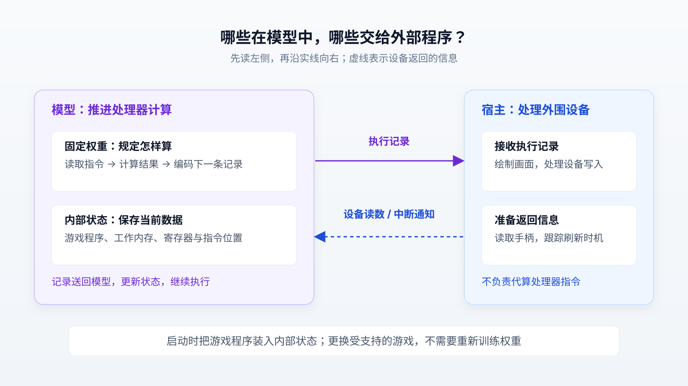

# nesformer：把游戏机处理器编译进模型权重，究竟证明了什么？

让语言模型执行程序，常见办法是让它生成代码，再交给外部解释器运行。nesformer 尝试把其中一部分执行过程搬进神经网络：将任天堂 NES 游戏机的处理器规则直接编译成权重，让模型逐步生成执行记录，并用内部状态保存游戏运行所需的数据。外部程序再根据这些记录绘制画面、处理手柄输入。

这项实验值得关注的地方，是它把“生成下一个符号”变成了推进一台具体机器的计算过程。同时，作者称构建工作主要由编程智能体完成，展示了智能体如何借助已有编译器和标准测试完成跨领域改造。它目前适合作为研究原型观察，距离实用游戏模拟器和通用智能体能力证明都还有明确边界。

本文以 Simon Willison 于 2026 年 10 月 30 日发布的[介绍文章](https://simonwillison.net/2026/Oct/30/nesformer/)为起点，核对项目源码、前身 Qwenputer 的说明及相关研究。核验截至 2026 年 11 月 3 日；下文的运行数字来自项目方报告，本文未独立运行权重或复现性能测试。

## 先看一个具体动作：游戏怎样读到手柄？

假设游戏正在等待玩家按下开始键。普通模拟器会执行游戏程序，遇到读取手柄的指令时，从宿主程序取得按键状态，再继续执行。这里的“宿主程序”，就是承载模拟器、负责连接屏幕和输入设备的外部软件。

nesformer 保留了这条输入路径，但改变了执行处理器指令的位置。模型先生成表示读取设备的记录；宿主收到后，把按键状态作为输入符号送回模型；模型再据此计算后续结果。这个例子用于说明机制，并非本文实测的游戏片段。

源码给这些符号定义了专门用途：`IOR` 表示读取输入输出设备，`IN` 携带宿主返回的数值。它们属于 token，也就是模型一次接收或输出的离散符号；在这里，token 编码机器操作和数据，而非普通中文词语。[符号定义](https://raw.githubusercontent.com/dbreunig/nesformer/main/nesformer/spec.py)和[运行驱动](https://raw.githubusercontent.com/dbreunig/nesformer/main/nesformer/run.py)清楚列出了这条交互路径。

因此，“在 Qwen 里面运行游戏”需要拆开理解：模型承担处理器计算，外围软件承担设备行为。模型也没有观察画面、自主决定如何通关；项目提供的按键脚本可以预先指定哪个时间段按哪个键。

下图从左侧开始读：实线表示模型向宿主输出执行记录，虚线表示宿主送回设备读数或中断通知。

## 新意在哪里：已有方法被移植到另一台机器

nesformer 由 Drew Breunig 发布，直接继承 Divyansh Agrawal 的 Qwenputer。后者已把 RISC-V——一种处理器指令集，也就是规定处理器能执行哪些操作的规范——编译进 Qwen 模型，并利用模型内部状态充当内存。因此，不能把“在模型里放入处理器”全部算作 nesformer 首创。[Qwenputer 项目](https://github.com/divagr18/qwenputer)公开了此前的实现。

两者还有一个容易混淆的区别。Qwenputer 作者描述的是在保留 Qwen 原有语言权重的基础上，增加计算用的层和维度，让语言模型可以把计算任务交给内置处理器。nesformer 则导出了一个专门执行 NES 处理器的模型文件；其生成代码直接构造电路权重，没有加载原始聊天模型权重的步骤。[前身说明](https://divagr.com/blog/qwenputer)、[nesformer 权重生成代码](https://raw.githubusercontent.com/dbreunig/nesformer/main/nesformer/weights.py)

这也解释了为什么“Qwen3.5-4B”容易造成误解：nesformer 借用了它的部分层结构和尺寸，交付文件却不是完整的四十亿参数聊天模型。实际配置是隐藏维度 768、八层，其中七层负责计算，另一层是用于适配框架缓存的全零注意力层。“标准模型类能够加载”描述的是结构兼容性，不代表保留了原模型的聊天能力。[模型配置](https://raw.githubusercontent.com/dbreunig/nesformer/main/weights/config.json)

它的新增贡献更具体：把已有编译方法移植到 NES 的 6502 处理器核心，设计配套执行记录，并接上能显示游戏的外围程序。这是一次有实际运行产物的技术迁移实验，而非新的语言模型训练方法。

## 为什么权重和内部状态能组成处理器？

一台处理器至少要记住数据、读出下一条指令、计算结果，再保存结果。nesformer 分别用模型的状态矩阵和计算层完成这些动作。

### 第一步：让内部记忆可以按地址读写

Qwen3.5 包含一种叫 Gated DeltaNet 的结构。它在每次处理 token 时更新一块固定大小的状态矩阵，可以把它理解为模型随运行持续修改的数据表。它属于循环计算结构：上一步留下的状态会参与下一步计算。官方框架文档确认，Qwen3.5 将这类结构与普通注意力层混合使用。[Transformers 文档](https://huggingface.co/docs/transformers/model_doc/qwen3_5)

Qwenputer 所用的关键办法，是控制这张表怎样被修改：让“遗忘门”保持不衰减，把写入强度设为完全替换，并用只有一个位置为 1、其余为 0 的向量选择地址。这种地址表示叫独热编码。这样，一次写入只替换选中的行；用同样方式查询，就能读回那一行。其他行的数据保持不变。[Qwenputer 的内存说明](https://github.com/divagr18/qwenputer#gated-deltanet-as-ram)

处理器寄存器，也就是保存当前运算值的小存储单元，以及工作内存，都能分配到这些状态中。需要强调，**固定权重保存计算规则，运行状态保存不断变化的数据**。游戏卡带中的程序也在启动时装入状态，而不是每换一个游戏就重新训练模型。[状态布局代码](https://raw.githubusercontent.com/dbreunig/nesformer/main/nesformer/core.py)

### 第二步：把一条指令拆成可执行的小步骤

以内存加法为例，处理器要先找到指令，识别它要求加法，再找到操作数，计算结果以及是否产生进位，最后更新寄存器和下一条指令的位置。进位表示结果超出了当前数值位宽，需要向更高位传递。

nesformer 的计算层按这个因果顺序排列：先取得处理器状态和指令地址，再读取程序字节、识别操作，随后算出数据地址、读取数据，最后计算结果并编码成下一个 token。源码中的层计划明确列出了这些阶段；不同指令会走不同条件分支。[处理器电路](https://raw.githubusercontent.com/dbreunig/nesformer/main/nesformer/core.py)

这里没有通过大量游戏样本学习“下一步大概是什么”。编译器根据预先写好的规则设置矩阵中的数值，让模型的一次前向计算——即输入经过各层得到输出——实现指定的逻辑。

### 第三步：输出记录，再用记录推进状态

生成的 token 不只是供人观看的日志。它携带寄存器新值、内存写入值或跳转目标等信息；随后被送回模型，驱动相应状态更新，再计算后续输出。因此，连续生成记录就形成了连续执行程序的过程。跳转、栈操作等较复杂行为可以需要多个 token，不能把每个 token 等同于一个真实处理器时钟周期。[执行记录规范](https://raw.githubusercontent.com/dbreunig/nesformer/main/nesformer/spec.py)

遇到设备访问，宿主才接手。比如模型要求读取图形设备状态时，宿主返回读数；到达画面刷新期间，宿主可以注入 NMI，即一种通知处理器转去执行指定处理程序的不可屏蔽中断。绘图代码和图形内存仍在宿主中。[外围实现](https://raw.githubusercontent.com/dbreunig/nesformer/main/nesformer/host.py)

## 更深入一点：为什么能“精确覆盖”，又为什么仍要测试？

把状态矩阵记为 \(S\)，选择第 \(i\) 行的独热向量记为 \(e_i\)，准备写入的数据行记为 \(v^T\)。在不遗忘、完全写入的理想条件下，更新可以写成：

\[
S' = S + e_i(v^T-e_i^T S)
\]

括号中先用新值减去旧的第 \(i\) 行，再把差值加回这一行，所以该行变成新值，其他行不变。查询 \(e_i^T S'\) 就读回该行。这解释了“状态可以充当随机存取内存”的数学依据；随机存取内存指可以按地址直接读写的存储空间。

这类增量更新与可修改记忆的关系已有研究基础，2021 年的[《Linear Transformers Are Secretly Fast Weight Programmers》](https://arxiv.org/abs/2102.11174)讨论过相关联系。此次实验的价值在于把它具体用于可执行机器，而非首次发现神经网络可以维护记忆。

但理想公式不能直接保证实际实现正确。模型还涉及归一化、非线性计算和有限精度数值。权重生成器专门处理缩放并检查数值能否用 bf16 表示；bf16 是一种 16 位浮点格式。快速执行器也显式模拟相应舍入。这些代码表明，“精确”依赖经过安排的数值路径，不能直接推广为任意精度、任意推理后端都能得到相同结果。[权重生成器](https://raw.githubusercontent.com/dbreunig/nesformer/main/nesformer/weights.py)、[快速执行器](https://raw.githubusercontent.com/dbreunig/nesformer/main/nesformer/fastengine.py)

## 证据到了哪一步？

目前可核验的主体是开源原型、测试代码和作者报告。它们支持不同层次的结论，需要分开阅读。

| 检查层次 | 现有证据 | 能说明什么、仍缺什么 |
| --- | --- | --- |
| 参考处理器是否可靠 | 测试将参考实现与 nestest 标准日志逐条比对，并断言完成 3,348 条指令 | 支持后续比较基准在这段测试上的正确性；遇到不支持的指令或跳入工作内存时会终止，不能称为完整覆盖 |
| 电路能否预测正确下一步 | 电路检查逐步输入参考记录，再比较下一 token | 能定位单步计算错误；由于每步输入正确记录，不能单独证明错误不会在连续运行中累积 |
| 权重能否自己持续运行 | 测试让模型输出接回输入，参考记录只用于比较，出现差异就报错 | 比逐步喂答案更接近实际执行；依然受程序、输入和运行长度限制 |
| 标准框架能否执行 | 作者报告标准 Transformers 下检查了 2,651 个位置，无不匹配；另报告 Full Game 连续运行约 265 万 token，保存的 210 帧全部匹配 | 提供兼容性与较长运行证据，但两组结果的执行后端和测试口径不同，不能合并成“标准框架完成全部长测” |

上述测试方法可在[测试文件](https://raw.githubusercontent.com/dbreunig/nesformer/main/tests/test_nesformer.py)、[电路检查器](https://raw.githubusercontent.com/dbreunig/nesformer/main/nesformer/check.py)、[标准框架检查器](https://raw.githubusercontent.com/dbreunig/nesformer/main/nesformer/hfcheck.py)中核对；长测数字来自[项目自报结果](https://github.com/dbreunig/nesformer#how-it-was-checked)。标准框架检查器还明确跳过宿主注入的输入位置，因为那些值本来就不应由模型预测。

画面匹配也有一个边界：模型与参考处理器可以使用同一套外围绘图实现，所以两者一致主要说明处理器替换后没有改变这些输出，并不证明外围实现已经完整复现原始硬件。

## 智能体的进展：两次提示背后有很强的验收依据

Breunig 在 [Hacker News 的作者评论](https://news.ycombinator.com/item?id=50306442#50307402)中称，Opus 5.5 在两次提示后构建出了可工作的权重和代码。第一条要求阅读 Qwenputer 文章及源码，研究能否模拟 NES；第二条明确接受速度慢，要求交付权重和能加载游戏文件的命令行工具。

这是作者对开发过程的陈述。该评论没有给出足以独立审计全过程的完整操作记录，因此不能从“两条提示”推出内部只做了两次尝试，也无法据此确定耗时、人工介入量或成功率。

不过，这个任务为什么适合智能体探索，是可以从公开材料理解的。已有编译器解决了“怎样把逻辑变成权重”，处理器规范限制了要实现的行为，而 nestest 提供了逐步正确结果。智能体不必只凭一张游戏截图判断成功，可以检查某条指令执行前的寄存器值是否正确，再检查生成记录是否一致。[nestest 原始说明](https://github.com/christopherpow/nes-test-roms/blob/master/other/nestest.txt)

由此可以作出一个有限的分析推断：这个案例展示了编程智能体在资料充分、反馈明确的环境中，组合已有工具并完成跨领域改造的潜力。它尚不能证明智能体能同样可靠地完成没有规范、缺少测试、需求不断变化的项目。公开成果验证的是一个具体任务，不是普遍的软件研发能力。

## 慢和不完整，具体限制了什么？

首先是速度。作者报告默认优化引擎约为每秒 1,650 token，普通 Transformers 执行约为每秒 10 token；整体游戏速度仍比真机慢约 150—290 倍。这些是项目方环境中的数字，缺乏充分硬件信息，不能作为通用性能基准。[速度说明](https://github.com/dbreunig/nesformer#speed)

默认引擎通过编译数值计算、利用大量零权重减少工作；宿主还会跳过满足条件的重复等待循环。引擎仍根据权重执行模型运算，并不是每一步调用普通 6502 模拟器代算。但这也意味着，演示中的速度不能直接当作通用模型框架逐步执行所有指令的速度。[执行器源码](https://raw.githubusercontent.com/dbreunig/nesformer/main/nesformer/fastengine.py)、[宿主代码](https://raw.githubusercontent.com/dbreunig/nesformer/main/nesformer/host.py)

其次是兼容范围。宿主的卡带加载器只接受 NROM，也就是不需要切换程序存储区的简单卡带类型；更复杂游戏用到的存储区切换机制尚未接上。项目还明确列出：不支持非官方指令、不能从工作内存执行程序，图形细节有近似处理，也没有声音。读者应把它看成能运行部分游戏的处理器实验。[卡带加载源码](https://raw.githubusercontent.com/dbreunig/nesformer/main/nesformer/host.py)、[项目限制](https://github.com/dbreunig/nesformer#limitations)

如果目的是流畅玩游戏，现有证据没有给出采用此方法的理由。如果目的是研究怎样让模型内部执行可检查的程序，这些限制反而把问题范围划得很清楚：先在已支持的机器行为内验证计算，再讨论扩展。

## 后续值得关注的是任务证据，而非演示规模

对智能体研究者，更有价值的后续信号是完整开发记录、重复实验和失败案例：同样的资料换一次运行能否成功，拿掉参考测试后表现如何，换一套指令规则要增加多少人工工作。这些证据才能帮助区分已有工具的贡献与智能体新增的能力。

对模型研究者，一个合理的研究方向是把自然语言规划与内部确定性计算结合起来。Qwenputer 已提供初步范例，但 nesformer 自身没有验证这种结合能提升开放任务的成功率。要继续向前，需要在同一任务上比较内置计算与外部工具调用的正确率、延迟和资源消耗，而不能从“游戏能启动”推导出“内部执行更高效”。

nesformer 已经给出了一个具体、可检查的结果：特定处理器规则能够被编译成模型计算，运行数据能够保存在模型状态中，并与外部设备程序配合产生游戏画面。它对 Agent 前沿最有启发的部分，是把大胆的构想接到了已有编译器、明确规范和逐步测试上；至于这种做法能否成为更有效的智能体计算方式，仍需要新的任务与独立复现来回答。
