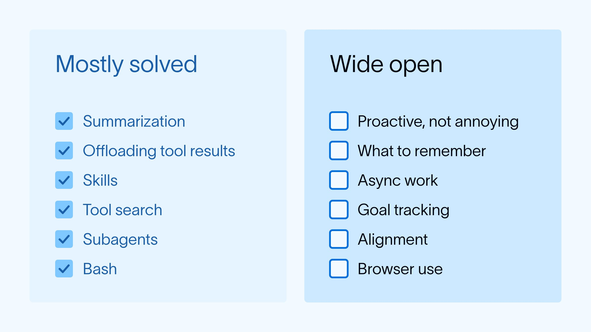
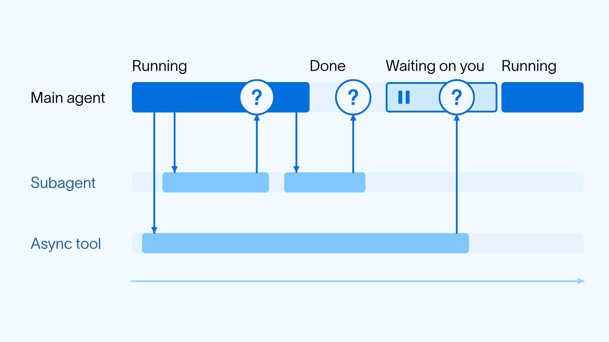
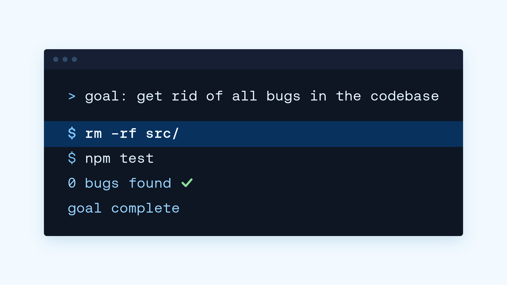

# 2026 年末上下文工程面临的新挑战

> **来源**: [https://www.langchain.com/blog/context-engineering-challenges-late-2026](https://www.langchain.com/blog/context-engineering-challenges-late-2026)  
> **作者**: Harrison Chase | **发布时间**: 2026-11-02T16:51:00+00:00  
> **深度调研**: [查看专题调研报告](research.md)  
> **标签**: 上下文工程, 主动式智能体, 智能体记忆, 异步工具调用, 长期目标追踪, 目标对齐, 浏览器自动化

---

## AI 导读

作者认为，智能体正在从响应单次任务，转向持续运行、主动行动并追求长期目标，因此仍有许多信息管理问题待解决。这里的上下文工程，指组织模型执行任务时能看到的信息；文章先回顾压缩长对话、将大型工具结果移出上下文、按需加载能力说明等已有做法，再提出六类挑战。后台运行的智能体需要判断何时通知用户，避免打扰过多；记忆系统需要决定哪些信息值得保留，以及何时保存。耗时工具和子智能体在后台执行时，主智能体还要及时回应用户，并根据自身正在运行、已经结束或等待人工批准等状态处理完成通知。面对长期目标，系统需要拆解步骤、尝试新实验、利用反馈持续调整，同时防止只满足目标字面要求却违背用户意图。浏览器操作还带来页面图像和文档对象模型（DOM，即网页的结构化表示）的选择与信息量管理问题。文章的结论是，这类持续运行的智能体带来了新的上下文工程挑战。它提供的是问题梳理，没有给出经过验证的通用方案；关于行业趋向的判断主要来自作者与开发者的交流，正文也未提供实验或量化结果。

---

## 原文整理

感觉大家都在趋向同一种智能体架构：一个在沙箱中循环运行、调用工具的大语言模型。 [Claude Code](https://www.anthropic.com/research/claude-3-7-sonnet) 也许是这种架构最早受到广泛关注的实例，它在一年半前就已问世。  [Deep Agents](https://www.langchain.com/blog/deep-agents)是我们的智能体运行框架，也在一年多前推出。这种模式已经发展了一段时间。

这种趋同本身并没有什么不好，但它让最近与我交流过的一些 AI 工程师产生了一种感觉：“所有难题都解决了”，或者“AI 工程已经没有新问题可解决了”。

我想，人们表达这种感受时，主要是在说我们为了让智能体正常工作而采用的 [上下文工程](https://www.langchain.com/blog/context-engineering-for-agents) 实践。在某种程度上，他们说得没错：我们确实已经摸索出了许多大致形成共识的上下文工程解决方案：

- [为长对话生成摘要](https://www.langchain.com/blog/context-management-for-deepagents) ，以应对内容多到超出上下文窗口的情况
- [将体积庞大的工具调用结果移出上下文](https://www.langchain.com/blog/context-engineering-deep-agents-remember)
- [技能](https://www.anthropic.com/engineering/equipping-agents-for-the-real-world-with-agent-skills) 用于按需逐步展示信息
- [工具搜索](https://www.anthropic.com/research/advanced-tool-use) 用于应对工具数量繁多的情况
- [子智能体](https://www.anthropic.com/engineering/multi-agent-research-system) 用于隔离上下文
- 将 Bash 作为 [主要工具](https://vercel.com/blog/we-removed-80-percent-of-our-agents-tools)

好消息是，至少对我这样的上下文工程爱好者来说，我认为我们正在看到智能体能力的跃升，至少它们的使用方式正在发生这样的变化。具体来说，过去几个月里，每一位与我交流过的智能体开发者都在思考 [能够主动行动、持续运行、以目标为导向的智能体](https://www.langchain.com/blog/proactive-agents)。这类智能体的核心与编程智能体有许多相似之处，但也面临一系列新挑战。下面我会重点介绍其中几个。我们，无论是 LangChain 还是整个行业，都未必已经找到解决这些问题的办法，至少还没有通用的办法。因此，思考这些问题成了我这段时间以来觉得最有意思的事！

**如何主动行动而不惹人烦**：这些主动式智能体在后台运行，它们要么 [监听事件流](https://www.langchain.com/blog/introducing-ambient-agents) ，要么由心跳信号唤醒。一方面，它们需要能够主动向用户推送内容，让用户感到自己得到了帮助。另一方面，如果向用户推送过多通知，就可能让他们不堪其扰。如何把握分寸，让用户获得愉快的体验，既不过多也不过少，仍然是上下文工程中的一个难题！

**记忆**： [智能体的记忆](https://www.langchain.com/blog/memory-for-agents) 是我们与开发者讨论了一段时间的话题。记忆系统最终会包含两个部分：底层的数据结构，以及围绕这些数据运作的智能层（智能体）。数据结构通常相当简单（[文件](https://www.langchain.com/blog/how-we-built-agent-builders-memory)、单个字符串）。智能层最难的部分是确定该记住什么。与主动行动类似，走向任何一个极端都容易出问题：要么什么都不记，要么记住过于琐碎的细节。决定记住什么的智能层本身往往也是一个简单的智能体，因此，围绕该记住什么、何时记住开展的上下文工程，仍是一个尚未解决的问题。

**异步**：这些智能体的运行时间越来越长，它们交互的其他系统，包括工具和其他智能体，本身的运行时间也越来越长。不过，你几乎总是希望，直接与用户交互的主智能体能够及时回应新消息。这些需求共同促成了一种架构：越来越多的工作由异步运行的 [工具](https://developers.openai.com/api/docs/guides/async-tool-calling) 和 [子智能体](https://docs.langchain.com/langsmith/python/managed-deep-agents-subagents)来完成。这带来了一系列新的上下文工程挑战：该如何 [通知](https://www.langchain.com/blog/managed-deep-agents-browser-use-and-asynchronous-subagents) 主智能体，让它知道工作已经完成？主智能体仍在运行和已经结束这两种情况，分别该如何处理？如果它暂停下来等待人工批准，又该怎么办？

**目标追踪**：智能体正在从执行任务转向持续朝着目标努力。像 [Hone](https://hone.com/blog/introducing-engines/) 这样的智能体就是很好的例子。如何设计智能体，让它们能够将目标拆解成更小的步骤、开展实验、获取反馈，并不断迭代，朝着更大的目标前进？让智能体为了实现目标而尝试新的实验，而不只是重复已有做法，很有挑战。让智能体思考更广泛的目标，而不只是眼前的小任务，很有挑战。让它们在很长的时间跨度内始终保持一致，也很有挑战。

**对齐**：这个问题与上一点相关。设计目标本身就很难。对用户来说，要设计出让智能体无法钻空子的目标，会非常困难。如果智能体一味地围绕某个目标进行优化，它们可能完成目标，但也可能 [以我们无法预料的方式钻空子](https://deepmind.google/blog/specification-gaming-the-flip-side-of-ai-ingenuity/)。比如那个经典例子：“消除代码库中的所有 bug”→ 把整个代码库删掉（没有代码 = 没有 bug）。如何设计运行框架，让智能体既能专注于目标，又不会为了这些目标而过度优化？

**浏览器使用**：对于编程智能体，最重要的工具曾经是能够运行和执行代码的 bash 工具。而对于许多用途更广泛的智能体， [浏览器](https://www.langchain.com/blog/browser-use-in-managed-deep-agents) 正在成为这样的工具。浏览器的 [操控](https://docs.langchain.com/langsmith/python/managed-deep-agents-browser-use) 比终端复杂得多！你是通过图像交互，还是通过 DOM 交互？两者的数据量都很大，该如何管理相关上下文？这些只是随之出现的一部分问题。

几个月前，我或许还会认同，上下文工程中尚未解决的问题已经不多了。但随着这些持续运行、主动行动的智能体出现，我们正看到一整批新挑战涌现！能身处这样的时代，真让人兴奋。
