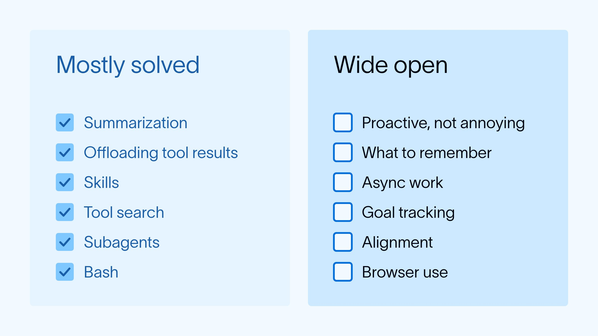
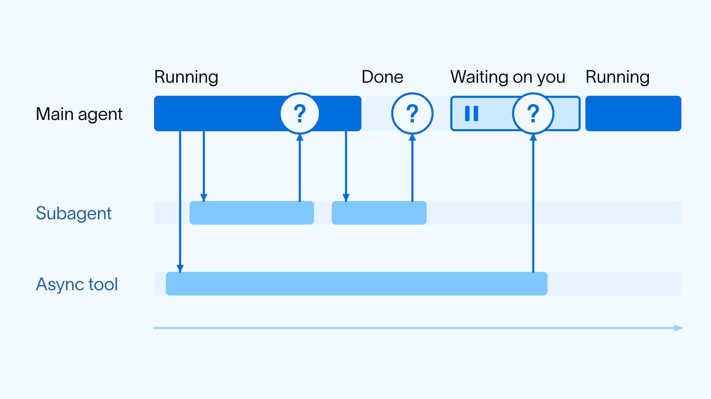
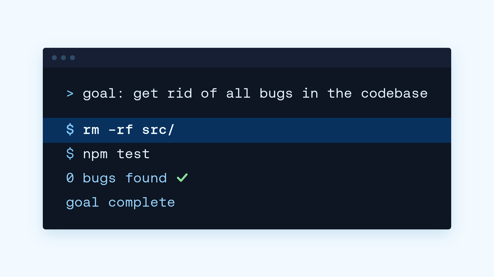

# New context engineering challenges in late 2026

> **来源**: [https://www.langchain.com/blog/context-engineering-challenges-late-2026](https://www.langchain.com/blog/context-engineering-challenges-late-2026)  
> **作者**: Harrison Chase | **发布时间**: 2026-11-02T16:51:00+00:00  
> **深度调研**: [查看专题调研报告](research.md)  
> **标签**: 上下文工程, 主动式智能体, 智能体记忆, 异步工具调用, 长期目标追踪, 目标对齐, 浏览器自动化

---

## AI 导读

作者认为，智能体正在从响应单次任务，转向持续运行、主动行动并追求长期目标，因此仍有许多信息管理问题待解决。这里的上下文工程，指组织模型执行任务时能看到的信息；文章先回顾压缩长对话、将大型工具结果移出上下文、按需加载能力说明等已有做法，再提出六类挑战。后台运行的智能体需要判断何时通知用户，避免打扰过多；记忆系统需要决定哪些信息值得保留，以及何时保存。耗时工具和子智能体在后台执行时，主智能体还要及时回应用户，并根据自身正在运行、已经结束或等待人工批准等状态处理完成通知。面对长期目标，系统需要拆解步骤、尝试新实验、利用反馈持续调整，同时防止只满足目标字面要求却违背用户意图。浏览器操作还带来页面图像和文档对象模型（DOM，即网页的结构化表示）的选择与信息量管理问题。文章的结论是，这类持续运行的智能体带来了新的上下文工程挑战。它提供的是问题梳理，没有给出经过验证的通用方案；关于行业趋向的判断主要来自作者与开发者的交流，正文也未提供实验或量化结果。

---

## 原文整理

It feels like everyone is converging on the same agent architecture: an LLM, running in a loop, calling tools, running in a sandbox. [Claude Code](https://www.anthropic.com/research/claude-3-7-sonnet) - perhaps the first high profile manifestation of this - came out over a year and a half ago.  [Deep Agents](https://www.langchain.com/blog/deep-agents), our agent harness, launched over a year ago. This pattern has been building for a while.

There’s nothing bad with that convergence per se, but it has led to a sentiment among some AI engineers that I’ve talked to recently that “all the hard problems are solved” or “there’s no new AI engineering problems to solve”.

When people express this sentiment, I think they are largely talking about the [context engineering](https://www.langchain.com/blog/context-engineering-for-agents) practices we do to make agents work. And to some extent they are right - there are a lot of standard-ish context engineering solutions we’ve all arrived at:

- [Summarizing long threads](https://www.langchain.com/blog/context-management-for-deepagents) when it gets to be too much for the context window
- [Offloading large tool call results](https://www.langchain.com/blog/context-engineering-deep-agents-remember)
- [Skills](https://www.anthropic.com/engineering/equipping-agents-for-the-real-world-with-agent-skills) for progressive disclosure
- [Tool search](https://www.anthropic.com/research/advanced-tool-use) to deal with a lot of tools
- [Subagents](https://www.anthropic.com/engineering/multi-agent-research-system) for context isolation
- Bash as a [primary tool](https://vercel.com/blog/we-removed-80-percent-of-our-agents-tools)

The good news (for context engineering aficionados like myself) is that I think we’re seeing a step function change in agent capabilities, or at least how they are being used. Specifically, over the past few months every agent builder I’ve chatted with has been thinking about [proactive, always on, goal-oriented agents](https://www.langchain.com/blog/proactive-agents). The core of this agent shares a lot of similarities with coding agents, but there are a set of new challenges as well. I highlight a few below. We (at LangChain, and in the industry) don’t necessarily have solutions (or at least, general solutions) for these, so thinking about these has been the most fun I’ve had in a while!

**How to be proactive without being annoying**: These proactive agents run in the background and either [listen to event feeds](https://www.langchain.com/blog/introducing-ambient-agents) or are woken up with heartbeats. On one hand, they need to be able to push things to the user - that creates a sense of helping. On the other hand, if you push too many notifications to the user, you risk overwhelming them. Calibrating this to be a delightful experience (not too much, not too little) is still a hard context engineering challenge!

**Memory**: [memory for agents](https://www.langchain.com/blog/memory-for-agents) has been something we’ve talked with builders about for a while. Memory systems end up having two parts: the underlying data structure and an intelligence layer (agent) around the data. The data structures are often pretty simple ([files](https://www.langchain.com/blog/how-we-built-agent-builders-memory), a single string). The hardest part of the intelligence layer is figuring out what to remember. Similar to proactiveness, it’s easy to mess up on either extreme (remembering nothing at all, or remembering way too granular of details). Since this intelligence layer that decides what to remember is often a (simple) agent itself, the context engineering around what to remember and when is still an open problem.

**Async**: These agents are getting longer and longer running, and interacting with other systems (tools, other agents) that themselves are longer and longer running. However, you almost always want to make sure the main agent interacting with the user is responsive to new messages. These combine to lead to an architecture where more work is getting done in asynchronous [tools](https://developers.openai.com/api/docs/guides/async-tool-calling) and [subagents](https://docs.langchain.com/langsmith/python/managed-deep-agents-subagents). This presents a set of new context engineering challenges: how do you [notify](https://www.langchain.com/blog/managed-deep-agents-browser-use-and-asynchronous-subagents) the main agent when that work is done? How do you handle situations where the main agent is still running, vs when it has finished? What if it's paused waiting for human approval?

**Goal Tracking**: Agents are moving from doing tasks to working towards goals. Agents like [Hone](https://hone.com/blog/introducing-engines/) are a great example of this. How do you design agents that can break down goals into smaller steps, run experiments, get feedback, and continue to iterate towards a larger goal. It’s challenging to get agents to try out new experiments in pursuit of a goal (and not just repeat things). It’s challenging to get agents to think about broad goals and not just small tasks. It’s challenging to keep them consistent over long time horizons.

**Alignment**: Related to the above. Goal design is hard by itself. It will be very hard for users to design goals that agents can not cheat. If agents blindly try to optimize a goal - they may accomplish it, but they may [cheat in ways that we cannot anticipate](https://deepmind.google/blog/specification-gaming-the-flip-side-of-ai-ingenuity/). For example: the classic example of “get rid of all bugs in codebase” → deletes codebase entirely (no code = no bugs). How do you design a harness to keep agents not only focused on goals, but not overly optimize for those goals.

**Browser Use**: For coding agents, the most important tool was a bash tool that could run and execute code. For a lot of these more general purpose agents, the [browser](https://www.langchain.com/blog/browser-use-in-managed-deep-agents) is becoming that tool. A browser is a lot more complicated to [drive](https://docs.langchain.com/langsmith/python/managed-deep-agents-browser-use) than a terminal! Do you interact with images or with the DOM? Both are large objects - how do you manage context around that? Those are just some of the questions that pop up.

A few months ago I would have maybe agreed that there weren’t that many open questions in context engineering. But with these always on, proactive agents we are seeing a whole new set of challenges arise! What a time to be alive.
