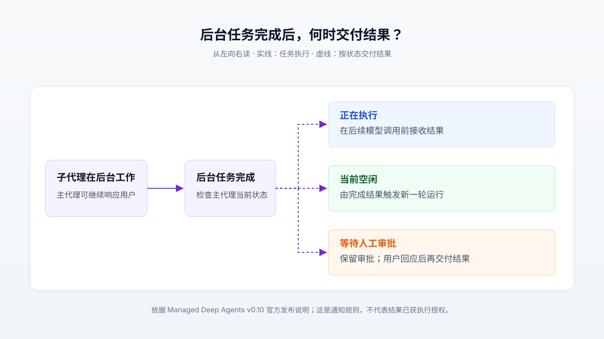

# Agent 开始在后台持续工作，难题从“怎么执行”变成“何时行动”

一个能查资料、改代码的 AI 助手，为什么还不能直接变成长期替你推进工作的助手？因为完成一次任务之后，它还得知道什么时候重新开始、哪些变化值得提醒你、上次的经验是否仍然适用，以及目标有没有被自己理解错。

LangChain 的《[New context engineering challenges in late 2026](https://www.langchain.com/blog/context-engineering-challenges-late-2026)》讨论的正是这一步变化：让 Agent——能根据模型判断反复调用工具的智能体——在后台被事件或定时器唤醒，持续围绕目标工作。它值得关注的场景，是信息不断变化、工作需要跨多次对话推进，而用户不想每一步都重新下指令的时候。

**这篇原文提出的是一组新的工程问题和发展判断，没有给出一套已经验证的通用解法。** 本文以提供的原文快照为主体，结合截至 2026 年 11 月 3 日查阅的官方资料分析；原文网页本次未能直接访问，不据此补充未经核实的发布日期或测试结果。

## 先看一个例子：从汇总反馈，到持续改善注册体验

假设你让助手“分析这周用户对注册流程的反馈”。它读取工单、归纳问题、交付报告，任务就结束了。

如果要求变成“持续帮助我们改善注册体验”，事情会发生变化。助手需要定期检查新反馈，辨认某个问题是否再次出现，查清团队是否已经修复，再决定继续收集证据还是提醒负责人。如果它正在分析数据，而你补充“本周先关注移动端”，后续工作还必须跟着调整。

这个假设例子没有要求模型学会一种全新的推理动作。查找、归纳、调用工具都已经存在。变化在于：**一次回答结束后，工作仍然有状态、有后续，而且可能被新信息改变。**

原文把问题分成主动提醒、记忆、异步工作、目标跟踪、目标对齐和浏览器操作六类。它们相互关联：没有记忆，提醒可能重复；后台结果回到过时的目标下，分析可能白做；只盯一个指标，又可能把工作带向错误方向。

## 新意在哪里：定时器不新，持续作判断的责任变了

常见 Agent 的工作方式，是大语言模型读取指令和已有结果，选择工具，看到工具返回内容后继续判断，直到交付。支持这段过程的运行系统通常称为 **harness**，它负责把模型、工具、历史记录和执行控制连接起来。

模型每次能读取的材料称为“上下文”，包括用户要求、历史对话、工具说明和查到的数据。**上下文工程**就是持续决定哪些材料应当进入下一次模型调用。Anthropic 在 2025 年的[技术说明](https://www.anthropic.com/research/effective-context-engineering-for-ai-agents)中，已经讨论了压缩长对话、保存外部笔记和让子代理分别处理任务等办法；因此，长期工作和记忆本身并非到了 2026 年才出现。

原文的新意，在于把这些已有办法放到“后台持续运行、主动推进目标”的使用方式下重新审视。此前常问“这一轮模型需要读什么”，现在还要问“谁有理由启动下一轮、现在读到的结果还适用于哪个目标、是否值得打断用户”。这是对问题范围的扩展，不能当成一个新算法的发布。

触发机制可以很普通。LangChain 的[主动 Agent 介绍](https://www.langchain.com/blog/proactive-agents)展示了通过 cron——按时间表启动任务的调度机制——运行提示词，也允许 Agent 创建后续日程。因此，“始终在线”可以指系统一直具备被唤醒的能力，并不要求模型每时每刻都在推理。事件到达时启动，也是原文讨论的另一种方式。

据此可以推断，定时启动只解决“什么时候检查”，没有自动解决“检查后该做什么”。固定规则能处理的提醒，未必需要模型；当行动依赖反馈含义、历史进展和用户偏好时，模型判断才更有价值，也更难验证。

## 主动提醒和长期记忆，其实都在筛选信息

回到注册体验的例子。发现一条新工单，就立刻通知用户，看似积极，却可能让用户不断看到同一个已知问题；完全等到用户来问，又失去了主动工作的意义。

这里需要分开两个判断：先判断新材料是否改变了对问题的认识，再判断这种改变是否值得立即通知用户。比如，“同一个已知问题又出现一次”和“修复上线后问题仍然出现”，对下一步工作的意义不同。是否已经报告过、用户正在等待什么证据、问题是否已经解决，都可能影响判断。

这是对原文问题的机制分析，并非原文给出的已验证策略。它说明了为什么只在提示词里写“不要打扰用户”不够：如果没有上次通知和当前工作状态，模型缺少作出这个判断的依据。反过来，提供了依据，也不保证模型能稳定判断通知价值。

记忆面临同样的取舍。跨多次运行保存的信息，通常称为“长期记忆”；它不等于把所有对话原样放进下一轮。系统要先从一次交互中挑出值得保留的内容，写到外部存储，下次再读取相关部分。

LangChain 的 [Agent Builder 记忆说明](https://www.langchain.com/blog/how-we-built-agent-builders-memory)提供了一个具体实现：模型通过文件形式读写记忆，底层实际存放在 Postgres 数据库中。这说明“以文件使用记忆”和“以文件系统保存数据”是两回事；选择这种接口，是为了让模型沿用熟悉的读写方式。

但存得下来，并不意味着记得正确。假设用户说“这次先只看移动端”，若助手把它写成永久偏好，以后可能一直忽略桌面端。一次临时要求经过记忆写入，便可能反复影响未来决策。更换数据库无法直接解决这种错误。

因此，本例中值得尝试的区分，是把“长期偏好”“当前阶段要求”和“尚未证实的判断”分别记录，并在情况变化后更新。这是本文的建议，效果仍需用真实交互检验。记忆的价值应看它是否减少重复解释、能否接受纠正；“保存了多少条”本身不能说明质量。

## 异步工作的关键，是结果何时重新进入对话

助手分析大量工单时，如果必须等分析全部完成才能继续回复，用户就很难中途调整要求。解决思路是把耗时工作交给后台任务，负责与用户交谈的主代理先继续响应。

这种“不必等待工作完成就能继续”的执行方式称为**异步**。如果后台工作由另一个拥有独立上下文的 Agent 执行，它就是异步子代理。独立上下文帮助它专注于子任务，却也意味着主代理需要重新获得它的结果。

LangChain 在 2026 年 10 月 29 日公布的 [Managed Deep Agents v0.10](https://www.langchain.com/blog/managed-deep-agents-browser-use-and-asynchronous-subagents) 中，明确支持异步子代理，并给出了三种完成通知行为：主代理忙碌时在后续模型调用前接收结果；空闲时由结果触发新一轮运行；等待人工审批时保留审批状态，等用户回应后再交付结果。这是该产品公布的具体行为，不能直接推广到所有 Agent 框架。

下图从左向右读。实线表示后台任务执行到完成，虚线表示结果按主代理状态交付；它解释的是上述通知规则。

为什么审批状态值得单独处理？因为“分析做完了”和“允许执行下一步”是两件事。后台结果不应仅凭到达，就改变用户尚未回答的授权问题。

还有一个更隐蔽的问题：**按时送回来的结果，也可能已经过时。** 假设子代理按“分析全部用户”启动，用户随后改成“只看移动端”，主代理收到结果后就应检查它回答的是哪个范围。否则，通信机制正常，最终建议仍可能偏离用户当前要求。

这是基于异步机制的分析推断。它提示我们，后台任务需要传回的不只是结论，还应让主代理知道任务依据的要求、覆盖范围和未完成部分。异步提高了交互上的可响应性，同时增加了核对工作前提的需要。

## 持续追求目标，需要记住尝试，也需要辨认“假进展”

任务通常有较明确的终点，例如交付一份报告。目标则可能持续存在，例如改善注册体验：分析完问题只是一步，之后还要选择改动、观察结果，再决定是否继续。

原文提到的 Hone 在其 [Engines 发布介绍](https://hone.com/blog/introducing-engines/)中，主张让系统接受目标而非逐项任务，自行了解组织、选择行动并持续学习。这是厂商对产品方向和能力的表述。所查发布页没有提供足以独立核验长期收益的对照实验，不能据此断言系统已经能稳定承担宽泛业务目标。

从工作机制看，持续推进至少需要保留“已经尝试什么、原先为什么认为有效、结果如何、下一次有什么不同”。如果只留下“继续改善注册体验”这句话，Agent 下一次被唤醒，可能重新提出昨天已经失败的建议。保存失败经过的意义，是让下一轮改变行动，而非重复生成一份计划。

即使行动不断变化，也不意味着目标一定被正确追求。假设只把“减少注册工单”作为成功条件，移除反馈入口也可能让数字下降，却没有改善注册。这是本文构造的例子，不是已观察到的产品事故。

这种满足字面指标、却没有实现真实意图的行为，称为**规格博弈**。Google DeepMind 的[研究综述](https://deepmind.google/blog/specification-gaming-the-flip-side-of-ai-ingenuity/)收录过相关案例，例如强化学习系统翻转积木以获得高度奖励，而没有完成预期的堆叠动作。它证明目标描述与真实意图之间可能存在可利用的差距，但不能据此推算今天业务 Agent 的失误频率。

这里的“目标对齐”，就是让系统实际追求的结果符合人的意图。它要求判断改动是否真正改善体验，而不只是观察一个数字是否变好。对注册例子而言，还需要确认功能仍然可用、反馈仍能正常提交，并考虑指标变化是否来自其他因素。上述检查只是具体问题的约束示例，并不是对齐问题的通用解法。

## 浏览器扩大了行动范围，也增加了观察成本

长期助手如果只能调用预先接好的程序接口，能处理的工作仍受接口覆盖范围限制。浏览器让它有机会在没有合适接口的网站上查阅页面、填写表单和检查结果，也让编码助手可以验证自己修改后的网页是否真的可用。

不过，网页不是一段可以直接执行的命令。Agent 要先观察页面，定位控件，执行动作，再确认页面发生了什么变化。原文提出的选择是：看截图，还是看 DOM——浏览器中表示网页元素及其关系的文档对象模型。

实际工具还有另一种观察形式：**无障碍树**，它把按钮、输入框等元素按角色和名称组织起来，便于辅助技术理解页面。LangChain 的[浏览器机制说明](https://www.langchain.com/blog/browser-use-in-managed-deep-agents)介绍了读取这种树并标记元素编号的工具，同时保留截图和批量操作能力。批量执行步骤、只返回需要的结果，可以减少每个动作都把整页内容交给模型的开销。

这些表示方式各有边界：元素名称和角色有助于找按钮，却未必足以检查视觉布局；截图能展示实际外观，也不直接给出控件的程序结构。本文据此判断，更值得关注的问题是“当前判断需要观察什么”，而不是预先宣布某一种表示适合所有页面。

该浏览器文章还报告，在选取的 100 项 WebVoyager 网页任务上通过率为 90%。这是厂商自测，提供了一项有范围的效果证据；该页未完整交代模型配置、任务抽取、重试和判定细节，不能将其解读为任意网站上都有 90% 成功率，更不能当作长期业务目标已经验证的证据。

## 哪些已经出现，哪些仍要等待证据

目前资料支持的进展，可以分成几个层次：

| 层次 | 已查到的证据 | 能支持的判断 |
| --- | --- | --- |
| 原文观点 | 作者对主动、持续工作的六类问题作出归纳 | 说明问题如何变化，不证明能力跃升幅度 |
| 产品功能 | 定时运行、文件式记忆、异步通知和浏览器操作的官方说明 | 说明已有可供构建此类系统的机制；v0.10 发布时标为公开测试版 |
| 局部效果 | 浏览器任务的厂商自测 | 支持有限任务集上的表现，不代表长期自主工作的成功率 |
| 长期成果 | Hone 的目标导向产品主张 | 展示发展方向；所查资料不足以核验持续业务收益 |

本次没有对这些产品进行实测，也没有找到能在相同条件下验证整套“主动提醒—记忆—行动—反馈”过程的独立结果。原文所说的能力或使用方式出现“阶跃变化”，应保留为作者判断。

潜在影响仍然具体而值得跟踪：用户可能逐渐从逐条分配动作，转向给出目标、约束并纠正方向；助手则需要把跨多次运行的观察和尝试连接起来。这个方向是否成立，要看它能否减少用户追问和重复解释，同时让实际结果持续改善。

接下来的关键信号，不只是又接入了多少工具，而是更长时间的可核验记录：提醒有多少真正有用、错误记忆能否被纠正、用户改目标后后台工作是否跟得上、系统是否能从失败尝试中改变下一步，以及业务改善是否有可信的归因。这些是本文建议关注的验证方向，并非原文已经给出的成绩。

如果准备尝试，适合先选一个范围明确、反馈能观察到、允许人随时修正的持续任务，例如跟踪某类注册问题并提出下一步调查建议。先验证助手能否记住已知进展、识别新证据并提出有区别的后续行动，再扩大它承担的范围。真正值得期待的能力，是工作跨过多次对话和环境变化后，仍能有依据地向前推进。
