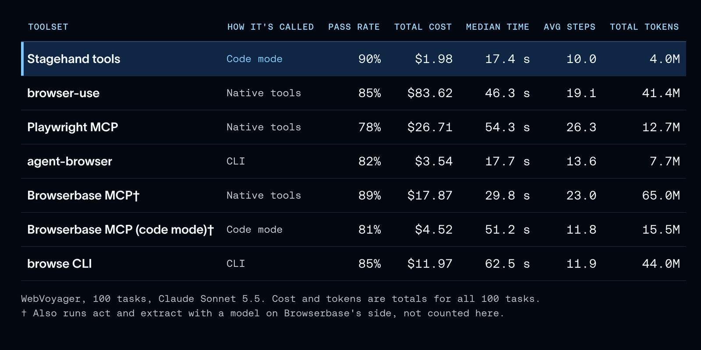
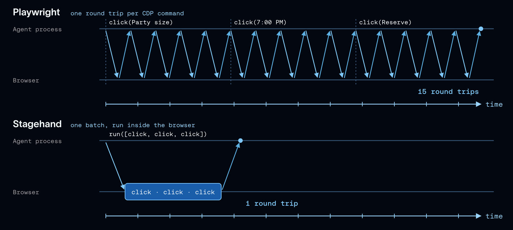

# 我们如何为 Deep Agents 优化浏览器操作

> **来源**: [https://www.langchain.com/blog/how-we-optimized-browser-use-for-deep-agents](https://www.langchain.com/blog/how-we-optimized-browser-use-for-deep-agents)  
> **作者**: Sydney Runkle | **发布时间**: 2026-11-03T16:00:00+00:00  
> **深度调研**: [查看专题调研报告](research.md)  
> **标签**: 浏览器代理, Stagehand, 上下文工程, Chrome DevTools Protocol, LangSmith, WebVoyager, HardBench, WebTailBench

---

## AI 导读

文章要解决的是浏览器代理在长流程网页任务中消耗大量模型上下文、产生过多工具调用并拖慢运行的问题。作者固定模型和任务，对七类浏览器工具进行比较，再通过 LangSmith 读取执行轨迹，定位浪费步骤和令牌的环节，并用多个真实网站基准反复评测。结果显示，Stagehand 的 code mode 可以把多步浏览器操作合并到一次调用中，snapshot 用带交互元素 ID 的无障碍树压缩页面信息，浏览器内批处理也能减少 Chrome DevTools Protocol（CDP，Chrome 的调试控制协议）往返；这些设计在文中的基准上同时改善了通过率、成本或速度。进一步把固定等待改成页面安静后提前结束的等待策略后，HardBench 中位耗时从 182 秒降到 124 秒，准确率在噪声范围内。文章的限制是评测组合、任务和成本口径披露不够完整，且部分数据来自相关厂商生态，读者应把结论视为特定代理和基准下的工程经验。

---

## 原文整理

## 要点

- 操作浏览器是智能体自主开展工作的一项重要能力，让它们能够在面向人类用户的网站上执行操作。
- 智能体用来控制浏览器的工具，会极大地影响其成本和执行路径，而 Stagehand 的工具正是为智能体设计的。
- 优化工具需要反复迭代：跟踪智能体的行为，找出效率低下的环节，更新运行框架，并在保留每项改动前通过评测验证效果。

浏览器智能体如今能够承担那些让人头疼又耗时的多步骤工作。例如，个人智能体 [Instinct](https://instinct.com/) 和 Meta 的 [Muse](https://ai.meta.com/muse/) 可以规划横跨全国的自驾游、取消不再使用的订阅、发布汽车出售信息，而且都是在没有公开 API 的网站上完成的。 [DataDome](https://finance.yahoo.com/technology/ai/articles/datadome-report-agentic-browser-traffic-130000558.html) 发现，仅在 9 月，由智能体发起的浏览器请求就增至原来的 4\.7 倍。

浏览器操作在两类场景中很有用：一类是 API 无法覆盖的操作，比如使用一个智能体事先未做适配的网站；另一类是对编程智能体构建的 Web 应用进行端到端测试。无论哪种场景，智能体都需要两样东西：

1. **工具** ，用于控制浏览器：打开页面、读取页面内容并执行操作。大多数工具集都通过 [Chrome DevTools Protocol](https://chromedevtools.github.io/devtools-protocol/) （CDP）控制浏览器，这一协议让工具能够检查和控制 Chrome。
2. **浏览器** ，供智能体控制，可以在本地运行，也可以使用托管服务。 [Managed Deep Agents](https://docs.langchain.com/langsmith/python/managed-deep-agents) 让你无需运维任何基础设施，就能在 LangSmith 中构建和部署智能体，它还可以为你的智能体 [运行浏览器](https://docs.langchain.com/langsmith/python/managed-deep-agents-browser-use) （详情见我们的 [发布文章](https://www.langchain.com/blog/browser-use-in-managed-deep-agents)）。像 [Browserbase](https://www.browserbase.com) 这样的浏览器托管服务商，会替你处理开放网络中的棘手问题，比如验证码、反机器人拦截，以及大规模运行多个浏览器。

本文聚焦于工具，以及如何把工具做好，让智能体能够高效地使用浏览器。

我们最初想为 [Managed Deep Agents](https://docs.langchain.com/langsmith/python/managed-deep-agents) 中的智能体配备浏览器。我们比较了七套工具，选出了表现最好的一套： [Stagehand](https://www.stagehand.dev/) （[GitHub](https://github.com/browserbase/stagehand)），由 [Browserbase](https://www.browserbase.com)开发。随后，我们根据 [LangSmith](https://docs.langchain.com/langsmith/observability) 执行轨迹中记录的智能体行为进行改进，并通过评测验证每项改动。这次最大的收获是：通过工具设计来改进智能体，还有很大的空间。

## 浏览器操作带来的上下文管理挑战

浏览器操作工具集有几种形式：原生工具、 [MCP 服务器](https://docs.langchain.com/oss/python/langchain/mcp)，或由智能体在 shell 中运行的 CLI。浏览器操作给这些工具带来了两个独特的挑战：

- **任务运行时间长**，需要大量按顺序执行的工具调用。使用 Playwright MCP 时，单个 WebVoyager 任务平均需要 26 轮模型调用。
- **网页包含大量内容**，其中通常只有一小部分与任务相关。通过 Browserbase 托管的 MCP 服务器执行一次页面导航，返回的字符数中位数约为 17,000。

这两点都意味着，浏览器工具必须高效地管理上下文。

## 我们如何测试工具

我们按照 [智能体开发生命周期](https://www.langchain.com/blog/the-agent-development-lifecycle)进行迭代：在基准测试上运行智能体，在 LangSmith 中查看执行轨迹，找出浪费步骤或令牌的地方，修改工具，再运行评测，确认改动是否有效。每次运行都是一次 [LangSmith 实验](https://docs.langchain.com/langsmith/evaluation)，因此我们可以并排比较不同配置，并从任意一项数据点击进入其背后的执行轨迹。

我们使用了三个基准测试，任务都在真实网站上执行：

- [**WebVoyager**](https://arxiv.org/abs/2401.13919)：包含 Allrecipes、Amazon 和 Google Flights 等热门网站上的 100 项日常任务，使用 Claude Sonnet 5\.5 执行，并由 [Jev](https://www.langchain.com/blog/building-a-harness-with-jev) 评判器评分。这个基准的表现已接近饱和，因此很适合用来直接比较上下文使用量、成本和速度。
- [**HardBench**](https://github.com/browserbase/stagehand/blob/main/packages/evals/datasets/hardbenchmark/README.md)：由 Browserbase 提供的 102 项更难的任务，使用其自有验证器评分，执行时主要使用 Claude Opus 5\.5。
- [**WebTailBench**](https://huggingface.co/datasets/microsoft/WebTailBench)：由 Microsoft 提供的真实世界“长尾”任务，每项任务都依据一份简短的评分标准打分。我们通过 [Stagehand 评测套件](https://github.com/browserbase/stagehand/tree/main/packages/evals)运行了其中的 150 项任务。

我们要求每个运行框架都返回结构化输出（JSON 格式的答案）。这样，格式上的失误，例如任务要求表格却只回复了一行文字，就不会影响对浏览器操作能力的评分。我们已将这一选项 [贡献到上游](https://github.com/browserbase/stagehand/pull/3219) ，纳入 Browserbase 的评测套件。

## 工具设计……实在太重要了

我们首先固定模型和任务，只更换工具集。这七套工具的区别在于智能体如何调用它们：

- **原生工具：** 每种操作对应一个工具，例如 `click` 或 `navigate`，每次调用一个（[Playwright MCP](https://github.com/microsoft/playwright-mcp)、 [browser-use](https://github.com/browser-use/browser-use)和 [Browserbase MCP](https://github.com/browserbase/mcp-server-browserbase)）。
- **CLI：** 智能体在 shell 中运行浏览器命令（[agent-browser](https://github.com/vercel-labs/agent-browser) 和 Browserbase 的 `browse` CLI）。
- **代码模式：** 智能体编写代码来调用浏览器，因此一次调用就能执行多个步骤（Stagehand 工具，以及通过代码调用的 Browserbase MCP）。



各套工具的任务通过率都在 78% 到 90% 之间，但成本和速度差异很大。Stagehand 工具的通过率最高（90%），总成本为 $1\.98，每项任务耗时的中位数为 17\.4 秒。Playwright MCP 的通过率为 78%，成本为 $26\.71，约为前者的 13 倍，每项任务的耗时也达到前者的三倍（[完整结果](https://github.com/langchain-ai/deepagents/pull/6868)）。

Stagehand 为智能体提供 [三个工具](https://docs.langchain.com/oss/python/integrations/tools/stagehand#tools)：

- `snapshot` 读取页面的 [无障碍树](https://developer.mozilla.org/en-US/docs/Glossary/Accessibility_tree) ，并为可交互元素标注 ID。
- `run` 在页面上执行操作，既可以批量执行 `click` 和 `fill` 等操作，也可以执行使用 Playwright 风格 `page` 对象的 JavaScript 代码。
- `screenshot` 截取渲染后的页面。

在更难的任务中，这种差距依然存在。在 HardBench 的 38 项核心任务中，Deep Agents 使用 Stagehand 通过编写代码执行操作的 `run` 工具，通过了 30 项；使用 Browserbase 命令式的 `browse` CLI 则通过了 21 项，且每项任务的成本是前者的三倍。

## Stagehand 专为智能体设计

早期的浏览器工具是将 [Playwright](https://playwright.dev)等测试 SDK 改作他用。正如 Browserbase 所说， [“Playwright 为测试而生，我们则为你的智能体打造了 Stagehand。”](https://www.browserbase.com/changelog/stagehand-v4) Browserbase 的 [Stagehand v4 发布公告](https://www.browserbase.com/blog/stagehand-v4) 中提到的三项设计，对我们的影响最大：

- **代码模式**，让一次工具调用就能执行多个浏览器操作步骤
- **快照**，以精简的文本呈现页面上的可交互元素
- **减少通信往返**，通过在浏览器内部运行来实现

### 代码模式让上下文保持精简

在代码模式下，智能体通过编写代码来调用工具，而不是逐个调用（Browserbase 在 [《你只需要代码模式》](https://www.browserbase.com/blog/code-mode-is-all-you-need) 和 [《用代码推动计算机操作能力演进》](https://www.browserbase.com/blog/evolving-computer-use-with-code)中阐述了这一思路）。它同时应对了上述两个挑战：

- **调用之间无需等待模型。** 浏览器操作步骤是按顺序执行的，因此使用 `run` 时，智能体会把整条操作链（打开页面、填写字段、点击、检查）写成一段代码，执行时每一步之间都不需要模型再做决策。
- **中间上下文不进入上下文窗口。** 代码片段在执行过程中接触到的所有内容都保存在其变量中，只有智能体在浏览器交互完成后返回的内容才会进入上下文。


在选定 Stagehand 之前，我们就已经看到了这种效果。在 [解释器](https://www.langchain.com/blog/give-your-agents-an-interpreter)中通过代码调用 Browserbase 的 MCP 工具，而非逐个调用，使成本降至约四分之一（从 $17\.87 降至 $4\.52）。

Stagehand 的 `run` 工具原生支持代码输入。使用它时，每项任务平均需要 10 个步骤，而 Playwright MCP 需要 26 个；一次页面导航返回的字符数中位数为 117，而 Browserbase 托管的 `navigate` 工具约为 17,000。

`run` 也支持 Playwright 风格的代码。模型训练时接触了大量 Playwright 代码，因此最擅长编写这类代码，Stagehand 的转换器会将其编译为 Stagehand 命令。我们尝试过让 `run` 改为接受 Stagehand 原生 API，但即使提供了准确的工具说明，任务通过率仍下降了 5\.3 个百分点，每项通过任务的成本增加了 19%。

### 快照呈现可交互元素

读取页面是浏览器智能体成本最高的操作之一。 `snapshot` 返回页面的无障碍树，只保留智能体需要的部分，并为每个可交互元素标注 ID。这种页面视图让智能体既能理解内容，又能直接执行操作，例如在 `{"op": "click", "id": "0-7"}` 中使用 `run`，因此点击按钮时完全不必读取原始 HTML，也不必编写选择器。Browserbase [表示](https://www.browserbase.com/changelog/stagehand-v4) ，v4 的令牌使用效率比 Playwright 高约 80%。

主要通过 `snapshot` 而非 `screenshot` 读取页面，能显著改善 [上下文工程](https://www.langchain.com/blog/context-engineering-for-agents)。无障碍树是精简的文本，智能体可以据此直接操作；截图则是模型需要解读的图像，在我们的 WebTailBench 测试中，每次调用返回的图像大小中位数为 89 KB。不过，内容必须从源头精简。我们曾在获取快照后将其限制为 8,000 个字符，但智能体只会再次获取页面，每项通过任务的成本没有变化。

![Stagehand's snapshot of the booking form from the earlier example (left) next to a screenshot of the same page (right). The Reserve button is \[0-7\] in the tree, the ID the agent uses to click it.](https://cdn.prod.website-files.com/65c81e88c254bb0f97633a71/6ae92fe00a2bb383cf6fe8df_6ae92f756c209f27da7462cf_snapshot-vs-screenshot.png)

### 尽量减少与浏览器之间的通信往返

Playwright 的一次 `click` 操作需要五次 CDP 调用：滚动页面使元素进入视野、读取元素位置，然后移动鼠标、按下和松开鼠标按键（[源码](https://github.com/microsoft/playwright/blob/main/packages/playwright-core/src/server/chromium/crInput.ts)）。Playwright 每次都要等到响应后才发送下一次调用，因此一次点击需要智能体与浏览器之间进行五次通信往返。浏览器运行的位置从笔记本电脑移到沙箱，再到云端，离智能体越远，这些开销累积起来就越大。

[Stagehand v4](https://www.browserbase.com/blog/stagehand-v4) 以扩展的形式在浏览器内部运行，因此这些底层调用就在页面所在的环境中完成，而 `run` 只需一次通信往返就能发送整批操作。Browserbase 表示，在其基准测试中，v4 的运行速度是 Playwright 的 2 倍。



## 探索其他优化

选定 Stagehand 后，我们继续调整运行框架。其中效果最显著的改进，是修正智能体等待页面加载的方式。

在 LangSmith 中查看执行轨迹时，我们发现智能体会编写 `page.waitForTimeout(8000)` 这样的固定时长休眠来等待页面加载。大多数页面在计时结束前很久就已准备就绪，因此智能体每次运行都有大量时间处于空等状态。

因此，我们修改了 `run` ，让每次休眠在页面连续 500 毫秒没有活动后结束，同时保证等待时间不超过智能体指定的时长。一次测量中，原本 8 秒的休眠在 0\.6 秒后就返回了。随后，我们用评测验证了这一改动。在 HardBench 上，这项改动与结构化答案和模型调用超时设置一起，将智能体耗时的中位数从 182 秒降至 124 秒，准确率的变化则处于噪声范围内。


此后，Stagehand 已将 [这项修复合入上游](https://github.com/browserbase/stagehand/pull/3282) 。

## 结语

与大多数工作相比，浏览器任务对智能体上下文的压力更大。我们发现，最大的改进来自工具，主要取决于工具向模型返回多少内容，以及需要多少轮调用。

你可以把同样的流程用在任何智能体上。先了解你的使用场景会产生什么样的上下文，再结合执行轨迹和评测反复迭代。执行轨迹能显示智能体在哪里浪费了步骤和令牌，评测则能告诉你改动是否有效。

这些就是 Managed Deep Agents 中浏览器背后使用的工具。你可以为智能体配备 [Managed Deep Agents 中的浏览器](https://docs.langchain.com/langsmith/python/managed-deep-agents-browser-use)，这项功能已于 [上周推出](https://www.langchain.com/blog/browser-use-in-managed-deep-agents)。

要在开源版 [Deep Agents](https://docs.langchain.com/oss/python/deepagents/overview)中使用同样的工具，请将 `StagehandMiddleware` （来自 [langchain-stagehand](https://docs.langchain.com/oss/python/integrations/tools/stagehand) ）添加到你的智能体中：

```
from deepagents import create_deep_agent
from langchain_stagehand import StagehandMiddleware
from stagehand import Stagehand, local_browser
browser = await local_browser.launch(headless=True)
stagehand = await Stagehand.create(browser=browser)
agent = create_deep_agent(
    model="openai:gpt-5.5",
    middleware=[StagehandMiddleware(stagehand=stagehand)],
)
```
对于需要大规模访问开放网络的智能体，请改为在 [Browserbase](https://docs.langchain.com/oss/python/integrations/providers/browserbase) 上通过 `browserbase.launch()` 启动浏览器。其余内容请参阅 [浏览器使用指南](https://docs.langchain.com/oss/python/deepagents/browser-use) ，包括浏览器的作用范围，以及如何在沙箱中测试应用。试试看，也欢迎告诉我们你构建了什么！

## 致谢

感谢 Baihao Wang 牵头开展 HardBench 相关工作，为贡献到 Stagehand 上游的优化提供支持；也感谢 Browserbase 的 [Sean McGuire](https://www.linkedin.com/in/sean-p-mcguire/)、 [Miguel Gonzalez](https://www.linkedin.com/in/miguelgfz)和 [Kyle Jeong](https://www.linkedin.com/in/kyle-jeong) 在 Stagehand 方面给予的帮助。
