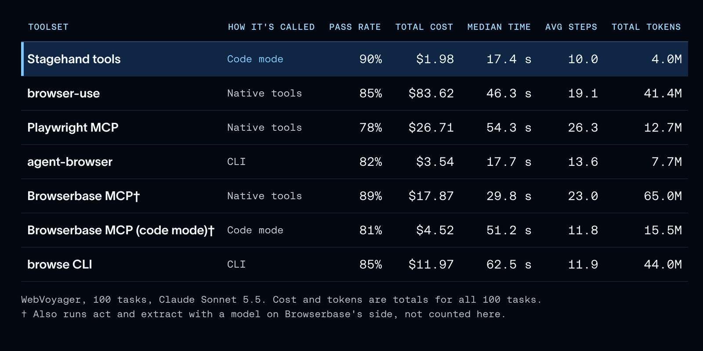
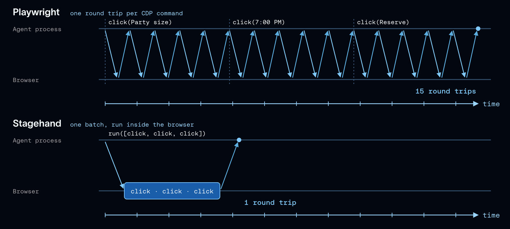

# How We Optimized Browser Use for Deep Agents

> **来源**: [https://www.langchain.com/blog/how-we-optimized-browser-use-for-deep-agents](https://www.langchain.com/blog/how-we-optimized-browser-use-for-deep-agents)  
> **作者**: Sydney Runkle | **发布时间**: 2026-11-03T16:00:00+00:00  
> **深度调研**: [查看专题调研报告](research.md)  
> **标签**: 浏览器代理, Stagehand, 上下文工程, Chrome DevTools Protocol, LangSmith, WebVoyager, HardBench, WebTailBench

---

## AI 导读

文章要解决的是浏览器代理在长流程网页任务中消耗大量模型上下文、产生过多工具调用并拖慢运行的问题。作者固定模型和任务，对七类浏览器工具进行比较，再通过 LangSmith 读取执行轨迹，定位浪费步骤和令牌的环节，并用多个真实网站基准反复评测。结果显示，Stagehand 的 code mode 可以把多步浏览器操作合并到一次调用中，snapshot 用带交互元素 ID 的无障碍树压缩页面信息，浏览器内批处理也能减少 Chrome DevTools Protocol（CDP，Chrome 的调试控制协议）往返；这些设计在文中的基准上同时改善了通过率、成本或速度。进一步把固定等待改成页面安静后提前结束的等待策略后，HardBench 中位耗时从 182 秒降到 124 秒，准确率在噪声范围内。文章的限制是评测组合、任务和成本口径披露不够完整，且部分数据来自相关厂商生态，读者应把结论视为特定代理和基准下的工程经验。

---

## 原文整理

## Key Takeaways

- Browser use is an important capability for agents doing autonomous work, letting them act on sites built for people.
- The tools an agent uses to drive the browser have a huge impact on its cost and trajectory, and Stagehand's are built for agents.
- Optimizing tools is an iterative process: trace the agent's behavior to find where it's inefficient, update the harness, and test every change with evals before keeping it.

Browser agents can now take on multi-step work that's painful and time-consuming for people. Personal agents like [Instinct](https://instinct.com/) and Meta's [Muse](https://ai.meta.com/muse/) plan cross-country road trips, cancel unused subscriptions, and list cars for sale, all on sites with no public APIs. [DataDome](https://finance.yahoo.com/technology/ai/articles/datadome-report-agentic-browser-traffic-130000558.html) saw agentic browser requests jump 4.7x in September alone.

Browser use helps in two places: actions an API can't cover, like using a website the agent wasn't set up for, and end-to-end testing of the web apps coding agents build. Either way, the agent needs two things:

1. **Tools** to drive the browser: open pages, read them, and act on them. Most toolsets control the browser over the [Chrome DevTools Protocol](https://chromedevtools.github.io/devtools-protocol/) (CDP), the protocol that lets tools inspect and control Chrome.
2. **A browser** to drive, either local or hosted. [Managed Deep Agents](https://docs.langchain.com/langsmith/python/managed-deep-agents) lets you build and deploy agents in LangSmith without running any infrastructure, and it can [run the browser](https://docs.langchain.com/langsmith/python/managed-deep-agents-browser-use) for your agent too (more in our [launch post](https://www.langchain.com/blog/browser-use-in-managed-deep-agents)). A hosted browser provider like [Browserbase](https://www.browserbase.com) handles the hard parts of the open web for you, like CAPTCHAs, bot blocking, and running many browsers at scale.

This post focuses on the tools, and on making them good enough that the agent uses the browser well.

We set out to give agents in [Managed Deep Agents](https://docs.langchain.com/langsmith/python/managed-deep-agents) a browser. We compared seven toolsets and picked the best one, [Stagehand](https://www.stagehand.dev/) ([GitHub](https://github.com/browserbase/stagehand)) from [Browserbase](https://www.browserbase.com). Then we improved it based on what agents did in [LangSmith](https://docs.langchain.com/langsmith/observability) traces, and validated every change with evals. The biggest lesson was how much room there is to improve an agent through tool design.

## Browser use poses context management challenges

Browser use toolsets come in a few forms: native tools, an [MCP server](https://docs.langchain.com/oss/python/langchain/mcp), or a CLI the agent runs in a shell. Browser use poses two unique challenges for those tools:

- **Tasks are long-running**, with a lot of sequential tool calls. On Playwright MCP, a single WebVoyager task averaged 26 model turns.
- **Web pages carry a lot of content**, and only a fraction of it is usually relevant to the task. One navigation through Browserbase's hosted MCP server returns a median of about 17,000 characters.

Both mean browser tools have to manage context efficiently.

## How we tested the tools

We iterated with the [agent development lifecycle](https://www.langchain.com/blog/the-agent-development-lifecycle): run the agent on a benchmark, read its traces in LangSmith to see where it wasted steps or tokens, change the tool, and run evals to check that the change helped. Every run was a [LangSmith experiment](https://docs.langchain.com/langsmith/evaluation), so we could compare setups side by side and click from any number into the trace behind it.

We used three benchmarks of tasks on live websites:

- [**WebVoyager**](https://arxiv.org/abs/2401.13919): 100 everyday tasks across popular sites like Allrecipes, Amazon, and Google Flights, run with Claude Sonnet 5.5 and graded by a [Jev](https://www.langchain.com/blog/building-a-harness-with-jev) judge. It's fairly saturated, which made it a clean way to compare context use, cost, and speed.
- [**HardBench**](https://github.com/browserbase/stagehand/blob/main/packages/evals/datasets/hardbenchmark/README.md): 102 harder tasks from Browserbase, graded by its own verifier and run mostly with Claude Opus 5.5.
- [**WebTailBench**](https://huggingface.co/datasets/microsoft/WebTailBench): real-world "tail" tasks from Microsoft, each scored against a short rubric. We ran 150 of them through the [Stagehand evals](https://github.com/browserbase/stagehand/tree/main/packages/evals).

We had every harness return structured output (a JSON answer). That way a formatting slip, like a one-line reply to a task that asks for a table, didn't count against its browsing. We [upstreamed](https://github.com/browserbase/stagehand/pull/3219) that option to Browserbase's evals.

## Tool design is… so important

We first held the model and tasks fixed and changed only the toolset. The seven toolsets differ in how the agent calls them:

- **Native tools:** one tool per action, like `click` or `navigate`, called one at a time ([Playwright MCP](https://github.com/microsoft/playwright-mcp), [browser-use](https://github.com/browser-use/browser-use), and [Browserbase MCP](https://github.com/browserbase/mcp-server-browserbase)).
- **CLI:** the agent runs browser commands in a shell ([agent-browser](https://github.com/vercel-labs/agent-browser) and Browserbase's `browse` CLI).
- **Code mode:** the agent writes code that calls the browser, so one call can run many steps (the Stagehand tools, and Browserbase MCP called from code).



Every toolset passed between 78% and 90% of tasks, but cost and speed varied widely. The Stagehand tools passed the most (90%) for $1.98 in total, at a median 17.4 s per task. Playwright MCP passed 78% for $26.71, about 13x the cost, and took three times as long per task ([full results](https://github.com/langchain-ai/deepagents/pull/6868)).

Stagehand gives the agent [three tools](https://docs.langchain.com/oss/python/integrations/tools/stagehand#tools):

- `snapshot` reads the page's [accessibility tree](https://developer.mozilla.org/en-US/docs/Glossary/Accessibility_tree) and labels interactive elements with IDs.
- `run` acts on the page, either with a batch of actions like `click` and `fill` or with JavaScript that uses a Playwright-style `page` object.
- `screenshot` captures the rendered page.

The gap held on harder tasks. On HardBench's 38 core tasks, Deep Agents passed 30 with Stagehand's code-writing `run` tool and 21 with Browserbase's command-style `browse` CLI, at three times the cost per task.

## Stagehand is built for agents

Early browser tooling repurposed testing SDKs like [Playwright](https://playwright.dev). As Browserbase puts it, ["Playwright was built for testing, we built Stagehand for your agent."](https://www.browserbase.com/changelog/stagehand-v4) Three of the design choices from Browserbase's [Stagehand v4 announcement](https://www.browserbase.com/blog/stagehand-v4) made the most difference for us:

- **Code mode**, so one tool call can run many browser steps
- **Snapshots**, a compact text view of the page's interactive elements
- **Fewer round trips**, by running inside the browser

### Code mode keeps context lean

In code mode, the agent writes code that calls the tools instead of calling them one at a time (Browserbase makes the case in [Code mode is all you need](https://www.browserbase.com/blog/code-mode-is-all-you-need) and [Evolving computer use with code](https://www.browserbase.com/blog/evolving-computer-use-with-code)). It answers both challenges:

- **No waiting on the model between calls.** Browser steps are sequential, so with `run` the agent writes the whole chain (open a page, fill a field, click, check) as one snippet, and it runs without a model decision between each step.
- **Intermediate context stays out of the window.** Everything the snippet touches along the way stays in its variables, and only what the agent returns after the browser interaction lands in context.


We saw the effect before we picked Stagehand. Calling Browserbase's MCP tools from code in an [interpreter](https://www.langchain.com/blog/give-your-agents-an-interpreter), instead of one at a time, cut their cost 4x ($17.87 to $4.52).

Stagehand's `run` tool takes code natively. It averaged 10 steps per task against 26 for Playwright MCP, and a navigation sent back a median 117 characters against about 17,000 from Browserbase's hosted `navigate` tool.

`run` also takes Playwright-style code. Models are trained on tons of Playwright, so that's the code they write best, and Stagehand's translator compiles it into Stagehand commands. When we tried a `run` that takes Stagehand's native API instead, it passed 5.3 points fewer tasks and cost 19% more per passed task, even with an accurate tool description.

### Snapshots represent interactive elements

Reading a page is one of the most expensive things a browser agent does. `snapshot` returns the page's accessibility tree, trimmed to the parts an agent needs, with an ID on each interactive element. This gives the agent a view of the page that it can understand and act on directly, like `{"op": "click", "id": "0-7"}` in `run`, so it never has to read raw HTML or write a selector to click a button. Browserbase [reports](https://www.browserbase.com/changelog/stagehand-v4) v4 is about 80% more token efficient than Playwright.

Reading pages mostly through `snapshot` instead of `screenshot` is a big win for [context engineering](https://www.langchain.com/blog/context-engineering-for-agents). The tree is compact text the agent can act on, while a screenshot is an image the model has to interpret, at a median 89 KB per call in our WebTailBench runs. Trimming has to happen at the source, though. When we capped snapshots at 8,000 characters after the fact, agents just fetched the page again, and cost per passed task stayed flat.

![Stagehand's snapshot of the booking form from the earlier example (left) next to a screenshot of the same page (right). The Reserve button is \[0-7\] in the tree, the ID the agent uses to click it.](https://cdn.prod.website-files.com/65c81e88c254bb0f97633a71/6ae92fe00a2bb383cf6fe8df_6ae92f756c209f27da7462cf_snapshot-vs-screenshot.png)

### Browser round trips are minimized

A single Playwright `click` is five CDP calls: scroll the element into view, read its position, then mouse move, press, and release ([source](https://github.com/microsoft/playwright/blob/main/packages/playwright-core/src/server/chromium/crInput.ts)). Playwright waits for each response before sending the next, so one click costs five round trips between the agent and the browser. That cost adds up as the browser gets farther from the agent, from a laptop to a sandbox to the cloud.

[Stagehand v4](https://www.browserbase.com/blog/stagehand-v4) runs inside the browser as an extension, so those low-level calls happen next to the page, and `run` sends a whole batch of actions in one round trip. Browserbase reports v4 runs 2x faster than Playwright in its benchmarks.



## Exploring other optimizations

With Stagehand chosen, we kept tuning the harness. The biggest win came from fixing how agents wait for pages to load.

Reading traces in LangSmith, we saw agents writing fixed sleeps like `page.waitForTimeout(8000)` to wait for a page to load. Most pages were ready long before the timer ran out, so agents spent a lot of each run doing nothing.

So we changed `run` to end each sleep once the page has been quiet for 500 ms, and never later than the time the agent asked for. In one measurement, an 8-second sleep returned in 0.6 s. Then we checked the change with evals. On HardBench, together with structured answers and a model-call timeout, it cut median agent time from 182 s to 124 s, with accuracy within noise.


Stagehand has since [upstreamed](https://github.com/browserbase/stagehand/pull/3282) the fix.

## Conclusion

Browser tasks stretch an agent's context more than most work. The biggest gains we found came from the tools, mostly from how much they send back to the model and how many turns they take.

You can use the same process on any agent. Understand the context your use case produces, then iterate with traces and evals. Traces show where the agent wastes steps and tokens, and evals tell you whether a change helped.

These are the tools behind the browser in Managed Deep Agents. Give your agent a [browser in Managed Deep Agents](https://docs.langchain.com/langsmith/python/managed-deep-agents-browser-use), which we [launched last week](https://www.langchain.com/blog/browser-use-in-managed-deep-agents).

To use the same tools in open source [Deep Agents](https://docs.langchain.com/oss/python/deepagents/overview), add `StagehandMiddleware` from [langchain-stagehand](https://docs.langchain.com/oss/python/integrations/tools/stagehand) to your agent:

```
from deepagents import create_deep_agent
from langchain_stagehand import StagehandMiddleware
from stagehand import Stagehand, local_browser
browser = await local_browser.launch(headless=True)
stagehand = await Stagehand.create(browser=browser)
agent = create_deep_agent(
    model="openai:gpt-5.5",
    middleware=[StagehandMiddleware(stagehand=stagehand)],
)
```
For agents that browse the open web at scale, launch the browser on [Browserbase](https://docs.langchain.com/oss/python/integrations/providers/browserbase) with `browserbase.launch()` instead. The [browser use guide](https://docs.langchain.com/oss/python/deepagents/browser-use) covers the rest, including browser scope and testing an app in a sandbox. Give them a try, and let us know what you build!

## Acknowledgements

Thanks to Baihao Wang for leading the HardBench work backing the optimizations upstreamed to Stagehand, and to [Sean McGuire](https://www.linkedin.com/in/sean-p-mcguire/), [Miguel Gonzalez](https://www.linkedin.com/in/miguelgfz), and [Kyle Jeong](https://www.linkedin.com/in/kyle-jeong) from Browserbase for their help with Stagehand.
