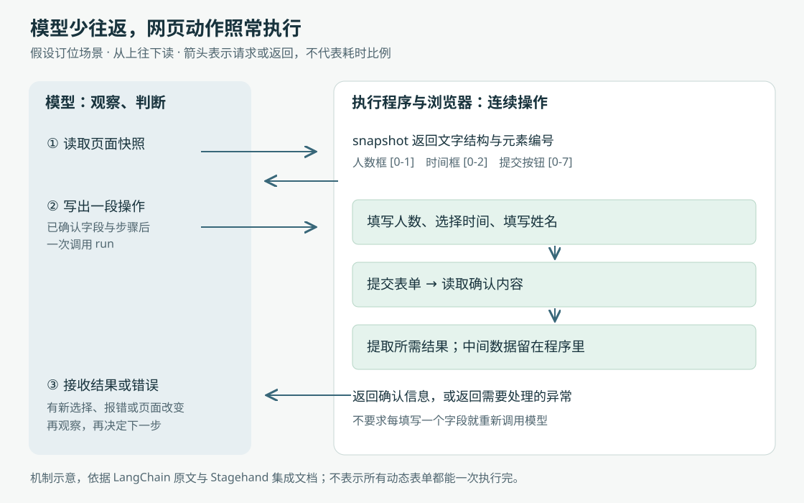

# 浏览器智能体怎样少等、少读、少调用模型：Deep Agents 的工具设计进展

> 来源：[www.langchain.com](<https://www.langchain.com/blog/how-we-optimized-browser-use-for-deep-agents>)  
> 作者：Sydney Runkle · 发布时间：2026-11-04 00:00（Asia/Shanghai）  
> 翻译正文：[阅读中文正文](article-zh-CN.md)

让人工智能在网页上查航班、填写表单，难点不只是认出该点哪个按钮。一次任务可能反复经历“读取页面、让模型判断、执行动作、再读取”，时间和费用就耗在这些往返中。LangChain 的这项进展，是为 Deep Agents 重新安排浏览器工具：让模型一次写出一段操作，只接收必要结果，并把底层控制逻辑移到浏览器附近。对于需要连续操作网站、或检验自己生成的网页应用的智能体，这种改动值得关注。

这里的“智能体”，指能够根据任务选择工具、观察结果并继续行动的程序；Deep Agents 则提供运行这类程序所需的工具接入、上下文管理等能力。本次研究主体是 LangChain 的[《How We Optimized Browser Use for Deep Agents》](https://www.langchain.com/blog/how-we-optimized-browser-use-for-deep-agents)。它是一篇工具优化实践报告，不是提出新模型的论文。新意主要在于：**把模型应该做的判断，与程序可以直接完成的连续动作分开，再用运行记录和任务评测检查收益。**

## 先看一次订位，哪些步骤真的需要模型判断

假设用户已经授权智能体完成一项餐厅订位：两人、晚上七点、姓名“小林”。这是用于解释机制的假设场景，并非本文实测。

一种做法是每填一个字段就返回模型：填写人数，返回；选择时间，返回；填写姓名，返回；点击提交，再返回。即使模型早已知道这几个动作应该怎样执行，它仍要多次接收工具结果，再生成下一条调用。页面很长时，无关导航栏、推荐内容也可能反复进入模型的“上下文”——也就是模型本轮作答能够看到的输入信息。

Stagehand 是 Browserbase 开源的浏览器操作工具包。LangChain 为它接入了三个主要工具：`snapshot` 读取可操作的页面结构，`run` 执行动作或代码，`screenshot` 在需要时截图。它们的作用可以连成下面这条流程。

模型先读取页面，确认人数、时间、姓名、提交按钮分别是什么。随后，一个 `run` 调用就能按顺序填写并提交；执行程序可以继续读取确认信息，只把所需结果返回模型。如果中途出现新的选择或错误，智能体再观察、再判断。这里减少的是不必要的模型介入，并没有省略实际网页操作。

这也说明批量执行的边界：如果选择人数后，网站才动态生成可用时段，就应该先读取新状态，再决定时间，不能把未知结果当作已知条件写进长脚本。官方文档也说明，快照中的元素编号会被下一次快照替换，导航或编号失效后需要重新读取。[Stagehand 集成文档](https://docs.langchain.com/oss/python/integrations/tools/stagehand)

## 三种节省，发生在三个不同位置

### 一次写出操作，让中间数据留在程序里

“代码模式”是让模型提交一段代码，由执行器连续调用工具。代码可以保存中间变量、检查返回值、筛选数据，最后只返回必要内容。它并不让多个有先后依赖的网页动作同时发生；它让这些动作之间不必每次都等待模型重新决策。

例如，程序读取搜索结果后，可以先提取名称和价格，再返回筛选后的列表。没有被返回的大段页面数据仍可由程序处理，却不必进入模型上下文。因此，代码模式同时减少了模型调用次数和模型需要处理的信息量。实际集成源码确认，`run` 接收代码或基于快照编号的动作列表；代码获得的是具有 Playwright 风格的 `page` 等对象。Playwright 是常见的浏览器自动化工具，这里采用相近写法，方便模型生成熟悉的操作代码。[集成源码](https://github.com/browserbase/stagehand/blob/main/packages/integrations/deepagents/examples/managed/tools/stagehand.py)

原文还报告：将 Browserbase 的逐个工具调用放入代码执行器后，费用由 17.87 美元降至 4.52 美元。这支持“调用方式本身会影响费用”的判断，但不能据此推断，给任何工具加一层代码执行器都能省四倍。若工具已经允许一次执行一段操作，再包一层执行器可能只增加开销。[原文](https://www.langchain.com/blog/how-we-optimized-browser-use-for-deep-agents)

### 把页面变成可以直接操作的文字结构

无障碍树原本用于向屏幕阅读器等辅助技术描述页面。它保留“这是按钮、按钮叫什么、输入框当前是什么值”等语义，让使用者不必从页面颜色和布局中猜测用途。[MDN 无障碍树说明](https://developer.mozilla.org/en-US/docs/Glossary/Accessibility_tree)

Stagehand 的 `snapshot` 返回经过整理的这类文字结构，并给交互元素附上编号。模型看到“提交按钮，编号 0-7”，就能通过这个编号发出点击指令。相比整份 HTML 网页源码，它省掉许多与当前动作无关的样式和结构；相比截图，它直接给出可操作目标，不必先从像素中定位。

但“压缩”必须保住任务所需信息。原文尝试把快照直接截到 8,000 个字符，结果智能体因为信息不足又去读取页面，每个成功任务的费用没有下降。原因很具体：少返回一次信息，却引出了后续重复调用，合计未必更省。[原文](https://www.langchain.com/blog/how-we-optimized-browser-use-for-deep-agents)

文字快照也不是所有页面的完整替代。判断图表、画布内容或视觉布局时，仍可能需要截图。更值得注意的是，无障碍快照并非 Stagehand 独有：Playwright 官方文档也提供带元素引用、面向人工智能的快照模式。因此，这次结果应理解为具体工具组合的比较，不能解释成“一个能读结构，另一个只能看图片”。[Playwright 定位器文档](https://playwright.dev/docs/api/class-locator#locator-aria-snapshot)

### 把底层控制放到浏览器附近，减少网络等待

前两种优化处理模型与工具之间的交互，第三种处理工具与浏览器之间的通信。

浏览器控制常使用 CDP，即 Chrome DevTools Protocol：一套让程序检查和控制 Chrome 等浏览器的消息协议。一个高层的“点击”，底下可能需要滚动、计算位置、移动鼠标、按下和松开。Playwright 的 Chromium 输入源码可以确认，移动、按下和松开分别发送协议消息；但这一个文件不足以证明任意点击都固定需要五次往返，实际路径还受页面状态和执行逻辑影响。[CDP 官方说明](https://chromedevtools.github.io/devtools-protocol/)、[Playwright 输入源码](https://github.com/microsoft/playwright/blob/main/packages/playwright-core/src/server/chromium/crInput.ts)

Stagehand v4 把状态管理和协议分发放进浏览器扩展：客户端把请求交给扩展，由扩展在浏览器内部继续发出底层指令。底层动作仍然存在，只是多次通信不再都跨越客户端到远程浏览器的网络。Browserbase 官方解释也明确指出，浏览器在本机时，原本通信就快，可节省的时间较少。由此可以推断，这种安排对远程浏览器更有价值，但收益大小仍取决于网络距离和操作种类。[Stagehand v4 技术说明](https://www.browserbase.com/blog/stagehand-v4)

## 等页面“安静下来”，也要知道它到底在等什么

原文从运行记录里发现，模型经常写固定等待，例如 `page.waitForTimeout(8000)`，含义是等待八秒。页面即使早已可用，程序仍会等满。

LangChain 因此在自己的工具实现中改变等待行为：页面连续安静 500 毫秒就提前返回，同时不超过模型要求的等待时长。原文举出一次八秒等待在约 0.6 秒结束的观察，并报告，结合结构化答案和模型调用超时设置后，HardBench 任务耗时中位数从 182 秒降到 124 秒。这个下降属于多项改动的组合结果，不能全部归功于等待策略。[原文](https://www.langchain.com/blog/how-we-optimized-browser-use-for-deep-agents)

核验上游改动后，需要补上一个重要区别：已于 2026 年 10 月 21 日合并的 [Stagehand PR #3282](https://github.com/browserbase/stagehand/pull/3282)，采用的是 **400 毫秒**静默窗口，默认关闭，需要主动开启；它改变的是兼容层中的等待行为，普通 SDK 的同名方法没有随之改变。

这个上游实现观察主文档的 DOM，也就是浏览器表示页面元素的文档对象模型。文档不再处于初始加载状态、且一段时间没有结构变化，才允许提前结束等待。它不观察 iframe 内部的变化——iframe 是网页中嵌入的另一个页面——也不观察封装组件内部的影子 DOM。因此，“主文档安静”并不能证明目标数据已经加载，更不能证明提交成功。若页面晚一点才发起请求，静默窗口也可能提前结束。[上游改动说明](https://github.com/browserbase/stagehand/pull/3282)

这项优化值得关注，是因为它把模型随手写出的保守等待，转换成了可测量的条件等待。但用于决定下一步时，检查“目标结果已经出现”通常比只检查“页面暂时没有变化”更贴近任务含义；这是基于上述机制的实践建议。

## 数字很亮眼，证据支持到哪一步

原文提供了三个层次的证据：一个订位演示、多个真实网站任务集上的作者实验，以及已经公开的集成代码和上游改动。它们分别支持“流程能展示出来”“在所测任务上观察到收益”“机制已有可检查实现”，证明力度并不相同。

下表中的 Playwright MCP，是通过模型上下文协议（MCP，一种向智能体提供工具的标准接口）开放 Playwright 操作的方案。以下数字均为 **LangChain 原文报告，本文未独立复跑**：

| 比较范围 | 原文结果 | 应保留的口径 |
| --- | --- | --- |
| WebVoyager 的 100 项任务，Claude Sonnet 5.5 | Stagehand 成功率 90%，总费用 1.98 美元，单任务耗时中位数 17.4 秒；Playwright MCP 成功率 78%，总费用 26.71 美元 | 是这次任务子集和配置下的比较，不能推广为所有浏览任务的价格或速度 |
| HardBench 的 38 项核心任务 | Stagehand 完成 30 项，`browse` 命令行方案完成 21 项 | 38 项不是 HardBench 全部 102 项；官方数据说明确认核心集为 38 项 |
| 等待等多项改动后的 HardBench 实验 | 耗时中位数由 182 秒降至 124 秒，作者称准确率变化在噪声范围内 | 不是只改等待的单因素实验，也未在博客中给出该表述对应的统计区间 |

来源：[原文实验说明](https://www.langchain.com/blog/how-we-optimized-browser-use-for-deep-agents)、[HardBench 数据集说明](https://github.com/browserbase/stagehand/blob/main/packages/evals/datasets/hardbenchmark/README.md)。

还有三点限制影响这些数字的解释。

第一，原文链接的 [Deep Agents PR #6868](https://github.com/langchain-ai/deepagents/pull/6868) 包含另一轮结果：其中 `facade` 方案为 85%、2.46 美元，Playwright MCP 为 75%、23.80 美元，与博客不同。该记录还提示，部分方案运行环境不同、耗时不能直接比较，部分服务端模型调用没有进入本侧追踪。公开记录说明比较仍在迭代；在缺少博客数字与具体运行配置、版本的一一对应时，费用也不宜直接当作包含浏览器托管等项目的完整账单。

第二，任务完成率也受网站拦截和评分方式影响。上述 PR 特别讨论了网站拦截对结果的影响。它还记录，在 WebTailBench——一组覆盖较少见真实网页任务的数据集——上，同一答案会随评分提示词变化得到不同分数。这不等于实验无效，但意味着“工具更会操作”和“这轮更少被拦截”需要分开分析，小幅分差尤其需要重复运行验证。

第三，WebVoyager 是已有的真实网站任务基准，LangChain 本次只取了 100 项，并采用自己的判分设置。不能把这个 90% 与 [2024 年 WebVoyager 论文](https://arxiv.org/abs/2401.13919)中不同模型、任务范围和评估方式下的成绩直接比较。原论文自身就研究了自动评分与人工判断的差异；使用基准名称，并不会自动统一实验条件。

据此，这项进展已经超过单纯概念演示：有集成文档、可检查代码和合并记录；但关于普遍性能优势，目前主要仍是相关团队自己的评测。本文查阅的一手资料不足以确认相同配置下的独立复现，更不足以推导开放网页上的长期无人值守成功率。

## 它可能改变什么，接下来该看什么

这次工作的价值，是展示了一个可继续探索的方向：让模型在需要理解新页面、处理分支时介入，让程序承担已经明确的连续动作。对于没有合适接口的网站操作，这可能降低长任务的调用成本；对于编程智能体，它也可能减少填写测试数据、跳转页面、收集结果时的重复判断。这里说的是机制所指向的潜在用途，并非原文已经验证了这些用途的长期效果。

对开发者，更有依据的下一步是先看自己的运行记录：时间是否花在固定等待，输入是否被重复页面内容占满，是否每个已知动作都要重新调用模型。只有出现这些具体问题，批量代码、精选快照或浏览器内执行才对应着明确收益。若任务真正困难的是图表理解、异常分支或网站拒绝访问，减少往返本身并不会解决它们。

后续最值得跟踪的信号有三个：博客结果能否对应到固定版本和完整配置；在更长、更依赖中途观察的任务上，批量执行是否仍能兼顾成功率；快照和等待策略在复杂组件、嵌入页面上的信息缺失，能否被有针对性的读取和结果检查补足。相比单次排行榜数字，这些证据更能说明：工具优化究竟只是让一轮演示更快，还是能持续扩大浏览器智能体可以完成的工作范围。
