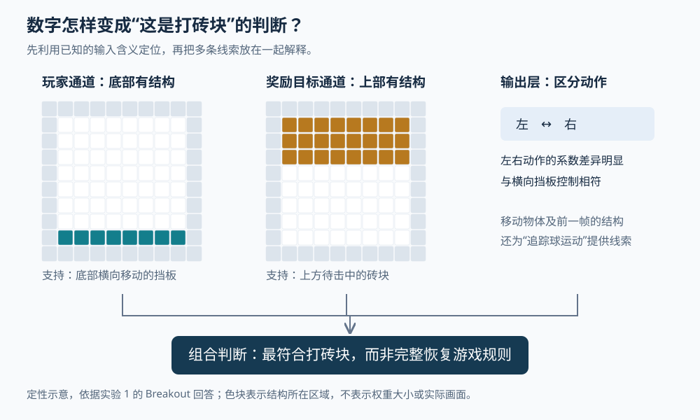

# 让本地模型从一串权重认出游戏：Qwen 这次展示了什么

> 来源：[simonwillison.net](<https://simonwillison.net/2026/Nov/3/qwen-can-interpret-model-weights>)  
> 作者：Simon Willison · 发布时间：2026-11-03 08:00（Asia/Shanghai）  
> 翻译正文：[阅读中文正文](article-zh-CN.md)

拿到一个神经网络，通常要给它输入、观察输出，才能知道它会做什么。Simon Willison 做了一个相反的尝试：不给模型运行网络的机会，只把另一个小网络的参数写成文本，让它判断这个网络学过什么游戏。运行在笔记本上的 Qwen 3.8 27B 在他报告的四次尝试中认出了三个。

这值得研究智能体的人关注：语言模型可能不仅能阅读程序，也能利用数值参数中的结构，提出关于另一个模型行为的解释。不过，这次展示的范围很具体——有输入含义说明的小型游戏网络。它距离可靠地理解任意大模型、自动改进自身，还有几道尚未跨过的门槛。

本文以 Willison 2026 年 11 月 3 日的[原文](https://simonwillison.net/2026/Nov/3/qwen-can-interpret-model-weights/)为主体，结合研究团队公开的提示词、回答和实验说明核验；没有自行运行这些语言模型或重新测量其成绩。

## 新意在于：通用语言模型直接读数字并作出解释

神经网络的“权重”，是把输入转换成输出时使用的一组数值系数。训练会调整这些系数，使网络更容易完成指定任务。这里被分析的是“策略网络”：它接收游戏状态，为可选动作打分，从而决定下一步怎么行动。

这轮讨论源于 Rikiya Takehi、Jayden Teoh、Alex Zhang 和 Omar Khattab 发布的研究博客 [Sparks of Weight-Space Programming](https://rikiyat.github.io/blog/weight-space-programming/)。作者将围绕自然语言目标、直接分析或修改网络参数的做法称为“权重空间编程”。其中一些实验不允许执行代码，另一些则允许模型编写代码、读取运行结果，再决定如何修改参数。两类实验必须分别理解。

“从权重提取信息”本身已有先例。2020 年的[《从权重预测神经网络准确率》](https://arxiv.org/abs/2002.11448)研究过不运行待测网络、只根据其权重预测性能；[超网络研究](https://arxiv.org/abs/1609.09106)则训练一个网络，为另一个网络生成权重。相比之下，这次值得留意的是：研究者直接向现成的通用语言模型提供结构说明和数字，要求它用自然语言解释任务，而没有为这四个游戏另行训练一个专用识别器。

Willison 又把其中“不使用工具”的实验搬到本地 Qwen 上。它把问题从“最强云端模型能否做到”推进到“本地模型是否也呈现这种能力”。这仍是探索性展示，不是一个已经成熟的模型审计产品。

## 先看一个具体问题：这些数字为什么像打砖块

实验并没有把一堆没有说明的数字扔给模型。研究者明确交代了棋盘、动作和网络结构，只隐藏游戏名称。

棋盘总共是 10×10 格，最外圈是墙，实际活动范围为内部的 8×8 格。每格有五个“通道”，即五种分别记录的信息：玩家、其他移动物体、奖励目标、障碍物，以及前一步玩家或移动物体的位置。每项取 0 或 1，因此一帧状态共表示为 500 个数。模型还知道五种动作是不动、上、下、左、右，以及这些输入如何连接到网络。[完整提示词](https://raw.githubusercontent.com/RikiyaT/lm_understand-logs/refs/heads/main/exp1_which_game/runs/breakout/prompt.txt)

这种说明很关键。它给了数字一个可解释的位置：某行参数对应“第八行第一列是否有玩家”，而非一个无名特征。模型因此能沿着以下过程寻找线索。

首先，看“玩家”通道哪些位置的连接权重有明显结构。公开的 Breakout 回答指出，这些结构集中在靠近底部的第八行；例如位置 `(8,1)` 有连接系数 `4.066` 和 `−4.013`。这支持玩家是沿底部横向移动的挡板，而不是在全场活动的角色。

接着，看“奖励目标”通道。较明显的结构集中在上方第一至第三行，与底部挡板分离；移动物体通道及前一帧通道则提供了追踪运动物体的线索。再看输出层，左右动作的系数区分明显，与横向挡板控制相符。

最后，把线索合并：底部挡板、上方奖励目标、场内运动物体，比起只有挡板和球的 Pong，更符合上方还有砖块的 Breakout，也就是打砖块。这是公开回答给出的推断路线。[实验中的完整回答](https://raw.githubusercontent.com/RikiyaT/lm_understand-logs/main/exp1_which_game/runs/breakout/answer.md)

图中的色块表示回答所描述的结构区域，不表示每格权重相同，也不表示这些格子在某一帧同时出现物体。“这是挡板”“那些是砖块”属于根据结构作出的解释，参数文件中并没有这些标签。

## 为什么权重会留下这样的空间线索

这个网络没有先把游戏画面压缩成难以命名的视觉特征，而是让每个棋盘位置、每个通道直接连接到第一层。训练时，如果玩家只会出现在底部，那么对应底部位置的输入会随游戏变化，相关连接有机会被反复调整；玩家从不出现的位置，其输入始终为零，相应连接就缺少由该输入产生的更新信号。

因此，在这种输入设计下，权重中的空间分布可能保留“哪些位置曾经参与决策”的痕迹。再结合奖励目标和动作的结构，就能缩小可能的游戏范围。这是根据网络结构给出的机制解释，不代表每个大权重都能被直接翻译成一条游戏规则。

尤其要注意：**权重大，不等于它对最终动作一定重要。** 后续层可能抵消它的作用，非线性运算可能使变化变小；一个始终存在的边界输入，还可能只是在为网络提供固定偏移。负权重也不表示“负奖励”。要证明某个连接确实控制了某种行为，仍需要改变该连接、运行网络、检查行为是否按预测变化。

Sean Goedecke 的[分析](https://www.seangoedecke.com/llms-are-not-superhuman-at-reading-and-writing-neural-network-weights/)提供了一个有帮助的参照：用代码汇总每个位置连向第一层的权重大小，再还原为棋盘热力图，人也能看到容易辨认的空间形状。这支持一种较克制的理解：语言模型找到了有意义的结构线索，但实验尚不足以证明它完整推演了网络的全部计算。

### 深入一点：它阅读的网络有多大

公开提示词给出的结构为 `500 → 32 → 32 → 5`。中间两层各有 32 个计算单元，使用 `tanh` 函数，把加权结果压到 −1 到 1 之间；最后五个输出是动作分数，再转换为选择各动作的概率。包括连接系数和偏置，总共有 17,253 个参数。

输入位置的编号为：

`i = (行号 × 10 + 列号) × 5 + 通道号`

例如 `(8,1)` 的玩家通道号是 0，对应输入编号 405，也就是第一层权重矩阵中编号 405 的那一行。它包含通向 32 个单元的系数。模型可以按这个索引把文本中的一行数字放回棋盘，而不必真的让网络玩一局游戏。

这也解释了扩展到大模型时的困难：本例一开始就知道“这一组数来自棋盘的哪个位置”。一般语言模型的中间单元没有这样直观的空间含义，不能照搬这条识别路线。

## 三次认对说明了什么，又留下了什么问题

Willison 报告，本地 Qwen 认出了 Pac-Man、Pong 和 Breakout；Freeway 则被误认为类似 Pac-Man 的游戏。三次成功分别耗时约 46 分钟、65 分钟和 52 分钟，Pac-Man 那次生成了 43,506 个推理词元——词元是模型处理、生成文本时使用的片段单位。他还指出默认 8192 的上下文设置运行失败，需要扩大可容纳文本的范围。[原文的运行记录与链接](https://simonwillison.net/2026/Nov/3/qwen-can-interpret-model-weights/)

因此，“能在笔记本上完成”不等于“能迅速完成”。原文使用的量化模型文件约为 17GB；量化指以较低精度存储参数，减少体积。文件大小也不能直接当作整个运行过程的内存需求，长输入和长输出还会带来额外开销。原文没有给出足以据此推算其他机器速度的完整条件。

还应把不同层次的证据分开：

| 证据 | 可以支持的判断 | 尚不能据此得到的判断 |
| --- | --- | --- |
| 研究团队的游戏识别实验 | Astra 对四个给定网络都给出了符合评分规则的游戏类别 | 对任意游戏网络都可靠 |
| Willison 的本地尝试 | Qwen 在报告的四个案例中识别出三个 | 一般任务准确率为 75% |
| 回答中的坐标、权重和解释 | 模型提出了一条可检查的结构分析路线 | 每一步解释都忠实反映其内部计算 |
| 模型给出的置信度 | 表示模型自报的确信程度 | 经统计校准的正确概率 |

研究团队的[实验说明](https://raw.githubusercontent.com/RikiyaT/lm_understand-logs/main/exp1_which_game/README.md)补充了两个重要条件：每种游戏训练了三个不同随机种子的网络，展示的是其中游戏表现最好的一个；Freeway 的回答写成类似 Frogger 的过马路游戏，也被计为正确。因此“四个全对”表示按公开规则识别了四个任务类别，不能理解成逐项恢复了四款游戏的全部细节。

Willison 将 Freeway 失败与游戏较冷门联系起来，但这只是解释猜测。没有对照实验，无法判断失败到底来自游戏知识不足、数字索引出错，还是对权重结构的误读。

截至本次核验，可查到的是研究博客、作者发布的日志，以及外部开发者的尝试。仓库说明只收录博客报告的运行，较早提示词版本的试跑未纳入。这提高了结果的可检查性，却仍不足以估计对新网络的成功率。[日志仓库说明](https://github.com/RikiyaT/lm_understand-logs)

## 修改 Qwen 数学能力，是另一类实验

原文也提到更引人注目的结果：修改 Qwen3.5-0.8B 的少量参数后，数学测试成绩显著上升。这里的 Qwen3.5-0.8B 是被修改的约八亿参数模型；笔记本实验中的 Qwen 3.8 27B 则是负责阅读游戏网络的约二百七十亿参数模型，二者角色不同。

数学实验允许 Astra 使用 Python，并多次请求运行待修改模型。所谓“50 次前向传播预算”，也不只是回答 50 道题：一次请求可以处理一批题目，或读取一批文本对应的内部数值。它没有采用根据误差反向计算参数更新的梯度下降，但确实利用了执行反馈。[实验设置](https://raw.githubusercontent.com/RikiyaT/lm_understand-logs/main/exp8_math/README.md)

具体做法是比较正常推进和重复思考时的内部活动，找出与重复相关的变化方向，再削减部分计算单元向这个方向写入的成分，测试修改是否有效。最终报告保留了第 15、19 层各 64 个输出列的修改。它更像一次由智能体执行的“提出解释—干预参数—测试验证”，而非静看数字后一次写出答案。[最终修改说明](https://raw.githubusercontent.com/RikiyaT/lm_understand-logs/main/exp8_math/runs/p50c/final_answer.md)

按作者的评测，MATH-500 数学题测试的平均正确率从 7.9% 升至 48.1%，达到生成长度上限的回答比例从 93.0% 降至 33.1%。评测启用了思考模式，每题采样四次，每次最多生成 32,768 个词元。这里应理解为重复思考导致输出在长度上限处被截断，并不是“运行超过这个长度之后才开始循环”。

这些结果支持“修复重复思考，使更多题能得到有效答案”。它们还不足以单独证明模型获得了新的数学知识。研究团队在较少出现循环的 Gemma 3 270M 上继续尝试，MATH-500 的提升未超过约一个百分点；这个负面结果也限制了方法的普遍性。[Gemma 后续实验](https://raw.githubusercontent.com/RikiyaT/lm_understand-logs/main/exp8_math/gemma_followup/README.md)

Matthew Honnibal 的[批评](https://honnibal.dev/blog/astra-read-write-misleading)主要针对将上述不同设置包装成同一种能力。这个区分有助于判断进展：不用工具的数字阅读展示了模式识别；借助执行反馈的参数修改则展示了研究工作的自动化。二者都值得研究，但不能互相替代证据。

## 接下来更值得跟踪哪些进展

对智能体研究而言，一个有依据的潜在用途是让模型协助检查小网络：指出异常区域、提出任务假设，并列出需要运行验证的实验。只读权重的能力在难以运行目标网络时可能有价值；能够运行代码时，利用统计和可视化工具，可能比让模型长时间阅读原始数字更实用。这些是由当前结果引出的研究方向，尚不是已验证的通用应用。

要判断能力是否继续进步，可以跟踪三类信号。首先是换用未公开的新游戏、不同随机种子和不同规模网络，是否仍能重复成功；这能减少对少数鲜明空间图案的依赖。其次是在隐藏语义标签、改变输入表示后，模型是否还能解释行为；这能区分它有多依赖提示词提供的坐标和含义。最后是让模型根据解释预测一次具体参数修改的后果，再实际验证；这比只报出游戏名称更接近对计算机制的理解。

对参数修改方向，则值得等待独立复现，以及与简单停止策略、已有干预方法在相同条件下的比较。只有这样，才能知道收益主要来自修复已知循环，还是存在更普遍的能力提升方法。

目前最稳妥的判断是：通用语言模型已经在少量、结构清楚的小网络上展示了从参数推断任务的能力，本地模型也出现了类似表现。它为模型解释和研究型智能体提供了新的实验入口；接下来最需要的，是用更多新样本和可验证的干预，把“解释听起来合理”推进到“能够预测并改变真实行为”。
