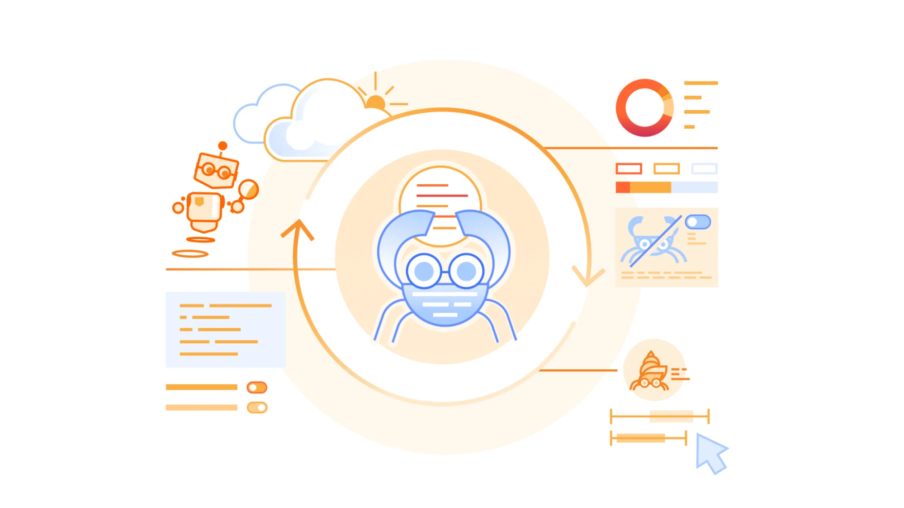
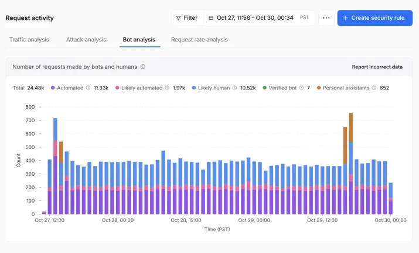
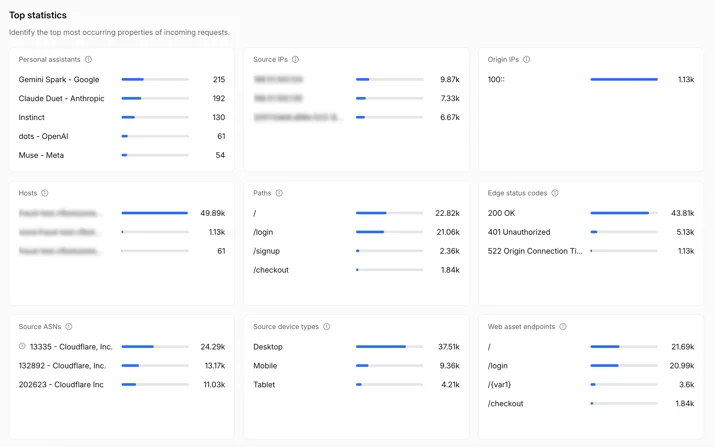
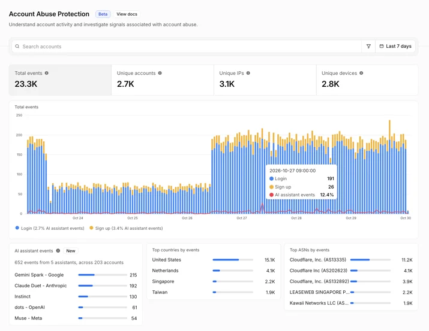
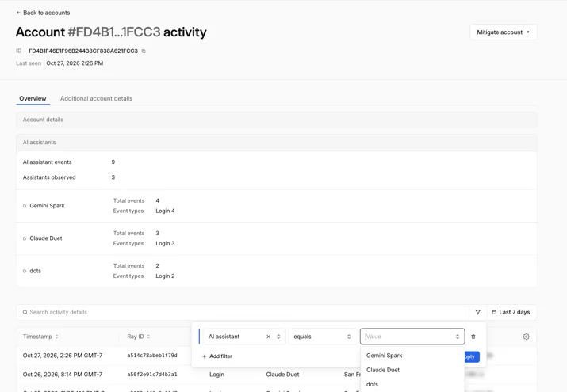
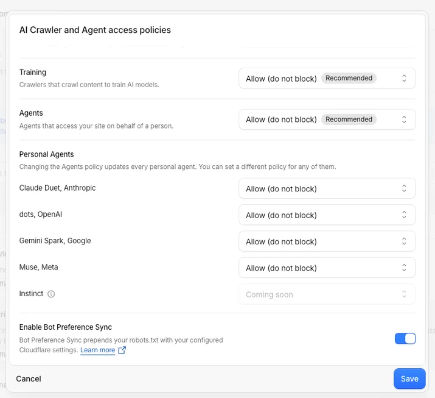

# 查看代理，设定规则：为个人代理提供全新的可见性和控制能力

> **来源**: [https://blog.cloudflare.com/personal-agents-visibility-control](https://blog.cloudflare.com/personal-agents-visibility-control)  
> **作者**: 未知 | **发布时间**: 2026-11-04T14:00:00+00:00  
> **深度调研**: [查看专题调研报告](research.md)  
> **标签**: Personal agents, Security Analytics, Bot Analysis, Account Abuse Protection, WAF, AI Crawler and Agent access policies, 反欺诈

---

## AI 导读

个人代理会代用户浏览、登录、比较商品或完成购买，网站若只看到自动化流量，就难以判断它是在带来客户还是制造风险。文章介绍 Cloudflare 新增的分析能力：在 Bot Analysis 中把 Personal Assistants 单独分类，在统计组件中按代理查看请求量、路径、状态码和来源网络；对启用 Account Abuse Protection 的站点，还能把代理与用户账户、登录和注册事件关联，并在可疑时按 Hashed User ID 用 WAF 规则处置单个账户。访问控制方面，站点可设置总体 Agents policy，再为支持的个人代理选择允许、仅在含广告页面阻断或完全阻断。文章的结论是站点可以据自身业务决定欢迎或限制代理；但用户上下文传递、代理信誉评估和出错责任仍是后续工作，且账户保护功能目前处于 early access，文中没有提供效果数据、识别准确率或完整实现细节。

---

## 原文整理

# 查看代理，设定规则：为个人代理提供全新的可见性和控制能力

个人代理是连接人类与互联网的中间媒介，会把人的指令转化为网站上的请求和操作。客户可能会让个人代理在你的网站上比较产品、查找支持文章或完成购买。对网站所有者而言，这三种互动都会显示为自动化流量；如果无法清楚了解哪些代理正在访问网站以及它们在做什么，就很难判断这些流量是在帮助业务还是带来风险。彻底阻止代理似乎是最安全的选择，但这可能意味着失去客户。更清楚地了解代理活动后，你就能决定哪些访问权限适合自己的网站。

今天，我们推出了新的分析功能，帮助你了解个人代理如何代表人类访问你的网站，同时提供更细致的访问策略，让你可以落实这些决定。两者结合后，你可以按自己的规则接纳代理，并以支持业务的方式使用它们。

## 查看代理如何访问你的网站

了解请求背后是哪一个代理，可以把无法解释的自动化流量变成你能够放心采取行动的流量。Cloudflare 维护着全球规模最大的经验证 [<u>机器人目录</u>](https://radar.cloudflare.com/bots/directory) ，如今我们将这项能力引入你的流量详情中。在 Security Analytics 中，Bot Analysis 图表现在新增 Personal Assistants 类别，与 Verified Bot、Likely Human、Likely Automated 和 Automated 并列。安全团队可以选择该类别，只查看一段时间内的个人代理流量。

在 Top statistics 中，新增的 Personal Assistants 组件会列出正在访问你网站的代理，以及每个代理发送的请求数量。筛选某个代理后，其他组件都会更新，只显示它的流量详情：它请求的路径、收到的状态码以及所属网络。你可以一眼看出代理是在登录、阅读产品页面、进入结账页面，还是在它无法使用的页面上遇到了错误。

对于使用 [<u>Account Abuse Protection</u>](https://blog.cloudflare.com/account-abuse-protection-dashboard/) 保护用户账户的网站（目前处于 early access 阶段），网站所有者和反欺诈团队可以看到每个代理代表的是哪位用户。用户群体概览页面会显示哪些个人代理正在你的用户群体中活动，以及有多少账户在使用它们，帮助你判断代理流量是否已成为业务的重要组成部分。现在，每个登录和注册事件都会显示请求是否由个人代理发起，以及具体是哪一个代理。反欺诈团队可以按 AI assistant 事件或 AI assistant 数量筛选账户。

此外，每个用户的账户概览都会显示代表该账户行事的代理。调查异常登录时，反欺诈分析师可以判断它来自客户已经依赖数周的代理，还是来自今天首次出现、需要进一步查看的代理。如果看起来有攻击者正在通过代理使用某个账户，反欺诈分析师可以直接通过针对其 Hashed User ID 的 WAF 规则处置该账户，同时不必阻止其他依赖该代理的用户。

这些视图结合起来，为你决定欢迎、限制或阻止哪些个人代理提供了更清晰的依据。

## 设置符合你偏好的访问策略

今年夏天，我们 [<u>推出了 AI bot policies</u>](https://blog.cloudflare.com/content-independence-day-ai-options#new-options-to-manage-ai-traffic) ，让网站所有者可以分别决定用于 Search、Training 和 Agent 行为的 AI bot 的访问控制。现在，我们正在扩展现有的 Agents policy，为受支持的个人代理加入更细致的控制选项。为体现这一更广的范围，我们将该设置重命名为 **AI Crawler and Agent access policies**。

在 **Security Settings**中，你可以设置总体 Agents policy，然后为每个受支持的个人代理选择不同的策略： **Allow (do not block)**、 **Block on pages with ads**或 **Block**。例如，你可以将总体 Agents policy 设置为 **Block on pages with ads**，然后为你想要欢迎的受支持个人代理选择 **Allow (do not block)** 。现有的 Search 和 Training 策略保持不变。

在向 Cloudflare 添加新区域时，你也可以进行这些选择。在引导流程中，我们会询问你是否通过广告页面获利，然后根据你的回答调整推荐策略。之后，你随时都可以在 **Security Settings**中重新查看访问控制设置。

合适的策略取决于你的网站。一家出版商可能会允许受支持的个人代理访问整个网站，让读者能够找到文章；另一家出版商则可能在依靠广告支撑内容的页面上阻止同一个代理。两家出版商都在选择适合自身业务的访问控制方式。

## 代理身份只是整个问题的一部分

我们今天推出的分析功能和策略，让网站所有者能够了解个人代理的活动并控制它们的访问。下一步，我们希望帮助网站所有者在个人代理充当中间媒介时，保留与用户关系中的上下文。网站可能知道发出请求的是哪个代理，却缺少原本可以获得的用户信息：用户是否是现有客户、授权代理执行了什么操作、是否拥有订阅，以及应当适用哪些保护措施。

要实现这一目标，需要在保护隐私的前提下采取以下方式：\(1\) 让用户上下文随代理传递；\(2\) 帮助网站评估信誉；\(3\) 在出现问题时明确责任归属。我们会与代理运营方及生态系统中的其他参与者合作，并在推进过程中分享更多信息，让网站所有者能够决定是否授予代理更大的访问权限，同时继续与用户建立关系。

## 为你的网站做出选择

那个让个人代理比较产品、查找支持信息或完成购买的人，仍然是试图访问你业务的客户。查看个人代理如何访问你的网站，然后前往 **[<u>Security Settings</u>](https://dash.cloudflare.com/?to=/:account/:zone/security/settings?tabs=bot-traffic) → AI Crawler and Agent access policies** ，为你的网站设定合适的规则。
