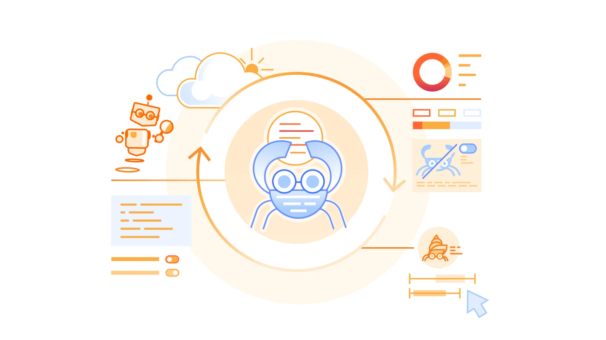
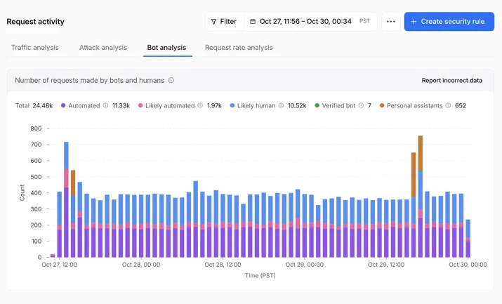
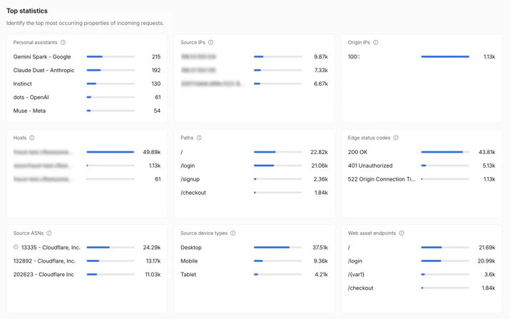
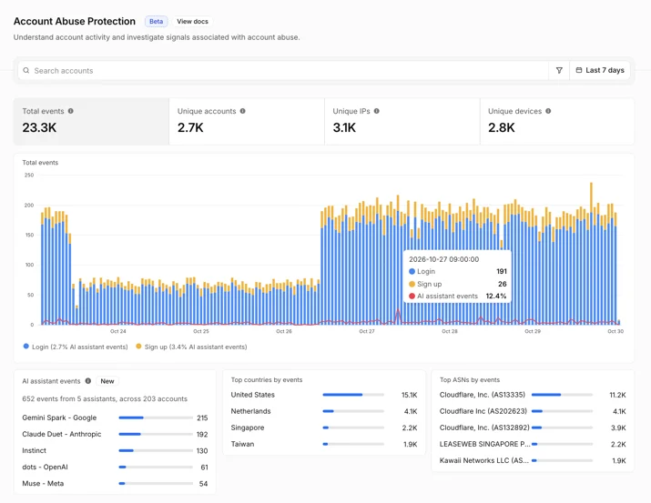
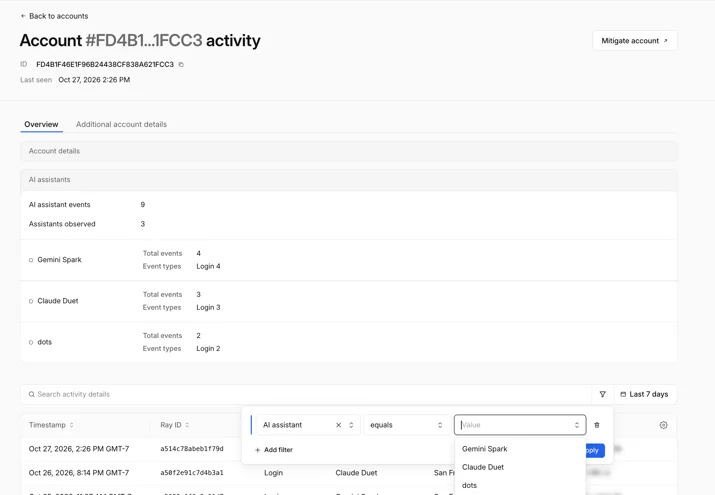
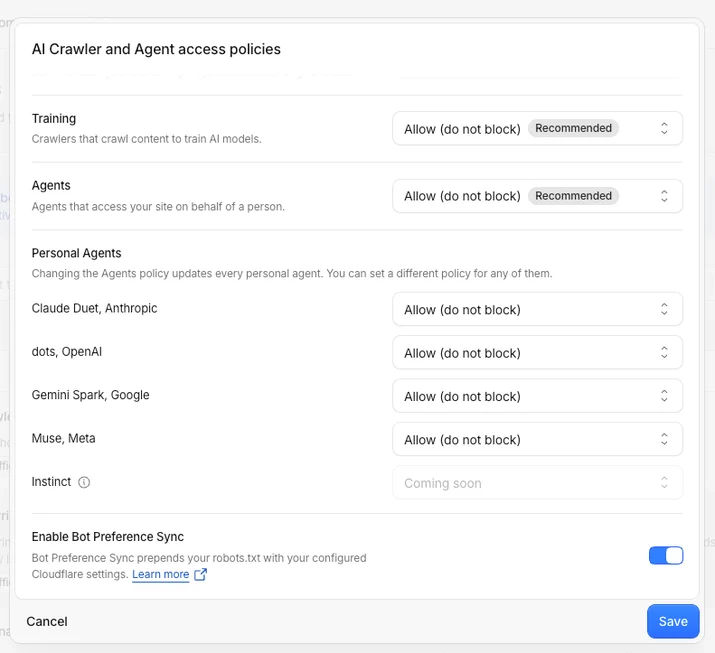

# See the agents, set the terms: new visibility and control for personal agents

> **来源**: [https://blog.cloudflare.com/personal-agents-visibility-control](https://blog.cloudflare.com/personal-agents-visibility-control)  
> **作者**: 未知 | **发布时间**: 2026-11-04T14:00:00+00:00  
> **深度调研**: [查看专题调研报告](research.md)  
> **标签**: Personal agents, Security Analytics, Bot Analysis, Account Abuse Protection, WAF, AI Crawler and Agent access policies, 反欺诈

---

## AI 导读

个人代理会代用户浏览、登录、比较商品或完成购买，网站若只看到自动化流量，就难以判断它是在带来客户还是制造风险。文章介绍 Cloudflare 新增的分析能力：在 Bot Analysis 中把 Personal Assistants 单独分类，在统计组件中按代理查看请求量、路径、状态码和来源网络；对启用 Account Abuse Protection 的站点，还能把代理与用户账户、登录和注册事件关联，并在可疑时按 Hashed User ID 用 WAF 规则处置单个账户。访问控制方面，站点可设置总体 Agents policy，再为支持的个人代理选择允许、仅在含广告页面阻断或完全阻断。文章的结论是站点可以据自身业务决定欢迎或限制代理；但用户上下文传递、代理信誉评估和出错责任仍是后续工作，且账户保护功能目前处于 early access，文中没有提供效果数据、识别准确率或完整实现细节。

---

## 原文整理

# See the agents, set the terms: new visibility and control for personal agents

Personal agents are the intermediary between humans and the Internet, turning a person’s instructions into requests and actions on websites. A customer might ask a personal agent to compare products across your site, find support articles, or complete a purchase. To a site owner, all three interactions show up as automated traffic — and without a clear view of which agents are visiting and what they are doing, it can be difficult to know whether that traffic is helping your business or creating risk. Blocking agents altogether can feel like the safest choice, but it can mean losing customers. Better visibility into agent activity allows you to decide what access makes sense for your site.

Today, we’re launching new analytics to help you understand how personal agents access your site on behalf of humans, along with more granular access policies to put those decisions into practice. Together, they let you welcome agents on your own terms, and in ways that support your business.

## See how agents access your site

Knowing which agent is behind a request turns unexplained automated traffic into traffic you can act on with confidence. Cloudflare maintains the largest verified [<u>bot directory</u>](https://radar.cloudflare.com/bots/directory) in the world, and we are now bringing that intelligence into your traffic details. In Security Analytics, the Bot Analysis chart now shows Personal Assistants as a new category, next to Verified Bot, Likely Human, Likely Automated, and Automated. Security teams can select it to see only personal agent traffic over time.

In Top statistics, a new Personal Assistants widget lists which agents are visiting your site and how many requests each one sends. Filter on one agent and every other widget updates to show only its traffic details: the paths it requests, the status codes it receives, and the networks it comes from. At a glance, you can see whether an agent is logging in, reading your product pages, reaching your checkout, or hitting errors on pages it cannot use.

For sites that protect user accounts with [<u>Account Abuse Protection</u>](https://blog.cloudflare.com/account-abuse-protection-dashboard/) (currently in early access), site owners and fraud teams are able to see which user each agent represents. The population overview page shows which personal agents are active across your users and how many accounts use them, so you can determine whether agent traffic is a meaningful part of your business. Every login and sign-up event now shows whether a personal agent made the request, and which one. Fraud teams can filter accounts by AI assistant events or number of AI assistants.

Additionally, each user's account overview shows the agents acting for that account. A fraud analyst investigating an unusual login can tell whether it came from an agent the customer has relied on for weeks, or from an agent that appeared for the first time today and needs a closer look. If it looks like an attacker is using an agent on an account, fraud analysts can mitigate that account directly, with a WAF rule on its Hashed User ID, without blocking the agent for everyone else who relies on it.

Together, these views give you a clearer basis for deciding which personal agents to welcome, limit, or block.

## Set access policies that reflect your preferences

We [<u>introduced AI bot policies</u>](https://blog.cloudflare.com/content-independence-day-ai-options#new-options-to-manage-ai-traffic) this summer so site owners could make separate access control choices for AI bots used for Search, Training, and Agent behaviors. Now we’re expanding the existing Agents policy to include granular control options for supported personal agents. To reflect this broader scope, we’re renaming the setting **AI Crawler and Agent access policies**.

In **Security Settings**, you can set an overall Agents policy, then choose a different policy for each supported personal agent: **Allow (do not block)**, **Block on pages with ads**, or **Block**. For example, you can set the overall Agents policy to **Block on pages with ads**, then choose **Allow (do not block)** for a supported personal agent you want to welcome. Your existing Search and Training policies stay as they are.

You can also make these choices when you add a new zone to Cloudflare. During onboarding, we ask whether you monetize pages with ads and then tailor the recommended policies to your answer. You can always revisit your access controls later in **Security Settings**.

The right policy depends on your site. One publisher may allow a supported personal agent throughout its site so readers can find its articles, while another may block that same agent on pages where ads support the content. Both publishers are choosing the access control that works for their business.

## Agent identity is only part of the story

The analytics and policies we’re launching today give site owners visibility into personal agent activity and control over their access. Our next goal is to help site owners preserve the context of their relationships with users when personal agents act as intermediaries. A site may recognize the agent making a request but lack information it would otherwise have about the user: whether they are an existing customer, what they authorized the agent to do, whether they have a subscription, or which protections should apply.

Reaching that goal will require privacy-aware ways to (1) carry user context through an agent, (2) help sites assess reputation, and (3) establish clear accountability when something goes wrong. We’ll be sharing more as we work with agent operators and others across the ecosystem, so site owners can choose whether to grant agents greater access while continuing to build relationships with their users.

## Make the choice for your site

That person asking a personal agent to compare products, find support, or complete a purchase is still a customer trying to reach your business. Review how personal agents are accessing your site, then visit **[<u>Security Settings</u>](https://dash.cloudflare.com/?to=/:account/:zone/security/settings?tabs=bot-traffic) → AI Crawler and Agent access policies** to set the terms that work for your site.
