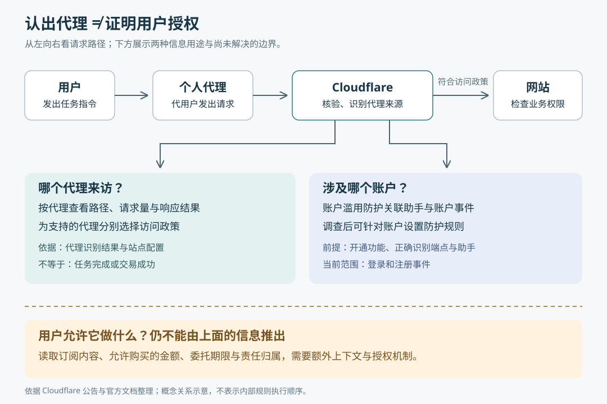

# 当 AI 代用户访问网站，网站该认谁、放行谁？

> 来源：[blog.cloudflare.com](<https://blog.cloudflare.com/personal-agents-visibility-control>)  
> 作者：未知 · 发布时间：2026-11-04 22:00（Asia/Shanghai）  
> 翻译正文：[阅读中文正文](article-zh-CN.md)

用户让 AI 帮忙比较商品、查找资料，甚至完成购买，网站收到的却是一批自动化请求。把它们全部拦下，可能挡住真实顾客；全部放行，又无法区分正常使用与滥用。Cloudflare 这次推出的办法，是让网站先看见哪些个人代理正在访问，再分别设置访问政策，并在部分账户事件中关联它们所使用的账户。

这里的**个人代理（Agent）**，指接收用户指令、代用户读取网页或执行操作的软件。这项进展值得网站经营者和代理开发者关注：它改善的是代理进入网站时的识别与管理条件。它没有展示模型推理能力的突破，也没有解决“用户到底授权代理做什么”。

本文以 Cloudflare 的[原文《See the agents, set the terms》](https://blog.cloudflare.com/personal-agents-visibility-control)为研究主体，结合截至 **2026 年 11 月 5 日**可查的官方文档核验。原文属于产品发布公告；以下将产品能力、发布方主张和分析推断分别说明。

## 从一次商品比较，看清网站缺少什么

假设一位顾客让代理：“比较两款相机的价格和退货条件，先别下单。”代理访问商品页、帮助页，可能还会尝试登录以查看会员价。

网站至少需要回答三个不同的问题：请求来自哪家代理服务？它正在使用哪个账户？这个账户的主人是否允许它下单？

这三个答案不能互相代替。知道请求来自某个正规代理服务，不代表驱动它的每个用户都可信；看见它提交了某个账户的登录信息，也不能据此认定账户主人授权了购买。原文的价值，正是开始把代理服务与用户账户放进同一个调查视野；原文最后也承认，授权范围、订阅关系和责任归属仍需要进一步解决。

这个例子还有一个容易忽略的细节：代理访问了结账页，只能说明它请求过那个地址。是否成功付款、是否获得用户同意，需要网站自己的交易记录和授权信息来判断。请求数量与页面路径提供线索，不能直接当作任务成功率。

## 新在哪里：从统一处理机器人，到分别处理代理

原文公布的变化可以分成三部分，它们回答不同层次的问题。

**第一，按代理查看流量。** 安全分析页面新增“个人助手”类别，站点可以选中某个代理，继续查看它访问的路径、收到的响应状态码，以及请求来自哪些网络。状态码是网站给请求返回的结果编号，例如表示成功或拒绝访问。这样，站点可以寻找代理经常失败的页面，而不只看到一团“自动化访问”。这些是原文展示的界面能力，尚不是代理完成业务任务的测量结果。

**第二，按具体代理设置政策。** Cloudflare 之前已经区分用于搜索、训练和代用户访问的自动化流量；本次进一步允许站点为支持的个人代理分别配置政策。例如，整体限制代理访问带广告的页面，同时为某个代理设置例外。这种例外能表达网站对不同访问渠道的选择，但不是“允许读、禁止买”那样的操作级授权。[访问政策文档](https://developers.cloudflare.com/bots/additional-configurations/block-ai-bots/)确认了这些配置入口。

**第三，在账户调查中加入代理信息。** 账户滥用防护服务可以展示哪些已识别的助手出现在账户的登录和注册活动中，帮助调查人员决定是否针对某个账户采取措施。这能减少因一个账户可疑而封禁整家代理服务的需要。不过，[11 月 3 日的官方更新记录](https://developers.cloudflare.com/changelog/post/2026-11-03-aap-ai-assistant-scope/)明确限定：这项助手可见性只覆盖登录、注册事件；未被 Cloudflare 识别的助手仍显示为普通流量。

因此，新增能力并不是完整记录代理的一切行为，而是在已有流量和账户视图中增加“由哪个代理发来”这一维度。

## 请求怎样变成可以采取行动的信息

下面是依据公开功能整理的概念图，表示信息如何支持不同判断，不代表 Cloudflare 内部规则的实际执行顺序。

### 先识别代理，不能只听它自报名称

请求里的 `User-Agent` 是客户端自报软件名称的字段，单靠它无法证明来源。Cloudflare 的“已验证机器人”机制还会使用请求签名、公布的网络地址列表等方式核验身份；其资格要求也包含遵守抓取规则、保持合理请求速率等行为条件。因此，目录中的身份既涉及技术验证，也涉及平台管理规则。[已验证机器人文档](https://developers.cloudflare.com/bots/concepts/bot/verified-bots/)说明了这些条件。

其中一种方法叫 **Web Bot Auth**，即让自动化客户端为请求附加密码学签名，以便接收方核验来源。它是这里的支撑技术之一，不能理解为所有个人代理都已采用它，也不是本次公告才发明的机制。

其过程可以这样理解：代理运营方先保存一把用于签名的私钥，公开对应的公钥，并向 Cloudflare 注册；发送请求时，代理选择要保护的请求字段，用私钥生成签名；接收方再用已关联的公钥核验。核验成功，才能把请求与相应签名身份联系起来。私钥负责生成签名，公钥负责验证，两者用途不同。[Cloudflare 接入文档](https://developers.cloudflare.com/bots/reference/bot-verification/web-bot-auth/)提供了具体流程。

这里还有一个技术边界：签名保护的是被选中的请求部分。**HTTP 消息签名**是为网页通信消息中的选定字段生成、携带和验证签名的机制，并不自动保护整条消息的所有内容。[RFC 9421](https://www.rfc-editor.org/rfc/rfc9421.html)明确提醒，未被签名覆盖的部分即使发生改变，也可能不影响验签结果。因此，“代理身份通过验证”不能直接变成“购买内容和用户授权也都得到验证”。

### 再把身份交给访问政策

站点可以给代理流量设置“不由此政策阻止”“在检测到广告的页面阻止”或“阻止”。个人代理默认继承整体代理政策，也可以单独调整；官方文档还提醒，修改整体政策会更新各个人代理的政策，之后可以重新设置个别选择。[政策行为说明](https://developers.cloudflare.com/bots/additional-configurations/block-ai-bots/)

这里有两个实际含义。首先，“带广告页面”取决于 Cloudflare 的检测，不能直接当成出版商所有商业价值页面的清单。其次，允许选项的名称本身是“Allow (do not block)”：据此能确认的是这项政策不阻止请求，不能推出网站登录检查、业务权限和其他防护也会放行。

上述相机例子中，站点可能欢迎某个代理读取商品信息，但是否允许该账户使用会员价、提交订单，仍然要由相应业务规则决定。

### 有账户线索时，把调查缩小到具体账户

账户滥用防护使用 **Hashed User ID**，即按站点生成的不透明用户标识，把相关账户事件关联起来。它需要启用相应功能，并正确识别登录、注册端点，也就是接收这些操作的网址；非标准端点可能需要额外标注。该服务目前处于早期访问阶段，面向使用企业版机器人管理服务的客户。[账户滥用防护文档](https://developers.cloudflare.com/bots/account-abuse-protection/)

将账户标识与助手信息结合后，调查人员可以寻找某账户是否突然出现新的代理，再决定是否使用 **WAF**——按规则检查和处理网站请求的应用防火墙——限制该账户的相关请求。原文提出了这种处理方式，但“出现新代理”只是调查线索，不是账户被盗的结论。

尤其要注意：登录事件所关联的账户，是请求试图使用的身份。若攻击者提交窃取的凭据，事件依然可能关联到受害账户。它不是对实际操作者本人或合法委托关系的证明。

## 证据到哪一步，哪些效果还不知道

这篇文章公布的是产品能力，评价它应看功能范围与实际效果，不能套用模型论文的基准分数。

| 证据层次 | 本次能确认的内容 | 仍不能据此确认的内容 |
| --- | --- | --- |
| 发布方公告与界面截图 | 宣布新增流量分类、代理筛选和访问控制 | 所有客户、所有代理都有相同覆盖 |
| 官方产品文档与更新记录 | 政策语义、账户服务准入条件，以及登录和注册范围限制 | 识别准确率、遗漏比例和实际误拦截率 |
| 协议与实现文档 | 公开了签名验证这一身份核验方法及接入要求 | 每个受支持代理均使用签名，或跨平台已完全兼容 |
| 应用效果 | 原文描述了调查与配置用途 | 带来多少订单、减少多少欺诈或节省多少人工 |

本次查阅材料没有提供独立对照测试或足以量化上述业务效果的数据；本文也没有进入客户控制台进行实测。官方文档能帮助核对功能边界，仍属于发布方证据。

协议成熟度也要分层看。通用的 HTTP 消息签名已有 RFC 9421，但 Cloudflare 接入文档引用的 Web Bot Auth 架构版本仍是草案；[该草案的 IETF 页面](https://datatracker.ietf.org/doc/html/draft-meunier-web-bot-auth-architecture-02)已标明旧版本被后续文档替代。不能把通用签名标准的存在，解释为整个代理身份体系已经定型。

最重要的未知仍是用户委托。原文把携带用户上下文、评估信誉和明确责任列为下一步目标；这说明当前的账户关联还不能回答“此人允许代理花多少钱、读哪些订阅内容、授权何时失效”。这些属于后续能力，而非本次已交付结果。

## 为什么值得关注，接下来该看什么

我的判断是，这项更新的重要性在于：网站开始有条件把代理当成一种可分别观察、设置政策的访问渠道。以前“自动化”往往首先触发拦截判断；现在站点可以继续追问，是什么服务、出现在哪些页面、是否涉及某个账户，再作选择。这是代理与网站关系的变化，尚不能证明代理已经成为可靠的交易执行者。

对网站经营者，近期值得做的是观察已识别代理访问哪些页面、在哪里失败，再结合自身内容和商业模式选择政策。依赖广告的出版站与希望顾客顺利比较商品的商城，可能作出不同决定。原文所说的“欢迎代理可能保住顾客”有合理动机，但缺少转化数据时，仍应视作发布方主张。

对代理开发者，公开且可核验的服务身份，可能使网站更愿意为其设置访问例外；这是机制带来的潜在用途。它是否真能改善任务完成率，还取决于网站政策、代理覆盖范围与页面可操作性，需要后续实测。

更值得持续跟踪的是三个信号：受支持代理的覆盖和识别质量是否公开；是否出现兼顾隐私、可撤销且能限定操作范围的用户委托方式；是否有独立案例把访问政策变化与任务完成、商业收益或滥用变化联系起来。在这些证据出现前，最稳妥的理解是：**网站获得了更细的观察与选择能力，代理代表谁、获准做什么，仍是需要继续补齐的问题。**
