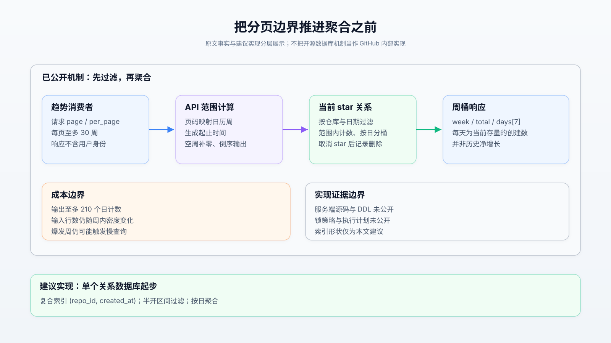
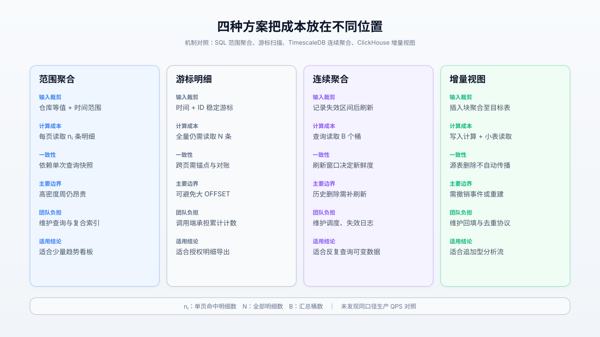
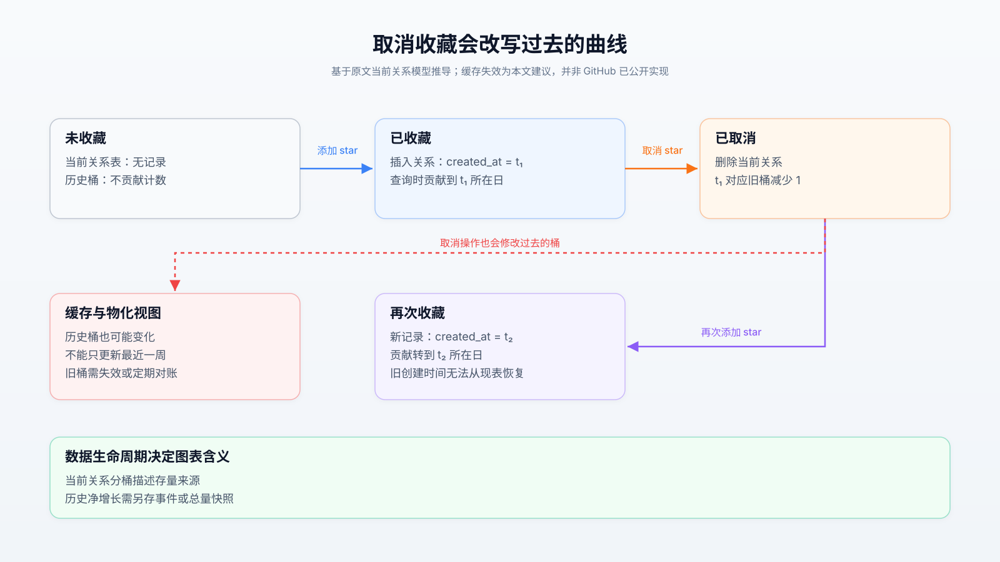
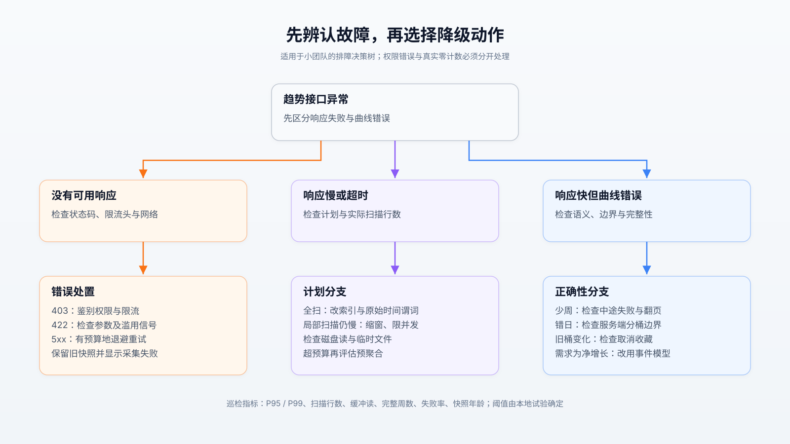

# 从 2500 次到 24 次：Star History 的查询边界与历史幻觉

2026 年的接口限制暴露了一个真实生产问题：GitHub 在限制前一周记录了近 3.7 万次慢计数查询，平均接近 3 秒，另有超过 1000 次被数据库保护机制终止。[原文](https://github.blog/engineering/architecture-optimization/from-2500-requests-to-24-rebuilding-star-history-without-the-stargazers/)给出的根因是分页实现反复计算全部 star 数，而消费者只想画趋势。**可迁移的优化原则是让分页范围先约束聚合输入；适用前提是业务接受日粒度的当前存量分布；关键边界是时间窗口不限制事件密度，也不能恢复已经删除的历史。**

本文以 `input/article.md` 为锚点，核验截至 2026-10-20 的公开资料。【原文】表示输入文章所述事实；【外部】表示文档、源码或使用者记录；【推断】表示本文的成本分析与实践建议。未获得 GitHub 服务端源码、索引 DDL、完整压测环境及新接口 P99，因此不把请求数下降解释为等比例的延迟或成本收益。

## 1. 先确定“历史”是什么

【原文】旧接口列出当前收藏者，附带 `starred_at`；取消收藏会删除关系记录。工具为了得到日期，必须接收并丢弃身份信息，既扩大身份采集面，又消耗分页额度。只删除 JSON 中的用户名，能减少身份暴露，却不能消除数据库扫描与客户端逐条计数。

【外部】新接口为 `GET /repos/{owner}/{repo}/stargazers/history`：按周倒序分页，每周提供 `week`、`total`、七个 `days` 值，日序从星期日开始；空周补零，`per_page` 默认及最大为 30，`page` 最大为 100。官方明确提醒周、日边界**不保证与 UTC 对齐**，调用端不能自行假设时区。[接口契约](https://docs.github.com/en/rest/activity/starring#get-repository-star-history)

更重要的核验来自社区：GitHub 工作人员确认，接口统计“今天仍有效的 star 在各日的创建数量”，不提供 unstar 历史。[官方答复](https://github.com/orgs/community/discussions/206104)所在讨论说明了这一点，具体回复可在页面内按 2026-09-11 定位。

【推断】若用户一月收藏、十月取消，一月桶也会减少；再次收藏则按新创建时间归桶。把这些桶从最早日期累加，得到的是“当前存量的来源曲线”，不是“当时实际拥有多少 star”。因此它可辅助观察发布前后的兴趣分布，却不适合计算历史净增长、流失率、留存率，更不能单凭曲线证明发布带来了增长。这个语义限制在旧明细重建方式中同样存在，并非聚合接口新增的误差。

## 2. 把范围放到聚合之前

【原文】直接 `GROUP BY` 日期后再 `OFFSET/LIMIT`，只限制返回桶数；文章中的实现仍需处理仓库全部当前 star。新方案先把 `page/per_page` 换算为日历周时间范围，经日期索引过滤，再对范围内记录按日计数。API 层负责范围、补零与排序，数据库负责过滤与聚合，消费者负责累计和展示。

下面区分已公开的数据路径与可复现的索引建议，避免把示意图误当作 GitHub 内部部署图。



【推断】在 PostgreSQL 中可用以下最小形态验证该机制；这是独立示例，未声称 GitHub 使用相同数据库或 SQL。`:lo/:hi` 是绑定参数，`created_at` 假设为 `timestamptz`，自建系统明确采用 UTC 日界。

```sql
CREATE INDEX stars_repo_created ON stars (repo_id, created_at);

SELECT (created_at AT TIME ZONE 'UTC')::date AS day,
       count(*) AS count
FROM stars
WHERE repo_id = :repo_id
  AND created_at >= :lo
  AND created_at <  :hi
GROUP BY 1
ORDER BY 1;
```

半开区间防止相邻页重复纳入边界记录；日期转换放在分组处，原始时间列保留范围谓词。复合 B-tree 的前导仓库等值条件、随后时间范围条件可缩小索引扫描区间，这与 PostgreSQL 的[多列索引规则](https://www.postgresql.org/docs/18/indexes-multicolumn.html)相符。但优化器仍可能因选择性、统计信息或缓存情况选择其他计划，必须检查实际执行。

【外部】PostgreSQL 18 的 [`nodeAgg.c`](https://github.com/postgres/postgres/blob/REL_18_0/src/backend/executor/nodeAgg.c)显示聚合对输入元组执行 transition function，HashAggregate 保存分组状态，超出内存预算可分批落盘；逐元组临时内存与较长生命周期的聚合内存分开管理。这里最多约 210 个日桶，所以对简单计数而言，**少量分组不代表少量输入**，瓶颈可能仍是读取大量索引项与可见性检查。

覆盖索引也不等于零表访问：PostgreSQL 的 Index Only Scan 还依赖 visibility map，频繁增删可能增加 heap fetch。[索引扫描文档](https://www.postgresql.org/docs/18/indexes-index-only-scans.html)说明了这一限制。普通聚合读取不必人为加行锁；MVCC 能提供语句快照，但多个 HTTP 分页请求并不自动共享一个数据库快照。[并发控制文档](https://www.postgresql.org/docs/18/mvcc-intro.html)支持前半点，跨请求结论属于架构推断。

不能把此案例推广成“所有 GROUP BY 加 LIMIT 都全扫”：有序输入、预聚合或特定计划可以提前停止。此处应验证的是目标计划是否在聚合前裁剪原始行，而非只看 SQL 的书写顺序。

## 3. 数字证明了什么

【原文】约 25.1 万 star 的示例，旧明细完整读取约需 2511 次请求；新接口约需 24 次。假设数据不变且各时间窗口不重叠，朴素全量聚合的 24 页反复处理约 600 万行，范围聚合在完整遍历中约处理 25.1 万行。前者反映网络调用放大，后者反映逻辑扫描放大，两者分母不同。

可用两个模型估算，但不可当作压测结果：

$$
R_{detail}=\lceil N/100\rceil,\qquad R_{time}=\lceil W/30\rceil \tag{1}
$$

其中 `N` 为当前 star 数，`W` 为从仓库创建周到当前周的周数，`R` 为完整读取的数据请求数；忽略元信息、重试及探测空页。对不变数据，一轮范围查询的处理量模型为：

$$
C_{range}=O(P\log N+\sum_{i=1}^{P}n_i) \tag{2}
$$

`P` 是页数，`n_i` 是第 `i` 页命中记录数；有效索引、无重复区间时，求和约为 `N`。这解释了收益来源，也说明单页 `n_i` 没有固定上限。

【原文】访问限制后，stargazer 请求约少 60%，计数查询总耗时约少 80%；这是**限制访问后的观测**，不能归因于新聚合算法。页面改用缓存总数后，相关慢查询从每周数百降至零，也不等于页面延迟为零。原文没有公开新接口在相同并发下的 P95、P99 或机器成本。

【外部】同一社区讨论中的使用者报告：2014 年创建、仅 76 个 star 的 `99designs/cmdstalk`，647 周需要 22 次请求，只有 53 周非空。按式（1），旧明细数据本可放入一页；新设计对“老而稀疏”仓库可能更费请求。这是使用者的具体观察，未经本文现场复测，也不构成全面基准。[案例与反馈](https://github.com/orgs/community/discussions/206104)

另一个机制参照来自 ClickHouse 官方文档：约 2.39 亿条投票记录，原始聚合示例耗时 0.133 秒、峰值内存 363.22 MiB；预聚合表的 `FINAL` 示例为 0.004 秒、289.75 KiB。示例同时展示插入开销从 29.359 秒增至 111.964 秒，处理工作也发生变化。它说明计算可以转移到写入阶段；这是一方教学基准，不能直接外推为 Star History 的生产收益。[基准 SQL 与输出](https://clickhouse.com/docs/concepts/features/materialized-views/incremental-materialized-view)

三角核验的结果是：原文生产记录、数据库执行机制、生态使用反馈共同支持“裁剪输入很重要”；**没有找到可独立复跑、同数据同硬件的 GitHub 新旧生产对照**，无法据此给出吞吐上限。

## 4. 四条路线的成本位置

【外部】Star History 的公开 `main` 源码快照仍可看到旧路径：`getRepoStarRecords` 从 Link 头提取页数，按请求预算选择页面，经 `Promise.all` 并发读取，用 `Map` 保存日期点；调用层默认预算为 15。这说明原生态存在抽样曲线，不能把“完整读取的 2511 次”当作所有工具的实际调用数。[API 源码](https://github.com/star-history/star-history/blob/main/shared/common/api.tsx)、[调用层](https://github.com/star-history/star-history/blob/main/shared/common/chart.tsx)。这些为可变分支、网页抓取快照，不能证明线上当前部署版本或完整迁移状态。

在此基础上有三条代表性替代路线：游标明细扫描保留灵活性；TimescaleDB 连续聚合保存失效区间并刷新；ClickHouse 增量视图把输入块的聚合结果写入目标表。它们与范围聚合的差别，是把成本留在读取、移至刷新还是移至写入。



| 维度 | 范围聚合 | 游标明细扫描 | TimescaleDB 连续聚合 | ClickHouse 增量视图 |
| :-- | :-- | :-- | :-- | :-- |
| 读取工作 | 每页约扫描 `n_i` 条 | 全量需传输 `N` 条 | 读取汇总桶，未物化部分另计 | 读取目标表的部分聚合结果 |
| 延迟与吞吐边界 | 密集窗口、I/O、连接池；无公开 QPS | 页大小、网络往返与消费速度 | 刷新积压、查询模式与热点 | 插入聚合、合并及查询并发 |
| 新鲜度 | 查询快照及缓存决定 | 跨页需对账 | 由刷新策略决定 | 随插入推进，仍需正确合并 |
| 删除与修正 | 下次查询可见 | 读取期间可能变化 | 对应历史区间需刷新 | 源表删除不自动传至目标表 |
| 恢复方式 | 重试只读请求、保留旧快照 | 保存游标并核验完整性 | 重跑失效区间、对账重建 | 去重、撤销事件或目标表重建 |
| 运维及协作 | API 与数据库负责人约定时间口径 | 客户端承担累计、抽样与一致性 | 增加刷新调度和版本回归责任 | 增加事件协议、回填与修正责任 |
| 不适用条件 | 硬性固定计算预算、极密集热点 | 仅需统计或不得暴露身份 | 无人维护刷新、历史频繁大范围修正 | 可变关系直接删除且无补偿协议 |

【推断】若业务确实需要明细，稳定的 `(created_at,id)` keyset cursor 可避免大 OFFSET 的跳过成本；但它不能省掉全量读数，也不能自动解决身份权限。PostgreSQL 文档确认被 OFFSET 跳过的行仍需计算，游标是对此类成本的替代，而非聚合语义的替代。[分页说明](https://www.postgresql.org/docs/18/queries-limit.html)

【外部】TimescaleDB 2.22.0 的 [`invalidation.c`](https://github.com/timescale/timescaledb/blob/2.22.0/tsl/src/continuous_aggs/invalidation.c)以 `[hypertable_id,start,end]` 记录源表变动，再移交各聚合的失效日志，合并重叠区间并按刷新窗口切割；失效存储过大时可落盘。它能处理历史变更，但“日志已记录”不代表相应时间段已经刷新。ClickHouse 增量视图只对新插入块触发，源表 mutation、删除或分区操作不会自动同步到目标表。[官方机制限制](https://clickhouse.com/blog/common-getting-started-issues-with-clickhouse)

【推断】只拥有 GitHub 聚合 API 的消费者不能直接用数据库预聚合补出 unstar 事件；这些替代方案适用于拥有源数据写路径的系统。小团队应先选一张关系表、一个索引与受控缓存，只有重复读成本超过刷新维护成本，才值得增加汇总链路。

## 5. 失败边界在历史桶里

**爆发周。** 时间范围限制了最多多少天，没有限制多少记录。发布或异常流量集中时，数据库仍可能超时；调用者同时重试还会耗尽连接池。可先降低 `per_page`、限制每仓库并发、设置查询超时；整周仍昂贵时再评估预聚合。后面这些是建议，不是 GitHub 已公开的保护实现。

**历史缓存失真。** 旧数据并非只读。取消操作可改变很早的桶，只刷新最近一页会长期保留错误历史。下图把关系生命周期与缓存影响并列，说明为什么“日历已过去”不能作为永久缓存条件。



【外部】Star History 后端缓存源码设置了 24 小时 TTL，并分别限制数据、图表 SVG 与卡片缓存容量；这只证明该应用快照中的缓存策略。[缓存实现](https://github.com/star-history/star-history/blob/main/backend/cache.ts)。【推断】请求预算外还应记录快照年龄，合并同键并发回源，避免 TTL 同时过期造成请求峰值。图表可展示旧快照，但应标注采集时间及本轮失败。

**跨页漂移。** 若采集跨越周界，基于“当前周”的页码可能移动；即使周范围不变，收藏与取消也会改变计数。建议按 `week` 去重，校验连续性，必要时重采边界页；自建 API 可增加固定 `as_of` 或范围游标。仅固定分页锚点仍不等于数据快照一致。

**错误伪装为零。** 生态 [Issue #539](https://github.com/star-history/star-history/issues/539)记录了网页与嵌入 SVG 表现不一致，维护者将其关联到接口限制。权限拒绝、限流、中途失败、真实零周必须分别建模；不能把空列表一律缓存为“没有收藏”。

**预聚合恢复失败。** 这类系统增加了持久化状态与刷新事务：TimescaleDB [#8621](https://github.com/timescale/timescaledb/issues/8621)记录 2.22.0 的刷新缺口及潜在崩溃，[2.22.1 发布记录](https://github.com/timescale/timescaledb/releases/tag/2.22.1)列出中断刷新遗留区间的修复，并限制可能死锁的层级并发刷新策略。这是具体版本故障证据，不表示后续版本仍有相同缺陷；它提示迁移成本还包括升级回归、重建演练与历史对账。

## 6. 小团队的最小验证

【推断】个人或两三人团队可分三阶段推进，先写明展示语义，再决定基础设施。

1. **POC：选三类仓库。** 热门、老而稀疏、近期爆发各一个。只用新接口读取公开计数，先取一页，再做一次完整遍历；保存原始周桶、采集时间、参数及失败页。检查每周七日之和等于 `total`、周序连续、无重复；完整遍历成功后才发布累计曲线。总数对账要容忍采集期间的变动。
2. **灰度：量化预算。** 先顺序采集，缓存 1 小时作为试验起点，测请求数、完成率、P95、P99、快照年龄。自建数据库则对均匀与集中分布分别执行 `EXPLAIN (ANALYZE, BUFFERS)`，记录实际扫描行、heap fetch、缓冲读、临时文件及写入延迟，比较全量聚合与范围聚合。测试取消旧 star 后，历史桶与缓存能否正确变化。
3. **扩展或退出。** 可先约定试验门槛：单次完整采集最多 30 个数据请求、60 秒内完成；局部失败不覆盖完整快照。这些是建议预算，需按网络和仓库年龄调整。若不能接受存量语义，立即退出该接口路线，改采定期总量快照或从今后记录事件；若范围扫描仍超本地 SLO，再验证连续聚合，勿仅凭仓库总 star 数选型。

全量上线应理解为覆盖全部目标仓库，而非搭建大厂规模集群。客户端迁移要替换身份型响应模型、日期累计逻辑与错误处理，并同时检查网页、嵌入图及缓存键。服务端新增索引还需评估构建期间 I/O、写放大和磁盘余量，保留原查询开关以便回退。

排障时先问“没响应、响应慢，还是数值错”。下图把状态码、执行计划与数据语义分成可操作分支；网络失败重试要有总预算，不能把扩大并发当作默认修复。



## 7. 证据索引

- **原文与契约：** [GitHub 工程文章，2026-10-14](https://github.blog/engineering/architecture-optimization/from-2500-requests-to-24-rebuilding-star-history-without-the-stargazers/)、[REST 文档](https://docs.github.com/en/rest/activity/starring#get-repository-star-history)。生产慢查询和请求数来自原文；未提供独立复测数据。
- **生态反馈：** [Community #206104](https://github.com/orgs/community/discussions/206104)包含存量语义答复与稀疏仓库反例；[Star History #539](https://github.com/star-history/star-history/issues/539)记录接口变更后的使用故障，均应按记录日期理解。
- **源码锚点：** [PostgreSQL 18.0 聚合执行器](https://github.com/postgres/postgres/blob/REL_18_0/src/backend/executor/nodeAgg.c)、[TimescaleDB 2.22.0 失效日志](https://github.com/timescale/timescaledb/blob/2.22.0/tsl/src/continuous_aggs/invalidation.c)。二者为明确版本；Star History 的 `main` 链接为核查时可见快照。
- **基准与故障：** [ClickHouse 示例基准](https://clickhouse.com/docs/concepts/features/materialized-views/incremental-materialized-view)、[增量视图限制](https://clickhouse.com/blog/common-getting-started-issues-with-clickhouse)、[TimescaleDB 2.22.1 修复记录](https://github.com/timescale/timescaledb/releases/tag/2.22.1)。教学测量、用户观察、生产故障与本文推断未合并为同一性能结论。
