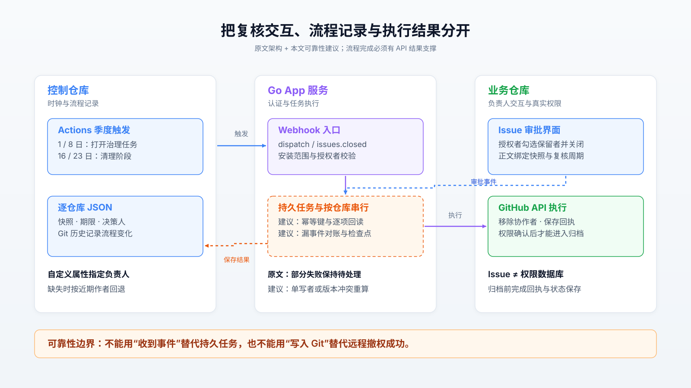
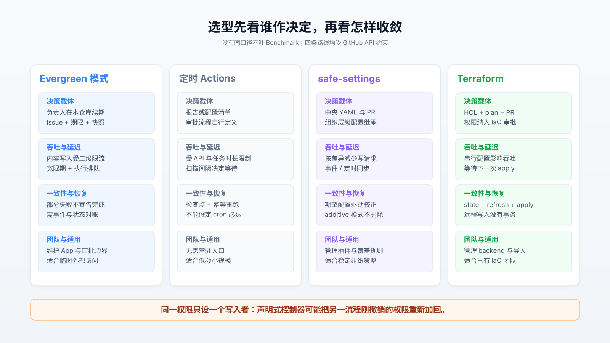
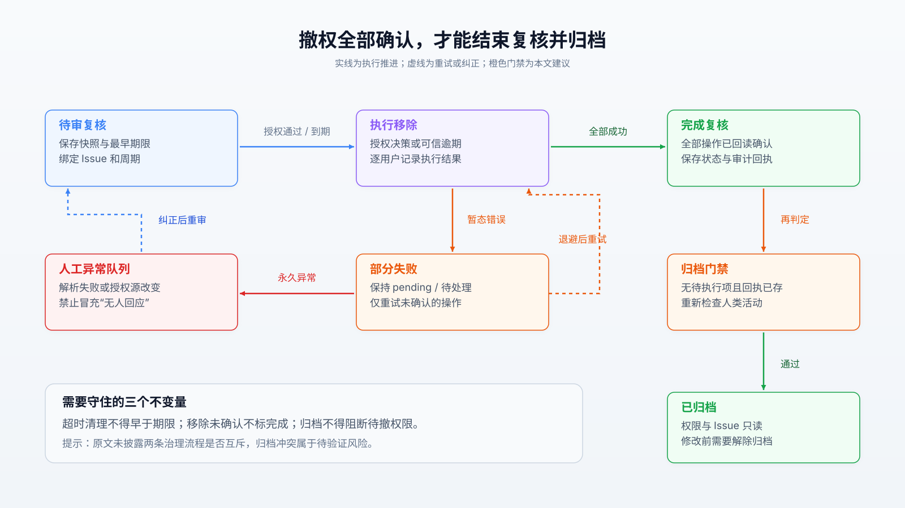
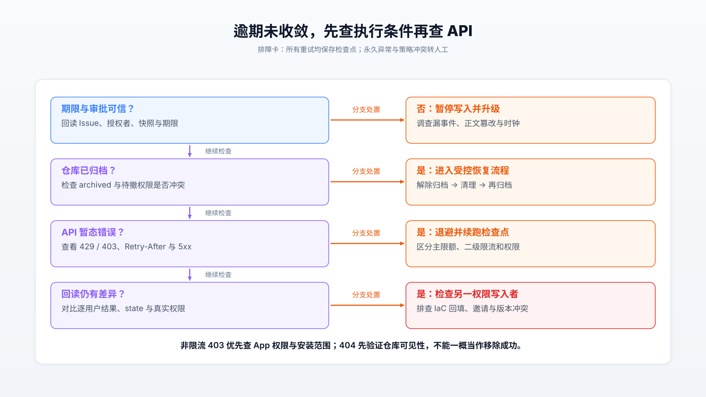

# 把权限复核做成控制器：Evergreen 的机制、代价与失败边界

2024 年 7 月 5 日，GitHub webhook 故障造成投递平均延迟 24 分钟、最长 71 分钟；如果权限系统把“没有收到审批事件”解释成“负责人没有回应”，平台故障就可能转化为误撤权。这是官方复盘记录的故障，不是 Evergreen 已发生的事故。[故障复盘][10]

**Evergreen 最值得借鉴的是把外部访问变成有期限、有责任人、有执行回执的授权流程。它适合容忍小时级收敛的周期治理，不能替代紧急离职撤权或持续身份管理。复用时必须补齐事件对账、逐项重试和撤权先于归档的依赖门禁，不能把 Git 历史误当作跨 API 事务。**

## 1. 问题是授权失去期限

【原文证据】Greg Mohler 于 2026 年 10 月 15 日发表的 [Staying Evergreen][1]，描述 GitHub 员工与客户、合作伙伴共享组织的治理实践：项目结束后，外部协作者仍可能保留权限，仓库负责人还要手工追踪名单、期限和提醒。Evergreen 用季度访问复核与闲置归档替代集中清理，组织中有 1,400 多名内部员工，但这不是仓库数、外部人数或压测并发数。

它改变了两项默认行为：无人回应时撤销本轮快照中的外部访问；闲置仓库经过警告和宽限期后归档，不删除内容。负责人在本仓库 Issue 勾选保留者并关闭，免去跳转独立治理后台的成本。代价是“忘记回答”成为有业务后果的事件，负责人识别、通知可达性和休假代理都进入可靠性边界。

【证据边界】原文未提供可定位的 Evergreen 源码仓库，也未公开误撤率、恢复时间、运行成本或可复现 Benchmark。本次公开检索未找到可核对的实现；下文用官方 API、公开同类源码和生产故障三角核验机制，**不将其他项目代码归属于 Evergreen，也不虚构第三方实测收益**。资料核验截至 2026 年 10 月 20 日。

## 2. 一个控制器，三种状态

【原文证据】系统主体是容器中的 Go webhook 服务。控制仓库的四个 Actions 工作流按季度触发 `repository_dispatch`：1 日发闲置警告，8 日打开访问复核，16 日执行归档，23 日清理未回应权限。人工也可触发，但硬编码宽限期阻止提前清理；真正的判断依据应是已保存的期限，而非某次工作流是否运行。

每个仓库用 `state/repos/<repo_id>.json` 保存快照、期限、决策人和跟踪 Issue；Issue 负责交互，GitHub 实际权限负责执行结果。这三者有不同职责：**Issue 是审批界面，JSON 是流程记录，API 返回及回读才是执行证据**。原文的负责人链为自定义属性 `evergreen_repo_owner` 优先，否则从近期 Issue、提交作者中筛选复核团队成员；推断出的活跃作者未必拥有项目终止决策权，应允许显式纠正。

【外部核验】协作者列表默认 `affiliation=all`，包含组织成员和继承权限；复核外部人员必须显式使用 `outside` 并遍历分页。接口返回的最高角色可能合并多个授权来源，不能反推出完整授权路径。[协作者 API][2] Go SDK 的 `ListCollaborators` 返回当前页和 `Response`，没有在该方法内部自动拉完所有页。[SDK 源码][12]

【分析建议】入口验签并校验安装、组织、仓库范围，持久化任务后快速返回；后台按仓库串行处理，以 `(repo_id, review_id, action, user_id)` 标识操作。图中蓝色表示原文交互，紫色表示执行，橙色虚线框表示本文建议补齐的可靠性模块。

原文称非授权员工关闭 Issue 时会被重新打开，但“关闭者合格”还不能证明复选框内容可信。【分析建议】把 Issue 编号、创建者、周期、快照用户 ID 和允许保留的集合绑定；拒绝正文插入陌生账号、重复条目或解析失败。共享正文若允许其他人编辑，应由授权者确认最终名单及摘要；执行前重新验证其复核资格，不能仅依据 webhook 的 `sender`。

### Git 省掉了数据库，也留下事务缝隙

【分析推断】逐仓库 JSON 适合低频、可人工审计的流程，主要 I/O 是远程 API、状态提交和日志写入，CPU 通常不是首要约束。按页流式处理可限制内存；一次全量加载历史和成员则会随组织规模增长。Evergreen 的实际锁、缓存和提交方式没有源码证据，不能断言其已经解决并发。

两个 worker 读同一版本后覆盖写，会丢决策；不同文件即使能合并，分支引用更新仍需协调。小团队可以先用单写者，扩展时再加版本比较与重算。更关键的是，撤权成功后进程崩溃、状态尚未提交，重启会再次尝试；反过来先写“完成”，则可能留下真实权限。应先记录操作意图，逐项执行、回读并保存结果，最后结束复核。Git 便于追责，却不能提供跨 GitHub API 的原子性，也不等于防篡改的独立审计存储。

## 3. 对比的是治理语义

三个替代方向分别适合不同问题：定时 Actions 脚本减少常驻服务；safe-settings 持续落实声明式配置；Terraform provider 将权限纳入已有 IaC 审批。它们都调用 GitHub API，增加 worker 不会消除平台限流；也都不会天然回答“这个客户下季度是否仍需访问”。

【源码核验】safe-settings 的 `main-enterprise/lib/plugins/diffable.js` 在 `sync()` 中先读取现状、计算增改删，再以 `Promise.all(changes)` 等待操作；`additive` 模式会跳过删除。因此“名单外自动删除”与“保留手工添加”是不同策略，迁移时必须明确。本次成功读取的是可变分支，未取得固定提交，结论仅限所见代码，不能当作 3.0.0 的逐行审计。[差异引擎源码][5]

Terraform GitHub provider **v6.13.0** 的单协作者资源先查邀请，再分页查成员；删除时区分取消邀请和移除成员。[资源源码][6] 其 `RateLimitTransport` 在关闭并行选项时以 mutex 包住等待、HTTP 请求及响应检查；响应体被缓冲以便检查和复用。锁让慢请求与退避产生队头阻塞，缓冲占用内存；打开并行则放弃这层串行保护，需另行控制请求预算。[传输层源码][7] 这说明瓶颈常是 API 与等待，不是 Go 是否足够快。

下图按决策载体比较四条路线；吞吐和一致性均描述机制约束，不作没有同口径实测的排名。

| 维度 | Evergreen 模式 | 定时 Actions 脚本 | safe-settings | Terraform provider |
| :--- | :--- | :--- | :--- | :--- |
| 决策与协作 | 仓库 Issue；负责人周期续期 | 清单或产出报告；自行审批 | 中央 YAML、PR 与配置继承 | HCL、plan、PR 与 apply |
| 吞吐极限 | 未披露；内容创建易受限 | 未披露；受 API 和运行时长限制 | 无同口径压测；只更新差异 | 无同口径压测；受串行配置、API 限制 |
| 延迟 | 人工宽限期加排队时间 | 扫描间隔加排队时间 | 事件触发或定时校正 | 下一次 refresh/apply |
| 一致性与容灾 | 部分失败保持待处理；需对账 | 靠检查点和重跑补齐 | 期望配置驱动再次同步 | state、refresh 与再次 apply；非远程事务 |
| 运维与成本 | App、密钥、入口、状态、日志 | 无常驻入口；仍有执行与维护成本 | App、配置层级、插件与升级 | backend、锁、导入和 provider 升级 |
| 不适用场景 | 分钟级强制撤权、无人认领仓库 | 高频交互、多执行器复杂状态 | 只有临时授权、没有稳定期望配置 | 完全依赖仓库负责人即时交互 |

【分析推断】已有 Terraform 的团队宜保留稳定基础权限，把短期例外交给独立流程；没有 IaC 基础的小团队，不应只为季度复核引入整个资源管理栈。同一权限必须确定唯一写入者：若 Evergreen 撤权后，safe-settings 或 Terraform 仍声明该用户应存在，下一轮同步就会恢复访问。迁移要先盘点授权来源，再导入现状、划定管理边界、演练恢复，成本主要来自策略整理与负责人培训。

## 4. 默认撤权不等于立即安全

【原文证据】删除部分成功、部分遇到 API 错误时，Evergreen 保持复核待处理及 Issue 打开，下一轮只重试未完成者，全部成功才记录撤销完成。这个不变量是可信设计方向；但外部 API 不可用时，尚未移除者仍能访问，不能把“流程不宣告成功”描述成“权限已经关闭”。

### 归档可能挡住撤权

【外部核验】官方明确：归档后仓库权限只读，不能增删协作者或团队，修改前必须解除归档。[归档语义][3] 这与原文“16 日归档、23 日撤权”形成值得验证的交叉风险。

【分析推断】如果同一仓库既闲置又有未完成复核，先归档可能阻断后续撤权及 Issue 回执。原文未说明候选集合是否互斥、归档前是否已清理权限，不能据此断言生产存在漏洞。稳妥门禁是：**访问复核无待执行项、撤权结果已确认、回执已保存，才允许归档**；已归档异常仓库进入人工处置或受控的解除归档、清理、再归档流程。归档本身不消除已有读取权。

### 事件丢失会被误认为沉默

【外部核验】GitHub 要求 webhook 在 10 秒内响应，失败投递不会自动重发；Actions `schedule` 高负载时可能延迟，部分排队任务可能被丢弃。[投递实践][8] [失败投递][9] [调度限制][4] 开头的生产复盘进一步证明延迟不是理论问题，但它不能用于估计 Evergreen 的具体误撤概率。

【分析建议】重复投递使用 delivery ID 去重，业务动作另用周期键幂等；不要在任务尚未可靠接收时永久标记“已处理”。定期扫描逾期记录，同时回读 Issue 关闭状态、授权者和名单，修复漏事件。观察到平台故障或无法确认审批数据完整时，进入有截止时间、需升级告警的异常队列，不能伪造“无人回应”；平台恢复后再继续已规定的默认撤权策略。

以下状态机把原文的失败重试原则与建议的归档门禁分开：只有全部撤权已验证才完成；解析或权限来源异常需要人工判断，不能无限重试。

快照还有两个边界。【分析推断】复核打开后新增的用户不在旧快照中，不应被无条件扫除，应另开增量复核；旧快照用户后来成为组织成员或授权发生改变，执行前需重查。闲置检测也不能简单读取 `updated_at`：机器人提交和治理 Issue 会制造活跃，长期只读依赖则可能完全没有人类写入。应排除自动化活动，并为发布归档、镜像源和只读依赖设置有期限、有批准人的例外。

恢复同样有成本。原文将日志称作恢复入口，但重新添加用户名可能发送邀请、需要对方接受，原权限角色也必须保存；已克隆的代码无法被撤权收回。复制账号名单只是恢复线索，不是事务回滚。恢复授权还可能遇到单仓库每日邀请上限。[协作者 API][2]

## 5. 容量先算内容预算

【外部核验】GitHub 当前一般限制内容创建不超过 **80 次/分钟、500 次/小时**，某些端点更低，且规则可变。这与安装令牌的主限额是不同约束；`remaining` 尚多不能证明未触发二级限流。原文每次写入间隔几秒并分批休眠，但间隔两秒本身仍可能每小时产生约 1,800 次请求，不能独自满足小时预算。[限流规则][11]

【分析模型】容量估算可先用公式（1）：**所需预算小时数 = N × C ÷ B**。其中 N 为实际需创建内容的仓库数，C 为每仓库 Issue、提醒及回执等内容创建次数，B 为分配给本流程的每小时内容请求预算；它是预算模型，不是墙钟耗时 Benchmark，实际还受突发窗口、共享消耗与重试影响。

例如假设 600 个仓库、每仓库 3 次内容创建，按 500 次/小时预算需 3.6 个预算小时；主动降至 300 次/小时则需 6 个预算小时。600、3 和 300 都是示例参数，不是原文观测值；不能把所有 DELETE 请求也机械计入内容创建。实现应分别计量读、内容写、权限变更，并处理 `Retry-After` 与限额重置时间，保留重试上限、检查点和令牌刷新。

【负面证据】provider Issue #3645 报告 v6.13.0 将过期邀请视为现存资源；对应版本的 `findRepoInvitation` 只按 login 匹配，未检查过期字段。两者支持“邀请状态可能掩盖权限缺失”的风险，仍不是本次已复现实验。[问题报告][13] [资源源码][6] 版本发布记录还显示 v6.13.0 重写客户端并增加并发控制，升级应核对迁移说明并做契约回归，不能只验证 plan 没报错。[版本记录][14]

## 6. 小团队从十个仓库开始

以下规模和阈值均为【实践建议】，不是厂商基准。个人账号不具备组织外部协作者的同等模型，应在测试组织验证。

1. **POC：先只读。** 选择约 10 个非关键仓库，用 GitHub App 只安装到白名单；获取成员、外部协作者和分页数据，人工确认负责人。输出带快照和期限的 dry-run 差异，至少覆盖空名单、超过一页、Issues 关闭、已归档、机器人活动和新增协作者。
2. **灰度：先测恢复。** 对两三个测试仓库开放必要写权限，使用短测试周期模拟宽限期；注入重复事件、漏事件、429、删除成功后崩溃、状态冲突。验收要求是零越权决策、零未经授权的提前清理、失败项不被标完成，重跑后状态与 API 一致，并成功恢复一次测试权限。
3. **扩展：按预算批量。** 一个正式复核周期通过后再扩大范围；保留显式负责人、代理人和带到期日的例外。监测审批耗时、最老待处理项、状态漂移数、误撤次数和恢复耗时。可先约定逾期任务 24 小时内收敛、测试恢复 30 分钟内完成；业务要求更严时重新选型。

出现任何误撤关键访问、审批身份无法验证、分页缺失或无法证明恢复路径时，立即停止扩大范围，切回只读并人工处理。若维护可靠入口、状态与告警的成本超过周期手工复核，退回报告加人工执行也合理；若任务积压长期超出允许窗口，再考虑持久队列或数据库，而非预先引入集群。

排障应从“是否真的满足执行条件”开始，再检查平台与状态。下图可作为值班决策卡：遇到归档冲突或授权来源不明，升级人工；遇到限流和暂态故障，保存检查点后受控重试。

## 7. 证据与复核入口

本次完成了原文、官方平台契约、公开源码及生产故障的交叉核验；未取得同工作负载的第三方 Benchmark，也未运行真实组织压测。可迁移的是控制器的状态不变量，具体收益仍需用本团队的误判率、收敛时间和维护工时验证。

1. [原文：Staying Evergreen][1]，2026-10-15；架构与组织实践的一手叙述。
2. [协作者 API][2]、[归档语义][3]、[Actions 调度限制][4]；权限与生命周期契约。
3. [safe-settings 差异引擎][5]；可变分支源码，复现前需固定提交。
4. [provider v6.13.0 协作者资源][6]、[传输层][7]、[go-github v88.0.0][12]；固定版本实现。
5. [webhook 实践][8]、[失败投递处理][9]、[限流规则][11]；可靠性和容量约束。
6. [2024 年 7 月生产复盘][10]、[过期邀请 Issue #3645][13]、[provider 版本迭代][14]；分别为生产观测、用户问题报告和变更记录，证据强度不同。

[1]: https://github.blog/engineering/platform-security/staying-evergreen-how-we-automated-secure-access-and-repo-hygiene-in-a-shared-org/
[2]: https://docs.github.com/en/rest/collaborators/collaborators
[3]: https://docs.github.com/en/repositories/archiving-a-github-repository/archiving-repositories
[4]: https://docs.github.com/en/actions/reference/workflows-and-actions/events-that-trigger-workflows#schedule
[5]: https://raw.githubusercontent.com/github-community-projects/safe-settings/main-enterprise/lib/plugins/diffable.js
[6]: https://raw.githubusercontent.com/integrations/terraform-provider-github/v6.13.0/github/resource_github_repository_collaborator.go
[7]: https://raw.githubusercontent.com/integrations/terraform-provider-github/v6.13.0/github/transport.go
[8]: https://docs.github.com/en/webhooks/using-webhooks/best-practices-for-using-webhooks
[9]: https://docs.github.com/en/webhooks/using-webhooks/handling-failed-webhook-deliveries
[10]: https://github.blog/news-insights/company-news/github-availability-report-july-2024/
[11]: https://docs.github.com/en/rest/using-the-rest-api/rate-limits-for-the-rest-api
[12]: https://raw.githubusercontent.com/google/go-github/v88.0.0/github/repos_collaborators.go
[13]: https://github.com/integrations/terraform-provider-github/issues/3645
[14]: https://github.com/integrations/terraform-provider-github/releases/tag/v6.13.0
