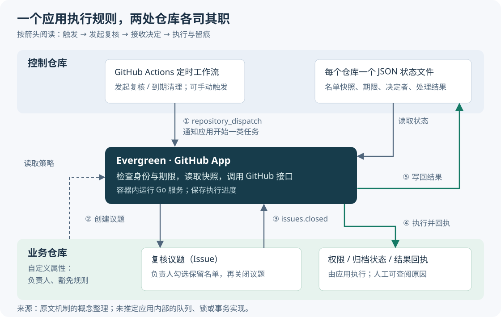
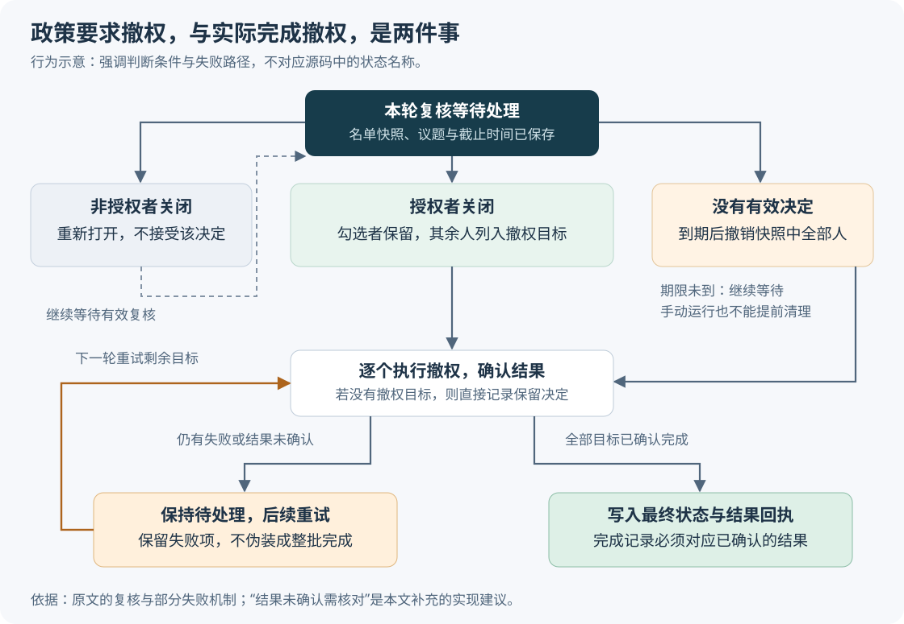

# 让过期权限真正到期：GitHub Evergreen 的机制、取舍与落地边界

客户试用结束了，代码仓库却还允许原来的合作人员访问；项目已经收尾，也没人确认仓库是否应继续维护。这类问题往往不是缺少删除按钮，而是缺少持续跟进的人。GitHub 的 Evergreen 把名单复核、提醒、撤权和归档连成定期流程，让负责人在仓库里直接作决定，再由程序执行。对外部协作频繁、临时仓库不断积累的团队，这种做法值得研究；对长期稳定运行的生产仓库，自动归档则需要更谨慎的判断。

本文以 Greg Mohler 于 2026 年 10 月 15 日发表的 [Evergreen 原文](https://github.blog/engineering/platform-security/staying-evergreen-how-we-automated-secure-access-and-repo-hygiene-in-a-shared-org/) 为研究主体，并用 GitHub 官方文档核验平台行为，核验日期为 2026 年 10 月 20 日。下文用“原文介绍”说明作者披露的机制，用“官方文档”说明平台约束；标为“分析”或“建议”的部分是本文推导，不代表 Evergreen 已实现。原文没有提供公开源码入口、完整配置或可复现效果测试，本次搜索也未找到可确认的对应源码，因此不能据此认定它已经处理了所有边界情况。

## 1. 问题不在于能否撤权，而在于谁持续确认

GitHub 把“不属于组织、但能访问组织内一个或多个仓库的人”称为**外部协作者**（outside collaborator）。这与组织成员不同：给某个客户开放一个试验仓库，并不需要让他加入整个组织。[官方定义](https://docs.github.com/en/organizations/managing-user-access-to-your-organizations-repositories/managing-outside-collaborators/adding-outside-collaborators-to-repositories-in-your-organization)

这种权限适合短期合作，难点出现在合作结束以后。负责人需要知道每个人为何获得权限、项目是否延期、谁能批准继续保留，还要记得真正执行撤权。人工清单可以记录这些信息，但名单、实际权限和提醒进度分散在不同地方，任何一步被遗忘，旧权限就会继续存在。

**假设**一个小团队为客户建立了试验仓库，Alice 和 Bob 都有写入权限。到季度复核时，Alice 还在协作，Bob 已退出项目。Evergreen 的交互是：在这个仓库建立一条议题（Issue，即 GitHub 中用于讨论和跟踪工作的记录），列出两人的复选框。内部负责人勾选 Alice，再关闭议题，应用就保留 Alice、移除 Bob；如果直到截止时间都没有有效决定，应用撤销本轮快照中两人的权限。这是解释机制的假设场景，不是生产事故或实测结果。

这里的政策选择很明确：**继续访问需要重新确认，沉默不再等于永久授权。**原文称之为“失败时默认收紧权限”（fail secure）。它降低了无人处理时权限长期遗留的可能，也把另一种成本带进来：负责人休假、通知失败或归属不清，都可能造成仍有业务需要的人被撤权。默认规则必须先得到业务认可，程序无法替团队作出这个选择。

## 2. 谁负责计时，谁执行，谁保存决定

原文介绍，Evergreen 是一个运行在容器中的小型 Go 服务，以 **GitHub App** 的身份工作。GitHub App 是可安装到指定仓库、按获准权限调用平台接口的应用身份。它把三类工作交给不同位置处理：控制仓库保存计划和状态，业务仓库承载人的复核操作，应用负责检查条件并执行修改。

图中箭头表示触发、读取或写入关系，是根据原文整理的概念图，不代表应用内部有特定的任务队列或事务实现。

### 定时任务只发起工作，应用仍须检查期限

控制仓库里有四个 GitHub Actions 工作流，即由平台运行的自动任务。原文给出的季度安排如下，不能把它误读成每个月都执行一轮：

| 本轮执行月份的日期 | 动作 |
| --- | --- |
| 1 日 | 检测长期无人活动的仓库，建立归档预警议题 |
| 8 日 | 保存外部协作者名单快照，建立权限复核议题 |
| 16 日 | 宽限期结束后，归档仍符合条件的仓库 |
| 23 日 | 清理到期且未得到有效回应的权限复核 |

这些工作流发送 `repository_dispatch`，即通过 GitHub 接口发出的自定义触发事件，通知应用开始某类任务。官方接口支持把这种事件交给 GitHub App 接收，因此定时工作流与外部服务可以这样连接；并不需要另建一套定时服务。[事件接口说明](https://docs.github.com/en/rest/repos/repos#create-a-repository-dispatch-event)

原文还允许通过 `workflow_dispatch` 手动启动工作流，但强调应用内有硬性的宽限期检查。这一层检查非常必要：管理员误点“清理”，不应让尚未到期的复核提前失效。两个日期之间约隔两周，实际是否到期应读取每条复核保存的截止时间，不能仅凭当天是几号判断。

**官方约束补充：**Actions 的定时执行在高负载时可能延迟，严重时排队任务可能被丢弃。因而，日期表表达的是执行计划，不是精确的撤权时限保证。**建议**另设周期性检查，查找所有已到期但未完成的记录，并监测最近一次成功扫描的时间，避免漏掉一次运行后一直等到下一季度。[定时事件限制](https://docs.github.com/en/actions/reference/workflows-and-actions/events-that-trigger-workflows#schedule)

### 状态文件解释“这次复核审查的是谁”

原文把每个仓库的状态保存为控制仓库中的 `state/repos/<repo_id>.json`。JSON 是用字段和值记录结构化信息的文本格式。这里的重要信息包括复核开始时的名单及权限、截止时间、处理状态、决定者、决定时间和对应议题。

名单快照固定了本轮审查范围。例如，Bob 在复核开始时有权限，之后又加入了 Charlie；不能因为截止日查到 Charlie，就悄悄把他算进一份从未列出他的复核清单。原文明确描述了对快照名单的到期撤权，但没有交代期间新增人员的完整政策。**建议**将新增权限单独登记或补充复核，而不是默认它们已经接受审查。

状态文件进入 Git 版本历史后，可以追查记录怎样变化，免去另建查询界面的工作。代价是仍要保护这些记录的访问和修改权限：Git 历史本身不保证记录不可篡改，也不保证远端权限一定与文件一致。控制仓库还集中保存了多仓库的人员和权限信息，应按这个信息范围限制可见性。

### 负责人属性解决通知，身份检查决定授权

原文先读取 `evergreen_repo_owner` 自定义属性，即挂在仓库上的结构化元数据字段，可以填写用户或团队。如果没有显式负责人，就从近期议题和提交作者中，寻找属于权限复核团队的内部人员并通知。

这个回退办法能找到“最近在做事的人”，却不能证明对方就是业务负责人。**分析：**对责任明确、人员稳定的小团队，显式登记负责人通常比长期依赖活动推断更容易核对；找不到负责人时，应升级给组织管理员处理，而不应把通知成功当作责任已经落实。

更要区分“通知谁”与“谁能批准”。原文介绍，不属于授权内部人员的账号关闭复核议题时，应用会重新打开议题并解释原因。迁移到其他组织时，应把原文中的 GitHub 员工身份换成本组织明确维护的授权团队或角色。

## 3. 从勾选到撤权，中间还需要哪些保证

负责人关闭议题后，GitHub 会发送 **Webhook**，也就是向应用地址发出一条事件通知。应用接收 `issues.closed` 后，检查关闭者身份，读取复选框，保留已勾选的人并撤销其余人的权限，再把处理结果写回议题。原文把这种在议题中发起和确认运维操作的方式称为 **IssueOps**。

### 部分失败必须留下待处理记录

假设一次到期清理需要移除三个人，前两次成功，第三次调用 GitHub 接口时超时。此时，“整批成功”是不真实的，“整批没做”也不真实，因为前两人已经失去权限。

原文明确说明：只要有撤权失败，复核就保持待处理，议题保持打开，下一次运行重试剩余项；直到全部撤权成功才记录最终撤销状态。它维护的是“记录不能抢先宣告完成”，而不是把多个接口调用变成一个全部成功或全部失败的原子事务。

图中“结果未确认需要核对”是本文补充建议。超时只说明调用方没拿到确定结果，远端操作可能已经生效。稳妥的重试需要先检查目标当前是否仍有相关权限，再补做尚未完成的动作；重复收到同一事件，也不应重复建立复核或覆盖已经确认的决定。这种让重复处理不改变最终含义的性质称为**幂等**。

因此，原文所说的“失败时关闭访问”（fail closed）有实际边界：程序能够坚持继续撤权、拒绝把失败标成完成，却无法在 GitHub 接口不可用时保证权限立即消失。失败持续多久、何时升级人工、下一轮何时重试，原文均未提供可验证的时限。

### 确认关闭者身份，还不等于确认名单可信

**安全分析：**如果某人能编辑复核议题正文，他可能改动复选框或人员标识，再由一个有权关闭议题的人触发执行。只检查“谁关闭了议题”，不足以证明正文中的全部内容都经过该人的认真确认。这是复用可编辑议题作为操作界面时需要验证的风险，不是本文确认的 Evergreen 漏洞。

建议把服务器保存的名单快照作为撤权目标的依据，只接受与本轮快照匹配的选择，不接受正文新增的任意账号。若议题允许较广泛的编辑，还应采用可信的审批记录、校验编辑来源或明确的重新确认步骤。原文没有展开其正文解析与编辑权限策略，不能替它作保证。

### 收到事件与完成工作，需要分别确认

官方建议 Webhook 服务在 10 秒内返回成功响应，并使用共享密钥验证消息来源；`X-GitHub-Delivery` 标识可用于识别事件，人工重新投递时标识保持不变。更关键的是，GitHub **不会自动重新投递失败的 Webhook**。[Webhook 最佳实践](https://docs.github.com/en/webhooks/using-webhooks/best-practices-for-using-webhooks)；[失败投递处理](https://docs.github.com/en/webhooks/using-webhooks/handling-failed-webhook-deliveries)

**建议的处理顺序**是先验证事件并可靠记录待办，再尽快响应，之后执行可能很慢的批量修改。如果先返回成功、只把任务留在进程内存里，服务重启后仍会丢失工作。定期对照议题、状态文件和实际权限，可以补回漏掉的事件。原文使用了原生功能，仍不意味着平台替应用提供了完整可靠的任务队列。

## 4. 归档与撤权各自有什么边界

### 没有人活动，不代表仓库没有业务价值

原文介绍，Evergreen 根据一段时间内是否存在人工活动判断仓库是否陈旧，先预警，宽限期后仍未改变才归档。它没有公开人工活动的完整定义、回溯范围和陈旧阈值，因此不能擅自补成“超过 90 天没有提交就归档”。

**分析：**机器人定期更新依赖，不一定代表项目仍有人维护；反过来，长期稳定的发布仓库、文档镜像或留存材料，可能没有新提交却仍有用途。自动化自己创建的预警议题和提醒，也不应被误算成业务活跃。这些差异需要通过项目类型、负责人确认和依赖关系补足，单一的“最近更新时间”无法回答。

原文通过两个独立属性提供豁免：`evergreen_exempt_from_access_review` 跳过权限复核，`evergreen_exempt_from_archive` 跳过归档。独立开关允许“仓库长期保留，但外部访问仍按期复核”。**建议**为豁免增加原因、批准者和复查时间，防止临时例外永久化；同时限制谁能修改豁免值。官方允许组织控制仓库参与者是否能设置属性，属性存在并不意味着只能由组织所有者修改。[自定义属性权限](https://docs.github.com/en/enterprise-cloud%40latest/organizations/managing-organization-settings/managing-custom-properties-for-repositories-in-your-organization)

### 归档不撤销读取权限，还会阻止后续修改权限

官方文档说明，归档让仓库变为只读，可以解除归档；归档后，议题和权限等也变为只读，不能增删协作者或团队。因此，**归档不是撤权的替代方案**，已有读取权限不会因为仓库只读就自动失效。[归档行为说明](https://docs.github.com/en/repositories/archiving-a-github-repository/archiving-repositories)

这对原文的时间表形成了一个必须验证的交互：若同一仓库既在 16 日符合归档条件，又有 23 日待执行的权限清理，先归档可能阻止后续撤权和回执更新。原文没有说明它如何处理这种重叠，不能据此认定实际系统一定有缺陷，也不能假定两个流程互不影响。

**建议**在归档前检查是否存在未完成的权限复核；有则延后归档，待到期清理及回执完成后再执行。不要为了赶上归档日期而提前撤权。对于已经归档但必须调整权限的仓库，需设计经授权解除归档、完成修改、再归档的处理过程，并记录中间结果。

### “不删除仓库”不能扩大成“没有破坏性副作用”

原文承诺 Evergreen 不删除仓库及其内容，并强调可以根据回执恢复访问。这个承诺应限定为应用本身的操作意图。官方文档另外提醒：从私有仓库移除外部协作者时，其私有派生仓库（fork，即从原仓库建立的独立副本）会被删除，而他已有的本地克隆仍然保留。[移除外部协作者的影响](https://docs.github.com/en/organizations/managing-user-access-to-your-organizations-repositories/managing-outside-collaborators/removing-an-outside-collaborator-from-an-organization-repository)

这意味着重新加回账号不一定等价于恢复所有相关状态，撤权也无法收回已经下载到对方电脑的数据。回执最好保存原权限及必要的角色信息，而不只有用户名；恢复时仍需核对业务授权。原文提到借助 Copilot 重新添加账号，只是一种操作便利，不是自动回滚或完整恢复保证。

## 5. 原生组件减少搭建工作，也带来明确的上限

### 速率限制会决定一轮复核怎样分批执行

原文介绍，它按批处理仓库，在创建内容的调用之间留出数秒，并在批次间等待，只将实际创建内容的仓库计入相关批次控制。官方确实列出了通常每分钟不超过 80 次、每小时不超过 500 次的内容创建限制；部分接口更低，限制也可能调整。这是防止过量操作的**次级速率限制**，不能只看普通接口请求额度是否还有余额。[官方速率限制](https://docs.github.com/en/rest/using-the-rest-api/rate-limits-for-the-rest-api#about-secondary-rate-limits)

**计算示例：**假设持续每 2 秒创建一次议题，每分钟约 30 次，看似低于分钟限制，但持续一小时约 1,800 次，仍超过每小时 500 次。若只考虑这项小时额度，长期平均间隔至少为 7.2 秒；这个算术值没有预留其他写入、突发流量或更低接口限制，不能当作安全配置或实测吞吐量。

因此，提前分批与遇限后的退避需要同时存在。官方要求遇到限制时按 `retry-after` 等响应信息等待；固定暂停几秒不能保证永不触发限制。规模变大时还应监测待办积压、完成一轮所需时间，以及应用安装令牌的续期；官方安装令牌通常在 1 小时后过期。[超限处理](https://docs.github.com/en/rest/using-the-rest-api/rate-limits-for-the-rest-api#exceeding-the-rate-limit)；[安装令牌有效期](https://docs.github.com/en/apps/creating-github-apps/authenticating-with-a-github-app/authenticating-as-a-github-app-installation)

### Git 历史便于追查，但不提供跨系统事务

原文用 Git 中的状态文件代替独立数据库，适合变更不频繁、人工需要查看历史的场景。然而，撤销远端权限和提交本地状态是两次不同操作：前者成功、后者失败时，文件就会落后于现实。失败后的下一步应是核对实际权限并补齐记录，而不是凭文件重做整批操作。

如果定时清理和议题关闭同时修改一个仓库的状态，也需要避免后写入的旧数据覆盖新决定。**建议**小团队先让每个仓库的处理串行执行，并对状态文件写入冲突进行重读和合并；通过文件内容接口更新时应使用对应版本的 `sha`，即标识文件版本的散列值，冲突不能当成成功忽略。[文件更新接口](https://docs.github.com/en/rest/repos/contents#create-or-update-file-contents)

当并发争用经常发生、需要频繁跨仓库查询，或者必须对处理期限作严格保证时，数据库和可靠任务队列可能更合适。这是根据访问模式作出的设计判断，没有一个由原文验证过的“超过多少仓库就必须换架构”的阈值。

### 与更简单的方案相比，增加的复杂度是否值得

下表是面向相同复核任务的分析比较，不是性能测试。没有直接价格或工时数据，成本只能比较需要维护哪些东西。

| 方案 | 实现与维护成本 | 可靠性、时效和性能 | 团队协作影响 |
| --- | --- | --- | --- |
| 人工定期复核 | 开发量少，持续依赖负责人跟进 | 取决于人的执行；适合少量低频变更 | 规则灵活，但人员交接容易遗漏 |
| 仅用 Actions 定期扫描议题和权限 | 无常驻服务；要维护扫描与补偿逻辑 | 回应要等下次扫描；仍受调度和接口限制 | 操作仍可留在议题里，适合容忍延迟的小团队 |
| Evergreen 式应用加定时扫描 | 增加服务、身份校验、状态和重试维护 | 议题关闭可触发及时处理；仍需补偿漏事件、控制批量写入 | 减少重复跟进，但必须明确谁批准、谁处理例外 |

应用还需要足够强的权限才能撤权。官方移除协作者接口要求仓库 `Administration: write`，即管理写权限，并支持应用安装令牌。安装时应只覆盖试点仓库，保护应用密钥、控制仓库及其工作流；自动化范围越广，错误配置的影响面也越大。[协作者接口权限](https://docs.github.com/en/rest/collaborators/collaborators#remove-a-repository-collaborator)

## 6. 原文证明了什么，尚不能证明什么

原文描述的是一个共享组织中的实际工程实践：组织有 1,400 多名 GitHub 员工，还有客户和合作伙伴；上线前使用 `DRY_RUN`，即只记录拟执行修改、不真正写入的演练模式，并通过 Splunk 日志平台检查运行情况。作者提到了空协作者列表、特殊权限、关闭议题功能的仓库等边界。

这些材料支持“团队采用了这套机制，并针对上线风险做了演练和观察”。但 **1,400 多人不是仓库数量，更不是吞吐测试结果**。原文没有给出处理仓库总量、执行耗时、节省工时、误撤权率、恢复时间或安全事件变化，也没有可复现实验。无法据此量化效率收益，更不能宣称自动化消除了权限风险。

适用条件主要来自流程而不是公司规模：协作主要发生在 GitHub；负责人愿意处理议题；团队接受到期不回应就撤权；管理员能处理异常并恢复必要访问。短期客户试用、临时交付和外包协作比较符合这些前提。

不宜直接照搬的场景包括：需要即时离职撤权或严格完成时限的系统、以长期稳定仓库为主的环境、议题不可用且没有替代通知渠道的仓库，以及审批必须由另一套正式系统记录的组织。季度复核可以补查遗留权限，不能替代离职即时撤权。复核范围也应保持明确：外部协作者名单不自动涵盖组织成员、团队、应用安装和其他访问凭据。

## 7. 小团队可以怎样做一次最小实践

以下是本文建议的试点方法，不是对现成 Evergreen 开源包的安装说明。本次未找到可确认的公开实现，若自行实现，应从一个流程开始。

1. **先选少量非关键仓库，只做权限复核。**例如选 3～5 个临时协作仓库，逐个确认负责人、允许审批的人和业务结束时间。长期生产仓库暂不纳入自动归档。事先约定清楚：哪些人需要复核、宽限期多久、无人回应会发生什么。
2. **先生成计划，逐项人工核对。**完整获取外部协作者名单，处理接口分页，将身份、原权限、仓库编号和拟执行动作保存下来。读取失败与空名单必须区分。官方列表接口的 `affiliation=outside` 可筛选外部协作者，默认值则是 `all`，不要误把全部可见协作者当成目标。[名单接口](https://docs.github.com/en/rest/collaborators/collaborators#list-repository-collaborators)
3. **走通一次带通知的完整复核。**在允许使用的议题中明确列出动作、截止时间和沉默后果，安排截止前提醒。小团队可先定期扫描结果，确认有必要后再增加 Webhook 服务；不要为了复刻架构而提前承担常驻服务成本。
4. **在测试仓库验证失败路径，再开启少量真实写入。**至少验证非授权关闭、正文被改、重复事件、一次撤权失败、状态写入失败、手动提前清理，以及复核期间新增协作者。还要演练恢复原权限；若以后引入归档，必须补测“归档先发生、权限尚待清理”的情形。以上是建议的验收用例，本文未运行 Evergreen 实测。
5. **让每轮结果可核对，再决定是否扩大。**记录待复核人数、有效回应比例、误撤权次数、待处理任务最长积压时间、撤权后验证结果，以及恢复访问实际需要的时间。分清“已发出修改请求”与“已确认目标状态”，不要只统计执行成功日志。

退出条件也应事先写明：发现越权批准、撤权对象与快照不符、读失败被当成空名单，或无法重建操作记录，就暂停新的自动修改，先人工核对已发生的变更。接口持续失败或状态保存失败时，保留待办并告警，不能把任务标为完成。若负责人长期不回应，应先修正责任归属和通知方式，再扩大默认撤权范围。

第一次试点值得验证的结果，是每次修改都能回答四个具体问题：**为什么改、谁决定、实际改成了什么、需要时怎样恢复。**只有这些答案与真实权限相符，自动化才适合从提醒工具逐步承担撤权和归档工作。
