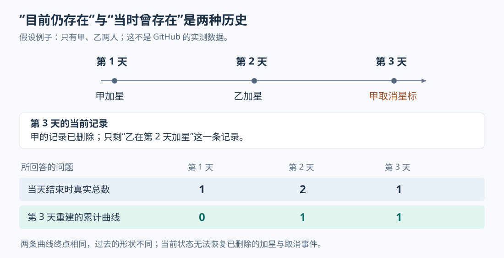
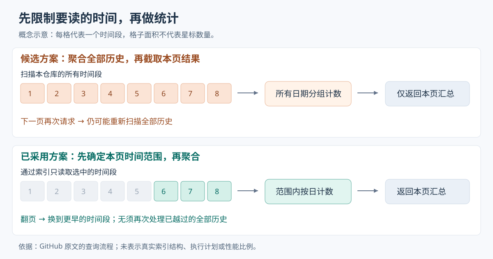

# GitHub 星标历史为何能从约 2,500 次请求降到 24 次

> 来源：[github.blog](<https://github.blog/engineering/architecture-optimization/from-2500-requests-to-24-rebuilding-star-history-without-the-stargazers>)  
> 作者：Taylor Cuilty; Sarita Iyer · 发布时间：2026-10-15 03:11（Asia/Shanghai）  
> 翻译正文：[阅读中文正文](article-zh-CN.md)

想知道一次版本发布有没有带来更多关注，维护者通常只需要一条按日期排列的星标曲线。过去，工具却要分页下载“谁在什么时候加了星”，取出日期，再丢掉用户名。GitHub 的新接口直接返回每日计数，并在统计之前限定查询的时间范围，减少客户端请求和数据库的重复工作。如果你正在开发趋势图、统计报表，或者发现接口只返回几条数据却依然很慢，这个案例值得关注。

不过，“星标历史”有一个容易误读的含义：它统计的是**现在仍保留的星标分别创建于哪一天**，并不完整记录每一天当时的星标总数。理解这个限制，才能正确评价方案的收益和适用范围。

本文以 GitHub 工程文章 [《From 2,500 requests to 24: Rebuilding star history without the stargazers》](https://github.blog/engineering/architecture-optimization/from-2500-requests-to-24-rebuilding-star-history-without-the-stargazers/) 为主体，结合官方接口文档、官方社区答复和数据库文档核验，资料查阅截至 2026 年 10 月 20 日。下文分别标明原文报告、外部补充和分析建议；假设例子不代表真实测量。

## 旧接口为什么让双方都付出了多余成本

GitHub 的星标可以理解为用户对仓库的收藏，也常被用作关注度的近似信号。原来的 API，也就是供程序调用的接口，`GET /repos/{owner}/{repo}/stargazers` 回答的是“哪些人给这个仓库加了星”。调用者指定相应的响应格式后，还能获得每条记录的加星时间。

**原文报告：**工具用这份名单画曲线时，需要遍历当前星标，每页最多取 100 人。原文中约有 25.1 万星的 React 仓库样本，完整读取需要约 2,511 次请求。这让工具更容易碰到调用额度限制，于是有些工具改为抽取部分页面，牺牲曲线的完整性。

服务端还有另一笔开销。原文称，分页实现中的一个缺陷导致每次取一页时，数据库还会重新统计该仓库全部星标，以计算共有多少页。客户端只收到最多 100 条记录，数据库却可能为这一页重复清点大量数据。这个缺陷并不是分页接口必然具有的成本，应当与“下载全部明细才能画图”的接口设计问题分开看待。

名单还带来了与画图无关的数据暴露。GitHub 报告有人批量收集星标用户，用于垃圾信息和钓鱼活动。其 [2026 年 6 月 30 日的变更公告](https://github.blog/changelog/2026-06-30-upcoming-access-restrictions-to-public-api-endpoints-and-ui-views/) 宣布，将相关名单和页面的访问限制到管理员、协作者等有权限的人。原文说明，这也中断了部分只想获得趋势的工具。

这里的产品问题很具体：画趋势需要日期和数量，旧接口却把它们绑在用户身份上。限制名单访问能处理眼前的滥用，但要让正常工具继续工作，还需要为趋势查询提供另一份数据契约，即明确接口返回什么、如何分页、哪些含义不作保证。

## 先弄清楚：这条曲线能回答什么

假设一个全新的仓库只有两位用户：第 1 天甲加星，第 2 天乙加星，第 3 天甲取消星标。那么三天结束时，仓库实际拥有的星标总数依次是 `1、2、1`。

原文说明，GitHub 的这份星标模型保存当前关系；取消星标时，相应记录会被删除。因此，第 3 天查询时只剩下“乙在第 2 天加星”这一条记录。按创建日期统计，三天的数量是 `0、1、0`；从头累加，得到的曲线是 `0、1、1`。



图中两条曲线的终点相同，过去的形状却不同。这不是分组计算出了错，而是当前数据里已经没有甲的记录。GitHub 在[官方社区的 9 月 11 日答复](https://github.com/orgs/community/discussions/206104)中也明确说明：新接口只呈现目前仍有效的星标，不提供取消星标的历史。

**据此可以推断：**同一个过去日期的计数，未来也可能因取消星标而减少。把这些计数累加得到的曲线，在一次完整读取中不会出现负增长，却可能在下一次读取时改变过去的形状。它适合粗略观察关注来自哪些时间段，不能直接解释成每天的净增量，更不能恢复用户何时流失。

如果你要回答“发布后总数有没有下跌”，需要保存每天观察到的总数快照；如果要分别统计新增和取消，则需要完整、可靠地记录这两种事件。快照只能记录观察时刻的状态，无法识别两次观察之间相互抵消的变化。这是数据来源的限制，换一种分页方式无法补回来。

## 真正的优化：先决定要读哪些记录，再分组

确认维护者只需要趋势后，GitHub 先尝试过隐藏用户名，仅返回每条星标的时间。**原文报告：**这个原型容易沿用现有权限和响应处理流程，也能减少身份暴露，但客户端仍须下载和处理大量记录。

下一步自然是让数据库直接统计每日数量。“把同一天的记录放到一组，再计算每组有多少条”，就是分组聚合。但原文中的第二个候选方案依然有问题：先统计所有日期，再从统计结果中取一页。

例如，调用者只要最近一段时间，数据库却先读完该仓库的全部当前星标，把所有日期的计数算出来，最后才执行 `LIMIT` 和 `OFFSET`。前者限定返回多少组，后者跳过前面多少组。返回内容缩小了，前面的统计工作却可能已经做完。下一页请求再次执行同样的查询，又重复处理整段历史。

GitHub 最终采用的办法是**按日历周分页，把页码先转换成时间区间**。原文描述的职责可以拆成三个部分；这是对查询流程的解释，不代表 GitHub 部署了三个独立服务：

1. 接口层接收仓库、`page` 和 `per_page`，计算这一页覆盖的起止时间。
2. 数据库利用时间条件和索引定位记录，只统计区间内的星标。索引是帮助数据库快速定位数据的有序查找结构，避免每次从头检查全部记录。
3. 响应处理把每日数量组织成按周排列的结果，交给画图工具；工具不再接收用户身份。



图中每格只表示一个时间段，不表示记录数。上面的路径在每页请求中重复处理全量记录；下面的路径把“本页需要什么时间”提前变成读取条件。非重叠的页面覆盖完整历史时，理论上每条当前星标只需要参与对应时间段的统计，而不必参与每一页的统计。

**外部补充：**[官方接口文档](https://docs.github.com/en/rest/activity/starring#get-repository-star-history)给出的地址是 `GET /repos/{owner}/{repo}/stargazers/history`。每页默认、最多 30 周，页码最大 100；页面向过去推进，页内周次也从新到旧排列。每周包含 `week`、`total` 和 `days`，其中 `days` 从周日开始记录七天数量，没有星标的周也保留零值。这里的 `total` 是该周汇总，不是仓库累计总数。

“30 周”是每次请求的时间跨度，不是接口只能查看最近 30 周，也不是只返回 30 个日计数。

## 这些数字分别证明了什么

原文提供了请求次数、扫描记录数和线上慢查询情况。这些指标衡量的是不同事情，不能合并成一个“性能提升倍数”。

| 指标 | 原文报告或估算 | 可以据此判断什么 |
| --- | --- | --- |
| 完整获取样本曲线的请求数 | 明细方式约 2,511 次，新接口约 24 次 | 客户端往返次数显著减少；不是单次请求延迟的测量 |
| 先聚合再分页的候选方案 | 24 次请求，每次重新处理约 25.1 万条记录，合计约 600 万条 | 说明重复聚合的工作量；这是候选方案估算，不是旧明细接口完整扫描量的实测 |
| 先按时间筛选的新方案 | 完整读取约处理 25.1 万条记录 | 说明按不重叠时间段读取可避免重复统计；不等于只发生这么多次物理磁盘读取 |
| 限制名单访问前一周 | 近 3.7 万次计数查询进入慢查询日志，平均近 3 秒，超过 1,000 次被数据库保护机制终止 | 说明旧计数路径存在可靠性问题；“近 3 秒”只针对这些慢查询，不能代表全部请求 |
| 限制访问之后 | 星标名单请求约少 60%，计数查询总耗时约少 80% | 反映访问限制后的运行情况，不能单独归功于新历史接口 |

上述数据均来自[原文的工程报告](https://github.blog/engineering/architecture-optimization/from-2500-requests-to-24-rebuilding-star-history-without-the-stargazers/)。原文还称，仓库网页改用缓存中的星标总数后，该页面原本每周数百次的慢计数查询降到了零。这是另一个优化：页面只需要现成总数时，就不要临时重新清点全部关系。

约 2,511 除以 24，意味着样本的请求数减少约两个数量级；它不意味着页面一定快一百倍。原文没有给出足以复现的硬件、完整查询计划、新旧端到端延迟分布或单位请求成本。本次调研也没有访问 GitHub 内部系统，无法独立复现这些生产数据，因而无法据此承诺其他系统的延迟或费用收益。

## 为什么不直接缓存所有每日统计

对于个人和小团队，值得比较的是完成同一需求的几条路径，而不是是否采用更复杂的架构。

| 方案 | 查询和维护成本 | 主要取舍 |
| --- | --- | --- |
| 逐条返回时间，不返回身份 | 服务端改动可能较小；客户端继续遍历大量明细 | 便于兼容旧工具，但请求数随当前星标数增长 |
| 对全部记录实时聚合，再截取结果 | 响应小；原文候选实现反复聚合完整历史 | 开发直观，查询成本容易被很小的响应掩盖；实际表现还取决于执行计划 |
| 按时间筛选后实时聚合 | 需要正确计算日历边界，并有可用索引 | 不必额外维护每日汇总表，但高密度时间段仍可能很贵 |
| 预先维护每日汇总 | 读取汇总表可减少明细扫描；新增存储和更新流程 | 必须处理更新失败、重复处理和统计修正，团队要维护更多状态 |

前三行对应原文讨论的路径；最后一行是分析补充，不是 GitHub 披露的实现。

预先汇总时，首先要定清楚统计含义。如果维护“目前仍有效的星标按创建日分布”，用户今天取消一枚上月的星标，就应修改上月对应日期的汇总。如果维护“今天新增、今天取消”，取消应记到今天。两种表都可能叫每日统计，回答的问题却完全不同。

**分析判断：**直接对当前关系按时间查询，省去了额外汇总数据的维护工作，但不能消除不同请求读到不同状态的问题。预先汇总可以把一部分成本移到数据变化时，代价是处理失败重试、核对汇总与明细是否相符，以及决定更新多久后对读者可见。只有读流量、数据密度或延迟要求已经让实时统计难以承受时，这些额外工作才更可能值得。

这个案例对团队协作也有启示。原文描述的实际过程是先限制访问，再与维护者、工具开发者沟通，最后提供专用接口；期间已有工具受到影响。对小团队，更可取的迁移安排是先列出旧接口的真实用途，让使用方确认哪些字段必需，再明确新旧口径、分页顺序与迁移时间。数据库优化和接口迁移需要共同验收：查询便宜但曲线被误读，仍然没有完成需求。

## 哪些边界仍然会让方案失效

**时间固定，不代表工作量固定。**原文明确承认，一周内若出现极大量星标，查询仍可能缓慢。索引帮助定位这一周，但这一周的记录仍须参与计数。因此，此方案更适合时间分布不过分集中的趋势查询，不能单独保证所有请求都有严格的成本上限。缩小每页周数可以减少普通页面的工作，却未必解决单个极密集周；这时才需要评估预先汇总、缓存或限制查询频率。

**调用次数从“随星标数增长”转为“随历史周数增长”。**这是按周分页的直接结果：活跃度很低的老仓库也会返回许多零值周。官方社区中已有使用方提出这一问题，但其个案数字属于用户自述，并非 GitHub 的基准测试。对只看最近发布效果的工具，优先读取近期范围，通常比每次重建全部历史更合理。[讨论及使用方反馈](https://github.com/orgs/community/discussions/206104)

**日期不能想当然地按本地午夜解释。**官方文档特别说明，周和日的边界不保证对齐协调世界时（UTC）。因此，把返回日期与某个精确发布时刻比较时，不能擅自按 UTC 或北京时间零点划分，再宣称当天的变化全部由发布造成。即使时间完全对齐，星标上涨与发布同时发生，也只能说明时间上的关联，不能单独证明因果。[接口的时间边界说明](https://docs.github.com/en/rest/activity/starring#get-repository-star-history)

**连续翻页不等于获得同一个时刻的快照。**当前星标会变化，文档没有承诺多页读取共享同一份固定数据快照。因此，完整拉取期间出现新增或取消，可能使不同页面对应不同观察时刻；跨日历周的长任务也应检查页面覆盖是否衔接。这是依据接口性质提出的客户端防护建议，不是已经复现的接口故障。

**聚合减少了直接身份暴露，但不是完整的隐私保证。**新响应不再给出“用户—时间”的逐条关系，因而减少了原文所述的名单收集渠道；原文没有给出正式的隐私保护证明，也不能由此推断其他渠道无法关联用户。对趋势工具，最直接的改进仍然是不要采集自己不需要的身份字段。

需要审计级历史、小时级行为、用户流失分析或严格跨页快照的系统，不宜直接把这份接口当作完整事件账本。对于能接受近似关注信号、按日观察并允许结果更新的维护者面板，它才更接近所需工具。

## 个人或小团队怎样做一次最小实践

下面是建议流程，并非本文已经完成的线上测试。可以分别验证“接口能否满足读图需求”和“查询是否真的少做了工作”。

### 先用一个仓库画出口径正确的图

选一个你关心的公开仓库，将 `OWNER` 和 `REPO` 替换为实际值：

```bash
curl --fail-with-body -L \
  -H 'Accept: application/vnd.github+json' \
  -H 'X-GitHub-Api-Version: 2026-03-10' \
  'https://api.github.com/repos/OWNER/REPO/stargazers/history?per_page=30&page=1'
```

公开资源可匿名调用；若使用细粒度令牌，文档列出的仓库权限是元数据只读。示例的路径、版本请求头和参数依据[官方文档](https://docs.github.com/en/rest/activity/starring#get-repository-star-history)，不是实测返回。

先检查每周是否具有七个日计数、日计数之和是否等于周汇总，然后把周从旧到新排列，并保持每周内周日到周六的顺序。需要更早的数据时再取下一页，以返回的 `week` 标识检查重叠和缺口，不要只按“第几页”缓存。

画每日柱状图时，标题写成“当前仍有效星标的创建日期分布”。只有确认取全仓库历史后，才把累加曲线标成该口径的累计图；仅取得近期数据时，累加结果只是该时间段的累计数量，不能冒充仓库从创建至今的总数。尚未结束的当天或本周也应标明数据未完整。

保存抓取时间、页码、每页覆盖范围和原始计数。下次抓取时允许旧日期修订；若想保留每天观察到的总数，另外保存总数快照。不要把两种序列混成一条线，也不要用当前总数强行平移一段不完整的历史来伪装精确结果。

验收时关注三件事：图的标签是否与数据含义相符；日期拼接是否连续且不重复；请求数、失败率和整次更新耗时是否在自己的刷新预算内。若需求必须显示真实历史净增减，这一步就应退出，改用前述快照或可靠事件来源，无须继续优化不适用的数据口径。

### 再在本地验证数据库有没有少读数据

若你维护的是类似的收藏或点赞服务，可以在本地测试库比较两条查询。以下用关系型数据库 MySQL 8.4 的 SQL（用于查询和修改数据库的语言）表达思路，**不是 GitHub 源码，也不代表其生产数据库版本或真实表结构**。假设 `stars` 只保存当前关系，`created_at` 的存储、数据库会话和示例分日方式均采用 UTC；冒号参数由客户端驱动绑定。

先为“仓库编号相同，并且创建时间处于某段范围”准备一个联合索引，也就是按多个字段依次排序的查找结构：

```sql
CREATE INDEX idx_stars_repo_created
ON stars (repository_id, created_at);
```

第一条查询先计算整个仓库每天的数量，再截取部分日期：

```sql
SELECT DATE(created_at) AS day, COUNT(*) AS star_count
FROM stars
WHERE repository_id = :repo_id
GROUP BY DATE(created_at)
ORDER BY day DESC
LIMIT :bucket_count OFFSET :skip_buckets;
```

第二条查询先指定起止时间，只计算这个区间：

```sql
SELECT DATE(created_at) AS day, COUNT(*) AS star_count
FROM stars
WHERE repository_id = :repo_id
  AND created_at >= :start_time
  AND created_at < :end_time
GROUP BY DATE(created_at)
ORDER BY day DESC;
```

这里用“包含起点、不包含终点”的区间：相邻两页共用边界时，位于边界上的记录只归入一页。时间条件直接作用于 `created_at`，让数据库有机会用索引定位范围，而不是先对每条时间做日期转换再筛选。联合索引如何根据等值和范围条件形成查找区间，可以参见 [MySQL 8.4 范围优化文档](https://dev.mysql.com/doc/refman/8.4/en/range-optimization.html)。上述查询都不会自行补出零值日期；日历补零和周响应格式还需要额外处理。

不要只看 SQL 文字的先后顺序。数据库可能重排执行步骤；[MySQL 的 `LIMIT` 优化文档](https://dev.mysql.com/doc/refman/8.4/en/limit-optimization.html)也说明，在特定索引和分组条件下，可以提前停止部分工作。因此，原文的教训不是“所有聚合后的 `LIMIT` 都无效”，而是**不能把返回行数当成扫描行数**。

用 `EXPLAIN ANALYZE` 实际执行测试查询，查看各步骤的耗时、输出行数和循环次数，重点检查扫描节点；该工具的行为见 [MySQL 官方说明](https://dev.mysql.com/doc/refman/8.4/en/explain.html)。准备均匀分布与集中在一个周内两类数据，并在相同时间覆盖范围、相同分组口径下核对结果。对于按当前关系计算的历史，还应验证删除一条记录后，对应旧日期的数量确实减少。

记录扫描节点输出的行数及其循环次数、查询耗时，以及第 95 百分位耗时——即约 95% 请求不会超过的耗时。成功信号是：历史增加但本页时间范围内记录数不变时，范围查询的读取量没有跟着全部历史线性增长；不是仅仅看到响应变短。

如果没有出现范围读取，先检查索引、时间条件和执行计划；如果范围读取已经生效，但最密集时间段仍超过预先约定的延迟或数据库资源预算，就停止把缩短响应当作主要优化，转而评估汇总表或缓存。一个人也可以完成这次验证，不需要先搭建分布式分析平台。值得复用的是这套判断顺序：先确认读者要看什么，再确认现有数据能回答什么，最后检查数据库为了给出答案实际做了多少工作。
