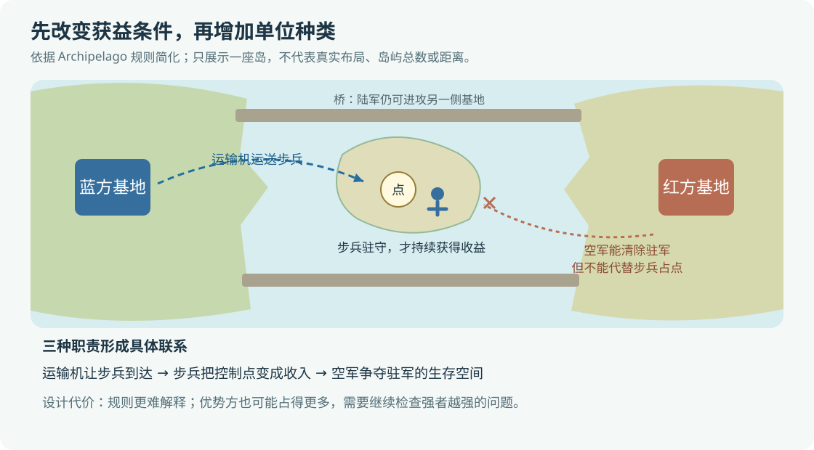
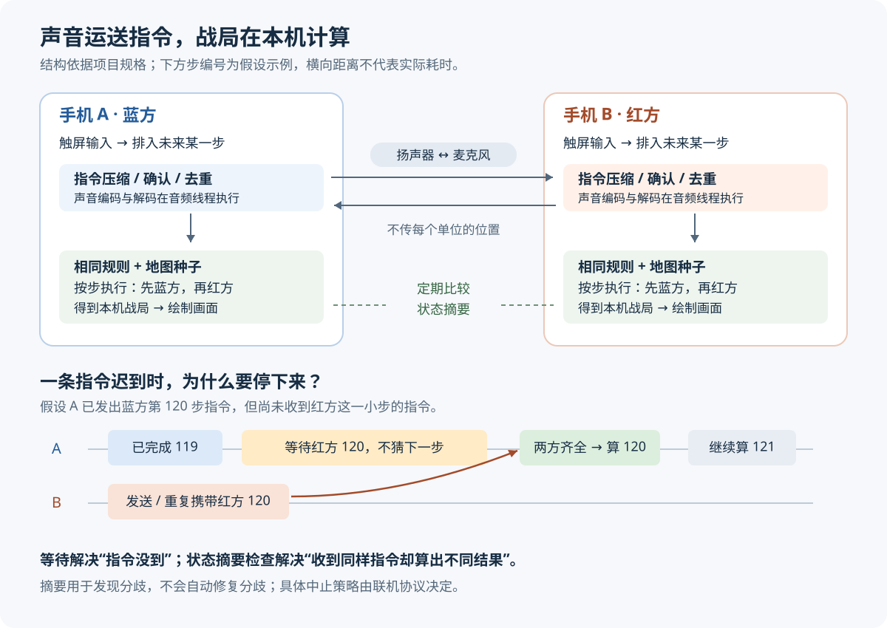

# Battle Drones：怎样把 AI 写出的游戏变得可玩，再用声音连接两台手机

让 AI 写出能造兵、能战斗的游戏，距离让人愿意再玩一局，还有一段距离。让两台手机进入同一场战斗，也通常意味着准备联机服务、处理连接和维护后台。Battle Drones 同时尝试解决这两个问题：用反复试玩与自动化对局改进玩法，再让附近设备通过扬声器和麦克风交换操作，各自在本机计算战局。

这个案例适合独立开发者和小团队关注，尤其是想做浏览器策略游戏、希望减少长期后台维护的人。但它的价值需要分开判断：作者认为游戏变得好玩，是个人体验；自动化对局改善了若干节奏指标，是项目自报结果；声学联机能否覆盖不同手机和真实环境，仍需要更多测试。

本文以 Simon Willison 于 2026 年 10 月 20 日发布的 [《Battle Drones—a vibe coded RTS with audio-based multiplayer》](https://simonwillison.net/2026/Oct/20/battledrones/)为主体，结合项目公开设计文档、浏览器规范和声学通信研究分析。下文明确标注原文陈述、项目文档中的证据，以及据此提出的分析与建议。

## 一、功能增加了，玩家为什么仍然无聊？

Battle Drones 是一款即时战略游戏，简称 RTS：玩家在持续推进的战场上采集资源、建造设施、生产部队并下达命令。原文记录了从二维原型到三维游戏的多轮开发。作者使用的“vibe coding”，在这里指主要通过自然语言让编码代理实现功能，自己很少审阅代码，但持续试玩。

原文中一个重要细节是：更换贴图、增加地图和单位后，作者仍然觉得无聊。直到他要求“让游戏好玩得多”，代理进行了长时间修改和模拟对局，才出现明显的主观改善。这并不能证明一句宽泛提示就能稳定产出好游戏；它首先说明，“像一个游戏”与“提供有意思的选择”是两个不同目标。

群岛地图 Archipelago 更清楚地展示了后一个目标。作者发现，新加入的步兵和 Condor 运输机很少被内置电脑对手使用，因为现有地图没有提供足够的使用理由。于是，他提出一组相互配合的规则：陆地采集资源较少，多个能提供收益的控制点位于岛上；坦克和步兵无法自行抵达，普通飞机又不能占领，必须由运输机把步兵送过去。两侧基地之间仍有桥梁，保留地面进攻路线。

这里的控制点叫 Uplink，可以理解为占领后带来资源等收益的地图目标。项目 [README](https://github.com/simonw/battledrones#readme)进一步说明：群岛上的点只有步兵驻守时才持续付费，空军可以消灭驻军。这让运输、驻守和空中作战形成了具体联系，而不只是增加几个可选单位。

**分析：**这次修改改变了玩家取得收益所需的动作。运输机不再只是“有这个功能”，而成为进入某类竞争的必要工具；步兵不再是送到后就可以忘记的单位，必须活着守点；空军即使不能占点，也能切断对方收入。因此，新增单位进入了玩家真正需要考虑的选择之中。

这同样带来代价。玩家需要理解哪些单位能抵达、哪些能占领、占领后为何还要驻守。占点收入也可能让强者越来越强：已经控制空域的一方，更容易保护自己的步兵并消灭对方驻军。增加冲突地点，并不自动带来公平或翻盘机会。

## 二、“更好玩”的数字，究竟证明了什么？

项目的“趣味更新”不只增加特效和音乐，还修改了战斗持续时间、开局选择、地图目标和电脑对手的行动方式。其[发布说明](https://github.com/simonw/battledrones/blob/main/Battle%20Drones%20The%20Fun%20Update%20%E2%80%94%20Release%20Notes.md)报告了以下结果：

| 指标 | 更新前 | 更新后 | 能支持的判断 |
| --- | --- | --- | --- |
| 到 25 分钟仍未分胜负的对局占比 | 14% | 0.9% | 测试中的长期僵局减少 |
| 已分胜负对局的时长中位数 | 5 分 51 秒 | 8 分 17 秒 | 典型对局更长，同时长尾僵局更少 |
| 获胜方曾落后至少 800 废料价值的比例 | 24% | 46% | 胜者经历明显落后的情况更多 |

最后一项尤其容易误读。它不是“所有落后玩家的翻盘成功率达到 46%”，而是从获胜方回看，有多少曾经落后。两者分母不同，不能互换。25 分钟也只是测试截断时间，不能把“仍未结束”直接当成正式游戏中的和局规则。

项目 [DESIGN.md 的测量口径](https://github.com/simonw/battledrones/blob/main/DESIGN.md#balance--pacing)补充了条件：普通难度、五张地图、不同电脑对手性格的有序配对、八个随机种子，每列 1,200 场；原始版本基线为提交 `187e23a`。这些条件使结果可以进一步追查，但仍有三个限制。

首先，这是同一项目的自报测试，本文没有重新运行。其次，多项规则和电脑策略同时改变，整体前后对比不能说明是哪一个功能产生了多少效果。最后，脚本控制的电脑对手不会像真人一样困惑、厌烦或误触。发布说明在当时甚至明确写着，新版本尚未经过真人试玩；原文后来补上的是作者自己的体验，并非独立用户研究。

**分析：**这些数字能帮助开发者发现“是不是总在同一地点交火”“领先后是不是很难被追上”等问题，不能替代“玩家是否愿意继续玩”。合理的验收需要同时看对局记录和真人行为，而不是把模拟场数当作乐趣证明。

## 三、一套战斗规则，为什么能支撑测试、回放和模型对战？

关键在于把“世界发生了什么”与“画面怎样显示”分开。项目的 [Agent Battles 文档](https://github.com/simonw/battledrones/blob/main/AGENT-BATTLES.md)描述了一个不依赖图形引擎的模拟层：输入当前世界和一组命令，推进一个固定小步，再得到更新后的世界。它每秒推进十步，随机行为由比赛种子决定；种子就是初始化伪随机数序列的值。

这套结构可以写成一个概念公式：

`下一步世界 = 模拟规则（当前世界，本步命令）`

这不是完整源码，也没有包含所有内部处理。它强调的是责任边界：模拟层决定资源、移动和伤害，显示层负责把结果画出来。Three.js 这样的三维绘图库负责呈现战场，并不需要成为规则计算的一部分。

于是，同一套规则可以接受不同来源的命令：人从触屏发令，内置电脑策略按规则发令，回放文件提供过去的命令，语言模型则通过工具读取局面后发令。测试时可以完全不画画面；看回放时再把计算结果交给显示层。

模型对战也有单独的时间安排。文档采用每五秒游戏时间一轮，双方看到同一时刻的局面，提交后一起执行；工具只暴露各自能看到的敌情。“战争迷雾”就是玩家尚未探索、或当前没有视野的区域，其信息由程序过滤，而不是要求模型自觉忽略。它与两台手机的声音联机是两种运行方式，不能把五秒模型回合当作手机联机延迟。

**分析：**对个人项目，先建立这个边界很有用：回放出错、电脑策略异常和联机失步，都能围绕同一组命令重现。对小团队，它还提供了协作约定：负责画面的人可以改镜头和特效，负责规则的人可以改战斗逻辑，双方通过明确的数据交接。但改规则仍可能使旧回放失效，模块分开并不等于版本兼容自动成立。

## 四、声音联机的关键，是尽量少传数据

假设两台手机上有许多坦克，蓝方玩家命令其中一组驶向一座桥。如果不断发送每辆坦克的位置、朝向和血量，部队越多，要传的数据通常越多。另一种做法是只发送“哪些单位，在第几步，前往哪里”，让两边各自计算后续移动与交火。

这种方法叫**确定性锁步**：相同初始状态与相同顺序的输入，必须产生完全相同的结果；执行某一步之前，先等齐这一小步所需的双方输入。它节省带宽的原因，是把大量连续发生的变化留在本机计算。游戏网络开发者 Glenn Fiedler 对[确定性锁步](https://gafferongames.com/post/deterministic_lockstep/)的解释也指出，通信量主要随输入量增长，而不是直接随场景物体数量增长。

按项目 [SOUND-DUEL.md 规格](https://github.com/simonw/battledrones/blob/main/SOUND-DUEL.md)，设备以 100 毫秒为一个模拟小步，给操作安排 3—8 步的预留延迟，配对时选择。这里对应 300—800 毫秒的预留时间，不能等同于完整触屏到执行延迟：操作等待封包、排队和丢包停顿还可能增加时间。

以假设的第 120 步为例，手机 A 即使已经知道蓝方命令，也不能在缺少红方输入时直接往下算。“对方没有下命令”与“对方的命令还没到”不是同一件事。空操作也需要由协议明确表示。为保持画面流畅，可以在已知状态之间补画中间位置；这不会给模拟层增加猜测未来的权力。

可靠传输还要处理重复与丢失。规格采用持续携带尚未获确认的操作，接收方忽略已经接收的回合；容量不足时，指令需要排队或拆分。它没有逐包请求重发的机制，但上层仍会重复发送未确认内容。因此，“没有逐包重传”不等于“丢了就不管”。

这里有一个边界：**等待只能解决输入迟到，不能解决算错。**两台手机收到相同命令，如果本地计算结果不同，继续等不会让世界重新一致。协议需要比较世界状态的摘要，也就是把大量状态压成较短的校验值，用于发现分歧；摘要本身既不是完整状态，也不能自动修复分歧。项目规格规定，发现不一致就终止对局，不计胜负。

## 五、浏览器为什么可能把同一场战斗算成两个结果？

固定时间步和相同随机种子都是必要条件，但还不够。命令执行顺序、数值计算、遍历时的选择顺序以及模拟规则版本，都可能影响结果。

例如，假设一个单位距离攻击范围边缘极近。某次数值计算末位不同，可能让一台设备判断“已进入范围”，另一台判断“还差一点”。第一台提前开火，目标提前死亡，后续锁定目标、路径和资源消耗便可能逐渐不同。这是解释机制的假设例子，不是项目公开的具体故障现场。

原文称，项目曾因不同浏览器的三角函数结果略有差别而导致回放失步。外部规范支持这种风险：[ECMAScript 对 `Math.sin` 的规定](https://tc39.es/ecma262/2025/multipage/numbers-and-dates.html#sec-math.sin)允许实现给出近似结果，并未要求所有引擎对一般输入都输出完全相同的末位。不能由此推导出“JavaScript 的所有浮点运算都不确定”。

项目的[跨浏览器回放说明](https://github.com/simonw/battledrones/blob/main/AGENT-BATTLES.md#watching)称，它为模拟层统一实现了相关数学函数，并禁止该层继续调用部分原生函数。这是项目对修复办法的说明；本次未能读取相关函数源码，也没有复现实验，因而不能进一步认证其全部输入范围或所有浏览器组合。

**建议：**跨浏览器验证应比较每一步的状态摘要，找到最早分歧，而不只是比较最终谁赢。同样，保存回放时要保存规则版本。新版重新执行旧命令可能得到另一场战斗，不能把这种重新计算包装成原比赛的准确记录。

## 六、怎样把操作变成声音，环境又怎样把它破坏？

把数据映射成音频波形、接收后再恢复数据的模块，叫声学调制解调器。浏览器可以用 `getUserMedia()` 取得麦克风音频，用 Web Audio 生成声音，并通过 AudioWorklet 执行自定义音频处理。AudioWorklet 把处理工作放到专门的音频线程，减少页面绘制等主线程任务的直接干扰；它不保证整个手机音频链路没有缓冲和延迟。[MDN：AudioWorklet](https://developer.mozilla.org/en-US/docs/Web/API/AudioWorklet)

项目选择的核心调制方式叫 OFDM，中文为正交频分复用：在一组仔细安排频率间隔的音调上并行承载数据。一般过程是先把操作编码成比特，加入帮助纠正错误的冗余，再映射成声音；接收端分析各频率分量，恢复并检查数据。

为什么不直接用一个音调快速切换？室内声音会经桌面和墙壁反射，同一段声音沿多条路径先后到达，前一段的回声可能覆盖后一段，这叫多径传播。把数据分到多个较慢变化的音调上，可以延长每个声音符号的时间；在符号前加一段复制其尾部的保护区，称为循环前缀，在回声时延没有超出设计范围等条件下，可以减轻符号之间的干扰。保护区越长，有效数据所占时间越少。

纠错也各有职责：纠错码加入规律性的冗余，让接收端有机会恢复被扰乱的比特；交织把相邻数据打散，使一次短促干扰不至于集中毁掉连续内容；循环冗余校验，简称 CRC，用来检测仍可能存在的错误。这类组合也见于华盛顿大学的 [AquaApp 论文](https://underwatermessaging.cs.washington.edu/underwater_comms.pdf)。该论文研究水下通信，这里只用来补充机制，不能移植其距离和速率结论来证明室内手机联机。

两台设备同时收发还会遇到自身声音过强的问题。项目给双方分配不同频带；扬声器失真产生的额外频率，以及游戏自己的音乐和爆炸声，都可能侵入接收区域，所以还需要安排频带间隔、限制音量并过滤游戏音频。高频也不等于人人听不见，或所有设备都能稳定播放。

### 先测真实链路，再讨论速率

原文中值得借鉴的动作，是先制作 [Radio Probe 测量页面](https://simonw.github.io/battledrones/radio-probe.html)，再实现完整联机。声音能录下来，并不意味着能可靠解码；一个方向能通信，也不意味着两台设备同时发送时仍能通信。

项目的[早期研究报告](https://github.com/simonw/battledrones/blob/main/reports/Audio%20modem%20for%20lockstep%20multiplayer.md)建议先采用 500 毫秒通信回合，估算每方向需要约 200—450 比特每秒，并明确标注若干平台行为和延迟尚未测量。后来的联机规格改为前述 100 毫秒模拟小步；默认高频方案规定每包载荷 188 比特，快速模式每包 100 毫秒。

按后者简单相除，得到每秒 1,880 比特的载荷槽位容量。**这是根据规格作的算术推导，不是持续游戏有效吞吐的实测值。**这些槽位还要承载协议字段、确认和重复内容，稳健模式也会更慢。早期报告与后期规格处于不同阶段，不能拼接成一次“实测性能提升”。

外部研究同样要求谨慎。Putz 等人的[声学通信评估](https://arxiv.org/html/2602.02249v1)比较了八种方案，进行了超过一万次手机传输，发现室内反射和设备音频差异会显著影响可靠性。其中 ggwave 的测试配置净速率为 268 比特每秒，但其 Android 播放、录制和离线解码流程，并不是 Battle Drones 的浏览器双向联机测试。它说明真实设备测试不可省略，不能证明本项目达到或达不到某个速率。

## 七、省去游戏服务器，代价转移到了哪里？

下面是基于机制的选型分析，不是这些方案在同一环境下的性能排名。

| 方案 | 实现与运行成本 | 可靠性、性能与适用范围 |
| --- | --- | --- |
| 两台设备通过声音交换命令 | 无需为对局维护网络后台，但要开发和维护音频协议、设备兼容与诊断工具 | 适合近距离、低操作数据量；环境干扰和设备差异可能引起停顿 |
| 浏览器通过 WebRTC 数据通道连接 | 可以直接传数据，但仍需交换连接信息，部分网络需要中继服务 | 可支持远程，数据容量通常更宽裕；需要处理网络连接失败和服务运维 |
| 服务器运行规则并分发结果 | 要承担计算、流量和后台维护，并设计客户端更新方式 | 容易指定可信的比赛结果来源；仍需处理延迟、断线和服务器故障 |

WebRTC 是浏览器之间传输音视频或数据的技术。其[官方连接指南](https://webrtc.org/getting-started/peer-connections)明确说明，双方需要交换连接描述和候选地址，这一步叫信令；不能据此说它必然需要自己经营一台信令服务器，手工交换也是可能的。TURN 则是在无法直接连接等情况下转发数据的中继机制。因此，“声音是静态网页唯一能用的联机方式”并不成立。

现有的 [ggwave](https://github.com/ggerganov/ggwave)使用多频移键控，也就是用不同频率组合表示数据，并加入纠错。它适合作为小数据声学传输的起点。若只是交换配对码，可以先验证这样的现成库；持续运行策略游戏，还要检查消息开销、双向收发和最坏情况下的操作突发，不能只看标称速率。

声音方案减少了游戏后台的运维负担，却增加了客户端工程和硬件测试工作。对小团队，这意味着除了功能开发，还需要有人维护协议约定、浏览器测试组合、失败记录和旧版本回放。编码代理能够生成这些工具，不代表工具已经准确、可维护，或维护成本消失。

## 八、哪些边界必须提前接受？

**更适合的条件**是：两名玩家在同一张桌子附近，指令数据较少，允许操作稍后执行，设备能够稳定同时播放和录音，双方运行一致的模拟规则。偏重布局与资源决策的策略玩法，比依赖即时瞄准的动作玩法更有机会容忍这种延迟。

**不宜直接推广的场景**包括远距离对战、多名玩家同时发声、强噪声环境，以及不能接受短暂停顿的玩法。从两台扩展到多台，需要重新解决谁在什么时候、哪个频带发送，而不是简单增加几个连接。完全由客户端计算全部战局，也不能靠界面上的战争迷雾实现可信的竞技防作弊。

浏览器平台还有两个独立前提。其一，[麦克风访问](https://developer.mozilla.org/en-US/docs/Web/API/MediaDevices/getUserMedia)需要安全上下文和用户授权，正式网页通常应通过 HTTPS 提供；手机访问电脑的普通局域网 HTTP 地址，不能当作 `localhost` 的等价情况。其二，切后台、来电或耳机连接都可能改变音频链路，需要验证恢复行为。

“静态网页”也不意味着首次访问后必然能完整离线运行。渐进式网页应用，简称 PWA，可以通过 Service Worker——浏览器在页面之外运行的脚本——预先缓存资源，再拦截请求从缓存返回。地图、图像、联机延迟加载模块和音频处理脚本都必须可离线取得；仅缓存了首页不够。[MDN：离线与后台运行](https://developer.mozilla.org/en-US/docs/Web/Progressive_web_apps/Guides/Offline_and_background_operation)

作者说自己已经在若干苹果设备和电脑间试用成功，但联机规格仍保留真实手机发送、同时收发隔离、切后台和离线等待验证项。两者可以同时为真：成功试玩说明方案有可行性，文档未关闭的验证项说明覆盖范围尚不充分。本文没有跨设备实测，也没有独立的成功率、耗电或持续延迟数据。

## 九、个人或小团队怎样做最小尝试？

下面是建议性的验证路线，不是项目已经采用的验收标准。目标应先缩到“一张地图、两台设备、少量单位、能重放完整对局”，暂缓美术升级、模型排行榜和复杂成长系统。

1. **先确认选择有意义。**选一个实际问题，例如“运输机从未被使用”，一次只改一个主要规则。请少量目标玩家试玩，记录首次理解规则的时间、误操作、放弃原因和是否愿意再来一局，同时观察单位使用率与对局时长。若使用率上升只是因为被强制操作，而玩家仍说不清选择的意义，就修改规则，不继续堆功能。

2. **先在本机证明可以重放。**固定规则版本、地图种子和命令顺序，记录一场小规模对局，在准备支持的浏览器中比较逐步状态摘要。正确性底线是这些记录不出现摘要分歧。若仍有分歧，就先定位最早出错的一步，暂缓接入声音；更好的通信链路无法修复规则计算差异。

3. **只测两台目标设备的链路。**先在预期摆放距离下分别测试单向和同时收发，再加入游戏声音与连续点击。记录消息到达率、最长连续丢失时间、往返时间，以及音量、朝向、浏览器和系统版本。只在目标机型组合下作结论；若必须保持难以接受的姿势或音量才可靠，就改用声音配对后走网络，或停止声学方案。

4. **最后让人在真实联机中玩。**记录从触屏到执行的延迟中位数和第 95 百分位、操作队列最长等待时间、停顿时长占比，以及切后台后的恢复结果。第 95 百分位表示 95% 的测量值不超过它，有助于看见平均数掩盖的慢操作。先让玩家在本地人为延迟下确定可接受范围，再把它当作目标；如果声音联机持续超出这个范围，应降低操作负担、改传输方式或结束试验，而不是无限增加缓冲。

这套顺序把失败限制在较小范围：先确定玩法有价值，再确定规则可重现，再确定设备链路可靠，最后判断整场体验。Battle Drones 提供了一个值得尝试的组合，但可迁移的经验，是让工具和测量回答具体问题，并为每个成功结论保留它成立的条件。

## 资料与核验范围

本文调研日期为 2026 年 10 月 21 日。原文依据所提供的 `input/article.md` 存档，保留[原文链接](https://simonwillison.net/2026/Oct/20/battledrones/)；该页面本次未能重新抓取。项目证据主要来自实际查阅的 README、玩法设计、更新说明、模型对战说明、声学研究报告和联机规格，文中均就近链接。仓库资料取自本次可访问的 `main` 文档，不能保证与原文发布瞬间或 `v12` 标签逐项一致。

外部核验使用了 ECMAScript 规范、MDN、WebRTC 官方指南、ggwave 项目说明，以及声学通信论文。文中项目效果数字均保留自报属性；本次未运行游戏基准、未逐行审计源码，也未完成两台真实手机的联机复现。图为依据文档整理的机制示意，不是产品截图或测量结果。
