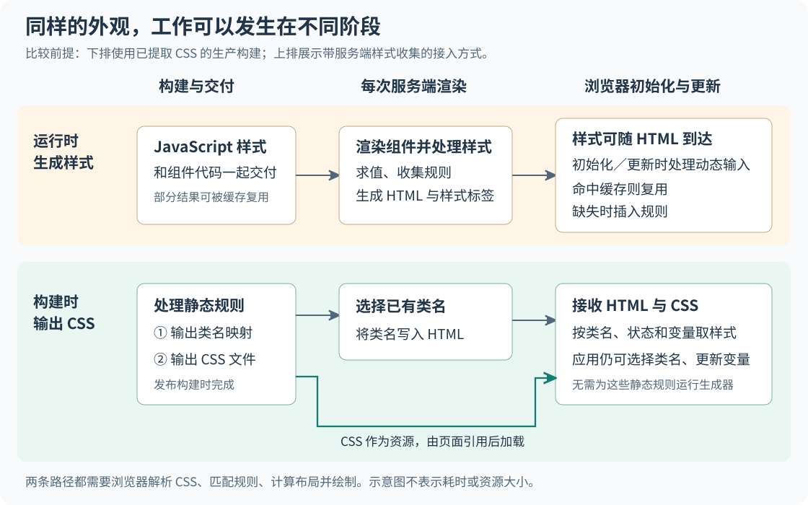
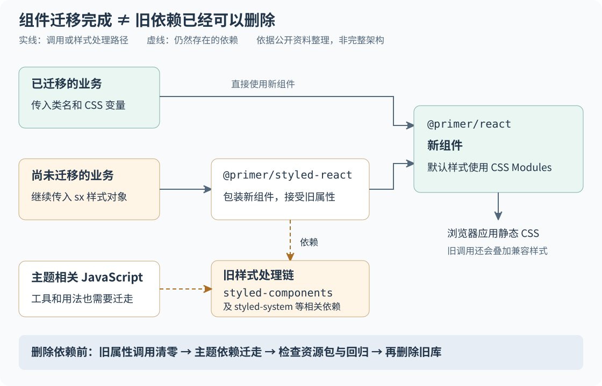

# GitHub 为什么把样式从 JavaScript 搬回 CSS

页面里只有几个按钮时，临时计算它们的样式通常不显眼；当列表、工具栏和弹窗包含大量组件时，同一类计算就可能拖慢页面生成和交互。GitHub 的做法是把可以提前确定的样式放进 CSS 文件，在构建应用时处理好，让页面运行时主要选择类名和更新变量。如果你的应用也大量使用动态样式对象，并且已经测到相关开销，这次迁移值得研究。

本文以 GitHub 于 2026 年 9 月 25 日发布的 [《Improving site performance by shipping more CSS》](https://github.blog/engineering/architecture-optimization/improving-site-performance-by-shipping-more-css/) 为主体。原文介绍了 github.com 把样式生成从页面运行时移到应用构建阶段的过程；本文用公开决策记录、库文档和源码核验机制。下文明确标为“原文报告”的结果属于 GitHub 自述，“外部补充”说明公开资料能证实什么，“分析与建议”则给出有条件的判断，不视为独立实测。

## 一个列表，为什么会把样式计算放大

假设一个任务列表有数百行，每行包含状态标签、操作按钮和一个可展开区域。开发者通过 `sx` 属性传入对象，指定间距、颜色，以及选中时的背景。这里的 `sx` 是 Primer 组件接受的一种样式定制接口，不是浏览器原生属性。Primer 是 GitHub 的设计系统：它把按钮等通用组件、颜色和间距规则集中维护，供业务页面复用。

这种写法很方便：业务逻辑和外观写在一起，编辑器还能检查许多属性和取值。但当用户全选列表或切换展示模式时，大量组件可能重新渲染，样式系统也要处理新的输入。**组件最后长得一样，不代表生成这个外观的过程没有成本。**

原文中的旧方案属于 CSS-in-JS，即在 JavaScript 中描述样式的做法；它使用的 `styled-components` 会在应用运行时处理样式。`styled-system` 则帮助把间距、颜色等属性转换成样式规则。需要特别区分：CSS-in-JS 是一类写法，其中也有在构建时输出 CSS 的工具；GitHub 这次解决的是其既有运行时实现的成本，不能据此认定所有使用 JavaScript 编写样式的方案都有相同问题。

原文报告的压力来自三个地方：客户端初始化样式、服务端渲染时收集样式，以及组件增多后的样式更新。服务端渲染，简称 SSR，是服务器先把组件生成 HTML，再交给浏览器显示的过程。把样式提前放到服务器计算，可以改善首次显示，却也让服务器承担了相应工作；计算并没有凭空消失。

## CSS Modules 把哪些工作提前做了

CSS Modules 是一种由构建工具处理的样式组织方式：开发者在独立文件中写 CSS，类名默认只在当前模块内使用，工具再把这些名称转换成页面实际使用的名称。例如，源文件里的 `.row` 可以被转换为 `.TaskRow_row_a1b2`，组件通过导入对象取得对应字符串。这个具体名称只是示意，实际格式取决于配置。[CSS Modules 官方说明](https://github.com/css-modules/css-modules)确认了局部命名和名称映射机制。

它同时解决两个需求：不同组件可以各自使用 `.row`，减少重名冲突；样式仍能和组件放在相邻文件中，便于一起维护。浏览器收到的最终仍是普通类名和 CSS 规则，不需要理解源文件中的模块约定。

在正确提取 CSS 的生产构建中，主要步骤如下：

1. 构建工具读取组件及其 CSS 文件，转换局部类名，生成名称映射，并输出样式资源。
2. 服务器渲染组件时，把选定类名写进 HTML，不再为这些静态规则逐个求值和收集样式。
3. 浏览器通过页面中的样式引用取得 CSS，再按类名、元素状态和变量值确定外观。组件状态变化时，应用可以切换已有类名，而不必重新生成整段规则。



图中比较的是工作发生的位置，不表示耗时比例，也没有省略浏览器必做的样式计算。旧方案可以随 HTML 发送已经生成的样式；新方案也仍可能由 JavaScript 选择类名、控制主题或更新变量。

**外部补充：旧库也有缓存，不能把成本解释成“每次都插入全部 CSS”。** 在 [`styled-components` v5.3.11 的 `ComponentStyle` 源码](https://github.com/styled-components/styled-components/blob/v5.3.11/packages/styled-components/src/models/ComponentStyle.js)中，`generateAndInjectStyles` 会区分静态与动态路径。动态路径展开规则、计算用于标识结果的哈希值，再检查相应规则是否已经存在；已有结果会复用，缺失时才插入。静态路径还有专门的缓存。因此，相同外观不一定生成重复规则，但动态输入仍可能触发求值和查找。这里用固定版本解释实现机制，原文没有披露 GitHub 全程使用的精确版本，不能把它当作生产版本证明。

SSR 也需要准确理解。[`styled-components` 的服务端文档](https://styled-components.com/docs/advanced#server-side-rendering)展示了在渲染期间用 `ServerStyleSheet` 收集规则、再输出样式标签的方法。它能够让浏览器先得到样式，并非必然要等客户端 JavaScript 执行后才有外观；与此同时，服务端仍要完成收集。是否需要额外渲染轮次取决于具体接入方式，不能把某个应用的实现推广为库的必然要求。

### “没有样式运行库”仍然有运行成本

CSS Modules 主要取消的是为这些规则在运行时生成 CSS 的工作。浏览器仍要下载和解析 CSS、判断哪些规则适用、计算尺寸位置并绘制页面。局部类名也不会阻止全局规则、继承或覆盖顺序影响结果：同一个元素上有多条规则时，浏览器仍要决定哪条生效。

此外，文件名改成 `.module.css` 并不自动保证资源加载方式正确。开发环境可能为了即时更新而用 JavaScript 注入样式；生产环境则应检查是否提取了 CSS、首次加载是否及时引用了它。[Vite 的官方说明](https://vite.dev/guide/features#css-modules)介绍了模块导入，其[构建优化说明](https://vite.dev/guide/features#css-code-splitting)则说明了异步模块对应 CSS 的提取和加载安排。这是可参考的工具行为，不代表 GitHub 使用了同样的构建配置。

文章标题里的“发送更多 CSS”也不应理解为增加 CSS 就能提速。关键是用预先生成的规则替代部分运行时工作。原文没有给出迁移前后 CSS、JavaScript 以及总传输字节的完整对照，无法判断资源究竟增减多少。根据 [web.dev 对浏览器关键渲染路径的说明](https://web.dev/learn/performance/understanding-the-critical-path)，页面顶部的关键样式可能阻塞首次显示；如果把所有页面的规则都塞进一个大文件，网络等待和解析成本可能抵消计算上的收益。

## 为什么组件改完，迁移还没结束

GitHub 面临的约束是：通用组件要改，业务页面却不能被迫同时重写。设计系统提供了一个集中修改底层实现的入口，但它的使用者也长期依赖原有定制接口。

原文的第一步是逐个迁移 Primer 组件：建立 CSS Modules 文件，用功能开关选择新旧样式，比较视觉回归测试，再从团队成员扩大到员工和普通用户。功能开关是在发布代码后仍能选择启用哪条实现的控制项；视觉回归测试则把修改前后的界面截图作比较，用来发现意外外观变化。

这里真正需要保持的是使用契约：按钮怎样接收参数、业务样式怎样覆盖默认样式、主题怎样生效。只要这些仍然成立，底层实现可以逐步替换；如果删除了业务仍在传入的属性，组件自身测试通过也无法保证调用方正常。

### 用兼容层允许两类调用者并存

GitHub 建立了 `@primer/styled-react`，给新的 `@primer/react` 组件再包一层，让尚未迁移的业务继续传入 `sx`。已完成迁移的业务则直接使用新组件。

这不是只在博客中出现的描述。[兼容包的公开 README](https://github.com/primer/react/blob/main/packages/styled-react/README.md)明确说明：包中组件包装对应的 Primer 组件，继续支持 `sx` 和 `styled-system` 属性；它是临时桥接包，组件会在相应旧用法归零后移除，次版本也可能包含破坏性变化。公开的 [ActionList 迁移任务](https://github.com/primer/react/issues/6774)还列出了删除类型、测试和旧辅助组件，并在需要时添加适配器、修改下游导入的步骤。



图中实线表示调用或样式处理路径，虚线表示仍需清理的依赖；这是依据原文和兼容包文档整理的关系示意，不是 GitHub 完整架构。

**分析：兼容层让收益可以先发生，也让旧成本继续存在。** 通用组件已经使用静态规则，但业务若仍传入动态样式，就还需要旧处理链。若新旧两条路径都进入页面资源包，依赖体积也未必立即下降。因此，“组件改用 CSS”和“整个产品可以删除旧库”是两个完成条件。

团队协作的代价也很具体：过渡期间要维护两种导入方式、两条测试路径，并知道哪些业务仍依赖兼容层。小团队可以在同一仓库保留一个临时适配器，无需照搬独立发布包；但应给它指定维护者，并记录剩余调用，避免临时接口成为永久入口。

### 主题不是把几个颜色值搬过去

当 `sx` 用法清零后，原文仍发现主题相关的 JavaScript 用法和工具依赖 `styled-components`。颜色值早已在 CSS 中，并不代表所有读取、传递和切换主题的代码都能删除。

外部资料说明了新的基础机制。[Primer Primitives 文档](https://primer.style/product/primitives/)把颜色、间距等统一取值称为设计令牌，并提供为 CSS 自定义属性，也就是可由规则定义、继承和读取的变量。比如组件使用 `color: var(--fgColor-default)`；浅色和深色主题分别给这个变量赋值。页面通过 `data-color-mode` 等属性选择主题规则，组件就可以保持同一条颜色声明。

这样，浏览器会根据当前主题规则取值，不必由每个组件重新生成颜色规则。但浏览器仍需重新计算受影响的样式；应用也可能需要 JavaScript 保存用户偏好和设置主题属性。对于脱离原容器挂到页面其他位置的弹窗，还要检查它是否仍能继承正确变量。这是从变量继承机制推导出的验证要求，不是原文披露的具体故障。

原文把 2024 年底的 Primer 组件迁移、2025 年末为新主题方式做准备，以及 2026 年 6 月完成全站迁移分别叙述。理解这些时间点时，应区分样式实现、业务接口和主题依赖的完成范围，不把第一个里程碑当成全部依赖已经移除。

## 性能数据说明了什么，哪些仍然未知

下面列出能追溯的主要数据。它们来自 GitHub 团队的博客或决策记录，不是本文复现，也不是不同方案在相同环境下的排名。

| 来源与阶段 | 公开结果 | 可以支持的判断 | 缺失的信息 |
| --- | --- | --- | --- |
| 原文：Primer 组件迁移 | 服务端页面渲染耗时减少 55% | 该阶段报告了明显的服务端收益 | 具体页面、绝对耗时、样本量、快慢请求分布和实验控制 |
| 原文：同一阶段 | 页面组件初始化耗时减少 25% | 客户端初始化也可能受益 | 初始化的计时边界、设备和浏览器条件 |
| 原文：业务 `sx` 迁移 | 部分页面 SSR 耗时改善约 1%—22% | 不同页面收益差异很大 | 各页面完整基线、流量结构、同期变更 |
| [Primer 的样式决策记录](https://github.com/primer/react/blob/main/contributor-docs/adrs/adr-016-css.md)：实验室场景 | 1,000 个组件，运行时注入为 242 毫秒，静态 CSS 为 96 毫秒 | 在该实验中，样式处理方式确实影响渲染时间 | 完整复现程序、软硬件环境及版本组合 |

55% 的 SSR 耗时下降不等于用户看到页面的总时间减少 55%。用户还可能在等网络、数据、图片和其他脚本。几个百分比来自不同阶段、页面和计时对象，也不能相加。公开决策记录提供了额外线索，但仍来自同一组织，不能当成独立第三方验证。原文也没有提供服务器用量或账单，无法把耗时下降直接换算成节省多少费用。

原文还报告，早期有 8 名工程师轮换工作，六个月迁移了 6,419 处属性；后期两名工程师借助 Copilot 编码代理，用三周把剩余 895 处降为零。这能说明自动修改工具参与了工作，不能据此计算 AI 带来的生产率倍数：前后任务难度、已有工具、工作投入和验收成本都不相同，也没有对照组。迁移计数是进度证据，不是质量或效率的完整测量。

原文称迁移最终成功，同时提到主题阶段出现过一些波折，却未给出故障清单、回滚次数或可用性统计。因此，可以学习其分批发布和及时修复的方法，无法据此证明过程里没有任何回归。

## 怎样比较替代方案与迁移代价

以下是结合公开机制作出的分析，不是统一基准。比较重点是样式在哪里计算、团队需要承担什么工作。表中的 TypeScript 是为 JavaScript 增加类型检查的语言，可以帮助编辑器发现属性和取值错误。

| 方案 | 运行与性能特点 | 可靠性、成本与协作取舍 |
| --- | --- | --- |
| 保留运行时方案，先优化热点 | 继续承担部分求值、缓存和样式收集；可减少高频变化值生成的新规则 | 改动小，保留现有接口和类型提示；团队仍需维护 SSR 接入和运行库，能优化多少要实测 |
| CSS Modules 加 CSS 变量 | 可预先输出静态规则，运行时选择类名、更新变量；仍承担 CSS 下载和浏览器计算 | 编写接近最终 CSS，容易检查产物；需要约定变量、覆盖方式和资源加载，对现有接口做迁移 |
| 在 TypeScript 中编写、构建时输出 CSS | 同样可以避免运行时生成静态规则；不能仅凭写法预测传输体积和速度 | 保留更多类型约束，但增加编译集成与工具规则，需要团队理解源码到产物的转换 |

第三种不是假想方案。[vanilla-extract 的官方说明](https://vanilla-extract.style/)展示了在 TypeScript 中编写局部样式、变量和主题，并在构建时生成 CSS 的方式。Primer 的公开决策记录也考虑过这类路线，但为了让编写的样式和交付产物更接近、便于控制输出，选择直接写 CSS。这属于团队偏好与维护策略，不能解读为编译式方案在性能上已经落败。

如果暂不迁移，仍有局部优化空间。比如一个颜色选择器不断产生新颜色，已有运行库也可以使用固定 CSS 规则加变量传值，减少新规则数量。[`styled-components` 的性能文档](https://styled-components.com/docs/advanced#performance)就建议对频繁变化的值采用这种方式。应先用性能分析确定热点，再决定是否值得承担全量替换的成本。

迁移后也会产生新的约束。以前一个样式对象可以组合任意条件；改为 CSS 后，要区分有限状态和连续值：选中、禁用等有限状态适合类名或 `data-*` 属性，进度和坐标等连续值适合变量。若把任意组合全部预生成成类，规则数量可能膨胀；若把所有逻辑改成难以理解的选择器，维护成本也会增加。

组件定制尤其需要约定。`className` 让调用方传入外部类名，但不保证它的规则一定覆盖组件默认值。团队还需控制选择器优先级和加载顺序，并为常见需求提供稳定的组件参数。否则，删除 `sx` 只是把定制成本转移成更复杂的 CSS 覆盖。

库的维护状态可以纳入依赖评估，但不宜代替性能证据。原文链接的[维护者公告](https://opencollective.com/styled-components/updates/thank-you)证实，`styled-components` 在 2025 年宣布进入维护模式，并表示继续提供修复。这个历史背景不等于库已经不可用；选型时仍应检查实际采用版本及当前支持情况。

## 什么情况下值得迁移，什么情况下先停下来

**分析与建议：更值得尝试的前提**是大量页面复用同一批组件，而且大部分外观可以提前描述。若性能记录已经显示动态样式处理占用可观时间，迁移通用组件就有机会让多个页面受益。团队还需要能控制构建配置、定义主题变量，并负责组件和业务调用方之间的兼容。

组件多只是线索，没有一个公开验证过的数量门槛。少量组件也可能包含昂贵逻辑，大量静态组件也可能已经运行良好；应看实际时间分布，而不是达到某个组件数就重写。

以下情况应先缩小目标或保留现状：

- 性能瓶颈主要在接口、图片或列表渲染本身，样式处理只占很小一部分。此时全面迁移可能只有很低收益。
- 样式大量依赖运行时输入，并且难以用有限状态和变量表达。强行静态化容易生成过多规则，或引入复杂适配层。
- 团队无法可靠提取、引用和部署 CSS。HTML 已上线、对应样式却缺失时，计算更快也无法保证页面正确显示。
- 没有人负责主题、覆盖契约和兼容层退出。过渡期两套方案会长期并存，维护负担可能大于收益。

规模小并不是不能采用 CSS Modules，而是不应为了复制大公司的结果，启动超过自身维护能力的迁移。

## 小团队可以完成的一次最小试验

以下步骤是实践建议，不是 GitHub 的原样流程。选择一个真实页面和其中一类重复组件即可，暂时保留其他部分。

### 先记录基线，再搬一类样式

固定页面数据、依赖版本、浏览器和设备条件，用生产构建记录首次打开、重复打开，以及一次会批量更新组件的操作。区分首次下载和缓存命中，避免把缓存差异误判为样式方案收益。如果应用有 SSR，单独计时服务器生成 HTML 的过程；纯客户端应用则不需要为试验引入 SSR。

接着，把目标组件的样式分成三类：固定规则、有限状态、连续变化值。固定规则写进模块文件，有限状态选择类名或属性，连续值留给 CSS 变量。迁移时保持元素结构和业务行为尽量不变，才能更容易判断外观与性能变化来自哪里。

一个容易漏掉的问题是数值语义。[Primer 的迁移表](https://primer.style/product/primitives/migrating/)说明，旧 `sx` 中用于堆叠容器内边距的 `p: 2` 对应 8 像素，而非 2 像素。机械地把对象改写成 `padding: 2px`，语法正确，外观却错了。颜色名、响应式取值和主题函数也必须按原规则转换，不能只替换标点。

### 一个自拟的最小写法

下面不是 GitHub 源码，而是展示“状态选规则、数值进变量”的简化例子。它假设项目已支持 CSS Modules，并已在入口加载所用 Primer 变量。

```css
/* TaskRow.module.css */
.row {
  padding: var(--base-size-8);
  color: var(--fgColor-default);
  background-color: var(--bgColor-default);
}

.row[data-selected="true"] {
  background-color: var(--bgColor-accent-muted);
}

.progress {
  width: var(--progress);
  height: 4px;
  background-color: currentColor;
}
```

```jsx
// TaskRow.jsx
import styles from './TaskRow.module.css'

export function TaskRow({selected, progress, children}) {
  const safeProgress = Number.isFinite(progress)
    ? Math.max(0, Math.min(100, progress))
    : 0

  return (
    <div className={styles.row} data-selected={selected ? 'true' : 'false'}>
      {children}
      <div
        className={styles.progress}
        style={{'--progress': `${safeProgress}%`}}
        aria-hidden="true"
      />
    </div>
  )
}
```

选中状态改变时，组件更新属性，由浏览器选择已有规则；进度改变时，只更新变量值。示例把数值限制在有效范围，但它只是装饰条，假设可见文字已经提供进度信息；真正承担信息表达的进度组件还应提供相应可访问性语义。CSS 变量也没有免除布局成本：持续改变宽度仍可能触发布局，不能把“没生成新规则”当成“没有更新开销”。

### 用结果决定继续还是退出

对这一小批组件，至少检查下面几项。无需先建设全公司的迁移平台。

| 检查项 | 实际要验证的问题 |
| --- | --- |
| 外观与交互 | 明暗主题、项目支持的高对比度模式、窄屏、悬停、键盘焦点和禁用状态是否符合原有要求 |
| 性能 | SSR 耗时（若有）、客户端样式处理时间和指定交互耗时，是否在多次测量中稳定改善 |
| 用户感受 | 最大内容绘制时间（LCP，衡量主要内容何时显示）是否退步；点击或键盘操作后的响应是否变差 |
| 交付资源 | CSS 与 JavaScript 的压缩传输字节、未用 CSS、样式到达时间，以及首次与缓存加载差异 |
| 迁移完成度 | 目标范围是否还有 `sx`、兼容包导入或旧主题依赖，旧运行库是否仍进入该页面资源包 |

先由团队根据现有波动和业务要求写下可接受范围，不套用 GitHub 的百分比。若外观持续回归、关键内容更晚显示，或多次测量仍无法区分收益与噪声，就停止扩大迁移；保留小范围成果或回到旧路径，再定位真正瓶颈。如果临时兼容层没有维护者和明确的退出范围，也应暂停扩张。

通过试验后再逐批扩大，每批都保留可恢复的旧路径。SSR 页面要让服务端和客户端选择一致，避免服务器生成的结构与客户端接管预期不一致。最终删除依赖前，同时检查业务调用、组件内部、主题工具和构建产物，不能只搜索一种属性名。

GitHub 案例最有用的经验，是把可预先确定的样式提前处理，并允许使用者分批迁移。对于个人和小团队，合理的下一步是选一个确有样式开销的页面，验证静态规则、状态和变量能否覆盖需求，再按真实收益决定是否继续。
