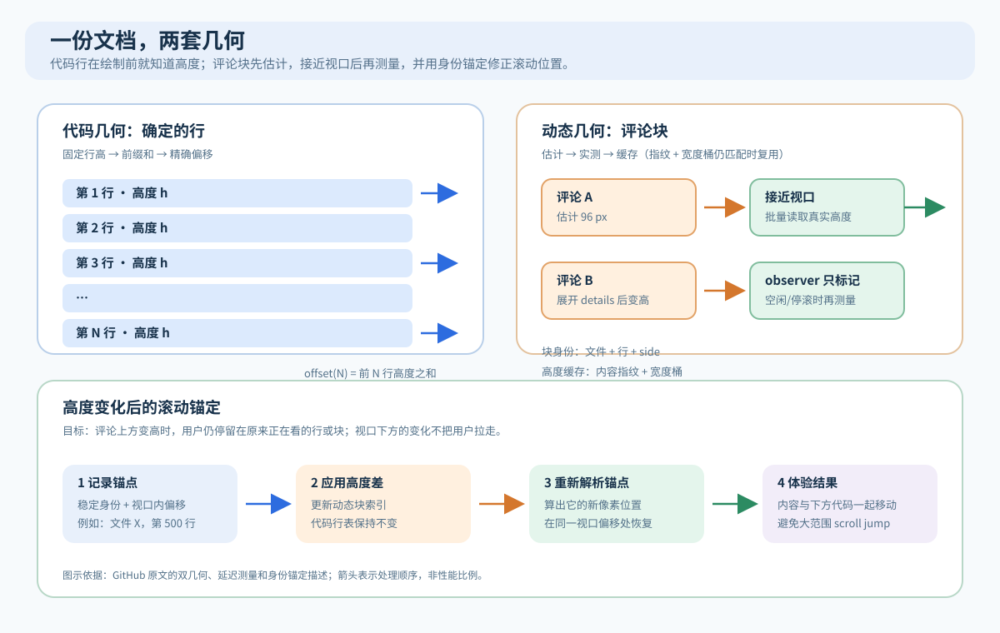

# 让百万行 Pull Request 仍能顺畅滚动：GitHub Copilot 如何处理可变高度评论

> 来源：[github.blog](<https://github.blog/engineering/user-experience/rendering-huge-pull-requests-in-the-github-copilot-app>)  
> 作者：Alberto Gimeno · 发布时间：2026-09-24 02:29（Asia/Shanghai）  
> 翻译正文：[阅读中文正文](article-zh-CN.md)

大型重构或迁移有时必须作为一次变更提交，Pull Request（PR，代码合并请求）就会变成几千个文件、上百万行差异。代码行本身容易虚拟化：屏幕上只保留附近的一小段 DOM（浏览器文档节点），远处的行只用高度和偏移量表示。真正棘手的是评论线程——Markdown 换行、图片加载、`<details>` 展开和回复编辑框都会改变高度，而且这些变化只能在渲染后知道。

[GitHub 的原文](https://github.blog/engineering/user-experience/rendering-huge-pull-requests-in-the-github-copilot-app)给出的做法是把代码行和评论块放进两套几何索引：代码行继续使用预先可计算的精确高度，评论使用估计值、按需测量和缓存；测量结果变化时，按用户正在看的行或评论重新定位视口。与此同时，数据管线先发送文件结构，重活延后到接近视口时做，并用自动化探针验证滚动过程中的不变量。

这是一篇产品内部实现的工程记录，不是跨浏览器基准测试。原文称其测试对象有 2,200 个文件、超过一百万行改动和 400 多条行内评论，但没有公开完整设备、浏览器版本、耗时或帧率数据。因此，下面会把原文事实、浏览器平台证据、分析推断和可执行建议分开写。若你的系统同时有“海量固定行”和“少量但高度不确定的动态块”，这套思路尤其值得关注。

## 先看一个具体场景：为什么代码行能快，评论却会把它打破

假设一个 PR 有 100,000 行改动，视口一次只能看到约 100 行。最直接的实现是把 100,000 行全部变成 DOM；浏览器需要为它们做布局、绘制和事件管理，内存和更新成本都会随总行数增长。列表虚拟化（virtualization，也叫 windowing）只挂载视口附近的行，滚动时回收旧节点、换成新行。用户仍能看到正确的滚动条和“跳到第 N 行”，因为未挂载的部分由高度表和偏移量代表。[web.dev 对 `react-window` 的说明](https://web.dev/articles/virtualize-long-lists-react-window)也把这种做法定义为只渲染可见项并回收离开窗口的节点。

代码行高度固定时，偏移量可以在首次绘制前一次算完。若每行高度为 `h`，第 `N` 行顶部的位置就是 `N × h`；有不同类型行时，也可以对高度数组做前缀和。原文的实现进一步使用命令式（直接复用 DOM 节点，而不是为每行创建一个 React 组件）的行渲染器、类型化数组保存几何数据，并让后端按“结构先于内容”的顺序流式传输差异文档。这些是原文披露的实现细节，不代表所有虚拟列表都必须这样写。

现在在第 50,000 行旁插入一条评论。评论可能只有一行，也可能包含折叠详情、长代码建议、图片和正在输入的回复。你若为每条评论预留固定高度，会遇到两种错误：预留太多，代码之间出现大片空白；预留太少，评论被截断或出现嵌套滚动条。若等评论真正渲染后把高度写回唯一的全局偏移表，评论上方的任何变化都会推动下面所有内容，用户正在滚动时就会看到视口跳动。

这不是“虚拟化失效”，而是原来的几何契约失效了：代码行满足“绘制前知道全部高度”，评论不满足。

## 两套几何索引：把确定的部分和不确定的部分分开

原文采用的总高度可以写成：

```text
总高度 = 精确的代码高度
       + 所有动态块的有效高度之和
       + 滚动内边距
```

“代码几何”只处理代码行。它的高度已知、前缀和精确，评论变高时不需要重建整张代码行表。“动态块几何”处理评论线程、草稿和回复编辑器等内容。每个块有自己的稳定身份，而不是依赖当前的像素位置：身份包含文件、行号和左右侧（side）等锚点，内容异步到达后仍能找到原来的块。

每个动态块还保存一个指纹（fingerprint），记录会影响高度的内容状态，例如评论正文、`<details>` 是否展开、回复框是否存在；同时记录上次测量时的宽度桶。宽度桶是把连续的窗口宽度划成几个区间，避免普通的几像素窗口变化使整份文档的所有缓存同时失效。一个块的有效高度按以下顺序取得：当前指纹和宽度仍匹配的实测高度、可复用的缓存高度、最后才是估计高度。



读图时先看上方两条路径：代码行直接由固定高度得到偏移，评论块先用估计值占位。评论接近视口后进入测量队列，结果写入自己的索引；下方的锚定步骤把用户正在看的对象重新放回原来的视口位置。这样，评论的变化不会迫使代码行几何跟着重算。

这个拆分还控制了工作量的增长方式。动态块的数量由评论数量决定，而不是由代码行数量决定；几千个评论块可能可管理，前提是首次绘制不挂载、不测量全部块。这里的“可管理”是设计判断，不是原文公开的性能上限。

## 测量不能直接反写布局：调度器如何避免反馈回路

浏览器的 `ResizeObserver` 会在被观察元素尺寸变化时通知脚本。规范描述了它与样式计算、布局和绘制的交互，并专门规定了循环通知的处理；如果回调改变了自己正在观察的尺寸，可能产生“ResizeObserver loop completed with undelivered notifications”错误。[W3C 规范](https://www.w3.org/TR/resize-observer-1/)和 [MDN 说明](https://developer.mozilla.org/en-US/docs/Web/API/ResizeObserver)都把这种循环列为需要避免的情况。

原文最初设想“每个块一个 observer，回调里立即写回高度”，后来在性能加固时放弃。最终方案让 observer 默认只把块标记为“需要重读”，不在回调中修改布局；真正的读高度由一个受空闲时间和滚动状态约束的统一测量过程完成。这个安排带来几条具体规则：

- 只有视口附近约 2,400 像素内的块才进入候选集合，远处块继续使用估计值。原文给出的 2,400 像素是该产品的实现参数，不是通用阈值。
- 可见且已经挂载的块优先读取。测量过程先批量读完，再统一记录结果，避免读写交错触发布局反复计算。
- 尚未挂载但很近的块最多做一次离屏渲染来修正预留高度；比视口还高的块不做这次预渲染，因为多余空间暂时在折叠线以下，测量收益不足。
- 用户仍在滚动时暂停批量修正，滚动停止后再处理。对于用户刚刚主动展开的详情、打开的回复框或刚加载完成的图片，原文允许在可见块中同步应用一次修正，让“内容变高”和“下面代码移动”出现在同一帧；每帧最多一次同步提交，滚动中仍回退到批量流程。

最后一步是保持视口锚点。应用高度变化前，记录用户正在看的行或块的稳定身份，以及它在视口中的相对偏移；应用高度差后重新计算这个身份的像素位置，再滚动到相同偏移。若视口上方的评论变高，就补偿相同的高度差；若变化发生在视口下方，不需要把用户拉过去；若变化来自用户刚展开的可见块，则让其下方自然向下流动，避免抵消用户的直接操作。

原文还记录了一个很具体的失败边界：用“最近一次 scroll 事件的时间”判断用户是否正在滚动，会把侧边栏调整宽度后由界面自己发出的程序化滚动误判为用户操作。开启换行时，宽度变化会重排上方代码，若错误地跳过锚定修正，正在阅读的文件会逐渐漂走。修复办法是区分输入设备造成的滚动和组件自己发起的滚动；任何“用户是否正在交互”的判断，都不能被自身副作用触发。

## 数据管线决定了前端能否兑现这套几何

布局索引再快，如果数据迟迟不到，用户看到的仍是空白。原文采用三项配合：

1. **先传结构，再传内容。** 文件树和元数据先显示，差异文档增量请求；完整评论线程集合先解析出来，避免滚动到某个位置时才突然插入新的块。原文将“滚动开始后不应再插入评论块”作为可检测的不变量。
2. **把逐项工作推迟到接近视口。** 语法高亮放到工作线程（Web Worker，一种不能直接操作 DOM、与页面主线程并行运行的脚本环境）中。代码行先以纯文本出现，着色结果到达后再增强显示。大型 Markdown 正文和建议变更上下文也接近视口才构建。[MDN 对 Web Worker 的说明](https://developer.mozilla.org/en-US/docs/Web/API/Web_Workers_API/Using_web_workers?lang=en)指出，worker 与主线程通过消息传递，不能直接改 DOM；因此它适合计算和解析，不适合直接绘制界面。
3. **只缓存近期的大对象。** 离开 PR 时释放完整差异文档可以控制内存，但每次返回都从空白开始会让用户误以为应用卡住。原文保留最近几份差异，超出数量就淘汰，元数据外壳继续保留，并在后台检查过期内容。文章没有公布缓存数量、命中率或内存曲线，所以不能据此承诺某个缓存规模的效果。

这里存在明显取舍：预解析全部评论能保持布局拓扑稳定，却要更早占用网络和内存；只加载可见评论能降低初始成本，却可能在滚动时改变文档结构。两者的边界取决于评论数量、服务端接口和可接受的首屏延迟。

## 用不变量做自动化验证，而不是靠肉眼重现

大 PR 的问题往往只在特定浏览器、滚动位置和加载顺序出现。原文把诊断信号永久放在界面里，持续回答几类问题：当前挂载了多少行和评论块；测量是否每帧合并为一次提交；滚动补偿有多大；滚动开始后是否又插入评论；observer 是否在卸载时断开。它们被写成合成的“多评论超大 PR”端到端测试预算，CI 只需判断是否越界。

验证分为两条自动化通道。无头探针用 JSON 描述“打开 PR、滚到某个比例、展开详情、调整窗口”等流程，读取 React 渲染次数、性能时间线和 `requestAnimationFrame`（浏览器下一次重绘前执行回调的 API）采样；桌面自动驾驶则在真实应用中覆盖冷启动、评论已加载、展开详情、打开并取消回复、折叠文件、切换文件树、深处文件扫描和调整窗口。每个样本还带健康信号：热状态下，整个滚动范围不能出现评论间空洞、空白评论块或未挂载的真实线程内容。

`requestAnimationFrame` 的回调会在下一次重绘前执行，[MDN 文档](https://developer.mozilla.org/en-US/docs/Web/API/Window/requestAnimationFrame)说明它适合观察逐帧行为；性能时间线则可以通过 `PerformanceObserver` 接收新的性能条目，[MDN 文档](https://developer.mozilla.org/en-US/docs/Web/API/PerformanceObserver)说明了这种异步观测方式。它们提供的是测量工具，不会自动告诉你“体验是否健康”，健康仍要由业务不变量定义。

原文的工作循环是：真实引擎上无人值守地复现；先看健康信号而不是截图；信号异常时只在怀疑的接缝处加一个窄探针；确认原因后把不变量固定进测试和设计文档，再删除临时诊断代码。这种方法的价值在于测量的是产品自己的生产信号，而不是一批只为调试而写、可能改变时序的 `console.log`。

## 与替代做法的取舍

下表是根据原文机制和平台资料做的分析，不是 GitHub 公布的对照实验。复杂度、可靠性和成本需要在自己的数据规模上验证。

| 做法 | 高度处理 | 滚动与内存 | 适合情况 | 主要代价 |
| --- | --- | --- | --- | --- |
| 全量渲染 | 所有内容立即布局 | DOM、布局和内存随行数增长 | 小型 PR、需要完整 DOM 的页面 | 大列表很快变慢，初次渲染压力高 |
| 固定高度虚拟化 | 绘制前精确计算 | 每帧只处理视口附近行，跳转简单 | 纯代码、日志、表格 | 动态内容会空白、截断或跳动 |
| 单一通用可变高度虚拟器 | 先估计，测量后改同一张表 | 实现通用，但高度修正会影响下面所有项 | 高度变化少、规模中等的列表 | 在大规模评论场景中容易出现大范围重排 |
| 双几何索引 | 代码精确，评论独立估计和测量 | 修正范围受视口和评论数约束 | 海量固定行加少量动态块 | 需要稳定身份、指纹、调度器、锚定和更多测试 |
| 堆叠 PR | 从流程上拆小差异 | 单个页面变小，团队需要维护分支依赖 | 变更可以按依赖层拆分 | 不能拆分的迁移仍会回到大 PR；分支重排和 CI 规则增加协作成本 |

GitHub 文档把堆叠 PR 定义为同一仓库中按依赖链排列的多个 PR，并明确指出它适合把大改动拆成可独立审查的层；同时也要求同仓库、线性依赖，并带来分支同步和 CI 管理成本。[GitHub stacked pull requests 文档](https://docs.github.com/en/pull-requests/get-started/about-stacked-prs)支持“优先拆分”的流程判断，但不能替代动态评论界面的工程优化。

双几何方案的复杂度主要集中在身份和时序：后端必须尽早确定评论拓扑，前端必须知道某个高度缓存是否仍可信，测量必须避免在滚动热路径中反复读写，焦点和键盘操作还要跨越被回收的 DOM。原文没有讨论屏幕阅读器、文本选择或浏览器缩放下的无障碍行为，这些应视为未核验项，而不是默认已经解决。

## 适用条件与失败边界

这套设计适合以下组合：固定或可预测的主列表非常大；动态块数量远小于主列表行数；动态块有稳定身份；内容加载后不会任意改变块在文档中的位置；团队能维护合成大数据 fixture、运行时探针和浏览器端到端测试。代码审查、日志查看器、构建输出、长时间线和带展开面板的文档阅读器都可能符合这些条件。

以下情况需要谨慎，甚至应选择别的方案：

- 动态内容本身接近主列表规模，或每一项都要同时挂载；双索引只能把问题拆开，不能消除总工作量。
- 评论没有稳定的文件、行和侧信息，或者服务端会在滚动中频繁插入、删除和重排；身份锚定就没有可靠基础。
- 宽度、字体和缩放经常变化，导致几乎所有宽度桶同时失效；缓存命中率会很低。
- 产品要求浏览器原生全文搜索、跨所有未挂载内容复制、复杂文本选择或无障碍工具直接遍历完整 DOM；虚拟化需要额外的语义、焦点和搜索层。
- 目标设备主线程很弱，且 Markdown、图片和语法高亮都必须在首屏完成；延迟工作只能移动成本，不能把它变没。

“滚动流畅”也不能只理解为帧率。评论不丢失、锚点不漂移、展开动作不被抵消、返回页面能恢复上下文，都是体验正确性的组成部分。原文的健康信号覆盖了其中一部分，其他维度仍需按产品定义补齐。

## 小团队的最小实践

不必一开始复刻 GitHub 的百万行规模。可以用一份可重复生成的数据集验证机制，并把退出条件写清楚：

1. **先建立固定行基线。** 生成 50,000～100,000 行假数据，使用固定行高和视口附近渲染。记录挂载节点数、首屏时间、滚动过程中的长任务和内存；这些是待测项目的基线，不是本文给出的效果承诺。
2. **加入少量动态块。** 在固定位置插入评论、折叠详情、图片占位和回复框。给每块分配稳定 key、内容状态指纹和宽度桶，先用估计高度占位。
3. **把测量移出滚动热路径。** observer 只做标记；滚动停止后批量读取视口附近块，读操作集中完成，再一次性更新索引。对用户刚触发的可见展开动作允许每帧一次同步修正。
4. **实现身份锚定。** 测量前保存“正在看的行或块 + 视口内偏移”，更新高度后重新解析该身份的位置。分别测试上方块变高、下方块变高、可见块展开和窗口宽度改变。
5. **先做结构，再做增强。** 文件树和评论拓扑先到，Markdown 和高亮靠近视口再构建；能放到 worker 的解析任务再放到 worker。根据实际内存曲线决定是否保留最近几份差异。
6. **把健康信号写进测试。** 至少检查挂载数量是否受视口约束、滚动开始后评论拓扑是否稳定、每帧是否重复提交、卸载后 observer 是否断开、滚动深处是否出现空洞。阈值应由基线和设备范围共同确定；如果只能凭肉眼判断“好像不卡”，就还没有可回归的验收标准。

当数据规模继续增长时，退出条件也很明确：若动态块数量已经与行数同量级、宽度变化让缓存几乎总失效，或身份无法稳定解析，就应停止堆叠补丁，重新评估拆分 PR、分页、服务端搜索或不同的阅读器架构。

## 证据边界与结论

原文直接支持的事实包括：双几何模型、动态块指纹和宽度桶、单一测量调度器、身份锚定、结构优先的数据管线、近期差异缓存、结构化探针，以及在超大合成 PR 上运行无人值守流程。浏览器规范支持 `ResizeObserver` 可能形成通知循环、`requestAnimationFrame` 在重绘前回调、worker 不能直接操作 DOM、性能条目可被异步观测。本文关于复杂度、适用规模、无障碍影响和方案比较的表述是基于这些事实的分析或建议；GitHub 没有公开足够的基准数据来证明某个通用帧率、延迟或内存上限。

值得带走的不是“评论也应该固定高度”，而是先承认两类内容遵守不同的几何规律：对能提前算完的部分保持精确，对只能运行时测量的部分限制候选范围、缓存有效条件，并在变化后按身份恢复用户位置。只有当数据到达顺序、主线程预算和自动化不变量也一起设计时，虚拟化才会从一个列表技巧变成可维护的阅读器基础。

## 资料来源

- [Rendering huge pull requests in the GitHub Copilot app（原文，Alberto Gimeno，2026-09-23）](https://github.blog/engineering/user-experience/rendering-huge-pull-requests-in-the-github-copilot-app)
- [About stacked pull requests（GitHub Docs）](https://docs.github.com/en/pull-requests/get-started/about-stacked-prs)
- [Virtualize large lists with react-window（web.dev）](https://web.dev/articles/virtualize-long-lists-react-window)
- [Resize Observer（W3C）](https://www.w3.org/TR/resize-observer-1/)
- [ResizeObserver（MDN）](https://developer.mozilla.org/en-US/docs/Web/API/ResizeObserver)
- [Using Web Workers（MDN）](https://developer.mozilla.org/en-US/docs/Web/API/Web_Workers_API/Using_web_workers?lang=en)
- [`requestAnimationFrame()`（MDN）](https://developer.mozilla.org/en-US/docs/Web/API/Window/requestAnimationFrame)
- [PerformanceObserver（MDN）](https://developer.mozilla.org/en-US/docs/Web/API/PerformanceObserver)
