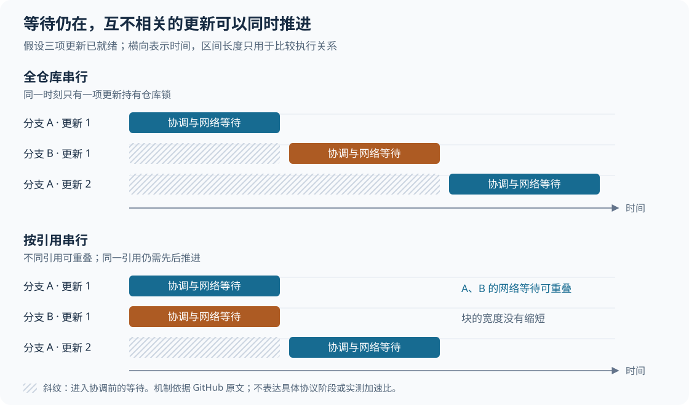
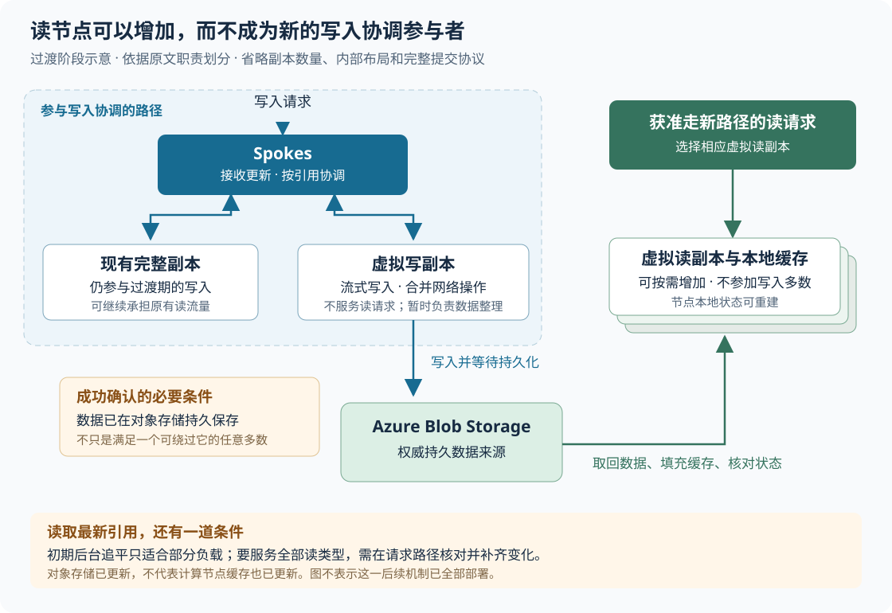

# GitHub 如何让不同分支并行写入，并把读流量从写副本中分离

> 来源：[github.blog](<https://github.blog/engineering/architecture-optimization/the-bridge-to-agent-scale-git-infrastructure>)  
> 作者：Eleanor White; Victoria Dye · 发布时间：2026-10-22 00:00（Asia/Shanghai）  
> 翻译正文：[阅读中文正文](article-zh-CN.md)

当许多开发者和自动编程代理同时向一个仓库推送代码时，真正拖慢服务的，可能是彼此无关的分支更新也必须排队。跨区域部署又会拉长每次等待，让原本勉强够用的仓库写入能力失去余量。GitHub 的过渡方案分两步：先让不同引用的更新并行执行，再把可靠保存数据的职责交给对象存储，让读取请求可以由另外增加的计算节点处理。

这套设计值得关注的场景，是同一仓库存在持续并发写入，或者一次代码更新会触发大量自动构建和检查。它不能直接解决所有人争抢同一主分支的问题，也不意味着把仓库上传到云存储后，就自然获得了正确、低延迟的 Git 服务。

本文以 [《The bridge to agent-scale Git infrastructure》](https://github.blog/engineering/architecture-optimization/the-bridge-to-agent-scale-git-infrastructure/) 为研究主体，依据输入材料，并于 **2026 年 10 月 22 日**核对在线原文及相关官方资料。下文用“原文披露”标识 GitHub 自述，用“外部核验”解释 Git 和 Azure 的公开语义，用“分析”或“建议”标识推导与实践判断；假设例子不代表生产事故或实测结果。

## 1. 为什么一次约 25 毫秒的往返，会挡住最繁忙的仓库

原文披露，GitHub 面临的不只是业务增长，还有自建数据中心及周边地区的供电容量上限，以及硬件供应约束。因此，继续在原地加机器的空间有限。但迁移平台的同时重写存储架构，会把两类风险叠在一起。GitHub 选择先迁移数据及依赖，再逐步调整架构。

这里容易误读一个数字：**99.99999% 的仓库已有副本进入 Azure，不等于这些仓库已经完成全部迁移。**按原文发布时的状态，多数仓库的五个副本中有两个在 Azure，Azure 承接约一半 Git 流量。Spokes 是 GitHub 管理仓库副本、协调写入并路由请求的内部服务；它尽量把读取请求交给同区域、同可用区的副本，可用区指同一区域内用于隔离基础设施故障的部署位置。随着副本迁入，流量逐步跟随。[出处：原文](https://github.blog/engineering/architecture-optimization/the-bridge-to-agent-scale-git-infrastructure/)

剩余极少数仓库的难点，是它们已经接近原有写入能力上限。旧架构在更新仓库引用时，会持有一把覆盖整个仓库的锁。在一次更新完成前，另一项更新即使操作的是完全不同的分支，也无法进入同一段写入流程。

多个副本还必须协调结果。这里的**法定多数（quorum）**，指协议完成提交所需的副本集合或数量门槛。原文特别指出：Spokes 虽然只需要多数副本满足提交条件，但其推进流程仍会等待所有健康副本响应，直到响应到齐或超时。因此，“多数已满足”与“可以立即释放仓库锁、处理下一项更新”并不是一回事。

Azure 目标区域距离原数据中心约一千英里，单次网络往返约 25 毫秒，而一次写入需要多次往返。锁在这些往返期间一直占着，网络等待就会变成全仓库的排队时间。请求到达速度持续超过处理速度时，积压只会越来越大。[出处：原文](https://github.blog/engineering/architecture-optimization/the-bridge-to-agent-scale-git-infrastructure/)

**外部核验：**GitHub 在 2017 年的 [《Stretching Spokes》](https://github.blog/engineering/infrastructure/stretching-spokes/) 中已解释，跨数据中心的引用更新要经过多阶段提交与分布式锁协调，网络往返会限制更新速率。该历史资料有助于理解问题来源，但不能据此把当年的具体轮次数直接当成 2026 年实现。尤其不能用 `1 ÷ 25ms` 估算今天的推送上限：25 毫秒不是完整写入耗时，推送还包含数据传输、校验和其他处理。

## 2. 先分清：保存代码内容，和移动分支指针

假设两个代理分别在 `agent/a` 和 `agent/b` 分支工作。它们各自生成一次提交，然后同时推送。理解这两次操作为什么可以并行，需要先拆开 Git 中的两类数据。

**Git 对象**保存文件内容、目录结构和提交记录。对象以包含类型、长度和内容的信息计算出的散列值作为标识；这种按内容寻找数据的方式叫“内容寻址”。在 Git 的对象模型中，已有对象的内容不被原地修改，修改会生成新的对象。这里的“不可变”指逻辑内容不变，不代表底层文件永不重新打包。[外部核验：Pro Git 的 Git Objects 章节](https://git-scm.com/book/en/v2/Git-Internals-Git-Objects)

**引用（reference，简称 ref）**则记录一个名字当前指向哪个对象。例如，`refs/heads/agent/a` 记录分支 `agent/a` 的最新提交。它会随着推送改变，所以需要检查和排序。

在这个假设例子中，可以把两项更新写成：

```text
refs/heads/agent/a：从提交 A0 改为 A1
refs/heads/agent/b：从提交 B0 改为 B1
```

两个引用没有相互覆盖，通常不必为了确定先后次序而等待对方。反过来，若两个请求都想把 `agent/a` 从 A0 改到不同的新提交，就不能都按“A0 还是当前值”的前提成功。必须先接受一个，再让另一个重新检查前提，决定拒绝还是重试。

这不是单纯增加一把更小的锁。正确性至少包含两个动作：**先比较引用的当前值是否符合请求预期，再把新值发布为已完成的更新。**Git 的公开命令 `git update-ref <ref> <new-oid> <old-oid>` 就提供了“旧对象标识匹配才更新”的本地操作；对象标识也称 OID。它帮助说明更新条件，但单机命令本身不提供 GitHub 跨副本的分布式保证。[外部核验：git-update-ref](https://git-scm.com/docs/git-update-ref)

此外，引用指向的新提交及其依赖对象必须能被读取。只更新指针、却让读取方找不到对应对象，会产生一个表面存在、实际无法取回的提交。Git 的接收端会先把新对象放在隔离目录中，检查通过后才移入正式对象库；官方文档明确禁止把引用指向仍处于隔离区的对象。[外部核验：git-receive-pack 的隔离环境说明](https://git-scm.com/docs/git-receive-pack#_quarantine_environment)

**分析：**对象内容不需要争夺“谁是最新版本”，使大量数据工作有机会并行；可变引用仍需可靠排序，而且必须与对象的可读性配合。这是 GitHub 后续缩小协调范围的基础，不是“对象不可变，所以整个系统无需协调”。

## 3. 把全仓库排队，改成只让相同引用相互等待

原文的第一步，是把串行化范围从整个仓库缩小到单个引用。**串行化**在这里指冲突更新必须按先后次序执行，不能同时把相同的旧状态改成不同结果。

回到两个代理的例子。旧方案下，A 的更新占有仓库锁，等待跨区域副本回复；B 虽然写另一个分支，也得等待 A 结束。新方案允许 A、B 的协调过程同时进行。每次更新仍需经历跨区域等待，但它不再独占整个仓库的更新机会。若随后又来一项更新 A 的请求，它仍需等待或处理与前一项 A 更新的冲突。



图中区间只表达执行关系，不代表实测耗时，也不表示锁调度一定遵循到达顺序。它要说明的是：**排队减少，可以同时提高吞吐并降低请求总延迟，即使单次网络往返完全没有变快。**吞吐指单位时间完成的操作数；总延迟还包含请求进入协调流程前的等待。

进一步看，假设一次持锁协调平均耗时为 S，忽略其他限制时，全仓库串行的容量约为每 S 时间完成一次更新。若同时有 K 个互不冲突的引用各自推进，理想容量才有机会接近每 S 时间完成 K 次更新。这里的 K 是实际活跃、互不冲突的引用数，不是仓库中分支的总数；计算、磁盘、网络或对象存储达到上限后，这个关系就不再成立。这是解释趋势的简化模型，不是 GitHub 的性能预测。

原文报告，在模拟现实流量的内部测试中，写入不同引用的吞吐提高了 **3–4 倍**，延迟也下降。这支持“缩小串行范围对该类负载有效”，但原文没有公开完整的机器配置、引用分布、请求大小、延迟分位数和复现脚本，因此不能据此承诺任意仓库都有同等收益。[出处：原文](https://github.blog/engineering/architecture-optimization/the-bridge-to-agent-scale-git-infrastructure/)

### 相同引用和多个引用的事务，仍然需要特别处理

第一种边界是主分支热点。即使一千个代理都能向自己的分支并行推送，最终合并若集中在 `main`，这些合并仍争用同一个引用。分支写入能力提升，不等于主分支接纳合并的速度同步提升。GitHub 的[系列前文](https://github.blog/engineering/architecture-optimization/building-git-infrastructure-for-agent-scale-development/)也把合并集中到单个引用列为单独挑战。

第二种边界是一次请求更新多个引用。Git 支持 `push --atomic`：服务器支持时，要么全部引用更新成功，要么失败时一个都不改。如果服务器不支持，该请求会失败。不能把这样的事务简单拆成若干互不相干的成功结果。[外部核验：git-push](https://git-scm.com/docs/git-push#Documentation/git-push.txt---atomic)

**分析：**按引用并行需要识别事务涉及的引用集合；只要集合重叠，就可能需要协调。锁定多个引用时如何避免死锁、部分失败如何恢复，都是实现负担。原文没有公开这些细节，也没有表明每个引用都拥有一套独立副本或独立共识集群，不应从“per-reference quorum”这个名称推断出完整拓扑。

还要区分“全部成功或全部失败”与“读者能同时看到所有引用的新值”。Git 的 `update-ref` 文档明确提醒，本地多引用事务即使执行成功，并发读者仍可能看到其中一部分修改。因此，多引用写入原子性并不自动等于跨引用的整体读取快照。[外部核验：git-update-ref](https://git-scm.com/docs/git-update-ref)

## 4. 为什么还要把对象存储接入写入流程

按引用并行缓解了写入排队，却没有解决读写使用同一批机器的问题。

原文披露，多数仓库每次写入对应约 100–1,000 次读取。在旧架构里，完整副本既负责持久保存数据，也负责响应读取。增加副本可以分担读流量，但新副本也进入写入协调；读能力扩展会继续增加写路径的负担。读请求偏好的大内存缓存，还会与整理仓库数据的工作争用资源。[出处：原文](https://github.blog/engineering/architecture-optimization/the-bridge-to-agent-scale-git-infrastructure/)

GitHub 的下一步，是让 **Azure Blob Storage** 成为可靠保存仓库数据的底层。它是一种对象存储服务：计算节点通过网络接口保存和取回数据，不依赖自己的本地磁盘成为唯一权威副本。为接入现有提交流程，GitHub 增加了一个“虚拟写副本”。“虚拟”指它由计算节点代表对象存储参与协议，本身不保有必须永久留存的本地仓库状态。

按原文披露，其职责分工如下：

1. **Spokes 接收并协调更新。**不同引用的事务可并行推进；现有完整副本仍参与这段过渡架构的写入。
2. **虚拟写副本把新写入流式送入对象存储。**它不服务读取；写入得到成功确认之前，数据必须已在对象存储中持久保存。
3. **互不相交的引用事务可以合并网络操作。**多个并发写入共用一组存储请求，分摊往返开销。这不意味着这些引用在业务上被合成同一个事务，也不意味着每次推送只调用一次存储接口。
4. **虚拟读副本从对象存储填充缓存并服务读取。**它们不加入写入法定多数，因此增加读节点无需同步增加写入协议的参与者。



图中省略具体副本数量和协议阶段；箭头表示数据或协调方向，不代表完整部署拓扑。原文没有公开对象存储内的布局、引用提交记录格式和完整恢复算法。

这里有一个需要保留的协议条件：**“对象存储是成员”本身，不足以推出“每次成功都必然包含对象存储”。**如果只是普通的任意多数，理论上可以选出不包含它的多数集合。原文同时明确要求，成功确认必须等到对象存储持久化。因此，分析这套方案时必须把这一要求当成额外的提交约束；原文未披露它究竟通过哪一种协议实现。[出处：原文](https://github.blog/engineering/architecture-optimization/the-bridge-to-agent-scale-git-infrastructure/)

### 计算节点可以丢弃，缓存重建仍有成本

虚拟读副本不承担永久保存权威数据的职责，因此节点故障后可以重新创建，再从对象存储取回所需数据。这减少了“扩读能力就要新增完整持久副本”的绑定关系，却没有消除网络和计算成本。

**分析：**缓存为空的节点需要下载数据、建立可用的本地状态；许多新节点同时启动，还可能集中冲击对象存储。旧节点的内存缓存也不能瞬间复制为新节点的热缓存。因此，“可随时替换”不等于“随时扩容且没有预热代价”。

原文还指出，在这个过渡阶段，虚拟写副本同时负责 **compaction，即把仓库数据重新组织、合并为更适合存储和读取的形式**，读副本继承整理后的状态。Git 中常见的相关操作是把对象重新打成 pack 文件，通过压缩及保存相近对象的差异减少空间占用，但原文没有公开云端 compaction 的具体算法。[外部补充：Pro Git 的 Packfiles 章节](https://git-scm.com/book/en/v2/Git-Internals-Packfiles.html)

这意味着维护工作只是逐步搬离读取节点，还不能据此认为其成本已经消失。数据增长过快时，整理速度、缓存更新和对象回收都可能成为后续瓶颈。

## 5. 对象存储里的数据是新的，读副本仍可能返回旧结果

假设一次推送已成功，把 `agent/a` 从 A0 更新为 A1。对象存储中也已经有 A1，但某个读副本的本地状态仍停在 A0。若它只依赖后台同步，然后直接回答“分支最新提交是什么”，就可能把 A0 返回给刚刚触发的自动构建任务。

问题出在计算节点的缓存尚未更新，不一定出在底层存储。Azure 官方文档说明，其存储服务采用强一致模型，完成插入或更新后，后续读取或列举返回最新更新；它还提供 ETag，即对象版本标识，以及 `If-Match` 条件，拒绝基于过期版本的覆盖。不过，这些底层能力不会自动刷新应用自己的缓存，也不会自动组成跨多个对象的 Git 事务。[外部核验：Azure Blob Storage 并发管理](https://learn.microsoft.com/en-us/azure/storage/blobs/concurrency-manage)

**在线原文补全了输入材料缺失的一项限制：**初期虚拟读副本在后台与对象存储核对状态，因此只适合部分读取负载；要承接所有类型的读取，需要把核对过程移到请求处理路径上，并且只拉取自上次追平以来变化的引用状态与数据。[出处：原文“Scaling reads on their own”末尾](https://github.blog/engineering/architecture-optimization/the-bridge-to-agent-scale-git-infrastructure/)

这使两类读取的差异变得具体：读取一个已知、已持久化的提交对象时，可以按其内容标识取回，缓存未命中则补取；询问某分支“现在最新指向哪里”时，却必须先确认引用状态足够新。前者也不能无条件判定安全：读取节点若还不知道对象存放位置，就需要从权威状态补齐；找不到时不能把缓存未命中误报为对象不存在。这些是机制分析，不是原文公开的请求路由规则。

要满足原文“成功更新之后，不应再读到该引用的更早状态”的目标，后者至少要完成：确定应采用的已提交引用状态、补齐变化，再确保其所指对象可取回，然后返回结果。具体版本判断、失败重试和请求路由如何实现，原文尚未提供足够细节。

还有一个容易混淆的地方：“更新后的状态”按**引用操作的先后顺序**判断，不按提交历史的新旧判断。强制推送可能有意让分支指向一个历史更早的提交；删除也可能让分支不再存在。这些都是新的引用状态，不能被缓存中的旧状态覆盖回来。

对象存储的跨区域灾备也要另外看。Azure 的 GRS/GZRS，即两类地理冗余存储配置，向备用区域异步复制；备用区域可能落后，主区域无法恢复时存在数据丢失风险。原文未公开 GitHub 在此处采用的具体冗余配置，因此不能把“已在 Blob Storage 持久化”扩大解释为“任意区域故障下都零数据丢失”。[外部核验：Azure Storage 冗余说明](https://learn.microsoft.com/en-us/azure/storage/common/storage-redundancy)

## 6. 得到了什么，又把复杂度移到了哪里

以下比较依据原文机制及前述限制作分析，不是成本或性能实测。

| 做法 | 能直接改善什么 | 必须承担的代价与边界 |
| --- | --- | --- |
| 保留全仓库串行，只增加机器资源 | 计算或磁盘不足时可能有效；写入顺序较容易推理 | 网络等待期间仍占全仓库锁，无法靠增加处理器消除这种排队 |
| 按引用并行，保留完整副本写入协调 | 多个独立分支可以同时推进，降低彼此等待 | 单一热门引用仍串行；多引用事务、恢复与并发测试更复杂 |
| 增加参与写入的完整副本 | 分担读流量，也增加数据副本 | 每次写入需要处理更多参与者；存储占用及副本修复负担增加 |
| 对象存储加独立读节点 | 读计算能力可单独增加，不必增加写协议成员 | 写入依赖对象存储；新增请求费用、传输、缓存预热及状态追平成本 |

可靠性同样发生了职责转移。旧方案中丢失完整副本同时影响数据冗余与服务容量；新方案中丢失读节点主要影响读取容量，但对象存储及其访问路径变得更关键。写入必须等对象存储持久化，也意味着该路径故障时不能仅凭其他副本成功就继续确认。这是由原文提交条件推出的可用性代价。

对团队协作而言，这不是简单把同一项运维工作交给云服务商。开发者仍希望推送、分支保护、合并和构建的语义稳定；基础设施团队却要共同定义“写入何时算成功”“读节点何时可以接流量”“缓存落后时如何处理”。监控也需覆盖协调、对象存储、缓存和维护任务，才能区分到底是哪一步拖慢请求。

原文还有两项效果表述需要谨慎理解：一是读副本压测先耗尽了负载生成工具的能力，这只说明在该测试条件下尚未测出服务端上限，不能证明无限扩展；二是[系列前文](https://github.blog/engineering/architecture-optimization/building-git-infrastructure-for-agent-scale-development/)提到的“最高 35 倍写吞吐”针对更广的新架构内部测试，不能拿来替代本篇过渡方案的 3–4 倍结果。两者都缺少足够公开条件供独立复现，也没有公开成本明细支持“单位请求必然更便宜”的判断。

## 7. 哪些团队值得尝试，哪些场景应先停下来

按引用并行最适合的前提，是大量写入确实分散在不同引用，并且测量发现无关更新被同一把锁阻塞。如果主要时间花在上传大文件、生成传输包、执行检查脚本，或所有更新都集中在 `main`，先改引用协调方式未必能改变主要瓶颈。

独立读节点更适合读取明显多于写入、相同数据被重复访问，而且读负载会突增的服务。它要求底层数据可可靠恢复，系统能识别缓存落后，并且团队有能力测试节点替换、维护任务和故障恢复。若负载很小、现有单机或托管服务已满足需求，新增分布式状态协议往往会让维护成本先于收益到来。

**对于直接使用 GitHub 的个人或小团队，服务端协议不是可自行配置的选项。**更实际的动作，是让独立任务使用独立分支、让构建明确对应某次提交、减少重复拉取，并保留主分支的审查和合并控制。独立分支有利于减少冲突，但不应为了制造并行而增加没有业务需要的分支或推送次数。

## 8. 最小实践：先验证自己的等待发生在哪里

以下是一套建议性试验，目标是确认机制是否适合自己的负载，不复刻 GitHub 的规模，也不要求先搭建五副本系统。

**第一步，记录真实请求，而不是先更换存储。**在代表性的工作时段记录推送与拉取数量、每项推送涉及的引用、成功率和耗时。自建服务还应拆分对象接收、检查、锁等待、协调及维护耗时。只使用托管平台时，客户端耗时无法直接证明服务器内部锁竞争，应把这一点保留为未知。

**第二步，用测试仓库对照两种负载。**让少量客户端分别更新不同测试分支，再让它们竞争同一测试分支；保持每次提交的数据量、请求到达速率及网络条件尽量一致。记录成功更新数和冲突拒绝数，不把被拒绝的更新当成吞吐收益。同引用测试中，客户端应根据新状态重试，不能靠无条件强制推送掩盖覆盖问题。

**第三步，只在确认锁竞争后试改串行范围。**这一步适用于能够修改自建协调层的团队。先保持原有存储方式，只调整协调粒度，检查不相交引用是否能并行，以及同引用竞争是否仍正确拒绝过期请求。同时验证多引用事务、引用删除和强制更新；普通 Git 命令的行为只能作为局部对照，不能证明整个分布式服务正确。

**第四步，再试一个可丢弃的读缓存节点。**如果读负载值得单独扩展，先让它只服务已知对象标识、且能从权威存储补取的数据。不要一开始就让只做后台同步的节点回答“分支最新状态”。需要接入这类读取时，先实现请求内的状态核对，再测试更新完成后换节点读取、节点重启，以及对象存储短暂不可用时的行为。保持原服务作为回退路径。

试验前应写下自己的可接受目标，至少包括：

| 验证问题 | 观察指标或判定方式 | 停止扩展或回退的条件 |
| --- | --- | --- |
| 并行是否减少了等待 | 成功吞吐、锁等待、p95/p99 延迟，即 95%/99% 请求耗时不超过的值 | 不同引用没有改善，或热点引用及其他业务的延迟超过预设预算 |
| 更新语义是否保持正确 | 已完成更新后的新读取不回到更早引用状态；已发布提交的依赖对象可取回；事务失败结果符合约定 | 观察到错误成功、丢失更新、旧引用回流或对象缺失，立即停止新路径接流量 |
| 新读节点是否承担了实际流量 | 缓存命中率、冷启动时间、存储读取量及错误率 | 预热流量冲击原服务，或节点频繁退回权威路径而无收益 |
| 新增成本是否值得 | 同等负载下每千次成功读取或每次构建的计算、请求、传输及维护成本 | 超过预设预算且无法通过减少重复工作改善 |

对一致性的试验也应限制口径：若测试期间没有后续写入，成功更新后的读取应返回该值；若有后续写入，则应返回该值或按操作顺序更新的值。客户端超时只代表不知道结果，不能立即认定服务器未提交，再无条件重复更新。有限测试能发现错误，不能代替对故障与并发状态的完整推理。

这篇原文给出的工程方法，是先找到哪些请求真的争用同一项状态，再让其余工作并行；先把数据可靠保存的责任安排清楚，再让服务请求的机器自由增减。小团队最有价值的起点，是证明自己存在这两类问题，并用一次范围有限、随时可回退的试验验证它们，而不是直接采用大规模分布式存储架构。
