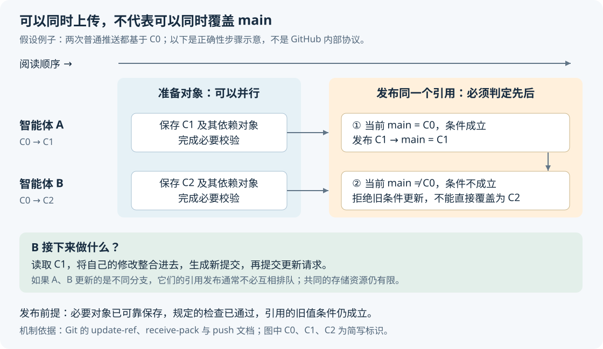
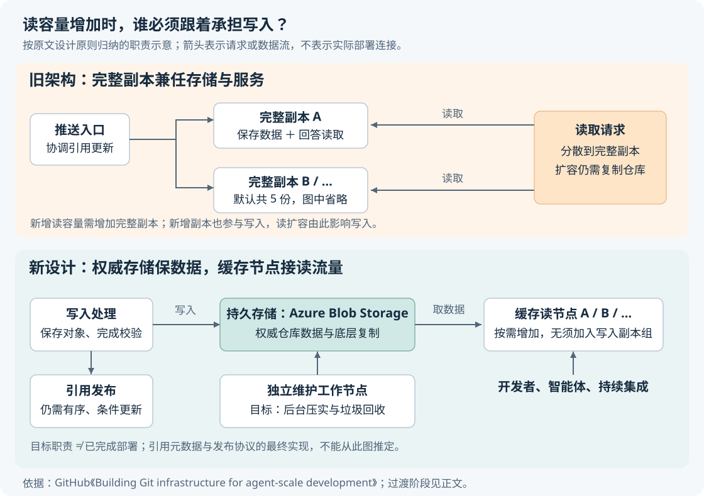

# GitHub 如何应对智能体密集读写：把数据保存与请求处理分开

> 来源：[github.blog](<https://github.blog/engineering/architecture-optimization/building-git-infrastructure-for-agent-scale-development>)  
> 作者：Brian Celenza · 发布时间：2026-10-07 04:57（Asia/Shanghai）  
> 翻译正文：[阅读中文正文](article-zh-CN.md)

当许多编程智能体同时修改一个仓库时，把代码下载得更快，只解决了一部分问题。每次推送还要保存新数据、检查分支能否更新，并让后续构建取得正确版本。GitHub 正在调整底层架构：让可靠保存数据的存储层独立工作，用可按需增加的计算节点处理读取，把必须相互等待的写入步骤缩到更小范围。对于同时运行许多智能体、频繁触发构建，或维护 Git 托管服务的团队，这个变化值得关注。

本文以 Brian Celenza 的 [《Building Git infrastructure for agent-scale development》](https://github.blog/engineering/architecture-optimization/building-git-infrastructure-for-agent-scale-development/)为研究主体。该文发表于 2026 年 10 月 6 日，次日更新。核验截至 2026 年 10 月 23 日：输入摘录省略了部分技术条目，本文通过在线原文补齐，并将 10 月 21 日的官方后续文章作为外部补充。下文明确标注假设例子、分析与建议；官方内部测试也不视为独立实测。

## 1. 为什么多加几台读服务器，会拖累写入

GitHub 原有的 Spokes 系统负责把仓库复制到多台文件服务器上。按研究原文的描述，默认有五份完整副本，每份既保存数据，也能回答读取请求。这样既能在磁盘或机器故障时保住数据，又能把读取分散到多台机器上。

问题在于，**增加读容量所用的副本，也参与写入**。推送更新分支时，系统要让这些副本就新状态达成必要的确认，而不是只往任意一台机器上写一下。副本增加，写入需要处理的参与者也随之增加；失去副本又会减少读容量，失去足够多的副本则可能停止写入。这是原文指出的扩展上限，并不表示完整副本架构对普通仓库没有价值。

这里的“足够多”涉及**法定人数（quorum）**：系统必须获得规定数量副本的确认，才能接受一次更新。它与“正常情况下等哪些机器”是两个问题。[2017 年的 Spokes 技术文章](https://github.blog/engineering/infrastructure/stretching-spokes/)介绍了三阶段提交，即通过分阶段询问、确认和提交，让多个副本共同完成引用更新的协议；它也说明，系统在一般情况下复制到全部副本，在所有情况下至少满足法定人数。不能把这种设计简化成“任意一台失联，整个系统就不能写”。

智能体把这个已有取舍放大了。人可能修改一段时间才推送，智能体则可能反复进行“修改、提交、推送、运行检查”。**提交是生成一个版本记录，推送才是把相关数据和分支更新发送给远端；两者数量不能混算。** 持续集成（CI，即自动获取代码并执行构建、测试的流水线）又会在推送之后发起更多读取。

原文给出的平台总量是：月度 Git 活动从 2025 年 9 月的 2182 亿次增加到 2026 年 8 月的 4733 亿次。这能说明平台压力增长，却不能单凭汇总数据算出智能体贡献了多少流量，也不能推断所有团队都需要同样的架构。[数据出处：研究原文](https://github.blog/engineering/architecture-optimization/building-git-infrastructure-for-agent-scale-development/)

## 2. 先看一次推送：上传内容与移动分支，性质不同

假设两个智能体都从提交 `C0` 开始工作。A 修改登录模块，生成 `C1`；B 修改搜索模块，生成 `C2`。这是假设例子，不是 GitHub 的实际事故。

要理解它们为什么能并行做一部分工作，却不能随意覆盖同一个分支，需要先区分 Git 中的两类数据。

**对象（object）保存内容与历史关系。** 文件内容、目录结构、提交记录分别用不同类型的对象表示。提交对象指向目录树和父提交。对象由其内容计算出的标识来寻址；改变内容会生成不同的标识，而不是把原标识对应的对象改写掉。这就是“内容寻址”的含义。这里的 Git blob 是文件内容对象，后文的 Azure Blob Storage 则是云存储服务，二者不能混为一谈。[外部依据：Git 对象模型](https://git-scm.com/book/en/v2/Git-Internals-Git-Objects)

**引用（reference，常写作 ref）记录一个名称当前指向哪个对象。** 例如 `refs/heads/main` 表示主分支的当前位置。A 和 B 可以分别准备 `C1`、`C2` 及其依赖对象，但如果两人都想把 `main` 从 `C0` 更新到自己的提交，服务器必须判断谁先成功。

A 成功后，`main` 已经指向 `C1`。B 原先的条件“当前仍是 `C0`”便不再成立。服务器若直接把它改为 `C2`，A 的提交就会从这个分支的当前历史中被排除。普通推送默认拒绝这种非快进更新：所谓**快进**，就是新提交沿着现有分支历史继续向前，保留原有历史。B 应先取得 A 的更新，整合自己的修改，再尝试推送。[外部依据：Git push 规则](https://git-scm.com/docs/git-push)

图中展示的是正确性要求，不是 GitHub 内部调用顺序。它解释了原文的关键方向：**大块内容可以各自准备，同一个分支名称的更新仍须受控。** 不同分支的更新通常可以少一些相互等待，但最终合入同一个主分支时，仍有共同的协调点。

## 3. 新设计如何安排存储、读取与维护

在线原文比输入摘录更具体：权威仓库数据放入 Azure Blob Storage，即负责保存对象数据的云存储服务；读取由带缓存的轻量工作节点处理；压实和垃圾回收则交给独立工作节点。这是原文披露的设计方向，不是对其内部源码的还原。[在线原文的方案说明](https://github.blog/engineering/architecture-optimization/building-git-infrastructure-for-agent-scale-development/)

### 读取节点可以替换，权威数据不能依赖它

“权威数据”是发生分歧后判断正确状态、重建服务所依据的数据。旧设计的完整副本同时承担这项责任和读取服务；新设计让缓存节点从持久存储取得数据，再为客户端提供服务。

这样增加读取节点时，就不必让新增节点也参加每次写入的副本确认。计算节点故障后，可以由新节点重新取数、建立缓存。这里的“可替换”不等于“没有状态”：缓存仍有内容，也可能暂时落后，只是这些内容不应成为恢复仓库的唯一依据。

**分析：** 这种分工有利于应对短时读高峰，但故障恢复仍有代价。新节点缓存为空，首次请求可能等待远端取数；大量节点同时启动，还可能把请求集中打到存储层。因此，“机器坏了像一次缓存未命中”描述的是恢复责任的变化，不能解读成故障对延迟毫无影响。

### 缩短共同等待，不等于跳过检查

原文提出，把对象保存、对象连通性校验和秘密扫描等工作尽可能与其他写入并行进行。**连通性校验**检查新提交所依赖的对象是否齐全，例如目录树是否引用了缺失的文件对象。秘密扫描则寻找不应上传的凭据等内容。

这里容易出现一个误读：“这些工作不再阻塞协调”不等于“可以先报告成功，以后再补数据或补必需检查”。如果某项检查是拒绝推送的前提，它仍须在接受这次更新之前完成；只是它不必占着一个让其他无关写入也排队的位置。

Git 自身的接收流程提供了一个可核验的例子。`git-receive-pack` 是服务端接收推送的程序，它先把新对象放进临时隔离目录，再运行 `pre-receive` 钩子，也就是更新引用前的自定义检查。检查成功后才把对象迁入主对象库；钩子不能把引用指向隔离中的对象，因为其他进程看不到它们。[外部依据：receive-pack 的隔离机制](https://git-scm.com/docs/git-receive-pack)

**据此分析，分布式实现至少要守住三个条件：** 对象已达到所承诺的持久保存要求；此次更新规定的检查已完成；引用的旧值条件在发布时仍成立。它们如何组合成 GitHub 的最终协议，所查文章没有完整公开。

### 后台维护移走的是资源竞争，删除风险仍要处理

Git 会把许多对象整理成便于存储和读取的打包文件。**压实**是重组这些数据，减少碎片或重复；**垃圾回收**则识别并清理不再需要的对象。它们会消耗处理器、内存和磁盘带宽，与在线请求共用机器时，可能互相影响。

独立维护工作节点能减少这类竞争，但不能随意删除“此刻没有分支指向”的对象。一个正在上传的对象，可能尚未来得及被引用。Git 官方文档明确记录了并发垃圾回收的风险：另一个进程可能正在使用尚未建立引用的对象，过早删除会导致失败，甚至损坏仓库。[外部依据：git gc 的并发限制](https://git-scm.com/docs/git-gc)

**分析：** 分布式后台维护因此还要处理上传中的对象、仍在读取旧打包文件的请求，以及新旧存储布局之间的切换。独立进程只是职责安排，保护这些对象的具体机制仍需另外设计。研究原文没有给出足够细节，无法判断 GitHub 最终采用哪种回收协议。

## 4. 后续文章核实了什么，哪些仍未完成

10 月 21 日的[官方后续文章《The bridge to agent-scale Git infrastructure》](https://github.blog/engineering/architecture-optimization/the-bridge-to-agent-scale-git-infrastructure/)补充了过渡路径：旧实现提交写入需要多数副本，但会等待所有健康副本响应，直到超时；仓库级锁使慢副本进一步限制吞吐。改成按引用分别安排顺序后，不同引用的写入可以同时进行，同一引用仍须等待。

它还介绍了连接对象存储的“虚拟写副本”：只有数据已持久写入对象存储，才确认写入；虚拟读副本不加入写入法定人数。文章同时承认，过渡阶段的读副本在后台追赶状态，尚不能服务所有读取场景，写入法定人数也仍是后续扩展的限制。

这份外部补充支持原文的改造方向，也提醒读者区分**目标、过渡机制和完成状态**。不能把加入对象存储等同于全部改造完成，也不能推定任何新缓存节点都已具备相同的最新状态读取保证。

### 更深入一点：条件更新能保护什么

Git 提供的 `git update-ref <ref> <new-oid> <old-oid>` 可以表达：“只有当前值等于旧对象标识时，才改成新值。”其中 OID 是对象标识。这个操作展示了如何防止一个基于过期状态的更新覆盖新结果。[Git update-ref 文档](https://git-scm.com/docs/git-update-ref.html)

但多引用更新更复杂。例如一次操作同时修改发布分支和标签，业务可能要求它们全部成功或全部失败。Git 的 `push --atomic` 在服务端支持时可以提出这种要求。它也不能直接等同于“所有并发读者会同时看到全部新引用”：`update-ref` 文档明确提醒，即使各引用单独更新是原子的，并发读取仍可能观察到部分修改。[Git 的原子推送](https://git-scm.com/docs/git-push)、[引用事务的读取限制](https://git-scm.com/docs/git-update-ref.html)

**分析：** 按引用减少等待时，仍须识别跨引用事务的边界；只讨论“每个分支各写各的”不足以证明整个托管平台正确。这也是本文不根据几张职责图推定最终一致性协议的原因。

## 5. “最高 35 倍”能说明什么

研究原文报告，新架构在内部基准测试中达到**最高 35 倍的写入吞吐**。吞吐是单位时间成功处理多少工作，与一次推送等待多久不同，更不是开发者交付速度的直接测量。[原文测试声明](https://github.blog/engineering/architecture-optimization/building-git-infrastructure-for-agent-scale-development/)

例如，系统允许不同分支的推送同时等待网络确认，完成每次推送的时间可能变化不大，但同时能推进的请求变多，整体吞吐就会上升。这是机制分析，不是该基准的实际测试配置。

| 需要判断的事情 | 当前证据能支持的结论 |
| --- | --- |
| 是否存在内部吞吐提升结果 | GitHub 报告了最高 35 倍，属于官方自述 |
| 普通仓库会提高多少 | 未公开足够的仓库规模、对象大小、引用分布、并发度和资源配置，无法外推 |
| 单次推送是否缩短为原来的 1/35 | 不成立；吞吐倍率不能直接换成延迟倍率 |
| 故障时是否也保持该倍率 | 所查资料未提供对应测试，未知 |
| 总成本和团队交付速度是否改善 | 缺少可比较的费用、评审与交付周期数据，未知 |

尤其要分别测试“很多分支各自写入”和“所有请求更新同一个分支”。前者能利用更细的协调范围，后者仍有共同的发布顺序。只给一个总吞吐数字，无法说明热点主分支的表现。

## 6. 选择这种设计，付出的代价是什么

下面是基于机制的比较，不是不同产品之间的实测排名。

| 做法 | 复杂度与可靠性 | 性能与成本取舍 | 对团队的要求 |
| --- | --- | --- | --- |
| 完整本地副本兼任存储与服务 | 数据路径直接，仍须复制、修复和故障切换 | 本地读取延迟低；扩读可能增加完整数据副本与写入协调开销 | 适合已有成熟复制运维能力、负载仍有余量的服务 |
| 权威存储加缓存工作节点 | 多了缓存追赶、对象定位、维护与发布之间的配合 | 读容量可独立扩展；缓存未命中、存储请求、网络传输和后台整理仍有费用 | 需要存储、Git 语义、在线服务团队共同定义接口和故障责任 |
| 托管仓库加工作流优化 | 团队不必自建仓库存储协议，但仍要验证备份、权限与自动化 | 先减少重复获取、无效构建和冲突重试；不能改变平台内部上限 | 通常更适合个人和小团队，主要投入在测量与流程改进 |

存储服务也不能替代全部正确性设计。Azure 文档说明其存储操作具有强一致性，即成功更新后的后续读取或列举会返回最新更新；但应用层缓存不会因此自动更新。其地理冗余方案中，复制到次区域还可能是异步的，灾难切换存在最近写入尚未到达次区域的风险。这些是存储产品的能力边界，**不是 GitHub 实际使用某种冗余配置的证据**。[Azure 并发与一致性说明](https://learn.microsoft.com/en-us/azure/storage/blobs/concurrency-manage)、[Azure 数据冗余说明](https://learn.microsoft.com/en-us/azure/storage/common/storage-redundancy)

因此，可靠性评估仍要问：确认成功意味着写到了哪里？读节点允许落后多久？区域故障后以哪份数据恢复？这些问题的答案，不能仅用“底层已经有多副本”代替。

这种设计更适合读写压力显著、不同分支有大量独立更新，而且有能力维护分布式系统的托管平台。以下情形则需要谨慎：

- **所有更新集中到一个主分支。** 缩小协调范围不能取消这个分支自身的顺序要求，合并与测试也可能先成为瓶颈。
- **仓库访问量不大，团队缺少存储运维能力。** 新增服务、缓存和恢复路径可能比节省的机器更贵。
- **业务要求推送后立刻读到新结果。** 必须明确新鲜度保证，不能随意把请求路由给后台追赶的缓存。
- **延迟主要来自大对象传输、网络或重型检查。** 改善引用协调不一定明显缩短端到端推送。
- **真正排队的是评审、测试或发布。** 仓库吞吐增加后，工作也可能只是更快地堆到下一阶段。

## 7. 小团队怎样做一次最小实践

对个人和小团队，可借鉴的是“找出必须共同等待的步骤，减少其他步骤的重复工作”。下面是建议性试验，不是 GitHub 官方迁移流程，也不要求自建对象存储后端。

**第一步，选一个真实仓库，先记录基线。** 在一次代表性的开发周期里，分别记录推送耗时、获取代码耗时、测试耗时、合并等待和重试原因。关注中位数以及 P95：后者表示约 95% 的样本耗时不超过该值。样本少时保留逐次记录，不要让百分位数制造精确的错觉。推送被拒绝时，要区分权限、分支冲突、检查失败和基础设施错误。

**第二步，让少量智能体在独立分支工作。** 可以先尝试两个并发任务，这是试验起点，不是性能阈值。每个任务推送自己的分支，通过拉取请求（PR，即请求评审并合并一组修改的协作单元）进入主分支。观察独立分支是否仍明显互相拖慢，并记录冲突重试是否增加；不要以关闭分支保护来换取表面吞吐。

**第三步，只优化已证实的重复读取。** 不需要完整历史的构建，可以试浅克隆，即只获取有限深度的历史；只需要部分文件内容的场景，可以评估部分克隆，例如 `--filter=blob:none` 将文件内容延迟到需要时获取。它们减少的对象不同，按需补取也可能带来额外请求。依赖版本历史、标签或比较基点的任务要验证功能是否完整。[Git clone 参数说明](https://git-scm.com/docs/git-clone)

**第四步，减少失去用途的检查，保留必要发布。** 对只需验证某分支最新状态的构建，可用 GitHub Actions 的并发分组，让新运行取消同组旧运行；把工作流名称和分支一起放进分组键，避免无关流程互相取消。这个办法不适合必须逐次执行的发布或迁移任务。[Actions 并发控制](https://docs.github.com/en/actions/how-tos/write-workflows/choose-when-workflows-run/control-workflow-concurrency)

如果大量时间花在“主分支变动后重新测试”，再评估合并队列：它按最新主分支及队列中已有改动构造候选状态，运行规定检查。使用 GitHub Actions 时还需配置 `merge_group` 事件，否则队列需要的检查可能不会运行。应先确认仓库具备该功能的使用资格。[合并队列官方文档](https://docs.github.com/en/repositories/configuring-branches-and-merges-in-your-repository/configuring-pull-request-merges/managing-a-merge-queue)

**最后，用同一组指标决定保留还是退出。** 比较相近任务和负载下，每个通过检查并完成合并的改动需要多久、消耗多少构建资源，以及重试和失败是否增加。只有请求数上升，不能算实践成功。

出现以下情况就应停止扩并发或撤回对应改动：浅克隆导致版本计算错误；部分克隆的补取使耗时更差；取消机制误伤必要任务；并发增加后尾部延迟和冲突持续恶化；新增维护成本超过已有等待成本。若主要时间始终花在模型执行、测试或人工评审，就先改进那一段，而不是继续改造 Git 存储。

GitHub 这次改造提供的判断方法是：先识别哪些数据可以独立保存，哪些状态更新必须共同确认，再让计算容量围绕真实负载伸缩。它有望扩大仓库服务的处理能力，但同一分支的发布顺序、数据恢复承诺和人的审核责任，仍须逐项兑现。
