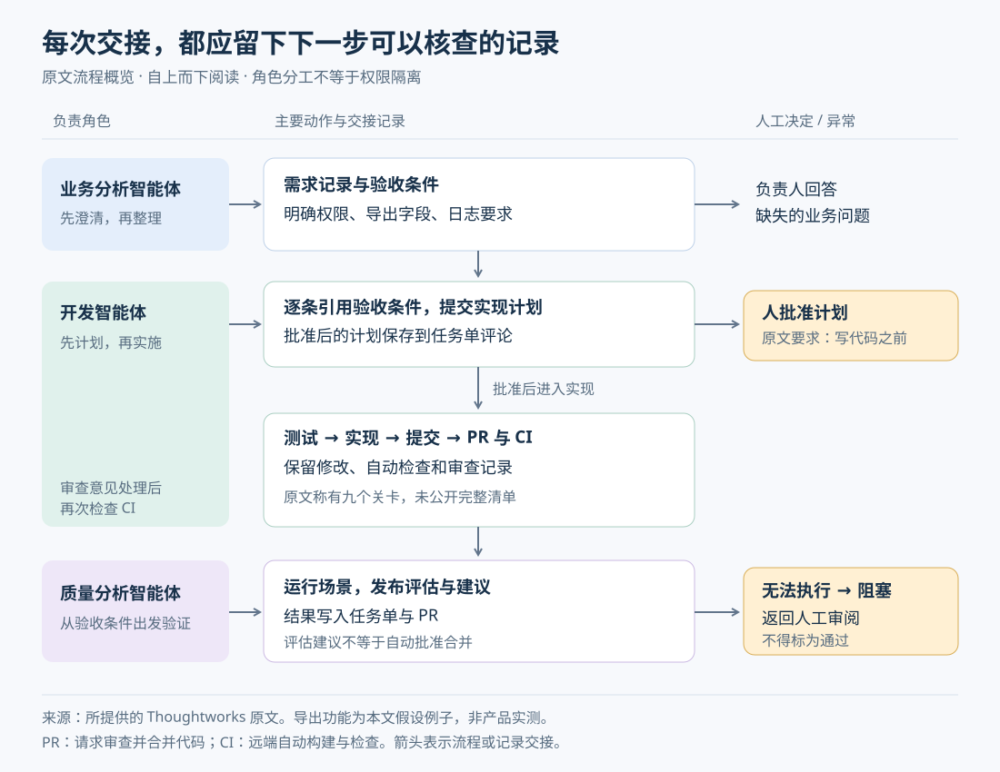
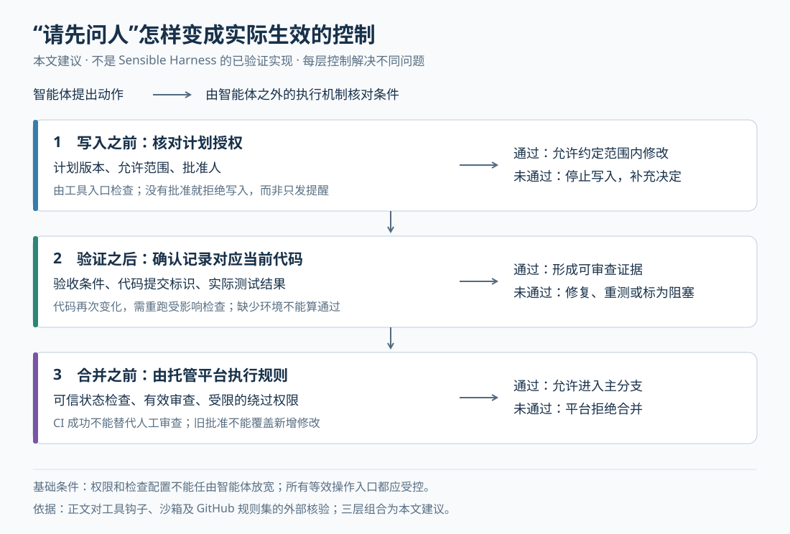

# AI 写完代码之后，团队怎样判断可以交付？理解 Sensible Harness

> 来源：[www.thoughtworks.com](<https://www.thoughtworks.com/insights/blog/generative-ai/how-sensible-harness-help-teams-create-ai-first-delivery-environment>)  
> 作者：Vitória Regina Ragazzon Toebe; Amy Pellegrini; María José Lalama · 发布时间：2026-10-22 08:00（Asia/Shanghai）  
> 翻译正文：[阅读中文正文](article-zh-CN.md)

AI 可以很快写出一批代码，团队却仍要回答：需求有没有理解错，测试是否真的执行过，修改有没有超出授权，这张任务单究竟花了多少时间和钱？当生成速度超过核查速度时，瓶颈就会从“写代码”转移到“证明这次修改值得接受”。

Thoughtworks 的 Sensible Harness 尝试把需求澄清、计划审批、实现、验证和费用记录接成一套工作流程。它值得经常使用 AI 修改共享代码库的团队关注，尤其是那些需要交接任务、保留审批记录的团队。不过，流程描述是否完整，与软件能否强制执行流程，是两个需要分别验证的问题。

本文以提供的[原文《How Sensible Harness can help teams create an AI-first delivery environment》](https://www.thoughtworks.com/insights/blog/generative-ai/how-sensible-harness-help-teams-create-ai-first-delivery-environment)为研究主体。原文描述的产品功能均视为作者自述；外部资料用于核验机制是否成立，不能代替对该产品的实现验证。本文没有运行 Sensible Harness，也没有取得可核查的产品源码或可复现测试，因此不把“保证安全”“无法绕过”或“降低成本”当作已验证结果。

## 1. 它要补上的，是代码之外的交付证据

编程智能体是能根据目标调用工具、修改文件并继续处理结果的 AI 程序。模型负责提出下一步动作，外围软件负责提供上下文、执行工具、记录状态和限制权限。这套外围软件通常称为 **harness**；本文称它为“智能体运行与约束环境”。

单纯给智能体增加一份“请遵守团队规范”的说明，可以改善行为，却不能证明它执行了测试，也不能阻止一个拥有写权限的工具修改文件。团队真正需要的是一条能追查的链：需求从哪里来，谁批准了什么，哪次代码修改实现了哪条要求，测试针对哪个版本运行，失败后由谁决定继续。

原文把这条链组织为三个角色：业务分析智能体整理需求，开发智能体实施修改，质量分析智能体检查结果。它还提供命令行工具，即通过终端命令操作的软件入口，用于生成仓库配置、技能文件和共享状态清单。这里的“技能”是智能体执行某类任务时加载的操作说明及配套资源。

这些能力分别解决不同的问题：

| 原文描述的做法 | 试图解决的实际问题 | 目前还不能据此得出的结论 |
| --- | --- | --- |
| 模板生成技能文件，并检查生成结果是否偏离模板 | 多个仓库或运行工具使用了不同版本的操作规范 | 文字一致就代表执行行为一致 |
| 先批准计划，再实现，并把计划写入任务单评论 | 换人、换会话后，不知道此前同意了什么 | 评论本身能够禁止未授权修改 |
| 对照验收条件检查修改，无法执行的测试标为阻塞 | 智能体把“没测”写成“通过” | 验收条件本身完整、测试覆盖所有风险 |
| 按任务记录模型费用 | 团队不知道花费来自哪一步 | 总交付成本下降，或开销已经受到硬性限制 |

原文开头认为，不受约束的 AI 代码生成会加快技术债积累。技术债指让以后修改软件更费力的遗留设计和实现问题。这是合理的风险判断，但文章没有给出对照实验或长期维护数据，不能据此认定所有团队都会发生同样结果。

## 2. 用一张导出功能任务单，看懂三个角色怎样配合

以下是**假设例子，不是产品演示或真实事故**：一个小团队要给客户管理系统增加 CSV 导出功能。CSV 是用分隔符组织表格数据的文本格式。任务单最初只有一句话：“支持导出客户列表。”

直接开始写代码，开发智能体可能只实现“点击按钮下载文件”。但谁能导出、导出哪些字段、日志能否包含客户数据，都还没有确定。即使按钮能用，也未必满足实际要求。

### 先把缺失的决定问出来

按原文的角色划分，业务分析智能体应先追问缺失信息，再整理成用户故事，也就是说明谁需要什么能力、为什么需要的需求记录。假设负责人确认了三条验收条件：

- 具有导出权限的用户可以下载指定字段。
- 没有导出权限的用户直接请求接口时，也必须被拒绝。
- 操作日志记录操作者和结果，但不记录客户字段值。

验收条件是判断功能是否满足需求的具体标准。第二条要求检查服务端，原因是隐藏页面按钮不能阻止用户直接请求接口；第三条要求检查日志，原因是下载内容正确并不代表数据没有从另一条路径泄露。

原文把这种澄清方式称为“苏格拉底式提问”，即通过连续追问定义、前提和反例来暴露含糊之处。它引用的[相关论文](https://arxiv.org/abs/2303.08769)讨论了这种提示方法，并展示对话示例；这可以解释方法来源，但不能证明 Sensible Harness 能稳定找全软件需求。负责人仍要判断哪些问题必须由业务决定。

### 再让计划成为可交接的记录

原文称，开发智能体会逐字引用验收条件，列出每一步使用的操作原语、模型和执行方式。“操作原语”在这里是预先命名、可以重复调用的动作，例如读取任务单、执行测试或创建代码审查请求，而不是让模型每次重新拼装命令。

负责人批准计划后，计划作为评论保存在问题跟踪系统 Jira 中。保存的价值是让后续人员能找到同一份约定，不必从聊天历史猜测上下文。逐字保留验收条件也便于发现遗漏，但仍需要检查“计划中的步骤是否真的能证明这条要求”，不能只检查文字是否出现。

### 最后让实现与验证分别留下证据

原文要求开发智能体逐条执行测试驱动开发，简称 **TDD**：先写能够暴露缺失行为的测试，确认它因预期原因失败，再实现代码使其通过，随后整理实现并保留测试。对导出功能来说，权限拒绝行为适合自动测试；日志内容则可能还需要启动服务、触发操作，再检查实际输出。不能只因为某个单元测试通过，就宣布整条要求完成。

每个循环产生一次原子提交，即围绕一个完整意图保存的一组代码修改；之后创建拉取请求，简称 **PR**，让团队审查准备合并的修改。持续集成，简称 **CI**，是在远端自动构建和运行检查的机制。原文称，流程会在 PR 创建后和审查意见处理后检查 CI，并在整个交付循环设置九个关卡，但没有给出完整清单和实现，本文不补造这九个关卡。

质量分析智能体再从验收条件制定测试计划，运行功能，并把结论写入任务单和 PR。如果缺少测试账号或运行环境，它应标为“阻塞”，而非“通过”。这能保留不确定性，让人知道还缺什么。

图按原文描述整理，不代表已核验的内部调用架构。需要特别区分：质量分析智能体发布的是评估和建议；本文没有证据证明它能独立决定是否合并。

## 3. 模板、共享状态和角色划分，各自能保证什么

### 模板检查可以防止规则文件悄悄分叉

原文描述了一条值得关注的生成路径：团队维护模板，渲染器把模板生成技能文件，生成结果提交进版本库，CI 检查生成结果有没有偏离模板，并用测试检查部分文字要求。

例如，团队在模板中增加“未执行的场景必须标为阻塞”，却忘记重新生成仓库中的技能文件。CI 可以重新生成一次并比较差异，从而发现仓库仍在使用旧文件。这种检查解决的是**发布出去的规则是否与模板一致**。

它无法直接回答智能体是否加载了正确文件、是否理解了规则、调用其他工具时是否绕过规则。检查文字存在，也不能证明该文字在所有情境下都能约束模型。因此还需要行为测试：故意不给测试环境，看系统是否仍然报告通过；移除批准记录，看系统是否真的停止写入。

外部的 [Agent Skills 规范](https://agentskills.io/specification)确实定义了 `SKILL.md` 及相关资源的组织方式，但其中工具预批准字段 `allowed-tools` 仍标为实验性，支持程度因实现而异。因而，“技能文件可以复用”与“不同运行工具提供等价的权限边界”不能画等号。

### 共享状态必须能区分“计划好了”和“已经做完”

原文把共享状态清单称为单一事实来源，但没有公开字段结构、并发更新办法或中断恢复机制。以下是**实现分析**：清单只有在各方据此检查进度，并能发现过期记录时，才有助于可靠交接。

例如，人批准的是计划第二版，智能体后来把任务范围改成第三版，原来的批准是否仍有效？质量分析针对的是某次提交，开发智能体随后又修改了权限判断，那份通过报告还能否用于合并？这些记录至少需要关联任务、计划版本和代码版本，否则“已批准”“已测试”可能指向不同对象。

还要考虑外部操作完成、本地记录未更新的情况。假设 Jira 已收到评论，但网络返回超时，重试可能重复发评论。一个可恢复的流程需要查询已有结果，或使用稳定的操作标识识别重复请求。仅有一份状态文件，不能自动解决这类跨系统的不确定性；本文无法核实 Sensible Harness 是否处理了这些情况。

### 三种角色有助于分工，但不会自动产生独立判断

业务分析、开发和质量分析分别关注需求、实现和验证，能减少一段对话同时承担所有职责的混乱。不过，如果三个角色都继承同一个错误前提，或者测试只是照着实现复述，它们可能一致地给出错误结论。

针对假设中的导出功能，验证者应直接构造“没有权限但请求接口”的反例，而非仅重复开发者演示过的成功操作。真正有价值的是不同的检查依据、可执行的反例和权限分离，而不只是角色数量。这是对方案的分析，不是原文提供的效果数据。

## 4. “必须先问人”要怎样才不会只停留在提示词里

原文最强的断言是：框架在架构中严格执行角色边界，保证保留人工批准检查点。要评估这个说法，应沿着实际动作追问：**批准缺失时，究竟是谁阻止了哪一次操作？**

可以把控制分成三个层次：

| 控制位置 | 能做什么 | 单独使用的局限 |
| --- | --- | --- |
| 技能或提示词 | 告诉模型先提计划、再等待批准 | 模型仍可能遗漏或误读步骤 |
| 工具执行前的检查 | 在写文件、更新任务单等动作发生前，核对授权并拒绝执行 | 必须覆盖所有可产生同类效果的工具，且检查配置不能任由智能体修改 |
| 操作系统与代码托管平台 | 限制文件和网络访问，阻止不满足条件的修改合入主分支 | 只能保证配置范围内的访问或合并条件，无法判断需求本身是否正确 |

这些机制在现有工具中有明确参照。例如，Claude Code 的 [Hooks 文档](https://code.claude.com/docs/en/hooks)说明，工具执行前的 `PreToolUse` 钩子可以返回拒绝决定；钩子就是在特定事件发生时自动运行的检查程序。其[沙箱文档](https://code.claude.com/docs/en/sandboxing)则区分了工具权限判断与操作系统对文件、网络的限制。两者都能加强约束，但这并不说明 Sensible Harness 已使用这些具体机制。

再比如，[GitHub 规则集](https://docs.github.com/en/repositories/configuring-branches-and-merges-in-your-repository/managing-rulesets/available-rules-for-rulesets)可以要求 PR 审查与状态检查，并在修改变化后使旧批准失效。平台阻止合并，比要求模型“记得看一下 CI”多了一层执行保证。但仅要求创建 PR 并不等于要求人工批准；还必须限制绕过权限，并明确哪些检查结果可信。

图中是**建议的落地方式，不是已确认的 Sensible Harness 内部实现**。三层分别回答：能不能开始改、证据是否对应当前版本、能不能进入主分支。主分支是团队接受并继续维护代码的主要分支。

在导出功能例子中，业务分析角色可以拥有读取需求和撰写故事的工具，却不必拥有代码写权限；质量分析角色可以运行测试、发表评估，却不必拥有合并权限。如果所有角色最终都能使用同一个权限完整的终端和凭据，仅靠调用名称不同，不能证明权限已经隔离。

这也是试用时最值得演示的失败路径：没有批准时尝试写文件；换一种工具执行同类写入；测试后再改代码；让智能体尝试修改约束配置。观察系统是否真正拒绝，而非只看正常演示中它是否主动遵守规则。

## 5. 仓库评分和费用报告，为什么都需要解释口径

### A 到 F 可以帮助排查，但不能直接宣布“适合交给 AI”

原文称，代码审计按十个维度对仓库评为 A 到 F，覆盖文档、测试、安全、可观测性和 AI 治理等方面，并生成 Markdown 报告及交互式 HTML 诊断。可观测性是通过日志、指标等信息了解软件运行情况的能力；AI 治理在这里指对智能体使用规则、权限和记录的管理。原文还称评分以仓库自己记录的标准为依据。

这种做法便于问一个具体问题：“我们承诺有权限测试，实际证据在哪里？”但自定义标准也带来限制：标准较弱的仓库可能得到好成绩；两个仓库的 A 未必能横向比较。若没有公开的评分细则、证据引用和重复运行结果，也无法判断分数是否稳定。

因此，更稳妥的使用方法是把审计结果作为待核查清单。每项发现应说明标准来自哪里、证据在哪个文件或哪次运行、影响什么风险，以及为什么优先修复。对于无法读取的模块，应显示证据缺失。原文没有提供误报率、漏报率或评分与生产缺陷的关系，本文无法确认其准确程度。

### 逐任务计费不等于便宜，也不等于不会超支

原文描述的模型分工是：复杂推理交给能力较强的模型，提交、推送和创建 PR 等常规动作交给轻量模型；主智能体规划，子智能体执行。这里的子智能体是被委派具体任务的独立执行会话。每个技能绑定模型，再把任务费用报告写回任务单。

这种做法让团队有机会发现钱花在了哪里，但是否省钱仍取决于重试、上下文传递和人工返工。如果轻量模型频繁失败，或者每次委派都重复发送大量仓库内容，较低单价未必带来较低总费用。对于已经确定参数的提交、推送动作，也可以考虑直接调用受控程序，避免为选择命令额外请求模型；这是小团队可以评估的简化方案。

费用记录至少应区分任务编号、执行会话、模型实际返回的标识、用量、计价版本，以及失败和重试。**Token** 是模型处理文本等输入输出时使用的计量单位，不同模型、输入输出及缓存用量可能适用不同价格，不能简单把总 token 数乘以一个统一单价。

外部实现提供了一个具体提醒：[Claude Agent SDK 的费用文档](https://code.claude.com/docs/en/agent-sdk/cost-tracking)说明，客户端费用字段是基于价格表的估算，并非权威账单；同一步的多条消息可能共享用量，必须避免重复累计，恢复会话后的累计值也不能直接重复相加。这些是该 SDK 的具体口径，不能不加区分地套用到其他运行工具。

对团队而言，应同时保留三项账：模型和工具费用、测试环境等基础设施费用、人工审查与返工时间。记录开销之后，还要另设预算上限、最大重试次数和停止规则，才开始具备控制能力。原文没有给出这些限制的实现，也没有公布每张任务单的成本分布或与其他方案的同条件对照，因此“成本可预测”仍是待验证目标。

## 6. 哪些团队值得采用，哪些情况应先简化

以下比较是根据机制和维护负担作出的**分析判断**，不代表三种方案有统一的性能排名。

| 做法 | 复杂度与维护成本 | 可靠性与协作收益 | 可能付出的时间代价 |
| --- | --- | --- | --- |
| 单个编程助手，人工操作测试与审查 | 起步简单，团队自己维持习惯 | 适合任务少、负责人熟悉仓库的情形；记录容易遗漏 | 手工交接与核查较多 |
| 单个助手，加仓库规范、固定测试和合并规则 | 需要维护少量配置与检查 | 自动检查客观条件，较容易追溯 | CI 运行和必要人工审查带来等待 |
| Sensible Harness 所描述的多角色完整流程 | 还要维护模板、状态、工具适配、模型路由和费用记录 | 有望统一跨任务、跨人员的交接方式；取决于执行与恢复机制 | 多轮模型调用、角色交接和计划审批可能延长等待 |

完整流程更适合反复发生的维护任务：需求能写成可检查条件，仓库能稳定构建，有可使用的测试环境，有人负责批准与处置阻塞，而且成员确实经常需要交接。这些条件让新增流程有机会被重复利用。原文没有公布适用的仓库规模上限或团队人数阈值，不能从“企业级愿景”推导出规模能力。

以下边界尤其需要提前确认：

- **测试不稳定或环境不可用。** 智能体可能反复修复并非由本次修改引起的问题；增加角色无法补上缺失环境，应先识别基础设施故障。
- **需求仍在快速探索。** 每个试探性动作都走完整审批，会增加等待。可以先限定在可丢弃的原型环境，待方向确定后再收紧交付条件。
- **涉及生产数据、权限或跨服务变更。** 沙箱测试成功不代表生产授权、数据迁移和回退可行，需要另外验证这些条件。
- **受数据使用或合规约束。** 模型和子智能体可能接收代码、任务内容或日志。需要核实允许发送哪些数据、发往哪里、记录保留多久；原文没有给出足以判断这些问题的部署说明。
- **团队没有精力维护约束本身。** 模板升级、模型变化、接口调整、状态恢复都需要负责人。对个人的一次性脚本，完整流程可能比手工审查更贵。

关于“是否更快”，也应避免拿其他研究替它背书。[METR 的早期 2025 年研究](https://metr.org/Early_2025_AI_Experienced_OS_Devs_Study-paper.pdf)让 16 位熟悉成熟开源项目的开发者完成 246 项任务，在该实验条件下，允许使用当时的 AI 工具使完成时间增加了 19%。但其 [2026 年后续说明](https://metr.org/blog/2026-02-24-uplift-update/)又指出，新实验受到参与者和任务选择偏差等问题影响，难以可靠估计新的生产率效果。这些研究没有测试 Sensible Harness，能支持的启示只是：应在自己的任务上测量完整交付过程，不能把生成速度或主观感受当作净收益。

## 7. 个人或小团队可以怎样做最小试验

不必先复制三套角色和全部关卡。下面是**建议的试验流程**，不是 Sensible Harness 的安装指南；由于未取得可核验的发行包和命令参考，本文不提供猜测的安装命令。

1. **选一个能回退的小改动。** 使用隔离分支和测试数据，先确认现有测试能稳定运行。记录当前人工操作方式，作为比较起点。
2. **写一份短计划。** 列出验收条件、允许修改的范围、验证动作和需要人工决定的问题。至少包含一个失败或拒绝场景，例如无权限请求导出接口。保存计划版本及批准记录。
3. **先限制能力，再自动执行。** 智能体只能修改试验分支，不能直接写入主分支，也不持有生产凭据。允许在约定范围内迭代；需求或修改范围变化时重新确认计划。
4. **让每条验收条件对应证据。** 保留执行命令、结果、测试环境和代码提交标识。无法执行就阻塞；针对新提交重跑受影响的检查。由人工审查最终修改及关键反例。
5. **先记录费用，再尝试模型分工。** 第一阶段用一种已熟悉的模型和运行工具，减少变量。记录失败、中止和重试费用，再判断哪些步骤值得换模型或直接交给程序。
6. **重复少量同类任务后决定是否扩大。** 如果主要损耗在需求澄清，就改进需求记录；如果在交接，就增加共享状态；只有观察到明确需要时，再引入独立角色。

试验应提前约定指标和退出条件，避免完成之后才挑选有利结果：

| 要回答的问题 | 最小记录 | 停止或缩小试验的条件 |
| --- | --- | --- |
| 是否节省了人的工作？ | 人工澄清、审查、返工的实际耗时；与等待时间分开 | 同类任务持续增加人工负担，且没有可确认的质量收益 |
| 结果是否可接受？ | 验收证据、人工发现的问题、合并后的缺陷及固定观察窗口 | 关键安全或权限要求缺少证据，仍被报告为通过 |
| 约束是否真实生效？ | 未批准写入、过期批准、测试后再修改等失败路径的执行记录 | 出现可绕过授权边界的路径，先停用相应写入能力 |
| 开销能否解释和限制？ | 全部尝试的用量与费用、对账差异、重试次数 | 用量无法归属，或达到预先设定的费用与重试上限 |

可把“全部试验开销 ÷ 被接受的任务数”作为一个辅助观察值，同时保留每项任务的差异；分子应包括失败和中止的尝试。小样本只能帮助发现问题，不能据此宣传普遍效率提升。

Sensible Harness 最值得借鉴的设计，是让团队能够追问每一步的依据：为什么开始修改，依据什么宣布通过，谁批准接受结果。对于小团队，优先把这条证据链做短、做实；只有当现有做法确实无法支撑交接、权限和费用管理时，再扩大自动化范围。

## 资料范围与尚未核实的部分

本次调研截至 **2026 年 10 月 23 日**。原文依据是提供的 `input/article.md`；原站链接未能通过本次浏览工具成功打开，因此未核对网页现版与所提供文本是否一致。公开搜索未取得可确认属于该产品的源码仓库、发行说明、完整评分规则或可复现基准，这不代表它们必然不存在。

本文实际查阅并链接了 Agent Skills 规范、Claude Code 的钩子与沙箱文档、GitHub 规则集、Claude Agent SDK 费用文档、苏格拉底式提示论文，以及 METR 的研究与后续说明。这些外部证据支持的是相应机制和测量限制。原文提到的内部使用、演示反馈和比赛成绩，均不足以证明产品在可靠性、性能或成本上优于替代方案；相关收益仍需在具体版本和团队条件下验证。
