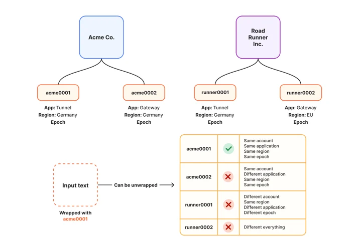
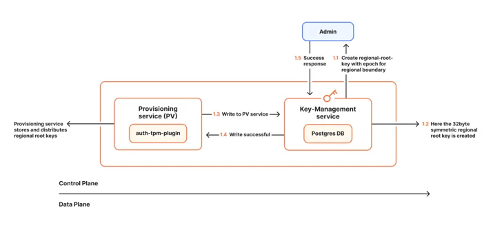
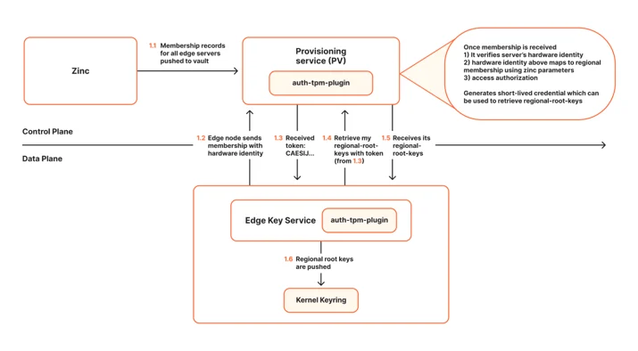
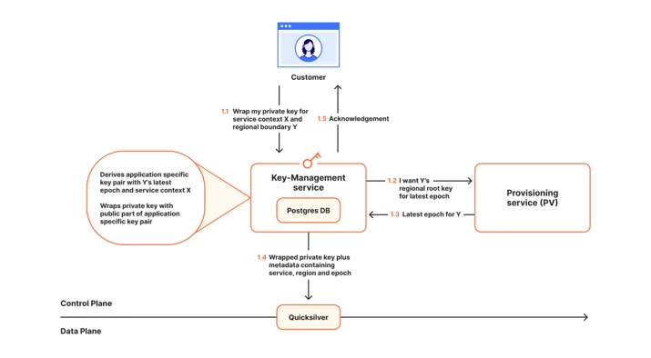
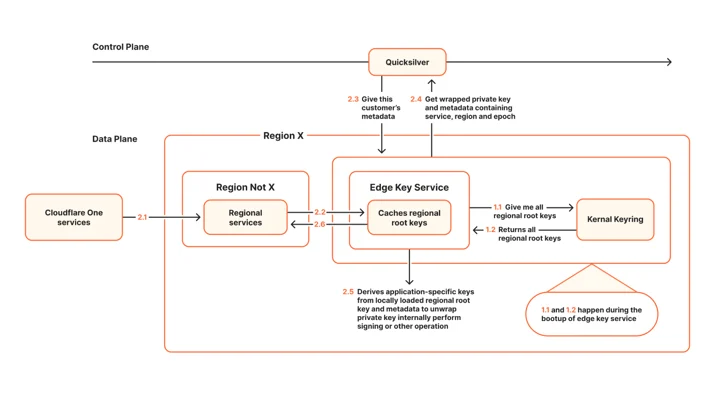

# 将后量子密码学引入具有地理边界限制的密钥管理

> **来源**: [https://blog.cloudflare.com/post-quantum-geo-key-manager](https://blog.cloudflare.com/post-quantum-geo-key-manager)  
> **作者**: 未知 | **发布时间**: 2026-10-23T18:06:56.089000+00:00  
> **深度调研**: [查看专题调研报告](research.md)  
> **标签**: 后量子密码学, GeoKey Manager, HPKE, ML-KEM-768, X25519, 密钥管理, 数据主权

---

## AI 导读

客户需要让加密数据在全球网络中保持可用，又要限制哪些地区的服务器能使用私钥；对长期敏感数据，还需防范攻击者先收集密文、等量子计算成熟后再破解。文章介绍的新方案把客户私钥加密后全球分发，将解密所需的区域根密钥通过独立服务发给获准服务器。授权依据包括可信平台模块（TPM）提供的硬件身份、服务器位置记录和区域配置，因此地域限制依赖这些控制环节的正确性。

每个区域根密钥按服务和密钥代次派生应用密钥对，再用公钥加密客户私钥。当前方案采用混合公钥加密（HPKE）框架，结合抗量子算法 ML-KEM-768 与传统密钥协商算法 X25519；文章称，只要两者至少一个仍安全，就能维持机密性。同一服务、区域和代次共享应用密钥对，因此应用密钥泄露可能影响多个客户，区域根密钥泄露的影响更广。

系统在缺少密钥或检查失败时拒绝请求。平滑轮换允许旧代次短暂共存，强制轮换则重新加密相关客户私钥，以移除旧代次。区域根密钥保存在内核密钥环而非磁盘，重启后需重新授权获取。不过，边缘服务会在进程内缓存密钥，直到重启或缓存过期，正文没有给出撤销权限的最长生效时间。

这套机制控制私钥在哪里解密和使用；请求路由、隧道终止和流量检查仍由其他机制负责。产品处于封闭测试阶段，内容分发网络（CDN）集成仍在开发。正文提供了架构和运行取舍，但没有性能数据、测试结果或足以独立验证安全保证的实现细节。

---

## 原文整理

# 将后量子密码学引入具有地理边界限制的密钥管理

今天，Cloudflare 推出支持后量子密码学、具有地理区域限制的密钥管理器，为我们的 Data Localization Suite（DLS，数据本地化套件）提供支持，并进入封闭测试阶段。这款全新的 PQ GeoKey Manager 是 Cloudflare 数据主权解决方案的基石，确保客户的解密密钥只能在其选定的地理区域内访问。为实现这一点，GeoKey Manager 会对每个解密密钥进行加密封装，使其只能由位于获准区域内的 Cloudflare 服务器解密。

虽然我们计划在 2027 年第一季度正式发布，但今天的推出仍是一个重要里程碑：我们既要支持客户实现数据主权目标，也要将 Cloudflare 的所有产品迁移到[后量子（PQ）密码学](https://blog.cloudflare.com/post-quantum-roadmap/)。

政府、金融机构、医疗服务提供者和国防组织处理的数据高度敏感，而且在产生后的数年乃至数十年里，可能仍然敏感。保护这些数据通常需要加密。如果使用传统公钥加密，攻击者并不需要现在就拥有量子计算机，也能让这些数据面临风险：他们可以先保存密文，等到量子计算机能够破解保护这些密文的公钥密码算法时，再进行解密。这种攻击策略被称为“先收集，后解密”。

对于有地理区域要求的组织来说，抵御这种威胁只解决了一半问题。在 Cloudflare 这样的规模下，要实现高可用，就必须把客户数据复制到全球网络中的众多服务器上。然而，许多数据主权法规要求，某些类型的数据只能在指定的地理区域内处理。因此，我们必须确保数据经过端到端加密，使得只有区域内的服务器才能访问明文。本文将介绍实现这一目标的系统。

## GeoKey Manager 的演进

早在 2017 年，Cloudflare 就通过 [GeoKey Manager](https://developers.cloudflare.com/ssl/edge-certificates/geokey-manager/) 率先提出了对传输层安全协议（[TLS](https://www.cloudflare.com/learning/ssl/transport-layer-security-tls/)）密钥施加地理限制的概念。客户可以控制其 TLS 私钥能在 Cloudflare 任播网络的哪些位置解封，从而在技术上更有力地保证请求在哪个区域被解密。例如，客户可以选择仅在印度解封私钥。这样，GeoKey Manager 就会确保每个客户请求的 TLS 签名都在我们的印度网络内完成，而不是允许整个 Cloudflare 全球网络进行解密。

2022 年，GeoKey Manager 再次演进，引入了[基于密文策略的属性加密](https://blog.cloudflare.com/inside-geo-key-manager-v2/)（ABE）。ABE 不再将加密后的密钥绑定到一组固定的数据中心，而是通过国家或区域等属性表达地理要求，例如“区域 = 欧盟”或“区域 = 加拿大 + 美国 + 墨西哥”。新获授权的服务器可以获得相应的解密能力，无需重新封装每个客户的密钥。

这种灵活性为向后量子密码学的迁移带来了挑战，也带来了机会。目前还没有可用于生产环境的后量子 ABE 方案，而客户需要的区域数量也不多。更简单的设计就能满足要求，而且更容易维护和运行。因此，Cloudflare 采用了结合 [ML-KEM-768](https://en.wikipedia.org/wiki/ML-KEM) 和 [X25519](https://en.wikipedia.org/wiki/Curve25519) 的混合保护方案，并使用两类密钥。其中，ML-KEM-768 是一项 [NIST](https://www.nist.gov/) 标准，也让我们能够服务对数据敏感性要求极高的客户。区域根密钥是与某个区域绑定的对称密钥；针对特定应用的密钥对则从区域根密钥派生，供 [Gateway](https://www.cloudflare.com/products/gateway/) 或 [Tunnel](https://developers.cloudflare.com/cloudflare-one/networks/connectors/cloudflare-tunnel/) 等单一服务使用。这既能保护私钥材料免遭“先收集，后解密”攻击，又能维持密钥使用的区域边界。

## 密文全球分发，密钥区域内解封

新一代 GeoKey Manager 是 Cloudflare 数据主权解决方案的密钥基础。它控制受保护的解密密钥可以在哪个区域、何时使用。隧道在哪里终止、流量在哪里检查、如何路由，以及在哪里处理明文，由其他独立的工作来决定。但所有这些工作都依赖客户私钥能在哪个区域解封，因为只有能取得该密钥的地方，才能解密 TLS 流量。

初始化时，边缘密钥服务会验证配置要求的所有区域根密钥是否均已加载。这个服务是运行在每台 Cloudflare 边缘服务器上的组件，负责解封客户私钥，并使用这些私钥处理请求。如果配置要求的某个密钥缺失或格式有误，服务就不会启动。初始化之后，如果单个请求的元数据指定了本地不可用的区域根密钥，该请求也会在检查失败时被拒绝：Cloudflare 会拒绝请求，而不会冒险在区域之外解封密钥。如果一个属于德国的请求由于某种原因试图在西班牙或法国解密，就会失败，因为西班牙和法国都没有德国的区域根密钥。这保证了无论发生什么情况，区域根密钥都不会离开其所属区域。

Cloudflare 需要在大规模保障客户区域化数据安全的同时，维持高性能。这正是新一代 GeoKey Manager 的作用所在。我们利用后量子密码学限制客户私钥的解封位置，从而在逻辑上划分网络，同时实现快速处理。我们的大多数区域都将支持客户把工作流程限定在区域内，不过具体产品可能会有一些限制。客户只需选择一个区域，Cloudflare 就会管理在该区域边界内解封私钥所需的其余一切。

## GeoKey Manager 如何确保密钥只能在指定区域内使用

GeoKey Manager 控制经过封装的私钥可以在数据平面的哪些位置解封和使用。它不控制请求在哪里转发或路由——这由 [Regional Services（区域服务）](https://developers.cloudflare.com/data-localization/regional-services/) 负责——也不控制隧道在哪里终止，或流量在哪里接受检查，后者同样由 Regional Services 负责。

GeoKey Manager 将全球分发的封装私钥与解封所需的区域根密钥分开处理。我们的全球配置分发系统 [Quicksilver](https://blog.cloudflare.com/quicksilver-v2-evolution-of-a-globally-distributed-key-value-store-part-1/) 会将封装后的私钥及其元数据分发到整个网络，但不分发区域根密钥。区域根密钥由独立的配置服务存储，并且只会发送给获得相应区域授权的边缘服务器。区域根密钥沿着独立、受控的路径传递。在数据平面，节点的区域配置，也就是节点所属的区域，决定了哪些节点可以接收哪些区域根密钥。

### 密钥层级与应用专用密钥的定义

每个经过封装的客户私钥都带有元数据，标明其服务上下文、区域边界和代次（epoch）。

服务上下文指使用该密钥的 Cloudflare 服务，例如 Tunnel 或 Gateway。区域边界指获准解封和使用该密钥的一组 Cloudflare 数据中心，例如位于德国或欧盟的数据中心。代次用于标识该密钥属于哪一代区域根密钥；每次轮换都会创建一个新代次。

例如，Acme Co. 可能有一个供德国 Tunnel 使用的密钥（acme0001），以及另一个供德国 Gateway 使用的密钥（acme0002）。Road Runner Inc. 可能有一个供德国 Tunnel 使用的密钥（runner0001），以及另一个供欧盟 Gateway 使用的密钥（runner0002）。

服务上下文、区域边界和代次都相同的密钥，会使用同一组应用专用密钥对。因此，如果 Tunnel 在德国使用的应用专用私钥被攻破，acme0001 和 runner0001 都可能暴露，但 Gateway 的密钥不会受此影响。如果德国的区域根密钥被攻破，则可能影响同一代次中从该根密钥派生的所有应用专用密钥，包括 acme0001、acme0002 和 runner0001。

在当前架构中，应用专用密钥对是非对称的。公钥部分用于封装客户的私钥材料，私钥部分则用于解封。封装后的私钥会连同其服务上下文（[Access](https://www.cloudflare.com/products/access/)、Gateway、Tunnel、[Cloudflare One 客户端](https://developers.cloudflare.com/cloudflare-one/team-and-resources/devices/cloudflare-one-client/)）、区域和代次一起分发。

### 配置区域根密钥

当 Cloudflare／管理员为某个 CF1 用例配置区域时，密钥管理服务会创建区域根密钥，将其与区域边界和代次关联，再发送给配置服务进行存储和分发。密钥管理服务还负责派生应用专用密钥对，并封装客户私钥。配置服务底层使用 Vault，由我们在自有基础设施上管理。

### 为边缘服务器授予区域访问权限

边缘服务器在接收区域根密钥之前，配置服务会评估三方面的信息：

1. [可信平台模块](https://en.wikipedia.org/wiki/Trusted_Platform_Module)（TPM）证明该服务器持有已注册的硬件身份。
2. Cloudflare 的服务器资产清单系统 [Zinc](https://blog.cloudflare.com/redefining-fleet-management-at-cloudflare/) 将该身份映射到数据中心和位置。
3. 配置服务确定该服务器可以访问哪些区域根密钥。

Zinc 会更新每台边缘服务器的区域归属记录。这个异步过程会随着网络扩张加入新服务器，并在服务器退役时将其移除。当 Cloudflare 对德国的数据中心进行维护时，Zinc 中关于哪些数据中心属于德国的记录也会改变。更新后的信息会通过 Quicksilver 快速传播到整个网络，让边缘服务器掌握最新情况。反过来也一样：当我们为网络增加容量时，Zinc 中德国或任何其他区域的范围也会更新，并通过 Quicksilver 快速传播到整个网络。

Zinc 还会将已注册的硬件身份与服务器及其物理位置关联起来，以支持符合 [FIPS 140-3](https://en.wikipedia.org/wiki/FIPS_140-3) 的要求。由 TPM 支持的身份、服务器资产清单数据和区域配置，共同决定边缘服务器属于哪个区域，以及可以访问哪些区域根密钥。

每台边缘服务器都会调用控制平面的配置服务，并提供其已注册的硬件身份。配置服务验证服务器的硬件身份和区域归属后，会签发一个令牌，只允许该服务器获取其所在位置获准使用的区域根密钥。每台边缘服务器收到令牌后，便用它获取区域根密钥。

获授权的边缘服务器会将区域根密钥加载到[内核密钥环](https://kernel-internals.org/crypto/keyring/)中，而不是将其持久化到磁盘。进程级访问控制会限制哪些服务可以使用这些密钥。由于这些密钥存储在易失性内存中，机器重启就会将其清除，服务器必须重新进行身份验证并再次获取密钥。这增加了运维复杂度，换来的是减少持久化存储的密钥材料，因为这些材料可能成为攻击者的攻击入口。

### 封装私钥，以便全球分发

密钥管理服务收到客户的私钥材料及其服务上下文和区域边界后，会根据请求中的区域边界，获取区域根密钥及其当前配置的最新代次。随后，它会派生出相应的非对称应用密钥对，并使用公钥部分封装私钥，得到封装后的私钥及其元数据。

接着，Quicksilver 会将封装后的私钥和元数据分发到整个网络。由于封装后的密钥需要在指定区域才能解密，因此，将其全球分发并不意味着全球边缘服务器都能访问该私钥：解封仍然需要相应的区域根密钥和服务上下文。

### 在数据平面使用应用专用密钥解封

## 为什么选择这种密码学设计

### 对称根密钥与非对称密钥封装

区域根密钥是 256 位对称密钥。GeoKey Manager 从每个区域根密钥派生出应用专用密钥。在当前 Cloudflare One 的处理流程中，控制平面的密钥管理服务会派生出一组应用专用的[混合公钥加密](https://blog.cloudflare.com/hybrid-public-key-encryption/)（HPKE）密钥对。

### HPKE 与混合后量子 KEM

Cloudflare One 的处理流程使用 [RFC 9180](https://www.rfc-editor.org/info/rfc9180) 定义的 HPKE。其密钥封装机制（KEM）结合了 [ML-KEM-768](https://en.wikipedia.org/wiki/ML-KEM) 与 [X25519](https://cryptography.io/en/latest/hazmat/primitives/asymmetric/x25519/)，使用 [HKDF](https://datatracker.ietf.org/doc/html/rfc5869)-SHA-256 派生密钥，并使用 AES-256-GCM 进行认证加密。将后量子组件与传统组件相结合，意味着只要至少一个组件仍然安全，就能维持机密性。

### 为密钥轮换而设计

经过验证的设计支持两种密钥轮换方式：平滑轮换和强制轮换。

平滑轮换会为区域根密钥创建一个新代次，同时保留对有限数量的旧代次区域根密钥的受控访问权限，例如只保留上一代。客户的新私钥材料会使用最新代次进行封装，而较早封装的私钥在过渡期间仍可使用。这类似于信用卡公司允许获授权的商户继续使用你的上一版信用卡进行定期扣款。在这里，我们支持的代次数量，决定了之前封装的私钥——也就是比喻中的信用卡——还能使用多少代。这让客户在过渡期间也能保持服务持续运行。

强制轮换则会使用替代代次，重新封装受影响客户已经封装的私钥，从而可以移除对旧代次的访问权限。这就像信用卡公司在任何情况下都不再允许你使用旧信用卡进行交易。

### 安全性与可用性的取舍

检查失败时拒绝请求，是我们有意作出的设计选择。如果检查失败后仍然放行，就意味着不拒绝请求，而是在获准区域之外解封客户私钥。我们绝不会这样做：任何一项必要检查失败，包括服务上下文、区域、代次等检查，请求都会被拒绝。启动时，每台边缘服务器上的密钥服务都会从其 Linux 内核密钥环中加载配置要求的所有区域根密钥。根密钥缺失或格式有误，都会导致边缘密钥服务无法初始化。运行后，边缘密钥服务会使用内存中的副本，以防止密钥被篡改，从而阻止区域外或跨区域解封。实际上，只有在配置和密钥分发均完成后，边缘服务器才会处理某个区域的请求。

信任边界涵盖所有能够访问区域根密钥的服务，包括密钥管理服务、配置服务和获得授权的边缘密钥服务，因为它们都能访问区域根密钥。密钥管理服务用它们派生应用专用密钥，配置服务负责存储和分发它们，边缘密钥服务则使用本地获准持有的副本。Quicksilver 位于这一信任边界之外，因为它只会收到封装后的私钥及其相关元数据。

## GeoKey Manager 的运行管理

Cloudflare 的网络始终在变化。服务器投入或退出运行时，Cloudflare 的服务器资产清单会更新其区域归属。这意味着，构成西班牙等区域的数据中心名单并不是固定不变的。GeoKey Manager 的配置层每天会多次刷新归属信息，随着网络变化授予或移除区域根密钥的访问权限。这个过程独立于密钥轮换，客户无需采取任何操作。

区域归属发生变化时，配置服务会立即同步服务器的 Linux 内核密钥环，使其包含最新获准使用的区域根密钥。边缘密钥服务会将这些密钥缓存在进程内存中，直到服务重启或缓存过期。届时，它会从内核密钥环重新加载当前获准使用的密钥集合。

## 下一步：Cloudflare One 集成与 CDN

GeoKey Manager 是 Cloudflare One 改进版 Regional Services 的基础；这些新功能将在几个月后公布。

旧版 GeoKey Manager 已经能够对 CDN 证书所关联的私钥施加地理限制。我们正在单独开发一项集成工作，将本文介绍的新一代后量子 GeoKey Manager 引入现有的 CDN 功能。待这项工作就绪后，我们会分享测试和迁移的详细信息。

## 开始使用

如果你是现有的 DLS 客户，正在将 CDN 流量限定在区域内处理，可以在该功能面向 CDN 流量正式发布前，通过[此处](https://forms.gle/GwBH2JKgF65QBpoAA)登记测试意向。

感谢所有让这款产品成为现实的人。这是 Data Localization Suite、Cloudflare One 和 Cloudflare Research 团队共同投入大量努力的成果。