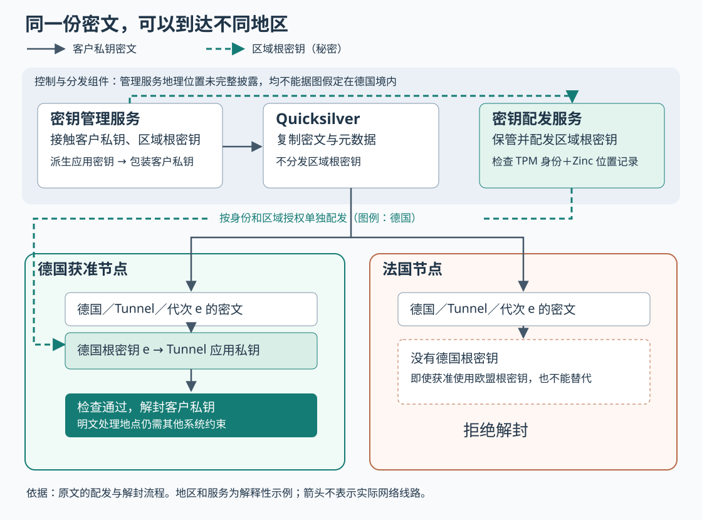
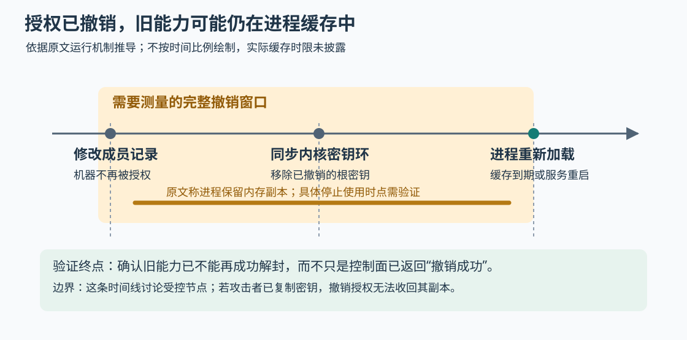

# 密文可以全球复制，解密能力如何留在指定地区？理解 Cloudflare 的后量子 GeoKey Manager

> 来源：[blog.cloudflare.com](<https://blog.cloudflare.com/post-quantum-geo-key-manager>)  
> 作者：未知 · 发布时间：2026-10-24 02:06（Asia/Shanghai）  
> 翻译正文：[阅读中文正文](article-zh-CN.md)

一家企业希望借助全球网络接收请求，又要求处理敏感内容的密钥只能在指定地区使用。把密钥复制到所有服务器上，会扩大泄露范围；每次都向远端服务器申请使用密钥，又会引入网络依赖。Cloudflare 新版 GeoKey Manager 的做法是：全球分发加密后的客户私钥，只向获准地区的边缘服务器提供解开它的能力，并为这层加密加入抵抗未来量子攻击的算法。

这套设计值得需要地区限制、又要跨地区部署服务的团队关注。但它首先解决的是**客户私钥在哪里能被解封**。要让流量明文、日志和业务处理也留在指定地区，还需要其他系统配合。

本文以 Cloudflare 的 [《Bringing post-quantum cryptography to geographically fenced key management》](https://blog.cloudflare.com/post-quantum-geo-key-manager/) 为研究主体。原文发布于 2026 年 10 月 23 日；截至本次核验日期 2026 年 10 月 24 日，文章描述的是封闭测试，正式开放计划为 2027 年第一季度。当前重点是 Cloudflare One 企业网络与安全服务的路径，内容分发网络（CDN）的新版接入仍在开发，不能据此认为现有 CDN 地区密钥功能已经完成后量子升级。下文用“原文披露”“外部资料”和“分析”区分证据来源；假设场景与实践建议不代表生产实测。

## 先看一个请求为什么应该被拒绝

**假设**某企业有两把客户私钥：一把供 Tunnel 隧道服务使用，限定在德国；另一把供 Gateway 网关服务使用，限定在欧盟。法国服务器可能获准持有欧盟对应的解封能力，但这不等于它可以使用德国专属的那把密钥。德国属于欧盟，也不意味着“德国”和“欧盟”这两个策略可以互换。

企业把德国 Tunnel 私钥交给密钥管理服务后，系统先将它加密，形成“包装后的私钥”。这里的**包装**就是用另一组密钥保护客户私钥；反向恢复私钥称为**解封**。包装结果可以复制到法国、美国等地，因为仅拿到这份密文不足以还原私钥。

正常情况下，获准的德国服务器拥有德国区域根密钥，可以从中得到 Tunnel 所需的应用密钥，再解封客户私钥。法国服务器没有德国根密钥，即使收到同一份密文，也应拒绝解封。原文称这种行为为 **fail closed，即检查失败就拒绝服务**：缺少授权能力时，不以跨地区解密维持可用性。

这个例子同时揭示了两种不同的限制：地区决定哪些服务器可以拿到根密钥，服务类型决定系统应选择哪组应用密钥。两者共同参与处理，但应用密钥的分组并不自动构成对根密钥持有者的隔离，后文会解释。

## 为什么从属性策略改为区域根密钥

原文需要同时应对两件事。第一，服务器不断新增、退役和维护，不能每增加一台机器就重新加密所有客户密钥。第二，攻击者可能现在保存密文，将来利用足够强的量子计算机破解传统公钥算法，这就是“先收集、后解密”。后量子密码的目标是抵御这类量子攻击，不意味着能防止运行中的服务器被入侵。

旧版使用**密文策略属性基加密（CP-ABE）**：加密时把访问条件附在密文上，机器持有与自身属性对应的解密材料，满足条件才能解密。例如，可以表达“位于欧盟”这样的条件。Cloudflare 的[旧版技术说明](https://blog.cloudflare.com/inside-geo-key-manager-v2/)确认了这种设计，并说明新增合格机器不必逐份改写客户密文。

原文给出的改版理由是：客户实际需要的区域组合有限，而团队没有可直接用于生产的后量子属性基加密方案。于是，新版把复杂策略收缩为明确的区域集合，为各区域配置根密钥，再使用后量子与传统算法相结合的公钥加密保护客户私钥。

**分析：**这是用较少的策略表达能力，换取更明确的算法和运维路径。新版仍能通过给新机器发放区域解封能力来扩容；变化的是不再依赖属性基加密表达丰富条件。“没有生产就绪的后量子 ABE”应理解为原文的选型判断，不能扩大为数学上不存在相关方案，也不能推出所有组织都适合放弃属性策略。

## 两条分发路径，承担不同职责

原文将配置和发放权限的部分称为**控制面**，把边缘服务器实际处理请求的部分称为**数据面**。理解它们不需要记住所有产品名，关键是看谁接触了什么。

| 组件 | 收到和保存什么 | 负责什么 |
| --- | --- | --- |
| 密钥管理服务 | 客户私钥、区域根密钥 | 创建根密钥，派生应用密钥，包装客户私钥 |
| 密钥配发服务 | 根密钥、机器身份和区域授权信息 | 判断机器可领取哪些根密钥；原文称底层使用自行部署的秘密管理软件 Vault 保管 |
| Zinc 服务器资产系统 | 硬件身份、机房和位置记录 | 将具体机器映射到区域，为授权提供依据 |
| Quicksilver 全球配置分发系统 | 包装后的客户私钥及其元数据等配置 | 广泛复制密文；不负责分发根密钥 |
| 边缘密钥服务 | 获准领取的根密钥、客户密钥密文 | 在本地检查条件并解封客户私钥 |

图中实线表示密文分发，虚线表示根密钥配发；控制面的位置没有被画进德国边界，因为原文未披露这些管理服务的完整地理部署。图按原文机制整理，并用假设的德国区域说明，不表示实际网络拓扑。

完整过程可以按以下顺序理解：

1. **创建区域根密钥。**密钥管理服务生成一个 256 位对称秘密，与区域和代次绑定。代次在原文中称为 **epoch**，用于区分轮换前后的根密钥。
2. **确认服务器身份和归属。**机器通过可信平台模块（TPM，一种支持硬件身份与密码操作的安全组件）证明自己持有已登记的硬件身份。配发服务再查询 Zinc，将身份与机房、区域对应起来。
3. **按授权配发根密钥。**验证通过后，机器得到只允许领取指定根密钥的令牌。根密钥先放入 Linux 内核密钥环，即内核提供的受权限控制的密钥存储设施；边缘密钥服务随后读取获准材料。
4. **包装并复制客户私钥。**管理服务按“服务、区域、代次”选择应用密钥对，用公钥包装客户私钥，再由 Quicksilver 分发包装结果与元数据。
5. **在边缘解封。**边缘服务根据元数据找到本地根密钥，派生相应应用私钥并解封。原文称启动时缺少所需根密钥会导致服务无法初始化；运行时缺少相应根密钥或检查不通过，则拒绝请求。

这个顺序解释了扩容为什么不必改写所有客户密文：新增机器拿到同一授权范围内的根密钥，就可以得到相应应用密钥。代价是获准机器持有的能力较强，机器身份、区域登记和根密钥保护都进入了安全前提。

## 后量子算法到底保护了哪一步

原文披露，当前路径使用 **HPKE（混合公钥加密）**包装客户私钥。这里的“混合”首先指把公钥机制与对称加密组合起来，不等于协议天然抗量子。新版又在其中组合后量子和传统公钥算法，这是第二层含义。

按原文算法选择及 [HPKE 的 RFC 9180](https://www.rfc-editor.org/rfc/rfc9180.html)，可以把一次包装理解为三个动作：

- **先建立一个共享秘密。**密钥封装机制（KEM）让发送方根据接收方公钥产生共享秘密和封装数据；接收方必须使用对应私钥，才能从封装数据恢复同一秘密。
- **再生成本次加密所需的密钥。**密钥派生函数把共享秘密转换成指定用途的密钥材料。原文使用 HKDF-SHA-256。
- **最后加密客户私钥并检测篡改。**原文使用 AES-256-GCM，它属于认证加密：既隐藏私钥内容，也让接收方发现密文被修改。分发包中需要携带封装数据和加密结果。

原文的 KEM 组合了 **ML-KEM-768** 和 **X25519**。前者是美国国家标准与技术研究院（NIST）在 [FIPS 203](https://csrc.nist.gov/pubs/fips/203/final) 中标准化的后量子密钥封装算法的一种参数配置；后者是成熟的传统椭圆曲线密钥交换算法。组合的目标是：在组合方式正确、实现和其他前提成立时，即使其中一种算法失守，另一种仍能支撑保密性。

这里不能跳过“组合方式正确”这个条件。RFC 9180 给出 HPKE 框架，并未在其原始算法表中定义这套 ML-KEM-768 与 X25519 组合。外部的 [X-Wing 技术草案第 10 版](https://www.ietf.org/archive/id/draft-connolly-cfrg-xwing-kem-10.html)展示了由这两种算法构造混合 KEM 的具体方法，也明确说明组合器的安全性依赖所选算法的细节。**原文没有披露完整组合规范，不能据此确认 GeoKey Manager 使用的就是 X-Wing，更不能自行拼接两个结果充当生产实现。**

同样需要区分两次派生：一次是“区域根密钥 → 应用密钥对”，另一次是 HPKE 内部“共享秘密 → 本次加密密钥”。原文明确了后者使用 HKDF-SHA-256，但没有给出前者完整的标签、编码和派生规范。[HKDF 文档](https://www.rfc-editor.org/rfc/rfc5869.html#section-3.2)说明了如何通过上下文信息区分不同用途；这支持设计原则，不等于验证了该产品的具体实现。

因此，公开资料足以解释机制，尚不足以逐字节复现或独立审计其密码实现。文章没有提供新版源码、完整测试向量和端到端基准，本文也未进行该系统的部署实测。

## 哪些安全边界不能由这层加密单独保证

### 私钥的位置，不等于明文的位置

原文有一句概括称，TLS 流量只能在私钥可用的地方解密。TLS 是保障网络连接机密性与完整性的协议；在 **TLS 1.3 的证书认证握手**中，证书私钥主要用于签名证明服务器身份，真正保护业务流量的是握手建立的会话密钥。[RFC 8446](https://www.rfc-editor.org/rfc/rfc8446.html#section-2)把密钥交换和身份认证区分为不同步骤。

这意味着，若其他位置可以远程请求签名，并在那里持有会话密钥，私钥留在区域内也不自动把明文留在区域内。Cloudflare 的 [Keyless SSL](https://developers.cloudflare.com/ssl/keyless-ssl/)就是私钥可以由客户保留、仍为 Cloudflare 提供服务的实例。

所以，原文的概括不能当作普遍的协议保证。Cloudflare 的 [Regional Services 文档](https://developers.cloudflare.com/data-localization/regional-services/)另外规定：将加密请求转发进指定区域，在区域内终止 TLS，也就是完成解密并开始处理明文。**密钥使用约束与流量处理约束必须一起核验**，还要单独检查源站、日志、缓存和会话恢复材料的去向。

这也说明，给客户私钥换上后量子包装，并不自动升级客户端到边缘、边缘到源站等所有连接的密钥交换算法。包装密文与网络流量是不同保护对象，不能把前者的升级表述为整个链路已经抗量子。

### 硬件身份需要依靠可信的位置登记

原文描述的 TPM 证明是“这台机器持有已登记的硬件身份”，位置则来自 Zinc。因而，地理边界依赖一条链：硬件身份可信、身份与机房的映射正确、区域授权正确、配发服务按这些记录执行。

**分析：**如果机器搬迁后资产记录未更新，或有权限的人错误修改了区域归属，密码算法本身不会发现“这台机器实际上已不在德国”。原文链接的 [Zinc 介绍](https://blog.cloudflare.com/redefining-fleet-management-at-cloudflare/)说明了权限限制和变更审批机制，这有助于控制登记风险，但不能据此推断新版的所有位置变更都有某种确定时限。

原文还明确把密钥管理服务、配发服务和获准边缘密钥服务列入信任边界：它们都能接触区域根密钥。管理服务也会接触客户私钥。**“根密钥在任何情况下都不会离开区域”不能仅由边缘拒绝解封推导出来**；还需核验管理服务、Vault、备份和运维路径的位置及访问权限。原文没有提供这些环节的完整地理证明。

### 按服务分组，仍然存在跨客户影响

原文披露：同一“服务、区域、代次”的客户密钥共享同一应用密钥对。因此，德国 Tunnel 应用私钥泄露，可能影响使用这组应用密钥包装的多个客户私钥；德国某代次的根密钥泄露，则可能影响该代次下多个服务的客户私钥。

服务分组能限制**仅泄露某个应用私钥**时的影响，但边缘服务若持有区域根密钥，就拥有派生该根下其他应用密钥的基础材料。它不能只靠“服务上下文”标签获得根级别的强隔离。若要求不同租户或服务之间即使发生进程入侵也不能相互影响，就需要进一步拆分根密钥、收紧进程权限或使用隔离的执行设施；这些是分析建议，不是原文已披露的保证。

### 内核撤销，不会自动抹掉进程中的副本

原文称，区域成员关系会每日多次刷新；授权变化后，配发服务同步内核密钥环。但边缘密钥服务会把根密钥缓存在进程内存中，直到重启或缓存到期才重新读取。

图中的间隔没有按真实时间比例绘制。关键在于：**停止继续配发密钥、删除内核中的密钥、停止使用已有密钥，是三个不同事件。**Linux 的[内核密钥文档](https://docs.kernel.org/security/keys/core.html)描述了权限、到期和撤销状态；这些机制并不等于追踪并擦除已经复制到用户进程中的字节。

**分析：**评估撤销时，应测量从登记变更到最后一次仍能成功使用旧能力的完整时间，而不能只测配发服务的响应。原文未给出成员刷新、缓存过期和异常情况下停止使用的最大时限，因此无法证明“撤销立即生效”。内存保存降低了边缘磁盘残留风险，也不意味着内存无法读取或篡改；还需考虑进程入侵、转储和已被窃取的副本。

## 轮换能停止什么，又不能挽回什么

原文定义了两种轮换方式。**软轮换**生成新代次，用它包装新客户私钥，同时保留受控数量的旧代次，避免旧密文立即不可用。文中“保留上一代”只是例子，不能当作固定产品承诺。**硬轮换**则把受影响的客户私钥重新包装到替代代次下，随后移除旧代次的使用能力。

**分析：**硬轮换需要先确认目标机器拿到新材料、客户密文重包装并分发完成，再撤除旧代次，否则可能造成请求失败。应急轮换还要处理缓存和离线机器，不能把“创建新根密钥”当作操作终点。

更重要的是，**重包装不会改变客户私钥本身，也不能收回已泄露的秘密。**如果攻击者已经取得旧应用私钥以及旧包装密文，即使系统后来删除旧代次，攻击者仍可能在系统外解开那份历史密文。若客户私钥已经暴露，往往还需更换客户密钥及相关证书或凭据，具体取决于其用途。

这与**前向保密**有关：它要求长期秘密后来泄露时，过去的密文仍保持安全。HPKE 文档第 9.7.4 节明确说明，它不针对接收方长期秘密泄露提供这种保证。后量子包装降低的是未来破解算法带来的风险；根密钥失窃则是另一种失败路径，不能靠算法名称化解。[依据：RFC 9180 的安全边界](https://www.rfc-editor.org/rfc/rfc9180.html#section-9.7.4)。

## 与替代方案相比，代价转移到了哪里

以下比较属于基于架构的分析，不是同环境性能测试。地区数量、客户密钥数量、轮换频率和组织分工都会改变结果。

| 做法 | 能解决什么 | 主要代价与边界 |
| --- | --- | --- |
| 区域根密钥＋后量子混合公钥包装 | 密文广泛复制，区域内本地解封；适合明确、有限的区域集合 | 要维护机器归属、根密钥配发和缓存撤销；同一根的泄露影响较大 |
| 属性基加密 | 直接用属性表达更丰富的访问条件 | 密码与策略实现更复杂；是否有满足本团队后量子、安全审计和运维要求的实现需单独评估 |
| 区域对称密钥包装 | 使用共享秘密加解密，组件可以更少 | 包装方也需要掌握对称秘密；仍须处理区域授权、密钥隔离与撤销问题 |
| 远程密钥操作，例如远程签名 | 尽量避免把长期私钥放到每台业务机器 | 请求依赖远程服务的连通性和容量；远程签名本身不限制明文处理地点 |

非对称包装的一个潜在优势是：只需公钥就能包装，包装方不必有解封能力。但原文中的密钥管理服务仍然持有根密钥，所以这是算法允许的职责拆分，不是当前架构已经消除管理端信任的证据。对小团队而言，如果只有一个区域、一个可信写入服务，对称包装可能更容易维护；不能仅因要考虑量子风险，就认定必须引入复杂的公钥层。

原文强调本地处理和性能，却没有给出新版延迟分布、吞吐、缓存命中率、资源占用或故障恢复数据。合理的架构推断是：本地解封避免在正常使用路径上逐次等待跨区密钥请求，但增加了边缘计算、密钥复制和轮换负担。实际收益多少、需要多少容量，仍然未知；旧版测试也不能直接代替新版实测。

可靠性上的取舍则很明确：一个地区缺少根密钥时，就拒绝该地区的相关服务。它保住了地区边界，却可能扩大配发故障和批量重启的业务影响。运维团队需要同时控制配置发布与密钥就绪状态；安全团队需要维护授权和撤销要求；应用团队要保证路由与明文处理规则一致。复杂度从单个密码算法延伸到了跨团队变更流程。

这套设计也有明确的不适用场景：如果要求连密文副本都不能出境，全球分发密文就不符合该技术前提；如果要求服务提供方完全不能接触客户私钥，原文中持有私钥和根密钥的管理服务就不满足这一要求；如果业务要求区域完全不可用时仍跨区解密继续服务，则与“检查失败就拒绝”的边界冲突。这些都应在选型前明确，而不是在故障时临时放宽。

此外，使用标准算法不等于整个产品已经通过认证。NIST 的 [FIPS 140-3 验证问答](https://csrc.nist.gov/Projects/cryptographic-module-validation-program/faqs)区分了采用算法、厂商声称符合要求，以及经过验证的密码模块。原文没有提供足以核验此新系统认证范围的证书编号，不能从 ML-KEM 已标准化推导出整套系统已获认证或满足某项地区法律。

## 个人或小团队怎样做最小验证

以下是**建议的试验方案，本文未执行**。目标是验证“密文能复制、能力受限制、撤销有时限”，无需复建 Cloudflare 的全球网络。适合开始试验的前提是：确有区域限制，团队能维护机器身份与位置记录，也能接受区域故障时拒绝服务。若需求只是单区部署，或不能承担密钥轮换与配发系统的长期维护，应先评估现成的区域密钥管理服务。

**第一步：写清三个允许和一个时限。**确定密文能放哪里、客户私钥能在哪里解封、明文能在哪里处理，再约定授权撤销的最长生效时间。把备份、调试日志、会话恢复和故障切换也纳入范围。否则，“密钥本地化”很容易被误当作整个业务的地理约束。

**第二步：只搭一个最小权限对照。**准备一个配发端和两个测试节点，分别模拟区域 A 与区域 B。若节点没有真实跨地区部署，这只能验证授权逻辑，不能证明地理位置控制。使用测试密钥，给 A 配发区域根密钥，B 不配发；把相同客户密钥密文复制到两边。先只保留一个服务和两个代次。

**第三步：先验证拒绝，再测速度。**从错误区域请求解封，修改服务、区域、代次及客户标识，再篡改密文。建议把这些标识绑定到受认证的上下文中，并检查它们与业务对象一致；因为 HPKE 基础模式下，能生成有效密文不等于发送者有权修改某客户配置，还需要配置写入授权和防止旧版本回放。这里是实践要求，原文没有披露全部元数据绑定细节。

**第四步：注入生命周期故障。**暂停配发服务后重启 A，验证它不会带着缺失密钥进入就绪状态；撤销 A 的授权但保持进程运行，测量缓存窗口；发布新代次，验证新旧密文过渡，再撤除旧代次。专门测试“节点错过更新后重新上线”，而不只测试所有机器在线的理想情况。

**第五步：在同一机器与负载下比较成本。**选择有明确规范、测试向量和维护记录的密码库；若试验混合 KEM，应确认具体组合规范与 HPKE 接口匹配。不要自行组合密码算法。拿本团队现有方案作基线，分别测首次解封和缓存后的路径，记录处理器、库版本、并发量和密钥对象大小。

| 要验证什么 | 应记录的指标 | 通过或退出条件 |
| --- | --- | --- |
| 区域和用途限制 | 不同区域、服务、代次组合的成功与拒绝结果 | 任何不应成功的解封一旦成功，停止扩大试验并修复边界 |
| 撤销是否有效 | 从授权记录变化到最后一次成功使用的时间 | 超过事先约定的时限，或无法解释旧能力为何仍有效，停止上线 |
| 重启与配发故障 | 密钥未就绪时是否接流量，恢复耗时与失败请求数 | 缺密钥时必须拒绝；恢复成本超过业务预算则调整方案 |
| 轮换是否完成 | 未重包装对象数、旧代次调用数、离线节点恢复结果 | 受控节点仍可使用已撤除代次，就不能宣布轮换完成 |
| 性能是否可承担 | 中位及第 95、99 百分位延迟、吞吐、CPU 与内存、密文大小 | 与同条件基线比较，超出预设预算则缩小范围或退出 |

这些指标不应预填“提升多少”。若无法说明谁能改机器位置、谁能读取区域根密钥、旧缓存何时失效，以及区域不可用时业务如何拒绝，就还没有验证最重要的前提。对小团队而言，最有价值的成果可以是一条可复测的授权与撤销链路；是否继续引入后量子混合包装，应由数据保密期限、现有算法风险和可维护性共同决定。
