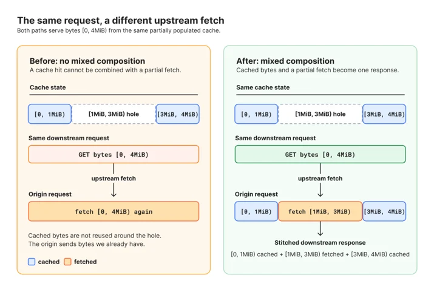

# Origin Range Requests: Serving large files without range-request tuning

> **来源**: [https://blog.cloudflare.com/origin-range-requests](https://blog.cloudflare.com/origin-range-requests)  
> **作者**: 未知 | **发布时间**: 2026-10-23T18:22:59.215000+00:00  
> **深度调研**: [查看专题调研报告](research.md)  
> **标签**: HTTP Range Requests, CDN, 缓存分块, 并发流式传输, HTTP 缓存一致性, Pingora, Cloudflare R2

---

## AI 导读

客户端只想读取大文件的一小段，缓存系统却可能从源站下载远多于所需的数据，并在多个数据中心之间重复传输。旧方案要求客户配置固定的请求范围大小：范围过小会增加回源请求和内存压力，过大则浪费带宽；同一范围内的并发请求还可能相互阻塞。

Cloudflare 的新方案利用缓存文件原本就采用的固定大小磁盘块，直接读取已缓存的字节，只为缺失部分发起与块边界对齐的回源请求，最终仅向客户端返回其请求的内容。多个请求可以共享正在进行的下载，同一个响应也可以组合磁盘缓存、下载中的数据和新补取的数据。为避免拼出混杂版本的文件，系统检查返回范围、文件总大小和实体标签（用于标识资源版本的校验值）。客户端要求的版本不匹配，或解压会改变字节位置时，系统改为返回完整内容。

作者报告，迁移后，其对象存储服务 R2 在缓存命中和未命中时，首字节等待时间的第99百分位均下降约一半；后续支持混合读取缓存与上游数据后，R2 及类似负载的分层缓存流量周环比下降约6%。这些是生产环境观察，文中未提供足以排除流量变化影响的对照数据。方案仍会为小于缓存块或未对齐的请求承担额外工作，也不改变响应能否被缓存的规则；源站需要支持按字节范围读取，部分回源才有实际作用。

---

## 原文整理

# Origin Range Requests: Serving large files without range-request tuning


A video player seeking to the middle of a movie asks for a few megabytes. Under our old range caching, that one request could make Cloudflare pull 128 MiB from the origin and move it between data centers, sometimes after the viewer had already left. Range requests are how large files get delivered, and caching them naively easily leads to wasted network bandwidth and wasted disk operations when running a CDN at scale.

So we rebuilt how our cache handles them. For R2, Cloudflare's object storage, p99 time to first byte dropped by about half, and a follow-up improvement cut [<u>tiered cache</u>](https://developers.cloudflare.com/cache/how-to/tiered-cache/) traffic for R2 and similar workloads by about 6%.

Today, we're making that new implementation available as [<u>Origin Range Requests</u>](https://developers.cloudflare.com/cache/how-to/cache-rules/settings/#origin-range-requests), a self-service feature on all plans. There's no range size to tune and no need to contact support. Turn it on with a [Cache Rule](https://developers.cloudflare.com/cache/how-to/cache-rules/), and Cloudflare handles the rest.

## A request for part of a file

An HTTP range request asks for part of a resource instead of the whole resource. The client sends a normal `GET` with a `Range` header:

```
GET /movie.mp4 HTTP/1.1
Host: example.com
Range: bytes=1048576-2097151
```
If the server supports the request, it returns `206 Partial Content` and identifies the returned bytes with `Content-Range`:

```
HTTP/1.1 206 Partial Content
Content-Range: bytes 1048576-2097151/524288000
Content-Length: 1048576
```
Range requests are common for large objects. A video player can request bytes around a seek position instead of the whole file. A download manager can resume after an interruption. A package manager can fetch part of an artifact. A client can inspect the end of a file without downloading everything before it.

The client decides whether to request a range, and Cloudflare does not change that request. Instead, Origin Range Requests changes how Cloudflare satisfies it.

## The range-size problem

Cloudflare has supported range-request caching for years via static zone configuration.

The previous implementation resembled the cache-slicing described in [<u>an nginx blog post</u>](https://blog.nginx.org/blog/smart-efficient-byte-range-caching-nginx): each client request was mapped to fixed-size ranges of the file, with the range size and file extensions configured per zone.

The size of each range created a tradeoff: small ranges led to many small origin requests and memory pressure on Cloudflare from coalescing all of the requests in-memory, while large ranges caused Cloudflare to download much more data than the client requested. Updates to the range size itself would invalidate cache entries, since the size was part of the cache key.

This design also meant people requesting content through our network could have unpleasant experiences accessing these files. Concurrent requests that fell inside the same range, no matter how far apart each client’s requested range was, could block each other. Our nginx-based cache also couldn’t combine range caching with [<u>concurrent streaming</u>](https://blog.cloudflare.com/introducing-concurrent-streaming-acceleration/), a feature we built to let multiple clients read a file from cache while it's still being written. Turning both on together cut responses short, so each range had to be fully downloaded before anyone could read it, and popular files needed a separate origin fetch for every range.

The extra bytes could also cross several parts of our distributed cache: from the origin to one data center, between cache tiers, and then toward the client. Every hop multiplied the waste. No value works equally well for a small seek, a sequential download, a large media file, and every origin and cache topology.

Our internal cache limitations were directly exposed to customers, who should not need to understand our capabilities in-depth to have files served efficiently.

Fortunately, our transition from nginx to a [<u>Pingora</u>](https://blog.cloudflare.com/how-we-built-pingora-the-proxy-that-connects-cloudflare-to-the-internet/)-based caching server created an opportunity to address the implementation problems that had forced a hard-to-use setting onto customers.

## Fixed-size cache chunks

The fix came from something Pingora was already doing. To make it easy to resume interrupted downloads, it stores every cached file on disk in fixed-size chunks. If the cache already thinks in chunks, the range size doesn't need to be a setting at all, it can just be the chunk!

For a range request, Cloudflare checks which requested bytes are already cached. It serves those bytes directly. For missing bytes, it fetches origin ranges aligned to the cache's fixed-sized-chunk boundaries, stores the result in the same chunks used for ordinary cache storage, and returns only the bytes requested by the client.

For example, a request for bytes `150-250` can cause Cloudflare to fetch the aligned chunk containing those bytes. The downstream response still contains only `150-250`.

This does not eliminate extra work for requests smaller than our chunk size — such a request can still require fetching the whole chunk containing it. We also are taking on the cost of more work for non-aligned ranges. The difference is that the extra work is bounded and predictable, and no longer determined by a customer-selected range size that can cause unpredictable effects on us and origins.

## Coordinating cached and in-flight data

Parsing the `Range` header is straightforward. The harder problem is producing one correct response when the requested bytes are split across cached data, an origin response, and downloads already in progress.

At a high level, the edge:

1. Looks up the asset headers and range-coverage metadata.
2. Reads whatever part of the asset it can from disk or streaming in memory.
3. Fetches missing coverage from the origin using aligned ranges.
4. Writes the new bytes and records the completed range in metadata.
5. Combines the pieces and sets `Content-Range` and `Content-Length` for the client response.



This is a coordinator, not a single cache lookup. One request can use a cached prefix, an in-flight download, and a newly fetched suffix. The internal origin response can be larger than the downstream response, but the downstream status and headers describe only the requested range.

If an existing download covers another request's bytes, the second request can attach to that download instead of starting another origin fetch. This shares work during bursts for popular large files.

The design uses the existing cache data model. Headers identify the asset version, the body is stored in bounded chunks, and metadata records which ranges were written successfully.

## Validate before composing

Composed range responses are valid only when all bytes belong to the same representation. The coordinator checks that each origin response matches the requested range, that the total asset size is stable, and that the entity tag remains consistent across subrequests.

The `If-Range` header lets a client request a range only if the representation still matches a known validator. If it does not match, Cloudflare returns the full representation instead of combining bytes from different versions.

Cloudflare also avoids composing ranges for a representation it is about to decompress because the range over a set of compressed bytes would be different from those selected by the range in a decompressed response. In these cases, Cloudflare serves the transformed full response rather than advertising a range it cannot honor correctly.

The resulting behavior is standard HTTP:

- A satisfiable range receives `206 Partial Content` with an accurate `Content-Range`.
- An unsatisfiable range receives `416 Range Not Satisfiable`.
- A response that cannot safely be ranged is served as the complete representation.

## What changed in production

Before opening Origin Range Requests to everyone, we moved existing users of the old range-caching feature onto the new implementation, starting with the workloads that hurt us most.

Those workloads had a lot of concurrent range requests against very large files, often on very spiky traffic. Configured range sizes on the old system ran from tens of kilobytes to tens of gigabytes. With a large range size, a request that wouldn't fill a floppy disk could make us download a few DVDs' worth of data from the origin and move it across several data centers, sometimes after the client had already given up and gone elsewhere. With a small range size, one request turned into a long line of tiny origin requests, each holding memory while it waited. Both patterns caused real operational incidents for us.

R2 was the largest internal user. Its configured range size was 64 MiB, so a small read that crossed a range boundary could cost us 128 MiB of transfer between data centers. After moving R2 to the new implementation, we saw:

- **Faster responses.** Across R2's storage regions, p99 time to first byte dropped by roughly half on both cache hits and misses.
- **Fewer bytes on our network.** Our most recent change taught the coordinator to combine bytes already on disk with bytes fetched from upstream in a single response. Before, a request was served either entirely from cache or entirely from upstream. After we turned this on for R2, tiered cache traffic for R2 and similar workloads dropped about 6% week over week, which is petabytes less data moving between our data centers every day.

## Getting started

Once the cache no longer depended on a customer-selected range size, the product configuration could not be simpler. Customers select matching traffic through [<u>Cache Rules</u>](https://developers.cloudflare.com/cache/how-to/cache-rules/). Cloudflare handles the chunking and cache coordination.

Origin Range Requests is intended for traffic where clients naturally request parts of a large cacheable object:

- Progressive and seekable video such as MP4
- Resumable large downloads
- Software distributions and package repositories
- Disk images, archives, and other multi-gigabyte objects
- AI training and inference workloads that transfer large model files or fetch selected regions of model artifacts
- Clients that fetch metadata or a small region of a larger file

We intend to make this the default way certain file types are served on our network, modifiable by cache rules.

This feature does not change normal cache eligibility. Enabling it does not make an otherwise uncacheable response cacheable. The origin also needs to support byte ranges for partial origin fetches to be useful.

To turn it on, create a [<u>Cache Rule</u>](https://developers.cloudflare.com/cache/how-to/cache-rules/) that matches your large-file traffic and set Origin Range Requests to On. You can do this in the dashboard under Caching > Cache Rules, or through the API with `origin_range_requests: { "mode": "on" }`. Customers choose the traffic; the edge handles the cache coordination and correctness requirements.
