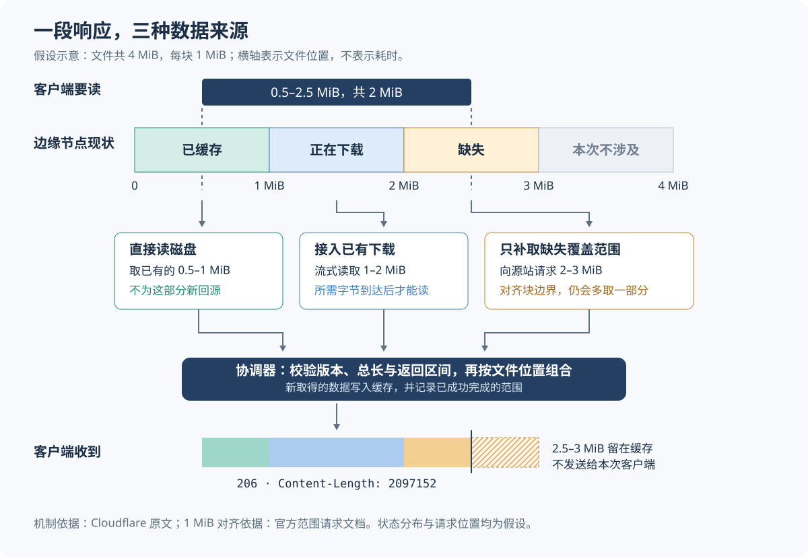

# 只读文件的一小段，为什么还会下载一大块：Cloudflare 范围缓存的改造

> 来源：[blog.cloudflare.com](<https://blog.cloudflare.com/origin-range-requests>)  
> 作者：未知 · 发布时间：2026-10-24 02:22（Asia/Shanghai）  
> 翻译正文：[阅读中文正文](article-zh-CN.md)

拖动视频进度条、恢复中断的下载，客户端通常只需要文件的一部分。但内容分发网络（CDN，把文件缓存到靠近用户的节点）为了填充缓存，可能从保存原始文件的服务器（源站）多取很多数据。用户已经停止播放，后台传输却未必结束；同一批多取的数据还可能在不同缓存节点之间继续流动。

Cloudflare 的 Origin Range Requests 把向源站取数（回源）的范围与底层缓存块对齐，并让一次响应同时使用已经缓存、正在下载和新取回的数据。它适合关注“大文件被局部读取”成本的团队，尤其是有随机跳读、断点续传和突发并发的业务。它仍会多读，也仍依赖源站正确返回文件片段，不能仅凭打开开关判断收益。

本文以 Matthew Gumport 于 2026 年 10 月 23 日发布的[原文《Origin Range Requests: Serving large files without range-request tuning》](https://blog.cloudflare.com/origin-range-requests/)为研究主体，结合截至 2026 年 10 月 24 日查阅的官方文档和 HTTP 标准核验。下文将厂商报告标为“原文披露”，将文档补充与分析推断分别说明；示例数字不代表实测结果。

## 1. 客户端只要一段，缓存为什么多取

HTTP 范围请求（Range Request）允许客户端指定需要的文件字节。举例，一个客户端发送：

```http
GET /movie.mp4 HTTP/1.1
Host: example.com
Range: bytes=1048576-2097151
```

字节位置从零开始，起止位置都算在内，因此这段长 1,048,576 字节，也就是 1 MiB。MiB 是二进制容量单位，等于 1,024 × 1,024 字节。服务器成功提供这一段时，可以返回：

```http
HTTP/1.1 206 Partial Content
Content-Range: bytes 1048576-2097151/524288000
Content-Length: 1048576
```

`206` 表示返回部分内容；`Content-Range` 说明本次返回的位置及文件总长；`Content-Length` 是这次响应正文的长度。这里的完整文件为 500 MiB，但客户端只收取其中 1 MiB。[HTTP 标准对字节范围和部分响应的定义](https://www.rfc-editor.org/rfc/rfc9110.html#section-14)支持这种用法。

问题出在客户端与缓存系统的取数单位不同。播放器按播放位置请求数据，缓存系统却可能把整个文件划成固定片段：即使只缺其中几个字节，也先下载完整片段，以便后续复用。

**原文披露：**Cloudflare 旧实现允许按站点配置片段大小和文件扩展名，做法类似 NGINX 的切片缓存。其 R2 对象存储业务曾配置 64 MiB 片段，一次很小的读取如果跨过片段边界，就可能触发两个片段、合计 128 MiB 的跨数据中心传输。这个数字有特定前提，不能理解成每个范围请求都会放大到 128 MiB。

把片段缩小也有代价。旧系统会产生更多小回源请求，并占用内存来等待、组织这些请求；片段过大则浪费带宽。片段大小还进入了缓存键——即缓存识别一份数据所用的标识——因此调整大小会让原有缓存条目无法继续按原键命中。这使一次调参同时影响源站请求数量、缓存复用和内存压力。[NGINX 切片模块文档](https://nginx.org/en/docs/http/ngx_http_slice_module.html)也要求将切片范围加入缓存键，并提醒过小切片可能增加内存占用和打开文件的数量；这是对切片方案代价的外部佐证，不是对 Cloudflare 内部故障的独立复现。

旧实现还有等待问题。原文称，同一大片段内的并发读取可能彼此阻塞；其基于 NGINX 的缓存实现不能同时正确使用范围缓存和“边写边读”，曾导致响应提前结束，因此必须等整个片段下载完再让客户端读取。这里描述的是 Cloudflare 当时的实现限制，不能推广为所有 NGINX 部署的固有限制。

## 2. 新方案怎样把三种来源拼成一次响应

原文称，迁移到基于 Pingora 的缓存服务器后，Cloudflare 可以复用现成的磁盘布局。Pingora 是 Cloudflare 使用的代理框架；新的缓存服务器本来就把文件按固定大小的块存储，以支持中断后的继续下载。范围请求于是直接沿用这些块，无需另设一套由客户调节的切片大小。

**外部补充：**原文没有给出块大小，当前[官方范围请求文档](https://developers.cloudflare.com/cache/reference/range-requests/#origin-request-behavior)明确写明，源站请求按 **1 MiB 缓存边界**对齐。这是本次查阅到的产品行为，不应当作永久不变的 HTTP 协议规定。

假设一个 4 MiB 文件，客户端要读从 0.5 MiB 到 2.5 MiB 之前的 2 MiB 数据，对应 `bytes=524288-2621439`。边缘节点——接收用户请求的缓存节点——此时有三种状态：第一个块已经在磁盘上，第二个块正在被另一个请求下载，第三个块还没有。



图中的假设请求可以这样处理：

1. **确定文件和已有范围。**节点读取文件响应头，以及记录哪些区间已成功保存的元数据。元数据是描述文件状态的记录，不是文件正文。
2. **先使用已有数据。**从磁盘读取 0.5–1 MiB；对于正在下载的 1–2 MiB，接入已有下载流，等所需字节到达后读取，避免为这部分再发起相同回源。
3. **补取缺失块。**向源站请求覆盖 2–3 MiB 的完整块。虽然客户端只需要前半块，缓存仍按块获取并存储。
4. **校验并记录结果。**检查源站返回的位置、文件总长及版本信息；新数据写入缓存后，记录成功完成的覆盖范围，不能把失败留下的缺口当作完整数据。
5. **按位置输出。**把三处数据按文件顺序组合，只发送客户端请求的 2 MiB，并生成对应的响应头。多取的 2.5–3 MiB 不进入本次客户端响应。

这套负责判断“哪些字节从哪里来、能否一起使用”的逻辑，原文称为协调器。磁盘负责保存正文，元数据负责描述覆盖范围，在途下载负责提供尚未完全落盘的数据，协调器负责安排读取、补取和输出。一个请求因此不再只有“全部命中缓存”和“全部从上游（上层缓存或源站）获取”两种选择。[原文的实现说明](https://blog.cloudflare.com/origin-range-requests/)明确描述了这种组合路径。

这里还要区分两类等待。共享下载可以省去重复请求，但字节没有到达时，后来的读取者依然要等；如果客户端所需的前段很慢，已经就绪的后段也不能在一个普通单范围响应中被随意提前发送。它减少的是重复工作和旧实现中的额外阻塞，不是消除网络等待。

## 3. 能拼起来，不代表可以安全发送

### 文件位置相同，文件版本也必须相同

假设缓存中的第一块来自版本 A，补取第三块时，同一个地址的文件已被覆盖成版本 B。即使文件长度没有变化，拼出的内容仍可能既不是 A，也不是 B。视频可能损坏，软件包也可能无法校验。

因此，原文说协调器会检查每次源站响应的范围、完整文件长度和实体标签 `ETag`。`ETag` 是服务器给某个文件表示附带的版本标识；所谓“表示”，就是该资源实际返回的具体字节形式。同一个地址的压缩与未压缩内容，也可能属于不同表示。

**标准补充：**[RFC 9111 第 3.4 节](https://www.rfc-editor.org/rfc/rfc9111.html#section-3.4)允许缓存合并部分内容，前提包括这些内容具有同一个强验证器。强验证器能够用于确认字节级一致；以 `W/` 开头的弱 `ETag` 不能提供同样的保证。

这也暴露出一个公开资料的边界：Cloudflare 的[产品文档](https://developers.cloudflare.com/cache/reference/range-requests/#partial-response-requirements)将源站 `ETag` 列为可选，要求它一旦存在，其有无和值在同一缓存表示的响应中保持一致，但没有解释缺少强验证器时所有内部判定路径。本次未从所查资料获得足以审计完整实现的源码证据，因此不能断言它只靠某一套标签比较就覆盖了所有更新竞争情况。**实践建议是使用内容不变的版本化地址，并返回稳定、正确的强 `ETag`；不要把“长度相同”当成版本相同。**

客户端也可以发送 `If-Range`：它表达“如果文件仍是我知道的版本，就给我指定部分；如果变了，就给我完整的新版本”。条件不匹配时应忽略范围，走完整响应路径，而非把新片段补到旧文件中。强标签比较等规则见 [RFC 9110 第 13.1.5 节](https://www.rfc-editor.org/rfc/rfc9110.html#section-13.1.5)。这一客户端条件与缓存内部各子请求的版本检查作用不同，不能相互替代。

### 压缩会改变字节位置

HTTP 的 `Content-Encoding` 表示对正文施加了 gzip 等编码。压缩后第 1,000 个字节，与解压后第 1,000 个字节通常没有直接对应关系。按压缩字节切一段，再把它当作未压缩文件的同位置片段发送，响应即使长度看似正确，内容也不对。

原文说明，Cloudflare 对需要解压的完整响应避免组合范围，改发变换后的完整内容。[HTTP 标准](https://www.rfc-editor.org/rfc/rfc9110.html#section-14.1.2)也规定，有内容编码时，范围位置针对编码后的字节序列。

**文档补充：**该功能生成的源站请求带 `Accept-Encoding: identity`，要求不要再施加内容编码；这不等于关闭客户端方向的正常压缩。源站可缓存的 `206` 还须提供匹配的 `Content-Range`、正确的数字 `Content-Length`，且不带 `Transfer-Encoding`。如果源站返回不兼容内容，已经开始的组合响应可能提前结束，客户端收到的字节会少于承诺长度。[源站响应要求](https://developers.cloudflare.com/cache/reference/range-requests/#partial-response-requirements)

要注意，下载 `.zip` 这类本身就是压缩格式的文件，并不等于 HTTP 又施加了 `Content-Encoding`；对归档文件自身的字节做范围读取仍是另一回事。

## 4. 不再调片段大小，代价转移到了哪里

新旧方案都使用固定边界。变化在于，新方案把网络取数与已有存储块统一，并允许不同状态的数据共同完成响应。客户少了一个调参项，平台却需要维护更复杂的范围状态、下载共享和错误处理。

下面的比较针对这些机制，属于分析判断，不是同一环境下的性能排名。

| 做法 | 适合的访问方式 | 主要代价与团队责任 |
| --- | --- | --- |
| 缓存未命中时取完整文件，再从中返回所需部分 | 大部分读取最终会覆盖全文件，文件能够较快填满缓存 | 状态较简单；随机读取靠后位置时可能等待较久，未被读取的部分也会消耗传输和存储。是否共享下载取决于实现 |
| 自管固定切片，例如 NGINX Slice | 流量模式较稳定，需要自建代理或精确控制取数范围 | 需要选择切片大小，处理切片缓存键、文件资源和更新策略；运维团队承担调参和容量管理 |
| Cloudflare 的块对齐与组合响应 | 同一大文件存在局部读取、部分命中及并发重叠 | 平台承担协调复杂度；客户仍要保证源站响应、版本和鉴权正确，并验证实际费用。内部行为受托管平台约束 |

第一种路径在 [NGINX 官方的历史实验](https://blog.nginx.org/blog/smart-efficient-byte-range-caching-nginx)中有清楚展示：缓存未命中时获取完整文件，所需位置的数据到达后才返回对应部分。该实验发表于 2016 年，只用来解释机制，不能拿其中耗时与今天的 Cloudflare 结果排名。

### 多读有边界，但放大比例仍可能很高

下面是对齐规则的数学推导，**不是实测，也不是平台对全部网络流量的上界承诺**。

设缓存块大小为 `C`，客户端请求闭区间 `[s,e]`，长度为 `L=e-s+1`。在所涉及块全部缺失、源站正确支持范围、无重试且每块只取一次的简化条件下，覆盖这些字节需要的块数为：

```text
n = floor(e / C) - floor(s / C) + 1
回源正文大小 B ≤ n × C
边界导致的额外正文 B - L < 2 × C
```

`floor` 表示向下取整。额外字节只可能来自请求首尾未用满的两个边界块；文件末块不足一块时还会更少。如果已有部分块或在途下载可复用，新增加的回源传输可能更少。

然而，绝对多读量有界，不代表比例很低。按当前文档的 1 MiB 对齐，假设一个冷缓存请求只读 1 KiB，却刚好跨越块边界，便可能取回两个完整块，也就是 2 MiB，正文放大约 2,048 倍。这里假设文件足够长、两个块都缺失；它用于说明边界，不是产品平均值。

原文给出的 R2 旧配置恰好也说明了这一点：从 64 MiB 的片段改用更小的底层块，可以大幅缩小一次小读触发的绝对传输，但不会让所有小读都变成精确到字节的回源。

### 请求数量、内存和协作成本仍要计算

小块可能降低浪费的正文量，也可能增加源站请求数和元数据处理。公开资料没有给出足够信息，无法据此计算每个连接的内存、并发上限、磁盘操作次数或调度开销；也不能简单断言“一个块必定对应一次独立网络往返”。

对客户团队，费用应拆成源站出站流量、按次收费的读取请求，以及已有套餐相关费用。少传字节但多发请求时，账单未必同比下降。对平台团队，复用下载还要处理慢读者、超时、失败与取消；原文没有披露完整策略，也没有承诺客户端退出后所有相关传输立即停止。

协作上的收益是，业务方不必理解平台内部后再选择片段大小。但责任并未消失：发布流程要维护稳定文件版本，源站团队要保证范围响应正确，运维要检查限流、监控和费用。特别是源站实际收到的范围可能被扩展或拆成多个请求，若签名或限流逻辑绑定客户端原始 `Range`，需要提前验证兼容性。

## 5. 生产数据支持什么，不支持什么

原文报告了两项不同改动的结果，应分别理解。

| 原文披露的结果 | 测量对象与改动 | 不能直接推出的结论 |
| --- | --- | --- |
| p99 首字节时间大约减半 | R2 各存储区域迁移到新实现后，缓存命中和未命中两类请求均有该变化 | 全文件下载时间减半，或所有 Cloudflare 客户都有相同比例的提升 |
| 分层缓存流量环比下降约 6% | 后续启用“磁盘已有字节与上游字节组合响应”，观察 R2 及类似负载的周环比变化 | 每个客户的源站流量或账单下降 6%，或所有降幅都已排除流量结构变化的影响 |

首字节时间（TTFB）是从请求发出到收到响应首字节的时间；p99 是这一耗时分布的第 99 百分位，用来观察较慢的一端。它不说明剩余数据多快传完。分层缓存则让靠近用户的缓存从上层缓存取数，上层再必要时访问源站；节点间的内部传输量，与客户源站出口流量不是同一个指标。

**证据限制：**[原文](https://blog.cloudflare.com/origin-range-requests/)没有给出绝对延迟、完整样本分布、请求大小构成、精确实验窗口或可复现的对照测试。其“每天少传数 PB”也是厂商对内部规模的描述；PB 是千万亿字节量级的单位。这些数据说明该方案在其特定生产负载中值得采用，但不足以预测小团队能节省多少。本文没有进行 Cloudflare 生产环境实测，也不把这两项结果视为独立第三方验证。

## 6. 哪些场景值得用，哪些边界先确认

从机制分析，**文件较大、经常只读一部分、相同或相邻区域能够复用**时，更值得尝试。可拖动的 MP4 视频、恢复下载和读取归档局部区域都符合这一方向。突发访问重叠较多时，共享在途下载还有机会减少重复回源。

如果每个文件只被完整下载一次，或请求几乎不重叠、全部是极小随机读取，缓存复用未必足以抵消块级多读和请求开销。业务规模没有一个公开的通用门槛；关键是访问方式与可复用程度，而不是文件名里是否出现“模型”“镜像”或“大数据”。读取机器学习模型的部分区域，也要先确认客户端和文件格式确实支持局部加载；缓存不会替应用决定哪些权重可以不下载。

产品边界尤其容易被“所有套餐可用”掩盖：

- **可用不等于能缓存任意大文件。**当前官方文档列出，Free、Pro、Business 的最大可缓存文件为 512 MB，Enterprise 默认 5 GB，可联系调整。这里沿用文档的 MB、GB 单位，不自行换成 MiB、GiB。[可缓存大小限制](https://developers.cloudflare.com/cache/concepts/default-cache-behavior/#cacheable-size-limits)
- **限制看完整对象。**不能把超限文件切成小范围请求来绕过限制；此功能也不支持 Cache Reserve，即 Cloudflare 的持久缓存存储服务。[范围请求限制](https://developers.cloudflare.com/cache/reference/range-requests/#caching-limitations)
- **源站必须配合才有局部取数收益。**它若忽略 `Range` 并返回完整的 `200 OK`，Cloudflare 可以使用响应，但仍须下载完整文件。若响应后来证明不可缓存，也可能继续使用范围取数，却不保存字节。[官方配置说明](https://developers.cloudflare.com/cache/how-to/cache-rules/settings/#origin-range-requests)

对于含私人数据、按用户返回不同内容或频繁覆盖同一地址的文件，先解决共享缓存资格、访问控制和版本策略。范围功能不会替代这些条件。多个源站副本若暂时返回不同版本，也会让拼接更难；“每个副本单独下载都正常”不足以证明跨请求组合安全。

原文说计划将来为某些扩展名默认启用；本次查阅的配置文档仍写明，没有文件扩展名默认开启。实施时应检查实际规则，不能把未来计划当成当前状态。`off` 也只关闭该功能生成的源站范围请求，不禁止从完整缓存文件向客户端返回范围。[模式定义](https://developers.cloudflare.com/cache/how-to/cache-rules/settings/#origin-range-requests)

## 7. 个人或小团队怎样做一次最小验证

无需复刻全球缓存网络。先用一个固定版本、例如 64 MiB 的公开测试文件，在小范围验证正确性和自身收益即可。以下是建议流程，不是已经执行的测试。

### 第一步：先验证源站能正确返回片段

准备本地参考文件，在测试源站发布同一内容，设置合适的缓存响应头，并返回稳定的强 `ETag`。直接对源站发出真实 `GET` 范围请求；不能只看 `Accept-Ranges` 响应头就认定支持范围。

重点检查跨 1 MiB 边界的 1 KiB 请求，例如：

```http
Range: bytes=1048064-1049087
Accept-Encoding: identity
```

预期得到 `206`、正确的 `Content-Range` 和 `Content-Length: 1024`，正文应逐字节等于参考文件的同一区间。还应测试尾部读取、从文件末尾之外开始的不可满足范围，以及 `If-Range` 匹配和不匹配两种情况。不可满足范围应检查 `416` 及 `Content-Range: bytes */总长`；版本不匹配的 `If-Range` 应检查完整响应。

这些验证项分别覆盖位置计算、文件总长和版本处理。单看状态码不够，错误的片段也可能带着 `206` 返回。

### 第二步：只对测试路径启用

在 Cloudflare 的 Caching → Cache Rules 中，精确匹配测试主机或目录，将 Origin Range Requests 设为 On。若通过规则接口配置，相关参数片段是：

```json
{
  "origin_range_requests": {
    "mode": "on"
  }
}
```

这只是规则动作参数的一部分，不是完整接口请求。开启前仍需确认普通缓存条件；不要为了让测试“命中”而直接覆盖生产目录的缓存安全策略。配置形式见[官方设置说明](https://developers.cloudflare.com/cache/how-to/cache-rules/settings/#origin-range-requests)。

### 第三步：比较四种访问方式

分别测试第一次读取、重复读取、读取部分已缓存区域，以及一小组并发且范围重叠的请求。另加一次顺序完整下载，检查是否出现小读改善、完整下载却退步的情况。若要验证文件更新，只在专用可变测试地址上操作，并检查结果全部属于某一完整版本，不能混入旧字节。

开关对照使用内容相同的受控测试地址，并在开始前确认清缓存或更换版本地址的行为。保持客户端位置、请求顺序、并发和文件内容尽量一致；记录命中的 Cloudflare 节点信息。两组请求若落到不同节点，或缓存冷热状态不同，就不能直接归因于开关。

源站日志应记录实际收到的 `Range`、状态、发送正文大小和版本标识。边缘节点可能从上层缓存取数，因此源站看不到请求，并不代表没有内部传输；只凭源站日志也不能证明在途共享的全部过程。

### 第四步：记录能决定去留的指标

| 指标 | 要回答的问题 |
| --- | --- |
| 正文比对、实际长度、截断和错误率 | 新路径有没有破坏正确性或完成率？ |
| 首字节时间与请求完成时间，分别观察冷、热和并发场景 | 开始响应更快，是否也更快拿齐数据？ |
| 源站正文总字节 ÷ 客户端成功接收正文总字节 | 对这组固定工作负载，回源传输放大是否下降？ |
| 源站请求数、每次读取费用与出站费用 | 节省的字节是否被更多请求抵消？ |

第三项是测试批次的传输比，不应当作某个请求的纯粹效率：缓存预热或提前退出可能使分子、分母发生变化，因此两组必须使用一致的观察窗口与请求序列。小样本先看每次请求和整体分布，不用少量数据宣称可靠的 p99 改善。

### 第五步：预先写下退出条件

只要出现正文不符、版本混合或可重复的响应截断，就停止扩大范围，先修复源站或关闭测试规则。若源站始终返回完整 `200`、文件超出缓存上限，或真实负载几乎没有可复用范围，也应先停止扩展，重新评估前提。

即使正确性通过，若完整下载、完成率或总费用超过团队事先设定的容忍范围，也不必保留开关。回退时可将匹配规则设为 `off`；它恢复的是不由此功能生成范围回源的行为，并不保证所有请求都变成源站直传。

对小团队，值得采纳的是这套判断方式：先确认应用真的只需要部分文件，再确认缓存能复用这些部分，最后用完整响应的正确性、延迟和费用决定是否上线。Cloudflare 的内部收益提供了尝试的理由，本地工作负载的证据才决定是否长期使用。
