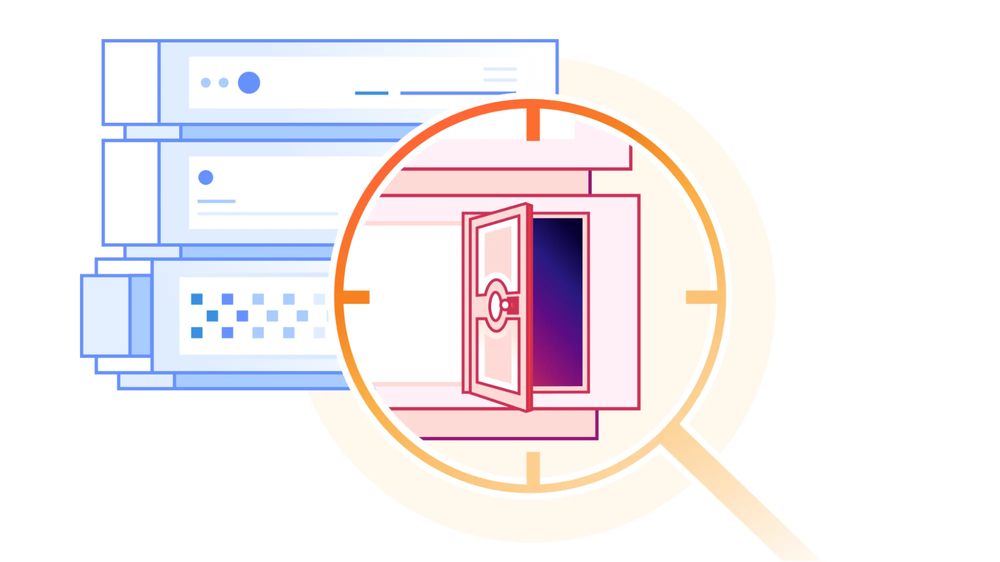
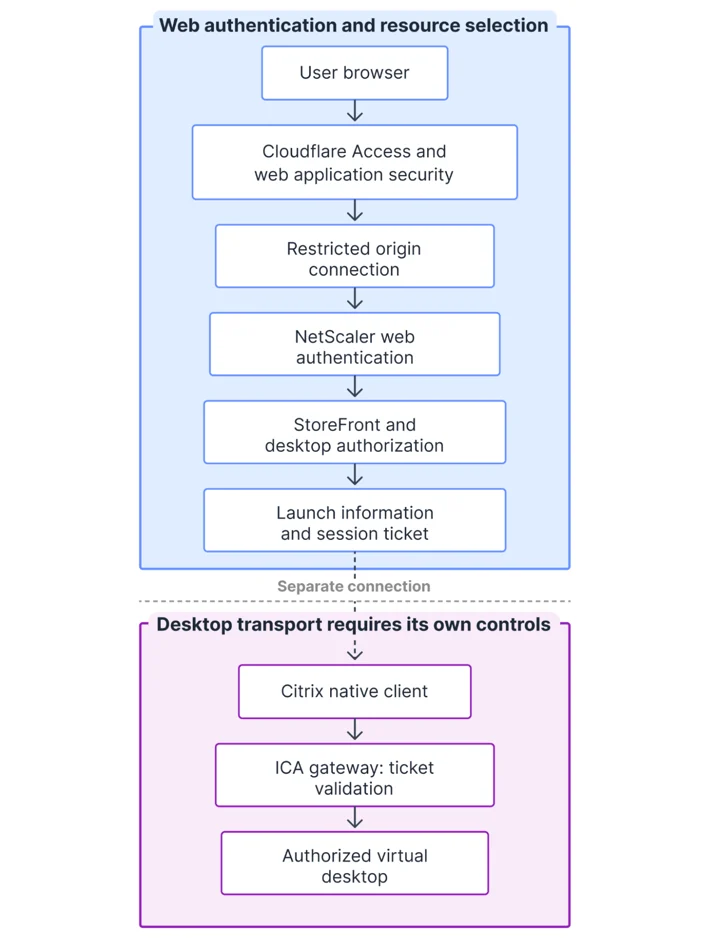
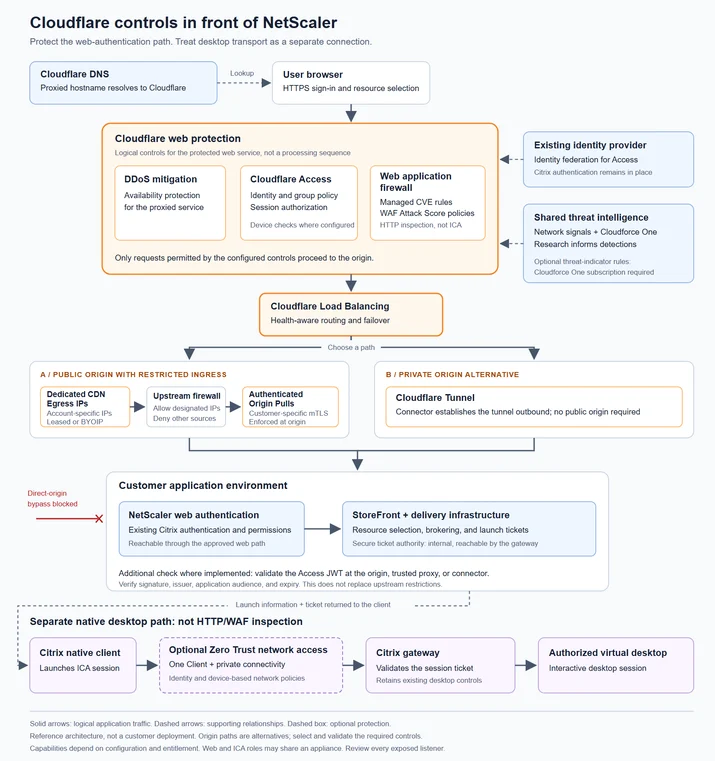

# There's always a patient zero: Defending the NetScaler front door before the patch

> **来源**: [https://blog.cloudflare.com/protect-your-netscaler-gateway](https://blog.cloudflare.com/protect-your-netscaler-gateway)  
> **作者**: Kenny Johnson | **发布时间**: 2026-10-19T13:00:00+00:00  
> **深度调研**: [查看专题调研报告](research.md)  
> **标签**: 零信任访问控制, NetScaler Gateway, 虚拟桌面基础设施, Web应用防火墙, 源站访问限制, 身份认证, 纵深防御, 安全运维验证

---

## AI 导读

文章讨论企业认证网关公开暴露时，未认证漏洞如何使登录入口本身成为攻击面，以及补丁部署期间和未来漏洞出现前如何降低风险。其方法是把独立的身份访问决策放在原认证服务之前，由 WAF 检查 HTTP 请求，并通过出站 Tunnel，或专用回源地址、防火墙、双向 TLS、Access JWT 校验等机制约束源站访问，防止攻击者绕过前置控制。原 Citrix 环境继续负责桌面授权和会话票据校验。

文章明确区分网页认证路径与 ICA、DTLS 等其他连接：浏览器认证代理不会自动保护全部桌面流量，后者需要另行设计网络路由和访问策略。它还讨论浏览器远程桌面和替代仅用于访问网页的虚拟桌面场景，并指出消费者登录页及建立初始会话所需的身份提供方端点可能必须保持公开，避免循环认证依赖。

结论是从一个受限服务开始，梳理网页和非网页入口，前置访问控制并封闭源站绕过路径；上线前验证未登录、无权限账号、源站直连及合法用户桌面启动与重连，并结合日志持续复查。补丁与已入侵环境的调查恢复仍然必要。局限是材料主要提供产品架构建议，缺少具体配置、漏洞复现、兼容性与性能测试、防护效果数据；所述漏洞与产品能力未在正文中获得独立验证，不能将方案主张视为实证结果。

---

## 原文整理

# Beyond the patch: Protecting your NetScaler gateway against future vulnerabilities

The recent disclosure of [<u>a major vulnerability</u>](https://www.cisa.gov/news-events/alerts/2026/09/27/critical-zero-day-vulnerabilities-exploited-citrix-netscaler-adc-gateway) in Citrix NetScaler pointed to a widespread weak point: a login page is an attack surface that can be used to compromise and access an application server. Indeed, [the disclosures](https://support.citrix.com/support-home/kbsearch/article?articleNumber=CTX697191&articleURL=Citrix_NetScaler_ADC_and_Citrix_NetScaler_Gateway_Security_Bulletin_for_CVE_2026_107406) included an actively exploited flaw that allowed attackers to execute commands on affected gateways without signing in. As with any emergency patch, admins had to weigh cutting off or disrupting their users’ access with the risk of delaying a critical security update.

If you’re a NetScaler customer and you haven’t patched your instance, stop reading and go do that. This was a bad one. Once you’ve finished the patch, we’ll explore how to avoid a future fire drill by laying additional security controls.

This issue extends beyond NetScaler and can be applied to any internal application available on the Internet. Remote desktop portals, administrative consoles, and other publicly accessible authentication pages all deserve the same scrutiny: Does the intended audience require unrestricted Internet reachability? And can an attacker bypass this authentication check to reach the application's server?

Citrix [<u>released software updates to address the flaw</u>](https://support.citrix.com/external/article/CTX697096), and Cloudflare followed with [<u>an emergency web application firewall (WAF) rule</u>](https://developers.cloudflare.com/changelog/post/2026-10-01-emergency-waf-release/) on October 1. But having a patch available does not guarantee safety: every instance has to be identified, updated, and tested. Applying updates across a production deployment is painful — it can result in downtime or cause disruptions to employees who still need their desktops throughout that process. Customers, patients, and others dependent on users of a remote desktop definitely don’t care about your security patch.

Using a web application firewall (WAF) can buy some additional time before a patch can be fully rolled out, but it’s reactive and does not account for the next exploit that’s discovered. Cloudflare and other security vendors do their best to cover variations and similar attacks. But AI is hastening how rapidly attackers can discover new and novel variants. That’s why it is crucial to build [<u>defense in depth</u>](https://www.cloudflare.com/learning/security/glossary/what-is-defense-in-depth/), to ensure that no specific software failure or exploit will lead to a critical security issue.

Cloudflare combines access policies, web application security, and restricted origin connections to protect the authentication service before a new vulnerability is disclosed. Access controls limit who can reach the application server; WAF inspection evaluates web requests for attacks; origin restrictions prevent direct connections from bypassing those defenses. These reduce exposure without waiting for a new exploit signature or replacing the existing desktop platform.

## The NetScaler exploit

Citrix's [<u>September 27, 2026 bulletin</u>](https://support.citrix.com/external/article/CTX697096) reported observed exploitation of CVE-2026-88771 and CVE-2026-88772. The first allows unauthenticated command execution on affected appliances, including in their default configuration. The second affects configurations using Datagram Transport Layer Security, or DTLS. Further advisories on [<u>October 3</u>](https://support.citrix.com/external/article/CTX697174) and [<u>October 8</u>](https://support.citrix.com/external/article/CTX697191/citrix-netscaler-adc-and-citrix-netscale) addressed additional vulnerabilities in SAML configurations. These exploits allowed attackers to execute arbitrary scripts on target machines and also execute denial of service attacks.

[<u>CISA's alert</u>](https://www.cisa.gov/news-events/alerts/2026/09/27/critical-zero-day-vulnerabilities-exploited-citrix-netscaler-adc-gateway) and [<u>Mandiant's technical investigation</u>](https://cloud.google.com/blog/topics/threat-intelligence/defending-against-active-exploitation-of-citrix-netscaler-adc-and-gateway-appliances) cover the vulnerabilities, observed exploitation, and response guidance in more detail. For details of the available web application protection, see [<u>Cloudflare's emergency WAF release for CVE-2026-88771</u>](https://developers.cloudflare.com/changelog/post/2026-10-01-emergency-waf-release/).

In a typical Citrix deployment, the user authenticates through NetScaler Gateway, which then uses a secure ticket authority to pass through to the StoreFront, which presents the applications and desktops available to that user. The native-installed Citrix app then uses that information to establish a separate connection using Citrix's Independent Computing Architecture (ICA) protocol. The gateway validates the ticket before proxying the desktop connection. Citrix documents these as [<u>distinct stages of the connection workflow</u>](https://support.citrix.com/external/article/227054/netscaler-gateway-storefront-and-xendesk.html). The entire exploit stems from the fact that the Gateway has to be publicly accessible on the Internet, otherwise users would not be able to initiate their desktop connection.

## Put the access decision in front of the authentication server

The best thing that you can do, after patching all your instances, is move any publicly accessible login pages or applications behind single sign-on before the request ever hits the target server. [<u>Cloudflare Access</u>](https://developers.cloudflare.com/cloudflare-one/access-controls/applications/http-apps/self-hosted-public-app/) can enforce [<u>an independent access policy</u>](https://blog.cloudflare.com/access-aegis-cni/) before the request reaches the existing gateway server. The Citrix environment continues to determine which desktop the user may launch and to validate the resulting session ticket. The additional boundary ensures that an attacker could never get to the Gateway server to try running specific exploits. They would only see the Cloudflare Access login page.

That decision no longer depends on recognizing an exploit signature and blocking that way, but rather on a set of Zero Trust policies that determine if someone should even be there to begin with. More attacks like this are coming, and adopting Zero Trust controls throughout your network is the single most important thing you should do next.

This follows the principle described in [<u>Cloudflare's own architecture as customer zero</u>](https://blog.cloudflare.com/frontier-model-defense/): reduce exposure and use independent defenses so that one flaw does not become a compromise. Here, the practical starting point is the service that users reach before they enter their applications.

Protecting the web authentication path adds a boundary in front of the existing Citrix controls. It does not automatically extend that boundary to other gateway services, including DTLS-enabled listeners. Those interfaces still need their own exposure review and applicable security updates, even when the desktop sessions they support already require authentication.

## The origin connection must enforce the same boundary

Changing a DNS record and enforcing Access policies are not enough. If an attacker can connect to the original address or an alternate hostname, they can avoid the controls placed in front of it. Access enforces a specific hostname: if the authentication server can be reached via an IP address or alternative hostname, then the Access policy enforcement is worthless. It’s important to take steps to ensure that all traffic comes from a request that was validated by Access. There are a few different approaches to accomplish this, based on your internal architecture.

[<u>Cloudflare Tunnel</u>](https://developers.cloudflare.com/fundamentals/security/protect-your-origin-server/) is the most commonly used approach. It establishes an outbound only tunnel from your application server and allows you to close all inbound IP traffic. This means that you won’t have a public IP for the server that can be reached by anyone.

When a public origin IP Address must remain or connector software cannot be run, network restrictions and origin authentication need to constrain the connections it accepts. For example, [<u>Dedicated CDN Egress IPs</u>](https://developers.cloudflare.com/smart-shield/configuration/dedicated-egress-ips/) give an account dedicated source addresses for traffic from Cloudflare to its origins. The application server’s firewall can allow those addresses and reject other sources. This makes [<u>the network restriction specific to the account's traffic</u>](https://blog.cloudflare.com/aegis-deep-dive/), rather than broadly allowing traffic from Cloudflare's shared address ranges.

[<u>Authenticated Origin Pulls</u>](https://developers.cloudflare.com/ssl/origin-configuration/authenticated-origin-pull/) can add further depth with mutual TLS to verify the Cloudflare-to-origin connection.

An origin that supports it can also [<u>validate the Access JSON Web Token</u>](https://developers.cloudflare.com/cloudflare-one/access-controls/applications/http-apps/authorization-cookie/validating-json/), including its signature, issuer, expiry, and intended application audience. This is the best way to guarantee that a request was authenticated by Access.

If you're unsure where to start, [<u>speak with a Cloudflare expert</u>](https://www.cloudflare.com/contact/sase/) to review your architecture and identify which controls fit your environment.

## Protect the web-facing authentication service

Cloudflare Access determines who may reach the web application; Cloudflare's [<u>web application firewall (WAF)</u>](https://developers.cloudflare.com/waf/) inspects HTTP requests to that same protected service. The WAF runs before any Access authentication checks, which gives you the ability to completely block known malicious IPs, specific countries, ASNs, or other attributes you know definitely shouldn’t be accessing your applications. The firewall runs continuously on all requests and will also identify users who managed to authenticate attempting to run exploits with known CVE signatures.

Alongside managed CVE signatures, [<u>WAF Attack Score</u>](https://developers.cloudflare.com/waf/detections/attack-score/) uses machine learning to identify potentially malicious requests that do not exactly match a known rule. Administrators can use the score in rules that block or challenge requests. The WAF attack score is powered by network observations from Cloudflare's global network traffic and Cloudforce One investigations feed [<u>Cloudflare's shared threat-intelligence platform</u>](https://blog.cloudflare.com/cloudflare-threat-intelligence-platform/).

Customers with a Cloudforce One threat intelligence subscription can also [<u>use live threat indicators in WAF policies</u>](https://blog.cloudflare.com/realtime-threat-intel-waf-rules/). That adds context about known malicious sources alongside inspection of the request itself.

Reducing exposure does not remove an attacker who already has a foothold. Seriously: go patch your system if you haven’t, and follow Citrix's [<u>suspected-compromise guidance</u>](https://support.citrix.com/external/article/CTX694799/steps-to-take-if-netscaler-adc-is-suspec.html). They lay out how to preserve evidence, revoke credentials and certificates, investigate connected systems, and rebuild or restore from a known-good state.

## Extend Zero Trust to desktop access, or remove the desktop dependency

Protecting web authentication can be an initial step without making it the final architecture. Cloudflare's [<u>Zero Trust architecture for virtual desktops</u>](https://developers.cloudflare.com/reference-architecture/diagrams/sase/zero-trust-and-virtual-desktop-infrastructure/) also supports controlling access to the desktop infrastructure itself. With the Cloudflare One Client and private-network connectivity, teams can restrict who and which devices may reach the endpoints carrying desktop traffic, including an existing Independent Computing Architecture (ICA) path. This requires its own routing and policy design; it is not a capability supplied by the browser authentication proxy alone.

Some workflows can remove the ICA dependency instead. For supported Windows workloads,  Cloudflare's [<u>browser-based remote desktop access</u>](https://developers.cloudflare.com/cloudflare-one/networks/connectors/cloudflare-tunnel/use-cases/rdp/rdp-browser/) connects users to a Windows host through Cloudflare Tunnel, [<u>without a local remote desktop client</u>](https://blog.cloudflare.com/browser-based-rdp/). If users only need a desktop to open web applications, Access and Browser Isolation can [<u>replace that web-access use case</u>](https://blog.cloudflare.com/decommissioning-virtual-desktop/) without a full virtual desktop.

Start by protecting the authentication service and existing desktop connections. Then replace virtual desktops used only for web access, and move supported Windows workflows to browser-based remote desktops. Reducing exposure does not have to wait for a full desktop migration.

## Decide which authentication services need to be public

The same assessment applies beyond virtual desktops. An employee portal or management console may need to be reachable by approved users from anywhere, without needing to accept application requests from everyone.

Not every authentication page can require a prior employee identity. Consumer login pages and the identity-provider endpoints required to establish an initial session may need to remain publicly reachable. Protect those intentionally, and avoid introducing circular authentication dependencies. The point is to make reachability a design decision rather than an inherited default.

Start with one restricted service. Map the web and non-web paths into it, then put the access decision ahead of its authentication surface. Before expanding the rollout, validate the boundary in your own environment:

1. Request the protected hostname without signing in. Confirm the request stops at Cloudflare rather than reaching the origin.
2. Sign in with a test account outside the permitted group. Confirm it still cannot reach the protected application.
3. Test direct-origin addresses and alternate hostnames. Confirm none bypasses the access policy.
4. Sign in as an approved user. Confirm authentication, desktop launch, and session reconnection still work.

Check the relevant policy, firewall, and origin logs rather than relying only on what the browser displays. Repeat these checks when routing, identity, or failover settings change, so the next configuration update does not quietly reopen the path you closed.

## Bring the controls together

The full architecture brings the access decision, web inspection, and availability controls in front of NetScaler, with restrictions on the connection to the origin. The public origin and Tunnel paths are alternatives. The native desktop connection remains separate, with an optional Zero Trust network access layer around that traffic.

## Get started

[<u>Speak with a Cloudflare expert</u>](https://www.cloudflare.com/contact/sase/) to plan the right controls for your environment. [<u>Download the solution brief</u>](https://cf-assets.www.cloudflare.com/dzlvafdwdttg/1kcuN1xf5hTA5i4BxQRhix/450f5f5cdf526b661417291406df7d76/Defense-in-Depth-for-Internet-Facing-Employee-Systems_Cloudflare.pdf) and [<u>sign up for the upcoming webinar</u>](https://cloudflare.registration.goldcast.io/webinar/06911088-c2f1-41d0-93a9-18030d09dc4c).

*Andrei Migia, Nathan Sackett, and Doug Shepherd contributed to this post.*
