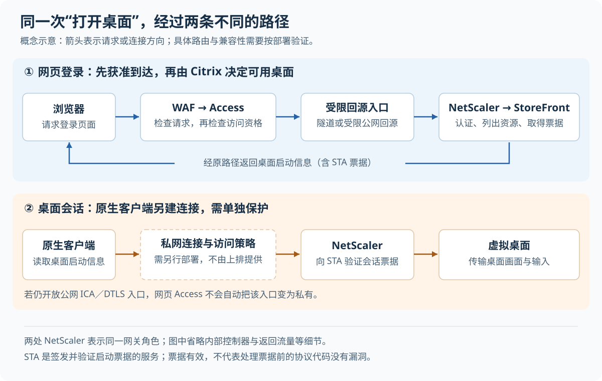

# 登录之前，先限制谁能到达：NetScaler 网关的分层防护

> 来源：[blog.cloudflare.com](<https://blog.cloudflare.com/protect-your-netscaler-gateway>)  
> 作者：Kenny Johnson · 发布时间：2026-10-19 21:00（Asia/Shanghai）  
> 翻译正文：[阅读中文正文](article-zh-CN.md)

员工需要从家里打开公司桌面，并不意味着互联网上的任何人都应当能向桌面网关发送请求。网关即使要求登录，也必须先接收和处理一部分未登录流量；如果这部分代码有漏洞，攻击者可能根本不需要密码。可行的改进是：在网关前另设访问检查，只让获准用户的请求进入，同时封住绕过检查的直连入口。它适合员工门户、远程桌面入口和内部管理系统，但不能代替软件更新，也不会自动保护所有桌面连接。

本文研究 Cloudflare 于 2026 年 10 月 19 日发布的[《Beyond the patch: Protecting your NetScaler gateway against future vulnerabilities》](https://blog.cloudflare.com/protect-your-netscaler-gateway)，以提供的原文为主体，并核对 Citrix 安全公告、连接流程及 Cloudflare 产品文档。以下将“原文提出”“官方资料确认”和“本文分析、建议”分别说明。核验截至 2026 年 10 月 26 日；本次没有部署测试环境，因此不提供实测拦截率、时延或成本收益。

## 1. 为什么“必须登录”仍然挡不住攻击

NetScaler Gateway 是用户进入 Citrix 应用和桌面的网关。它既要检查用户身份，也要处理建立连接、接收请求等工作。**登录检查只是请求处理流程中的一个步骤，无法保护在它之前就会执行的全部代码。**

假设一家小公司让员工通过 `desktop.example.com` 远程办公。正常用户输入账号、完成验证，再选择自己的桌面。攻击者却不必照着页面操作：他可以直接向网关发送异常请求。如果网关在检查账号之前就错误地处理了输入，“没有正确密码”并不妨碍漏洞被触发。这是假设场景，用来解释机制，并非本次调研发现的真实事故。

官方公告给出了这个问题的具体依据：

| 已核验的漏洞 | 影响与触发前提 | 对防护设计的意义 |
| --- | --- | --- |
| CVE-2026-88771，CVE 是公开漏洞编号 | 输入校验不当，可使未认证攻击者执行任意命令；受影响版本的默认配置也在范围内 | 不能把网关自身的登录检查当作唯一保护 |
| CVE-2026-88772 | 内存溢出，可导致远程代码执行或拒绝服务；前提是启用了 DTLS，即为 UDP 这类按数据报传输的连接提供加密保护的协议 | 只保护网页请求，会遗漏另一类协议入口 |

Citrix 的 [CTX697096 公告](https://support.citrix.com/external/article/697096)确认两者均已被实际利用。这里的“拒绝服务”指使服务无法正常响应；“远程代码执行”则意味着攻击者可以让目标运行其控制的代码，二者不能混为一谈。

后续公告还说明，更新不能只盯住第一次修复：涉及 SAML——在系统间传递登录身份的一种标准——的 [CVE-2026-88779](https://support.citrix.com/external/article/697174)被列为拒绝服务漏洞；[CVE-2026-107406](https://support.citrix.com/external/article/697191)则可能导致远程代码执行或拒绝服务，且取决于版本及设备承担的身份角色。因此，原文把后续风险合并描述为脚本执行和拒绝服务时，应按具体公告进一步区分，不能推断每个漏洞都能执行代码。

原有方案的困难在于时间差。补丁发布以后，团队仍要找到所有设备、选对版本、安排维护并确认客户端兼容。网页应用防火墙（WAF）会检查网页使用的 HTTP 请求，识别并阻断某些攻击，可以作为这段时间的补充措施。但规则的存在不等于所有入口都受保护。Cloudflare 的[紧急规则记录](https://developers.cloudflare.com/changelog/post/2026-10-01-emergency-waf-release/)明确针对 CVE-2026-88771，没有据此承诺覆盖 DTLS 漏洞。

## 2. 一个远程桌面操作，实际上走了两条路

要理解原文方案，先要把“打开登录页”和“连接桌面”拆开。

在 Citrix 官方记录的一种典型流程中，用户先通过 NetScaler 认证，StoreFront 再展示他可以使用的应用和桌面。StoreFront 是资源入口，负责组织并呈现这些可用资源。用户选择桌面后，它取得启动信息，其中包括由安全票据颁发机构（STA）签发的票据；这份票据供网关核验本次桌面连接。

随后，本机 Citrix 客户端读取启动信息，建立**另一条连接**。它使用 ICA，即传输远程应用和桌面交互的协议。NetScaler 向 STA 验证票据，验证通过后才代理到桌面所在的机器。Citrix 的[连接流程文档](https://support.citrix.com/external/article/227054/netscaler-gateway-storefront-and-xendesk.html)明确指出，这一阶段的 ICA 数据不是 HTTP。该文档描述特定部署流程，不代表所有版本和交付模式完全相同。

图中上排保护网页登录，下排保护桌面会话；下排的私网连接与访问策略必须另行部署。两处 NetScaler 表示同一网关角色，图示不是可直接照搬的配置。

这个区分带来两个直接结果。第一，把网页域名接到 HTTP 代理后，浏览器能登录，不代表原生客户端一定能启动桌面。第二，即使桌面连接本来就要求票据，也不能据此认为其协议处理代码没有未认证漏洞。NetScaler 的 [DTLS 配置文档](https://docs.netscaler.com/en-us/netscaler-gateway/current-release/hdx-enlightened-data-transport-support/configuring-citrix-gateway.html)还说明，使用 EDT——Citrix 基于 UDP 的桌面数据传输方式——时，需要启用 DTLS 并开放相应 UDP 端口。这个入口必须单独审查。

## 3. 把访问检查放在网关前面，具体改变了什么

原文建议在现有 NetScaler 前使用 Cloudflare Access。Access 在这里充当独立的访问检查点：请求先到 Cloudflare，只有满足身份和策略要求，才继续转给后端网关。

沿用前面的假设场景，可以把允许条件设为“属于试点员工组，并完成公司要求的身份验证”。没有会话的访问者先被引导登录；不属于允许组的账号，即使成功证明了自己的身份，也不能进入。Cloudflare 的[自托管应用文档](https://developers.cloudflare.com/cloudflare-one/access-controls/applications/http-apps/self-hosted-public-app/)确认，应用默认拒绝访问，用户必须匹配允许策略；Access 会检查每个 HTTP 请求的应用令牌。

请求通过这一层后，原来的 Citrix 系统仍负责判断用户能使用哪些桌面、签发启动信息并验证会话票据。前置检查回答“是否允许到达这个服务”，Citrix 内部权限回答“到达后能使用什么”。接入 Access 不会自动合并两套登录流程，也不应成为取消原有权限检查的理由。

这体现了零信任的一项原则：不能仅因连接来自某个网络，就默认允许访问资源。NIST 的[零信任架构说明](https://csrc.nist.gov/pubs/sp/800/207/final)强调在建立资源会话之前进行身份认证和访问授权。产品可以帮助落实这一原则，但购买产品不等于所有路径都已受控。

**本文分析：**这项改动的主要价值，是让不具备访问资格的人无法把任意网页请求送入网关，而不必先判断请求是否包含某种已知攻击。然而，它只在策略覆盖完整、后端没有旁路时成立。已获准账号被盗、有效会话令牌被窃取，或者内部机器已经失陷时，攻击者仍可能进入这层边界。原文“攻击者无法到达网关”的表述，应限定为“未获准的外部访问者，无法经已正确保护的路径到达”。

## 4. 封住源站直连，才能让前置检查成为必经之路

源站是实际承载服务的后端设备；从 Cloudflare 连接到它的过程叫回源。假设只把 `desktop.example.com` 的域名解析改到 Cloudflare，却保留旧公网地址可访问，攻击者仍可能绕过 Access，直接连接 NetScaler。旧域名、备用地址和 IPv6 地址也可能形成同样的旁路。

原文给出两条主要路线：用 Cloudflare Tunnel 连接私有服务，或者保留公网源站但严格限制回源。它们应按实际网络条件选择。

### 路线一：由内网连接器向外建立隧道

Cloudflare Tunnel 使用 `cloudflared` 连接器主动向 Cloudflare 建立连接，网页请求沿已建立的连接进入内网。这样可以关闭目标服务的公网入站通路，而不要求给它保留可直连的公网地址。[源站保护文档](https://developers.cloudflare.com/fundamentals/security/protect-your-origin-server/)确认了这一连接方式。

连接器可以部署在能访问网关的内网主机上，不能据通用文档假定可直接安装进 NetScaler 专用设备。团队仍需限制连接器能访问的地址与端口，维护它的凭据、更新和可用性。**建立隧道本身不等于配置了用户访问限制**：官方文档建议先创建 Access 应用，再发布隧道路由，并支持让连接器验证 Access 令牌，避免发布出一个未经保护的新入口。

### 路线二：保留公网地址，但验证连接来源

不能部署连接器时，可在防火墙限制允许连接的来源，并在接收回源的服务上验证凭据。这里会用到 TLS，即通过证书确认对端、加密通信的传输层安全协议。几种控制证明的事情不同：

| 控制方式 | 可以证明或限制什么 | 不能据此认定什么 |
| --- | --- | --- |
| 只允许 Cloudflare 公共地址段 | 将可连接的网络来源缩小到共享地址范围 | 请求来自自己的账户，或通过了自己的 Access 应用 |
| 账户专用回源地址 | 将来源进一步限定到本账户专用地址 | 每个请求都已通过某个应用的用户授权 |
| 双向 TLS 客户端证书 | 对端持有被信任证书对应的私钥；双向 TLS 即连接双方都验证证书 | 证书天然代表某位员工，或天然包含应用授权结果 |
| 验证 Access 应用令牌 | 令牌签名、签发者、有效期和目标应用符合预期 | 持有令牌的人绝不会作恶，或网关全部协议均已受保护 |

Cloudflare 的[专用回源地址文档](https://developers.cloudflare.com/smart-shield/configuration/dedicated-egress-ips/)将这项能力列为企业客户功能。它能缩小网络信任范围，但小团队未必需要为此选用更高套餐，应先评估隧道是否满足要求。

这里还有一个容易忽略的细节：Authenticated Origin Pulls（AOP，验证回源客户端证书的功能）的默认全局证书由 Cloudflare 账户共享。官方[AOP 文档](https://developers.cloudflare.com/ssl/origin-configuration/authenticated-origin-pull/)说明，默认方式只能证明连接来自 Cloudflare 网络；需要账户专属保证时，应使用自己上传的区域或域名证书。该文档也明确，AOP 不用于通过 Tunnel 连接的源站，不应把两条路线机械叠加。

### 进一步核验：让请求携带可验证的应用凭据

Access 可向后端发送 JSON Web Token（JWT），即带有数字签名和声明字段的令牌。它通过 `Cf-Access-Jwt-Assertion` 请求头传递。接收端不能只看“有没有这个头”，因为任何人都能构造同名请求头；它必须验证签名，并检查以下内容：

- `iss`：是否由预期的 Access 团队签发。
- `aud`：是否用于当前应用，防止接受给另一个应用的令牌。
- `exp`：是否仍在有效期内。

Cloudflare 的[令牌验证文档](https://developers.cloudflare.com/cloudflare-one/access-controls/applications/http-apps/authorization-cookie/validating-json/)提供了相应示例，并要求考虑签名密钥轮换。有效令牌仍可能被窃取后重放；签名验证不能代替会话保护。

**本文分析：**验证位置也决定保护范围。若目的是防止网关处理未经授权的 HTTP 请求，应在请求进入网关之前，由受控连接器或独立代理完成检查。若验证代码位于网关内部，先执行的协议解析代码仍可能暴露。即使采用客户端证书，验证证书之前的连接处理也仍然存在，不能用它宣称设备底层漏洞已被修复。

## 5. WAF 与身份检查各管一件事

Access 判断是否允许访问；WAF 判断网页请求是否呈现攻击特征。原文明确说，在其描述的路径中 WAF 先于 Access 检查执行，因此未登录流量可以先被过滤，已获准用户发送的恶意网页请求也仍可接受检查。具体规则是否启用、是否有跳过条件，必须查看实际配置。

原文同时提到机器学习攻击评分。Cloudflare 的[评分文档](https://developers.cloudflare.com/waf/detections/attack-score/)确认，它可以补充精确特征匹配，识别不完全匹配已知规则的可疑请求。但“存在这种检测能力”不等于“能识别所有未知漏洞”：本次查阅资料没有提供覆盖这些 NetScaler 场景的完整检出率、漏报率与误报率。原文有关人工智能加快攻击变体发现的论述，也没有给出可用于计算本方案收益的测量。

这些网页控制不能自动扩展到非 HTTP 流量。Cloudflare 的 [Spectrum 文档](https://developers.cloudflare.com/spectrum/reference/configuration-options/)说明，普通 TCP、UDP 转发不会自动获得网页防火墙检查。即使两个服务都用了 443 端口，也不能认为它们经过同一套 HTTP 保护。

如果要进一步限制桌面会话，可另行使用终端客户端和私网路由，在连接桌面基础设施之前检查用户、设备和目标。Cloudflare 的[虚拟桌面参考架构](https://developers.cloudflare.com/reference-architecture/diagrams/sase/zero-trust-and-virtual-desktop-infrastructure/)描述了这条路线。它需要单独规划目标地址、策略和路由；仅给登录域名添加 Access，不会自动完成这些工作。

## 6. 多一层防护，也会多一些运行代价

下面是根据上述机制作出的工程比较，不是产品性能排名。软件更新和失陷处置是共同前提。

| 做法 | 能改善的范围 | 复杂度、可靠性与成本代价 | 适用条件 |
| --- | --- | --- | --- |
| 保留公网网关，持续更新并使用 WAF | 修复已知漏洞，过滤部分网页攻击 | 改造较少；仍需接受未授权流量到达某些协议入口，维护窗口依然存在 | 暂时无法调整路径，且清楚记录剩余暴露面 |
| 用固定来源地址限制访问 | 使不在允许范围的来源无法连接 | 规则简单，但移动办公和外包人员的地址变化会增加维护；网络地址不能精确代表个人 | 来源稳定、人员和访问范围有限 |
| 前置网页身份检查，加封闭回源 | 限制未获准用户触达网页服务 | 增加代理、身份服务和回源链路依赖，需处理登录兼容、证书、连接器和套餐成本 | 使用者范围明确，网页登录路径可兼容代理 |
| 通过受控私网连接承载桌面流量 | 将访问限制延伸到桌面连接目标 | 增加终端部署、路由排障和设备策略管理；仍需保留 Citrix 权限与票据验证 | 需要原生桌面体验，且能够管理终端 |

**本文分析：**前置代理可能改变连接路径、增加登录交互，也可能改变 HTTP 连接复用方式；没有同一环境的测试，无法判断净时延变化。桌面流量是否经过同一路径还要另外确认。故障时也必须明确选择：保持限制可能使用户暂时无法访问；直接恢复公网入口则会重新暴露服务。应提前准备受限维护通路和回退配置。

协作成本同样具体。身份管理员负责用户组和会话策略，网络管理员负责回源限制与路由，Citrix 管理员负责启动、重连和权限行为。小团队可以一人兼任，但应把这些配置一起记录、复核；只修改域名解析而没人确认桌面流量和备用入口，会留下难以察觉的缺口。

## 7. 哪些情况下有效，哪些情况下会失效

这类方案更适合用户集合明确的内部系统：能够说明谁应该访问，有可用的身份服务，能控制回源路径，也有条件验证客户端行为。决定能否落地的关键通常是这些前提，而非用户数量本身。

以下边界需要在选型时就确认：

- **原生客户端不一定支持额外网页登录。**应按实际 Citrix 客户端版本和连接方式测试；不能为了让它可用，就给整个站点添加无需验证的例外。
- **未覆盖的协议仍然暴露。**如果公网 DTLS 或其他监听服务保持开放，前置网页检查无法保护它们。Mandiant 的[处置建议](https://cloud.google.com/blog/topics/threat-intelligence/defending-against-active-exploitation-of-citrix-netscaler-adc-and-gateway-appliances)也明确，限制 DTLS、UDP/443 的措施针对 CVE-2026-88772，不能用来缓解 CVE-2026-88771。
- **账号和会话失陷仍可穿过身份边界。**应保留后端最小权限、请求检查和行为监测；两层检查共用同一身份系统时，也不能宣称完全独立于身份系统的故障。
- **不能把所有登录页都再套一层员工登录。**消费者需要公开注册或登录的页面不适合这样限制。身份提供方，即负责最初确认用户身份的服务，也不能依赖一个必须先向自己登录才能通过的前置检查，否则会形成循环依赖。
- **已经被入侵的设备不能靠隐藏入口恢复可信。**Citrix 的[失陷处置指南](https://support.citrix.com/external/article/694799/steps-to-take-if-netscaler-adc-is-suspec.html)要求保存证据、隔离设备、撤销凭据和证书、调查关联系统，并重建或恢复到可信状态。它还明确要求不要把管理服务暴露到公网。

原文后半部分提出以浏览器远程桌面或浏览器隔离减少传统桌面依赖，这是另一项迁移决策。远程桌面协议（RDP）可让用户连接 Windows 桌面；浏览器隔离则把网页运行在远端环境。它们是否够用，取决于业务功能。例如 Cloudflare 当前的[浏览器 RDP 文档](https://developers.cloudflare.com/cloudflare-one/networks/connectors/cloudflare-tunnel/use-cases/rdp/rdp-browser/)列出了音频、剪贴板和打印等限制。需要原生外设、特定桌面应用或多媒体能力时，不能把浏览器方案视为无条件替代，也无需等待这类迁移才能先缩小现有入口的暴露面。

## 8. 小团队如何做一次能判断成败的试点

以下是实践建议，不是已验证的部署结果。个人实验可以先用普通内部网页理解前置检查与回源限制；要判断 Citrix 是否可用，则必须使用有代表性的测试环境和真实客户端。

**第一步，列出入口，再选一个服务。**记录公网和内网地址、域名、端口、协议、备用节点、管理接口，以及用户登录到桌面重连的全过程。先选影响可控、能够回退的测试入口。若发现设备可能已失陷，应转入事件处置；若版本仍受影响，应优先安排更新，不把试点当作延期理由。

**第二步，先建立允许策略，再发布访问路径。**创建一个明确的试点用户组，准备允许账号和组外账号。身份检查应覆盖必要的网页路径；确需保留的内部回调或健康检查应限制来源、路径和权限，并说明理由，不设置无法解释的大范围例外。

**第三步，选择一种回源路线并关闭旁路。**能运行连接器时，可先验证 Tunnel 和令牌检查；必须保留公网地址时，则验证来源限制、客户端证书或独立令牌检查的组合。另行决定桌面会话入口如何保护。试点网页登录成功，不应成为继续开放未评估协议的理由。

**第四步，按结果验收。**在授权范围内，用正常请求和受控测试账号检查，不需要向生产设备发送漏洞利用载荷。

| 测试 | 应观察到的结果与证据 |
| --- | --- |
| 未登录请求受保护网页 | 请求停在前置检查；用时间和测试标记核对，后端未收到对应应用请求 |
| 组外账号成功登录身份服务 | 仍被拒绝进入应用；可在访问策略日志找到拒绝记录 |
| 直连原地址、旧域名、IPv6 和备用节点 | 无法绕过预期边界；结合防火墙和入口日志确认原因 |
| 在验证入口测试缺失、伪造、过期或目标应用不符的令牌 | 对应请求被拒绝，不转发给网关 |
| 允许账号执行完整业务流程 | 网页认证、资源列表、桌面启动、断线重连均成功，并确认实际使用的协议 |
| 检查非网页入口 | 未授权来源不能连接到要求受控的目标；不能以浏览器结果代替此项验证 |
| 连接器、身份服务或主备节点发生受控切换 | 行为符合预定的可用性和访问限制，不自动恢复公网旁路 |

直连测试要覆盖“仍使用正确域名，但将连接指定到原地址”的情况，否则一次证书名称错误可能被误认为旁路已封闭。这里同时涉及网页请求中的目标域名和 TLS 握手携带的服务器名称；只测试浏览器直接打开 IP 地址不够。

**第五步，记录指标并预设退出条件。**安全指标记录上述检查的通过情况和未授权请求是否到达网关；业务指标记录登录、启动、重连的成功情况及耗时，样本足够时再比较中位数和第 95 百分位数，后者表示约 95% 的样本耗时不超过的数值；运行指标记录误拦截、支持工单、配置维护时间及新增费用。改造前后应尽量使用相同客户端、网络和业务步骤，样本小时不要把统计结果推广到全体用户。

如果任一未经授权的旁路仍能到达网关，试点不能通过安全验收；如果关键客户端必须依赖宽泛放行才能工作，或者登录、重连表现超过团队事先接受的退化范围，应停止扩大部署，调整路径或回退到预先准备的受限方案。原文及本次查阅资料没有提供通用性能阈值，团队应按业务要求制定，不能套用没有测量依据的承诺。

这次试点最终要回答的是一个可检查的问题：**未获准的人是否真的无法把请求送到目标服务，而获准的人是否仍能完成工作？**只有网页登录、桌面连接和备用路径都得到相应证据，增加的那层检查才成为实际边界。
