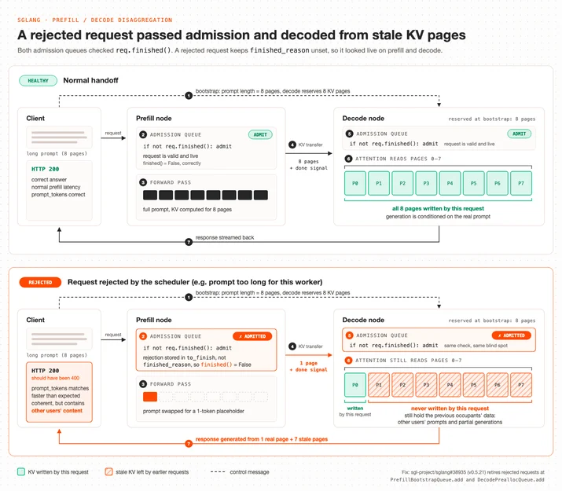

# GLM-5.3 Workers AI 模型中的跨请求 KV 缓存泄露，以及我们与 SGLang 的修复工作

> **来源**: [https://blog.cloudflare.com/kv-cache-exposure-remediation](https://blog.cloudflare.com/kv-cache-exposure-remediation)  
> **作者**: 未知 | **发布时间**: 2026-10-26T22:01:23.889000+00:00  
> **深度调研**: [查看专题调研报告](research.md)  
> **标签**: SGLang, KV Cache, Prefill/Decode 分离, 多租户隔离, GPU 内存安全, RDMA, 大模型推理, 安全事故复盘

---

## AI 导读

Cloudflare报告，GLM 5.3服务在2026年8月27日至9月9日期间，有155次响应包含其他用户此前请求的数据，涉及的输入均超过681,280个词元，即模型处理文本的基本单位。调查未发现蓄意利用的证据，但这不等于证明没有发生利用。

问题由配置不匹配和推理引擎SGLang的错误处理缺陷共同触发。服务允许约105万词元的上下文，但负责处理输入的显卡只能缓存681,280个词元。服务把处理输入和逐步生成回答分配给不同节点，两者通过KV缓存交接上下文；KV缓存是模型保存已处理上下文的键值数据。超出缓存容量的请求虽被内部标记为拒绝，却仍以单词元占位输入继续执行。生成节点预留了完整请求所需的内存页，只收到少量新缓存后便认为传输完成，随后读取未被覆盖的旧页面，导致跨用户数据泄露。

修复同时扩大缓存池，并让被拒绝的请求在分配内存和传输数据前就返回错误。作者称，两项改动经过研究者复现脚本和自有标记测试验证后，服务恢复。文章还说明了请求中止时过早释放内存、远程写入稍后到达等相关风险，并介绍延迟释放、限制传输批量和部署前直接核对容量等加固措施。

复盘的关键教训是：请求成功返回和性能正常，不能证明输出正确或用户数据隔离有效。更长期的方案是在每次读取缓存前核对页面是否属于当前请求，但现有原型曾因可靠性问题停用，也受模型架构限制；传输校验尚未覆盖所有模型，形式化验证仍是后续计划。正文提供了补丁线索与验证说明，但未展示原始日志、完整测试数据或影响范围的统计方法。

---

## 原文整理

# GLM-5.3 Workers AI 模型中的跨请求 KV 缓存泄露，以及我们与 SGLang 的修复工作

2026 年 9 月 8 日，Knostic 的安全研究员 Gadi Evron 向我们报告，GLM-5.3 Workers AI 模型（`@cf/zai-org/glm-5.3`）存在租户隔离问题，该问题自 2026 年 8 月 27 日起开始影响服务。我们已完成修复，并于 9 月 9 日恢复了该模型的服务。我们已确认，Workers AI 托管的其他模型均未受到影响。

8 月 27 日至 9 月 9 日期间，少数使用 GLM 5.3 Workers AI 模型的客户收到的响应中，包含了其他客户稍早前向同一模型发送请求时的数据。共有 155 次响应受到影响，对应的提示词长度均超过 681,280 个词元。

排除我们自己和研究员的测试后，我们识别出的请求在时间和数量上都符合正常的长上下文使用情况，没有呈现出反复利用该漏洞的特征。我们未发现蓄意利用的证据。

今天，我们与所使用的开源推理引擎 SGLang 同步发布文章，进行协调披露。本文介绍导致此次问题的漏洞、我们的响应时间线，以及此后对生产环境中的 SGLang 部署所做的加固。我们也会详细介绍与 SGLang 上游维护者持续合作，解决这一漏洞及类似问题的工作。

## 发生了什么

GLM 是 [Z.ai](http://z.ai) 推出的文本生成模型，面向智能体编程工作流构建，也是 Workers AI 提供的众多[模型](https://developers.cloudflare.com/workers-ai/models/)之一。9 月 8 日，Gadi Evron 通过我们的 HackerOne 项目提交报告，指出在 Workers AI 上向 `@cf/zai-org/glm-5.3` 发送很长的提示词时，有时会返回属于其他用户会话的文本。Cloudflare 于次日上午复现了该问题，并在宣布进入事故响应状态后的 40 分钟内将模型下线。随后，我们部署了修正后的配置和打过补丁的推理引擎，并于当天恢复服务。

此次报告的跨请求 KV 缓存泄露由两个问题叠加导致。第一个问题是 Cloudflare 使用的开源推理引擎 SGLang 配置有误。我们为 GLM 5.3 配置了 1,048,576 个词元的上下文窗口，但预填充 GPU 上的 KV 缓存池只能容纳 681,280 个词元。上线前，我们已经知道两者不匹配。我们预期引擎会对无法处理的提示词返回错误，而长上下文测试又得到了成功响应，因此当时并不认为这会构成问题。

第二个问题是 SGLang 在预填充与解码分离模式下，处理由此产生的超长请求时存在漏洞。无法放入缓存池的提示词会在内部被标记为拒绝，并替换成一个词元的占位提示词。但预填充端并未中止请求并向客户端返回错误，而是为这个占位提示词生成 KV 缓存，再将其传给解码节点。解码节点收到“传输完成”消息后，以为预填充端已经用当前请求完整提示词的 KV 缓存覆盖了此前请求留下的缓存，实际上大部分旧状态都还保留着。随后，解码节点在生成响应时，通过注意力机制读取了仍含有此前请求数据的旧缓存页。因此，长度超过 681,280 个词元的提示词所得到的响应，可能包含其他用户 GLM 5.3 会话中的数据。

## 立即采取的修复措施

[禁用模型](https://www.cloudflarestatus.com/incidents/jsvvrtk5hvym)后，我们采取了以下措施来修复漏洞，之后才恢复对外开放：

**针对配置问题，我们让缓存池能够容纳完整上下文。** 我们调整了 GLM 5.3 的配置，使其与 GLM 5.2 的配置一致。这释放出了足够的 GPU 内存，使预填充 KV 缓存池现在能够容纳约 204 万个词元，约为 1,048,576 个词元上下文长度的两倍。现在，只要提示词没有超出上下文窗口，就一定能放入缓存池，因此有效请求不会再进入拒绝处理流程。仅这一项改动就能防止该漏洞被触发。

**针对引擎问题，我们也确保拒绝处理流程是安全的。** 仅依赖缓存池大小并不稳妥：量化、张量并行、CUDA 图大小或未来模型版本的任何变化，都可能改变缓存池大小，而且很容易被忽略。此外，预填充调度器也可能在其他情况下拒绝请求，从而触发同一个漏洞。为防止这种情况，我们还为引擎打了补丁：如果请求带有尚待处理的拒绝状态，就在分离模式的准入队列中终止该请求，并返回原始错误，确保这一切发生在任何引导、内存分配或 KV 传输之前。我们通过 [#38704](https://github.com/sgl-project/sglang/pull/38704) 向上游提出了这一方案，该补丁还让解码节点核对传入的词元数量是否与其预留的数量一致。SGLang 的 `main` 分支上其实已经有了相关修复，即 9 月 6 日合并的 [#36988](https://github.com/sgl-project/sglang/pull/36988)。该修复针对的是一条相关的失败处理路径，当时尚未发布。维护者还沿用我们的方法，合并了 [#38935](https://github.com/sgl-project/sglang/pull/38935)，使这些请求能更早被拒绝。

恢复模型之前，我们使用研究员提供的复现脚本和自己的金丝雀标记测试，验证了这两项改动。

## 背景：我们如何提供 GLM 5.3 服务

Workers AI 使用 SGLang，以预填充与解码分离的方式运行 GLM 5.3：一组预填充 GPU 处理提示词，生成相应的模型 KV 缓存，然后通过 [Mooncake](https://kvcache-ai.github.io/Mooncake/)，利用远程直接内存访问（RDMA），将缓存交给另一组负责生成响应的解码 GPU。我们此前在介绍[高性能大语言模型](https://blog.cloudflare.com/high-performance-llms/)以及[更小、更快、更安全的模型](https://blog.cloudflare.com/smaller-faster-safer-models/)的文章中，讨论过这种架构。

GPU 内存中的 KV 缓存是一个由固定大小页面组成的共享池。每个请求在获准执行时分配到页面，并在完成时释放这些页面。目前，请求之间不会将页面清零；下一个拿到该页面的请求会直接覆盖它。这种做法在推理引擎中很常见，也是实现最佳性能所必需的，但这意味着推理引擎必须负责跟踪这些内存页的归属。跟踪 KV 缓存页的归属和生命周期，既要处理节点内部的共享使用情况——KV 缓存卸载和词元生成都会访问同一块内存，但使用时段不同——也要处理与远程预填充节点之间的共享情况，因为后者同时持有对该页面的可修改引用。

此外，这个缓存池的大小并不是一个配置值。SGLang 会在启动时，根据加载模型权重后剩余的 GPU 内存来确定其大小。而模型对外标示的上下文长度，是另一个独立的配置值。系统没有机制强制两者匹配，核对它们是否匹配是我们的责任。

## 问题一：配置错误

在我们的配置下，GLM 5.3 预填充节点的缓存池容量为 681,280 个词元，而模型的上下文长度为 1,048,576 个词元。SGLang 会在启动日志中输出所选的 KV 缓存池大小，也会将其作为指标暴露出来。我们知道两者大小不匹配；但在上线前的基准测试中，我们看到的是表示成功的 HTTP 状态码，流式响应体中也没有错误帧。我们因此以为，引擎能够通过流式处理或其他机制，妥善处理 KV 缓存池容量与请求上下文窗口之间的差异。

这是我们测试中的一个关键缺口：对于长上下文，我们只验证了 HTTP 响应码和引擎性能，没有验证模型输出及其连贯性。现在，每次对分离部署的变更上线之前，我们都会直接从运行中的引擎获取 KV 缓存池大小，与上下文长度核对，而不再根据响应码推断。

## 问题二：SGLang 漏洞

SGLang 团队现已在 v0.5.21 中处理了这个漏洞，修正了对长度超出 KV 缓存池容量的提示词的处理方式。此前的情况如下。

当收到的提示词长度超出 KV 缓存池容量时，SGLang 调度器会拒绝该请求。拒绝处理路径（`Req.set_finish_with_abort`）会记录要返回给客户端的错误，并将提示词替换成一个词元的占位提示词，让请求无需分配实际内存，就能走完正常的批处理流程。在单节点部署中，这种做法是有效的：占位提示词执行完毕，批次结束，客户端收到错误。

但在我们使用的分离模式下，预填充端和解码端的准入队列检查的都是请求是否*已完成*，而不是是否*已被拒绝*。被拒绝的请求仍会报告自己处于活动状态。于是，流程变成了这样：

1. **引导。** 路由器将提示词长度告知解码节点（图中为 8 页）。解码节点为该请求预留了 8 个 KV 页面。
2. **预填充准入。** 只要 `req.finished()` 为 False，预填充准入队列就会接纳该请求。被拒绝的请求将拒绝状态存放在 `to_finish` 中，而不是 `finished_reason` 中，因此 `finished()` 仍然返回 False。这个被拒绝的请求就这样获准进入了后续流程。
3. **预填充前向计算。** 拒绝处理此前已将提示词替换成一个词元的占位提示词。预填充端只对这一个词元执行了一次很简单的前向计算。
4. **KV 传输。** 预填充端向解码端发送了一页 KV 数据，并发出传输完成信号。
5. **解码准入。** 解码端的准入队列采用同样的 `finished()` 检查，因此接受了这次交接。
6. **解码注意力计算。** 解码端开始生成内容，注意力计算读取了全部 8 个预留页面。只有 P0 页由本次请求写入过。P1 至 P7 页仍保留着此前请求留下的内容：其他用户的提示词和已生成的部分内容。
7. **响应。** 客户端收到的是 HTTP 200，而不是 HTTP 400。`prompt_tokens` 与长提示词的长度相符，回答也很连贯。它返回得比处理 8 页输入所需的预填充时间更快，而且包含了其他用户 KV 页面中的内容。

所有超过这一阈值的请求都会出现上述行为。另一位用户已于 2026 年 7 月 6 日通过问题单 [#30233](https://github.com/sgl-project/sglang/issues/30233) 向 SGLang 报告过这个漏洞，Cloudflare 在调查本次事故时注意到了该问题单。自 v0.5.10 起，我们就一直在向 SGLang 提醒这类问题；此次安全事故加快了 Cloudflare 此前已与 SGLang 团队合作开展的工作。该问题的补丁已在 SGLang v0.5.20 中发布，v0.5.21 和 v0.5.22 又加入了后续修复，其他依赖 SGLang 的运营方都可以使用。我们强烈建议所有运营方将 SGLang 依赖升级到 v0.5.22 或更高版本。各个 PR 的具体情况见下文。

GLM 5.3 是唯一受此漏洞影响的模型。Workers AI 上其他所有采用分离模式的部署，预填充端和解码端的 KV 缓存池都大于各自的上下文长度，因此没有请求能够进入这条拒绝处理路径。我们已将引擎修复和下文所述的加固措施应用到所有使用 SGLang 提供服务的模型，部署检查也要求每个新部署都必须具备这些措施。

## 时间线

以下时间均为 UTC。

| 时间 | 事件 |
| --- | --- |
| 2026 年 8 月 27 日 | GLM 5.3 在 Workers AI 上线，预填充 KV 缓存池小于上下文窗口。泄露问题从上线时就已存在。 |
| 2026 年 9 月 8 日 23:11 | 通过 HackerOne 收到报告。 |
| 2026 年 9 月 9 日 08:00 | Cloudflare 开始核实 HackerOne 报告。 |
| 2026 年 9 月 9 日 13:22 | 宣布发生安全事故。产品安全团队在 25 分钟内使用两个独立账户复现了泄露。 |
| 2026 年 9 月 9 日 14:00 | 确认问题范围后，将 GLM 5.3 设为私有。请求返回 HTTP 400。更新状态页面。 |
| 2026 年 9 月 9 日 14:35 | 确定根因为预填充缓存池小于上下文长度。确认使用更大缓存池的金丝雀预填充节点不受影响。 |
| 2026 年 9 月 9 日 14:52 | 所有预填充节点均已滚动更新为修正后的配置。 |
| 2026 年 9 月 9 日 19:04 | 使用修正后的配置及 Cloudflare 编写的引擎补丁，重建整个部署。该补丁可对被预填充调度器拒绝的请求正确返回错误。已通过研究员的复现脚本验证。 |
| 2026 年 9 月 9 日 19:40 | 模型恢复对外开放。 |
| 2026 年 9 月 10 日 23:30 | 与 SGLang 维护者（RadixArk 首席技术官及核心工程师）开会，就上游修复方案达成一致。 |
| 2026 年 9 月 11—19 日 | 向所有生产环境中的 SGLang 部署推出更多加固措施，详见下文。 |
| 2026 年 9 月 16 日—10 月 12 日 | SGLang 上游合并准入修复、逐次传输校验和、中止确认（ACK）保留等改动，并默认启用 KV 延迟释放。 |
| 2026 年 10 月 2 日 | SGLang v0.5.21 发布。 |
| 2026 年 10 月 19 日 | SGLang v0.5.22 发布。 |
| 2026 年 10 月 26 日 | 与研究员及 RadixArk 协调发布。 |

## 持续加固

这个漏洞属于一类 KV 缓存内存安全问题，Cloudflare 已为解决这类问题努力了数月。在这类问题中，页面被释放、复用或读取时，仍有其他操作需要使用它。我们发现了两种常见原因。

第一种是单节点内部的页面生命周期问题。解码节点上的多个任务可能同时持有同一页面，包括词元生成、向主机内存卸载、KV 传输接收，以及中止和错误处理流程。如果其中一项任务释放页面时，另一项还在使用它，那么即使该页面仍在被读写，也可能被分配给新请求。我们此前针对解码端卸载的修复（[#24226](https://github.com/sgl-project/sglang/pull/24226)、[#30899](https://github.com/sgl-project/sglang/pull/30899)），以及针对语法错误时重复释放的修复（[#30937](https://github.com/sgl-project/sglang/pull/30937)），都属于这一类。

第二种是跨节点的竞态。当请求被中止时，如果预填充端仍在通过 RDMA 向解码端写入 KV 缓存，已经发出的写入就无法撤回。如果解码端立即释放这些页面，它们就可能被分配给另一请求，随后到达的写入便会落入新请求的 KV 缓存。Cloudflare 通过提出修复方案（[#31357](https://github.com/sgl-project/sglang/pull/31357)、[#38961](https://github.com/sgl-project/sglang/pull/38961)）及提供复现脚本（[#32564](https://github.com/sgl-project/sglang/pull/32564)），参与了解决这一竞态的工作。这两种情况都会导致输出损坏，或让一个用户的数据出现在另一个用户的响应中，而且不会报错。本次事故中的漏洞有所不同：被拒绝的请求每次都会进入交接流程，并非偶然的时序问题。但结果相同：解码端读取了本次请求从未写入过的页面。此前这些修复都未涵盖本次事故的失败场景，即预填充端拒绝了请求，解码端却始终不知情。

事故发生后，我们已经：

- 扩展了延迟释放机制，使其也保留预填充端的源页面，并覆盖所有失败类型，而不只是中止。我们通过 [#38961](https://github.com/sgl-project/sglang/pull/38961) 向上游提出该方案，随后它被 [#40645](https://github.com/sgl-project/sglang/pull/40645)、[#41402](https://github.com/sgl-project/sglang/pull/41402) 和 [#41404](https://github.com/sgl-project/sglang/pull/41404) 取代。
- 部署了对 Mooncake 传输批次大小的限制（[#32758](https://github.com/sgl-project/sglang/pull/32758)，来自 SGLang 社区），确保单次传输调用的持续时间不会超过释放超时期限。
- 修改了负载均衡器，使客户端断开连接时，不再中止正在传输的请求。负载均衡器会保持预填充连接，直到预填充完成；同时保持解码连接，直到生成首个词元，然后关闭两条连接。
- 为每次分离部署变更增加了检查：核对 KV 缓存池大小与上下文长度，确认预填充和解码两端均启用延迟释放，确认传输批次限制能让传输在释放超时期限内完成，并确认已应用所有必需补丁。

上述改动均已部署到我们采用分离模式的生产环境中。

## 与 SGLang 团队合作

9 月 10 日，也就是事故发生后的第二天，我们与 RadixArk 的 SGLang 维护者开了会。双方商定，由 RadixArk 调查我们报告的竞态条件，将完整性检查的思路纳入上游，并为这类漏洞编写复现测试。

以下改动已合入 SGLang 的 `main` 分支，用于解决本次事故及相关 KV 缓存竞态问题。除一项外，其余均已包含在 v0.5.22 中。以分离模式运行 SGLang 的运营方应升级到 v0.5.22，或按需将这些补丁移植到所用版本。

| 类别 | 拉取请求 | 发布版本 | 作用 |
| --- | --- | --- | --- |
| 本次事故 | [#36988](https://github.com/sgl-project/sglang/pull/36988) | v0.5.20 | 在已中止的预填充请求的结果到达解码端之前，终止这些请求。此改动可阻止本次事故中的泄露。 |
| 本次事故 | [#38935](https://github.com/sgl-project/sglang/pull/38935) | v0.5.21 | 在准入阶段就拒绝这些请求，早于任何引导、内存分配或 KV 传输。沿用了 Cloudflare 补丁草案 [#38704](https://github.com/sgl-project/sglang/pull/38704) 的方法。 |
| 竞态 | [#39461](https://github.com/sgl-project/sglang/pull/39461)、[#41612](https://github.com/sgl-project/sglang/pull/41612) | v0.5.21、v0.5.22 | 客户端断开连接或预填充失败时，`sgl-router` 会同时取消请求的预填充和解码两部分。 |
| 竞态 | [#37454](https://github.com/sgl-project/sglang/pull/37454)、[#41023](https://github.com/sgl-project/sglang/pull/41023) | v0.5.20、v0.5.21 | 先将 KV 延迟释放限制为仅在支持它的后端启用，随后改为默认启用。 |
| 竞态 | [#40645](https://github.com/sgl-project/sglang/pull/40645)、[#41402](https://github.com/sgl-project/sglang/pull/41402) | v0.5.21 | 修复写入排空确认丢失的情况，使页面在收到确认时就能释放，无需等到超时。 |
| 竞态 | [#41404](https://github.com/sgl-project/sglang/pull/41404) | v0.5.21 | 所有传输失败时都保留页面，不再仅限于解码端发起的中止。 |
| 竞态 | [#41618](https://github.com/sgl-project/sglang/pull/41618) | v0.5.21 | 修复中止通知路径中的一项回归问题。 |
| 竞态 | [#43719](https://github.com/sgl-project/sglang/pull/43719) | v0.5.22 | Mooncake 发送失败时，不再将其写入报告为已排空。 |
| 竞态 | [#37077](https://github.com/sgl-project/sglang/pull/37077) | v0.5.22 | 按请求为中止消息添加标记，防止复用的 ID 接收并处理旧确认。增加 MORI 支持。 |
| 竞态 | [#36612](https://github.com/sgl-project/sglang/pull/36612) | v0.5.20 | 让 Mooncake、NIXL 和 MORI 共用预填充端向解码端发送失败通知的机制。 |
| 竞态 | [#32758](https://github.com/sgl-project/sglang/pull/32758) | v0.5.20 | 提供可选的 Mooncake 传输批次大小上限，防止一次超时调用留下数量不受限制、仍在途中的写入。 |
| 生命周期 | [#30899](https://github.com/sgl-project/sglang/pull/30899) | v0.5.21 | 解码端会先等待正在进行的主机内存卸载完成，再撤回请求并释放其页面。由 Cloudflare 编写。 |
| 生命周期 | [#43562](https://github.com/sgl-project/sglang/pull/43562) | v0.5.22 | 从主机内存恢复缓存失败时，让参与张量并行的各个 rank 保持一致。 |
| 可观测性 | [#39500](https://github.com/sgl-project/sglang/pull/39500) | v0.5.21 | 添加 `--disaggregation-enable-kv-checksum`：解码端在生成前验证所传输 KV 数据的校验和。进一步整理见 [#39729](https://github.com/sgl-project/sglang/pull/39729)，已合并，等待发布。 |
| 可观测性 | [#38596](https://github.com/sgl-project/sglang/pull/38596)、[#40642](https://github.com/sgl-project/sglang/pull/40642) | v0.5.20、v0.5.21 | 修复 SGLang 的 KV 金丝雀检测机制；该机制用于检测潜在的数据损坏并记录日志。 |
| 可观测性 | [#41128](https://github.com/sgl-project/sglang/pull/41128) | v0.5.22 | 为延迟释放增加指标：次数、持续时间，以及每次保留页面是因收到排空确认而结束，还是因超时而结束。 |

以下后续工作仍在进行：

- [#39729](https://github.com/sgl-project/sglang/pull/39729)：对 `--disaggregation-enable-kv-checksum` 做进一步整理。已合并，等待发布。
- 释放时将 KV 页面清零，提案草案：[#46435](https://github.com/sgl-project/sglang/pull/46435)。
- 将 KV 校验和验证从预填充到解码的交接环节扩展到每一个解码步骤，见下文“从设计上保障完整性”。
- 扩大 KV Canary 和 KV Checksum 对模型与功能的支持范围。

## 我们对其他运营方的建议

如果你以预填充与解码分离模式运行 SGLang，我们建议：

1. **测量 KV 缓存池大小，并与上下文长度核对。** 每次修改权重、量化、并行配置或内存分配比例后，都应在每个预填充和解码节点上，从引擎启动日志中获取这些数据。如果缓存池更小，就降低上下文长度，使其能够放入缓存池。不要依赖代理来强制执行这一限制，也不要假定引擎会拒绝放不下的请求。这正是我们此前没有强制执行的检查。
2. **升级到包含 [#36988](https://github.com/sgl-project/sglang/pull/36988) 和 [#38935](https://github.com/sgl-project/sglang/pull/38935) 的构建版本（v0.5.22 或更高版本）**，确保无论缓存池大小如何，超长请求都会在交接之前被拒绝。这是引擎侧的修复，也是第一步检查出错时的兜底措施。
3. **在预填充和解码两端都启用 KV 延迟释放**（在 [#41023](https://github.com/sgl-project/sglang/pull/41023) 之后默认启用），并限制 Mooncake 传输批次大小，防止一次超时调用留下数量不受限制、仍在途中的后续写入。
4. **在模型支持的情况下开启数据损坏检测。** `--disaggregation-enable-kv-checksum` 和 `--kv-canary` 尚未覆盖所有模型架构。检查日志，确认请求确实得到了验证。我们正与 SGLang 团队合作，将这两种检查扩展到更多架构，包括 GLM 5.3、GLM 5.3 Flash 和 DeepSeek V4。
5. **确保代理不会触发不必要的中止。** 配置负载均衡器，允许请求继续执行到生成首个词元，以免触发需要跨节点协调的中止。

## 长期方向

### 从设计上保障完整性

配置检查和生命周期修复，能够减少页面被误用的途径，但无法彻底排除误用的可能。这次事故提醒我们，下一个漏洞可能会以我们从未见过的形式出现。持久的解决办法是：让引擎在读取时发现，请求即将通过注意力机制读取不属于自己的页面，并让该请求失败，而不是返回别人的数据。

我们在夏季构建了一个这样的原型，并[于 8 月作了介绍](https://blog.cloudflare.com/smaller-faster-safer-models/)。每个物理 KV 页面都带有一个标记，页面被重新分配时，标记也会变化；每个请求记录自己预期的标记，解码端读取缓存前会检查这一对应关系。测试中，它对吞吐量和尾延迟带来的开销均低于 1%。我们于 8 月中旬在 GLM 5.2 上测试了该原型，但不久后因可靠性问题将其禁用。

这个原型还与特定的注意力后端和模型架构绑定，因此无法成为通用修复方案。我们正在与 SGLang 团队合作，将一个适用于所有模型、可用于生产环境的版本直接集成进引擎，而不是维护 Cloudflare 专用补丁。[#39500](https://github.com/sgl-project/sglang/pull/39500) 中逐次传输的校验和是第一步：它验证从预填充端到解码端的交接。页面级标记则更进一步，因为它会检查每一次读取，包括传输结束很久之后的读取。

### 用数学证明排除完整性问题

RDMA 将数据从一个节点的内存直接复制到另一个节点的内存。因此，两台机器必须就数据写到哪里、大小是多少、何时完成达成一致；任何不匹配都可能导致接收端读取错误的数据。这次漏洞就是分布式系统一致性失效的一个例子：两台机器对系统状态的认识不一致。

在 Cloudflare 的其他项目中，我们已经投入精力，使用形式化验证方法证明分布式系统的安全性。[Topaz](https://blog.cloudflare.com/topaz-policy-engine-design/) 让我们的权威 DNS 服务器能够无冲突地选择 IP。对 [Meerkat](https://blog.cloudflare.com/meerkat-introduction/) 的 QuePaxa 实现所建立的模型，揭示了一些一致性漏洞，这些漏洞随后得到了修复。

现在，我们正将形式化方法的经验用于 KV 缓存传输引擎。起点是为一种基于 RDMA 的 KV 缓存传输协议建模，并证明其安全性。目标是为我们生产环境中使用 Mooncake 的 SGLang 分布式 KV 缓存系统建立模型，然后跟踪并修复它与我们希望保证的安全属性之间的任何偏差。我们希望尽可能证明，这样的漏洞不会再次发生。现实地说，我们预计证明工具能给出的结论仍会有空白，但证明系统的其余部分后，我们就能更仔细地审查和监控这些空白。

## 协调披露

我们发布这份报告，是协调披露的一部分。感谢研究员 Gadi Evron 通过我们的 HackerOne 项目报告此问题，提供了清晰、可复现的脚本，并在公开之前留出时间，让我们完成修复并与 SGLang 维护者协调。我们也感谢 RadixArk 的 SGLang 团队：他们将此事视为双方共同的问题，迅速推动上游修复落地。

更多内容请阅读 [SGLang 团队的文章](https://www.lmsys.org/blog/2026-10-26-cf-security)。

如果你发现 Workers AI 存在安全问题，请通过 [hackerone.com/cloudflare](https://hackerone.com/cloudflare) 报告。