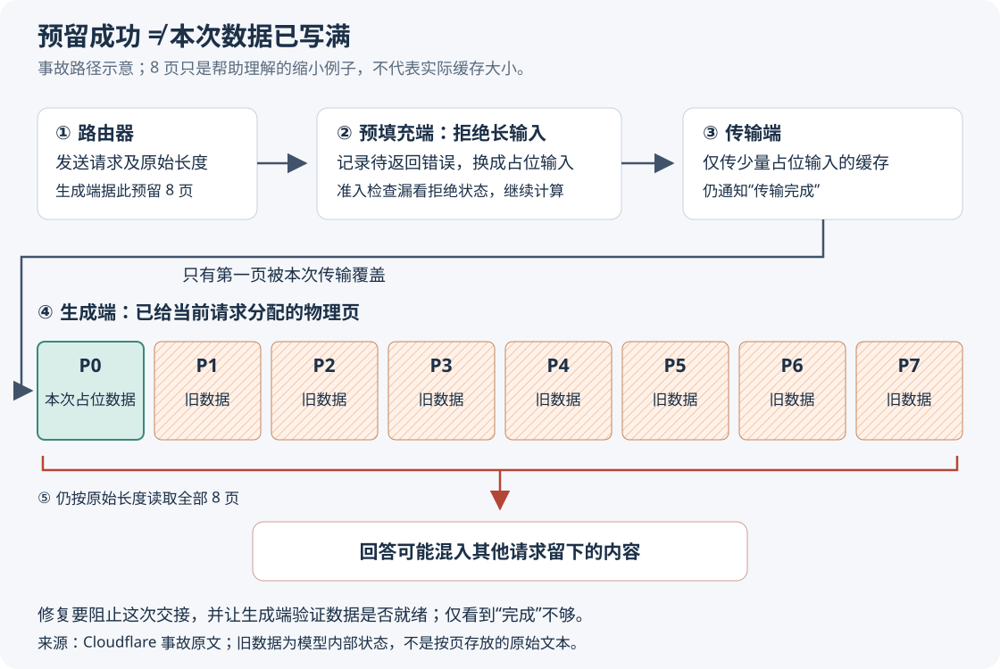
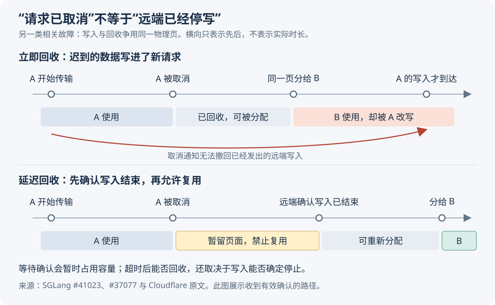

# 大模型为什么会回答出别人的内容：Cloudflare 跨请求缓存泄露分析

> 来源：[blog.cloudflare.com](<https://blog.cloudflare.com/kv-cache-exposure-remediation>)  
> 作者：未知 · 发布时间：2026-10-27 06:01（Asia/Shanghai）  
> 翻译正文：[阅读中文正文](article-zh-CN.md)

一份很长的输入被推理服务拒绝后，系统本该返回错误，却继续生成了回答，甚至混入其他用户先前提交的内容。Cloudflare 披露的 GLM-5.3 事故就发生在这条异常路径上：负责处理输入的机器只准备了一小段数据，负责生成回答的机器却以为完整数据已经到齐。

Cloudflare 通过调整缓存容量和修补请求处理流程恢复服务，随后又加强了取消请求、传输失败和内存回收时的保护。这个案例值得自建模型服务的团队关注，尤其是多人共享显卡、支持长输入，或者把输入处理与回答生成分配给不同机器的场景。关键问题是：**生成回答前，服务怎样确认即将读取的数据确实属于本次请求，而且已经准备完整？**

本文以所提供的 [Cloudflare 事故报告](https://blog.cloudflare.com/kv-cache-exposure-remediation)为研究主体，并结合 SGLang 的公开问题记录、修复说明、版本源码和相关论文核验机制。事故规模属于运营方披露；下文会将这些事实与外部证据、分析和实践建议分开说明。

## 先看一个缩小的例子：分到了内存，不代表里面是自己的数据

假设用户甲让模型阅读一份内部项目材料。回答结束后，服务收回了用于处理这份材料的显存，准备交给其他请求使用。这里的显存，就是显卡上供模型计算和保存中间结果的内存。

随后，用户乙提交很长的输入。服务为乙分配了八页缓存；但处理输入的一端发现请求太长，实际只处理了一个用于收尾的占位输入，并传来足以覆盖第一页的数据。生成端没有发现这个差异，仍按八页读取。其余七页虽然已经分配给乙，内容却没有被乙的数据覆盖，可能仍保留甲或其他请求的状态。

模型使用这些旧状态生成后续文字，就可能把其他请求的信息带入乙的回答。**这是依据原文机制构造的示意，不是真实客户现场；八页也不是事故中的实际容量。**

这些缓存叫 **KV 缓存（Key-Value Cache）**：模型处理先前文字时，会为注意力计算保存“键”和“值”两类内部数值，生成下一个词元时直接读取，避免重复计算。词元（token）是模型切分和处理文本的单位，不等于一个汉字或一个单词。注意力则是模型在生成当前内容时，计算应参考哪些先前位置的机制。

因此，KV 缓存不是一段可以直接打开阅读的聊天记录，但它保留了会影响后续生成的信息。读错缓存不一定输出乱码，也可能产生连贯、却不属于当前用户的内容。原文报告的风险正是后者。

图中要区分两件事：**页面分配给谁，以及页面里已经写入了谁的数据。** 这两件事不能只靠一条“传输完成”通知来等同。

## 事故有两个前提：容量不匹配，拒绝路径又没有安全停止

据 Cloudflare 报告，受影响的是 Workers AI 上的 `@cf/zai-org/glm-5.3`，暴露窗口从 2026 年 8 月 27 日持续到 9 月 9 日。运营方识别出 155 个受影响响应，输入均超过 681,280 个词元；该部署对外配置的上下文窗口却是 1,048,576 个词元。上下文窗口指一次推理所能使用的输入与生成内容的长度范围，具体限制还受服务实现影响。Cloudflare 表示，其平台其他模型未受这次问题影响，也没有发现蓄意利用的证据。[来源：原文](https://blog.cloudflare.com/kv-cache-exposure-remediation)

这几个数字需要谨慎理解。155 是受影响的**响应数**，不能当成客户数或泄露比例；原文没有给出可供计算发生率的完整请求分母。681,280 是该部署当时的缓存容量，不能推广成 GLM-5.3 或 SGLang 的通用安全阈值。“没有发现蓄意利用”也只是调查结论，不等于已经证明从未发生利用。

第一个前提是配置问题。SGLang 是管理模型计算、请求调度和缓存的开源推理引擎。在原文所述部署中，它启动时根据模型加载后可用的显存确定 KV 缓存池大小；而上下文长度是另一项配置。对外允许接收的输入，可能大于内部实际能容纳的输入。

Cloudflare 已经知道两者不匹配，但上线前看到长输入测试返回成功状态和正常流式响应，便以为引擎能通过某种机制处理。这里缺少两项验证：直接检查运行中的容量，以及检查回答是否确实依据当前输入。把输入拆批计算，并不会自动让不足的缓存变得足够；若要依靠缓存卸载或特殊注意力机制突破显存限制，必须验证该模型与部署确实支持相应路径，不能从接口成功反推支持。

第二个前提是引擎缺陷。容量不足原本应导致请求失败，实际却进入了成功交接的流程。**容量错误触发了异常路径，异常路径的状态处理错误才把资源不足变成了跨用户数据暴露。**

外部记录支持这一机制并非事故报告的事后解释：2026 年 7 月 6 日提交的 [SGLang 问题 #30233](https://github.com/sgl-project/sglang/issues/30233)已描述，输入超过工作进程的限制、却仍低于上下文限制时，预填充端中止请求并换成一个词元，生成端却从不完整缓存继续生成。不过，该记录本身不能独立证明 Cloudflare 的受影响数量和客户范围。

## 为什么要把输入处理和回答生成拆开

模型服务通常包含两个阶段。**预填充（prefill）**读取输入并计算其 KV 缓存；**解码（decode）**利用这些缓存逐步生成回答。前者处理大量输入位置，后者反复读取已有状态并生成新词元，两者的资源需求和延迟目标不同。

如果两阶段挤在同一组计算资源上，处理长输入可能干扰正在输出的请求。把它们分开，可以分别安排显卡数量、批处理方式和并行策略。这叫**预填充与解码分离部署**，下文简称“分离部署”。[DistServe 论文](https://arxiv.org/abs/2401.09670)说明了这种干扰和资源配置问题，但其特定实验收益不能直接当成 Cloudflare 或其他部署的收益。

原文中的职责分工如下：

| 部件 | 正常情况下负责什么 | 必须交代清楚的信息 |
| --- | --- | --- |
| 路由器 | 将同一次请求交给预填充端和生成端 | 请求身份、输入长度和取消状态 |
| 预填充端 | 接收输入、计算缓存、发起传输 | 输入是否被接受、哪些数据已经算好 |
| Mooncake 传输层 | 将缓存搬到生成端的目标内存 | 写入范围、传输结果、是否仍有写入未结束 |
| 生成端 | 分配目标缓存、等待数据、生成回答 | 数据是否完整可读、页面是否仍属于本次请求 |

Cloudflare 使用 Mooncake，通过 **RDMA（远程直接内存访问）**传输缓存：一台机器能够向另一台机器已开放的内存区域直接写入，减少常规数据搬运的开销。Mooncake 是这里承担缓存传输的组件，而不是模型本身。[来源：原文](https://blog.cloudflare.com/kv-cache-exposure-remediation)、[Mooncake 官方项目文档](https://kvcache-ai.github.io/Mooncake/)

为了高效利用显存，引擎把缓存池划成可重复分配的页。分页能减少连续内存分配造成的浪费；相关思路可参见 [PagedAttention 论文](https://arxiv.org/abs/2309.06180)。但分页只是组织内存的方法，不能自行保证用户隔离。原文明确说，该部署在请求之间不清零页面，而由后续写入覆盖，所以引擎必须准确记录页面归属、有效内容和使用期限。

由此产生了一项额外约束：请求是否成功、数据是否写完、内存是否可以回收，必须在不同机器之间达成一致。单机里看似可行的收尾技巧，一旦跨越这个边界，就可能失效。

## 拒绝请求以后，错误是怎样一步步传播的

原文所述故障链可以拆成六步，关键在于区分“已经决定拒绝”和“已经完成收尾”。

1. **生成端按原始长度准备空间。** 路由器告知完整输入长度，生成端为它预留目标缓存。这个动作并不保证预填充端有足够容量处理该输入。
2. **预填充端决定拒绝，但暂不完成请求。** `Req.set_finish_with_abort()` 把错误记在 `to_finish`，并把输入换成一个词元的占位输入。这样做原本是为了让请求经过现有批处理流程收尾。
3. **准入检查漏掉了待返回错误。** `finished()` 检查的是最终结束原因 `finished_reason`；错误暂存在另一个字段，因此请求仍被看成可以继续处理。
4. **占位输入产生少量缓存，并被正常传出。** 这次传输相对于占位输入可能已经完成，却没有覆盖生成端为完整输入预留的空间。
5. **生成端接受了错误的交接含义。** 它把“传输完成”理解为原始输入对应的缓存全部可用，没有在这里阻止短传输与长预留之间的差异。
6. **模型读取旧状态并返回回答。** 原始长度仍指导缓存读取，未覆盖部分就进入注意力计算；客户端得到的可能是成功状态和连贯回答，而不是资源不足错误。

以上状态字段与占位输入机制也得到 [#38935 的修复说明](https://github.com/sgl-project/sglang/pull/38935)印证。在原文描述的单机路径中，占位输入走完批处理后会把错误返回客户端；分离部署却在正确收尾前跨过了数据交接边界。

这解释了为什么仅测接口成功率不够。成功状态证明接口走到了成功返回分支，却没有证明模型读取了正确的缓存。原文还提到，错误响应可能比真正处理完整长输入更快。因此，延迟变短也不能单独作为性能优化的证据。

从机制上推断，服务至少需要分别确认三个条件：请求仍被允许执行；实际就绪的数据覆盖模型将读取的范围；在读取结束前，这些页面不会被回收、复用或遭到其他请求的迟到写入。这是从事故提炼的检查原则，并非已经覆盖所有实现细节的形式化证明。

## 修复分成三层，每层解决的问题不同

### 让正常请求有足够容量，同时保留安全拒绝

Cloudflare 调整配置后，预填充缓存池约能容纳 204 万个词元，高于约 105 万词元的上下文长度，避免合法请求再次触发本次超长拒绝路径；同时部署引擎补丁，在恢复公开访问前使用研究者复现脚本和自有标记测试验证。[来源：原文](https://blog.cloudflare.com/kv-cache-exposure-remediation)

扩容解决触发条件，安全拒绝解决失败行为，两者不能互相替代。即使一个完整请求装得下，并发请求也可能耗尽空闲容量，系统仍要安全排队、拒绝或调度。模型权重、数值精度、并行配置和预留内存发生变化后，实际池容量也需要重新测量。

版本关系尤其值得澄清。上游 [#36988](https://github.com/sgl-project/sglang/pull/36988)先在预填充结果收尾时处理已中止请求，阻止其结果进入错误交接；[#38935](https://github.com/sgl-project/sglang/pull/38935)随后把初始拒绝移到两端准入入口，省去握手、分配和占位计算。后一个提交明确说明，在已经包含前一个修复的主分支上，旧缓存和错误成功状态的症状已不能复现，因此它主要进一步改善拒绝时机和等待行为。

所以，不宜把原文不同段落中对 v0.5.20、v0.5.21 的提及理解成互相矛盾，也不宜把所有安全修复归给单个版本。原文最终建议使用 v0.5.22 或更新版本；[v0.5.22 发布记录](https://github.com/sgl-project/sglang/releases/tag/v0.5.22)也列出了后续相关修补。部署时仍应核对实际镜像和提交，不能只检查版本号。

提前拒绝还必须区分“尚未获准的新请求”和“已经运行过、带着资源重新排队的请求”。直接丢弃后者可能留下未释放资源。若只有一端拒绝、另一端仍在等待，失败通知还需要跨端传播；#38935 也记录了这种非对称情况下仍可能等待传输超时的限制。这里体现的是错误处理的代价：改准入条件时，还要同时维护资源清理和对端通知。

### 请求取消后，等远端停止写入再回收页面

本次事故主要是拒绝后的确定性错误路径；原文还讨论了另一类相关问题：**请求已经取消，缓存写入却仍在途中。**

假设请求甲正在向生成端传输缓存，客户端突然断开。若生成端马上回收页面，并把它们给请求乙使用，甲先前发出的 RDMA 写入仍可能到达，把乙的缓存改坏。这里不需要生成端读错页号；读对页面也可能读到被迟到写入污染的数据。

**延迟回收**就是暂时保留这些页面，等相关发送方确认写入已经结束后再释放。上游 [#41023](https://github.com/sgl-project/sglang/pull/41023)将生成端相关保护改为默认开启，但受传输后端能力约束；[#37077](https://github.com/sgl-project/sglang/pull/37077)进一步统一了写入结束确认，并为取消消息绑定代次，避免复用的请求编号误认旧确认。

这种保护会在异常期间暂时占用容量。若确认丢失，页面可能保留到超时，因此需要监测暂留数量、持续时间和超时回收比例。更关键的是：**等待超时只是本地时钟经过了一段时间，不自动证明远端已经停止写入。** 原文将延迟回收与限制传输批次配套使用；从工程上看，还要验证传输、错误返回与底层写入停止之间的关系。单纯减小批次不能在任意网络或设备故障下给出时间上限证明。

### 检查数据，但别把检查能力想得过宽

上游 [#39500](https://github.com/sgl-project/sglang/pull/39500)增加了可选传输校验：预填充端计算缓存的 Adler-32 校验和，随最终传输块发送；生成端在生成前重新计算并比较，不一致就中止请求。校验和是用于发现数据差异的数值摘要。该功能需要两端开启 `--disaggregation-enable-kv-checksum`，并使用相匹配的缓存布局。

这能增加发现交接损坏的机会，但 Adler-32 不是证明来源可信的密码学认证；比较相等也不等于不存在任何错误。它检查的是交接时选定的数据范围，不能独自证明后续每次读取都正确，也不能替代请求身份、长度和页面归属检查。模型支持范围必须实际确认，原文明确提醒并非所有架构都受支持。

Cloudflare 还提出为物理页设置随重新分配变化的标签，让请求记录预期标签，在生成前检查映射。其[较早的技术文章](https://blog.cloudflare.com/smaller-faster-safer-models/)给出一组测试：两预填充、两生成配置，输入 8,192 个词元、输出 1,000 个词元，并发为 1、2、4、8，吞吐和第 95 百分位延迟的变化幅度均低于 1%。第 95 百分位延迟是 95% 请求不会超过的耗时。这只是运营方在该环境下的测量，不能推广到所有模型和工作负载。

本次原文同时说明，相关原型曾因可靠性问题停用。因此，低计算开销并不等于已经适合全面部署。

还要区分标签的能力边界：如果标签只在页面重新分配时更新，它可以帮助发现过期映射，却不自然证明页面已被本次输入完整写入，也未必发现同一页面遭到迟到写入。公开描述不足以证明原型能覆盖这些情况；要覆盖本次短传输问题，仍需验证有效数据范围和就绪状态。这是对保护机制的分析，不是对该原型完整实现的断言。

## 设计取舍：该保留哪些复杂度

下表是基于上述机制的工程判断，并非同环境性能排名。原文没有提供足以横向比较全部方案的基准。

| 选择 | 能带来什么 | 需要承担什么 |
| --- | --- | --- |
| 同一实例处理输入和生成 | 减少跨端握手、缓存搬运和远端取消协调 | 两阶段仍可能互相干扰；本地缓存归属与回收仍须正确 |
| 分离部署 | 分别配置两阶段资源，减少直接计算干扰 | 增加网络传输、双端状态、超时和资源回收的维护负担 |
| 降低上下文上限 | 用较小资源建立可验证的容量边界 | 更长输入会被拒绝，业务可能需要压缩材料或分段处理 |
| 扩大缓存池 | 为长输入或更多并发留出空间 | 占用显存，可能挤压其他用途；不能修复异常路径 |
| 页面复用前清零 | 减少旧请求残留数据被后续读出的机会 | 消耗显存带宽、需要正确排序；不能阻止清零后的迟到写入 |
| 为敏感租户使用独立实例 | 缩小共享进程缓存造成的跨租户影响范围 | 资源利用率和部署成本可能变差，隔离范围仍需明确 |

“页面不清零”与“页面可以随便读”是两回事。只要保证读取前正确初始化、映射有效且写入者受控，复用本身不必导致泄露；一旦保证失效，清零可作为降低残留风险的补充措施。原文中的清零方案仍是草案，不能写成已完成修复。

团队协作成本同样具体。模型部署负责人需要提供真实容量和配置记录；引擎维护者要核对拒绝与资源清理；网络和代理负责人要检查断连、取消和超时是否会制造额外中止。若这些设置分别变更却没有联合验收，即使每项局部测试都通过，跨端组合仍可能出错。这是从事故推导出的协作建议。

分离部署更适合已经测出两阶段干扰、拥有足够负载，并能维护传输与异常处理的团队。个人或小团队若只是运行低并发服务，或缺少排查跨机问题的能力，先保留简单部署通常更容易验证。这里没有通用的请求量门槛：是否值得拆分，应由自己的输入长度分布、延迟目标、网络条件和维护成本决定。

## 小团队怎样做一次有退出条件的验证

下面是建议的最小实践，不是本次调研已经完成的实测。目标是验证自己正在运行的配置，而不是复刻百万词元输入或大型集群。

**第一步，保存一份能对应到运行实例的记录。** 记录引擎提交或镜像摘要、模型版本、上下文限制、两端实际缓存池容量、传输后端和相关开关。先把允许的输入及输出预算设在已验证容量内，并按引擎实际限制留出余量。缓存池是共享资源，单请求能放下不代表任意并发都能放下。

**第二步，用两个测试身份和虚构材料建立对照。** 身份甲的输入放入每轮变化、不会自然猜中的随机标记；身份乙的输入不含这些标记。先确认模型在自己的正常请求中能正确取回标记，避免模型根本不遵循指令而使测试失去意义。再交替运行两身份、促使页面复用，检查回答是否出现不属于当前身份的标记。标记只用于测试，不应使用真实秘密。

**第三步，在隔离环境测拒绝边界。** 从日志或接口取得工作进程实际输入限制，分别测试明显低于限制、接近限制和超过限制的输入，同时覆盖上下文入口限制。若要验证事故涉及的路径，可以在不对外开放的实例中暂时降低缓存容量，让请求低于入口上下文限制、却超过工作进程限制。用实际分词结果计数，不能按文件字节或字符数估算。

上游 #38935 的验证使用的是 Qwen3-0.6B 和一预填充、一生成配置，说明触发条件可以缩小到小模型实验，无需原样部署 GLM-5.3。硬件仍需满足所选模型和后端要求；同机双进程可以检查部分状态路径，但不能据此声称验证了真实跨机 RDMA 的故障行为。

**第四步，只在确实使用分离部署时加入取消和传输失败。** 分别在预填充中、传输中和开始输出后断开测试客户端，检查两端是否停止或安全收尾，缓存暂留是否最终结束。若开启校验，需要用受控的数据差异确认它确实会拒绝请求；如果没有这种验证手段，就应把“检测是否有效”列为未验证项。

可以使用以下验收表。数值目标应事先由业务确定，不从 Cloudflare 的结果照抄。

| 检查项 | 记录什么 | 何时停止试验或退出当前配置 |
| --- | --- | --- |
| 身份隔离 | 每类场景的测试次数、其他身份标记出现次数 | 出现一次可确认的跨身份标记，就停止扩大试验，保留证据并排查 |
| 拒绝行为 | 客户端最终结果、生成端是否仍启动生成、双端等待时长 | 已被引擎拒绝的请求仍按正常任务生成回答，或对端等待行为超出约定预算 |
| 正常输入质量 | 当前请求标记取回结果、与简单部署的对照 | 出现不能解释的输入丢失、内容串入或质量退化 |
| 异常回收 | 暂留页面数量、暂留时长、确认与超时回收比例 | 资源不能恢复，或无法说明超时后为何可以安全复用 |
| 使用成本 | 每秒完成请求数、首个词元延迟、后续词元间隔及显存占用 | 不满足业务预设预算，或分离部署收益不足以覆盖运维复杂度 |

首个词元延迟常记为 TTFT，表示提交请求到开始收到回答的等待；后续词元间隔可用于判断输出是否流畅。比较时应固定模型、输入输出长度和并发，避免把少算输入或错误短路当作加速。

此外，**不要把“升级完成”当作“加固完成”。** 所查 [v0.5.22 的环境变量源码](https://github.com/sgl-project/sglang/blob/v0.5.22/python/sglang/srt/environ.py)中，`SGLANG_MOONCAKE_MAX_TRANSFER_BATCH_INDICES` 默认为 `0`，即保留不拆分批次的行为；[官方文档](https://docs.sglang.io/docs/advanced_features/pd_disaggregation)也把它列为主动启用的限制。应在自己的版本上设置并验证有效值，而不是复制某个提交早期说明中的默认数字。

若无法确认保护受当前模型支持，或者异常路径仍有无法解释的写入和回收，退出方案可以是降低上下文上限、停用分离部署，或为敏感请求使用独立实例。没有检测到标记串入，只能说明这组测试尚未发现问题；一次串入足以否定隔离保证，有限次数的通过不能证明不存在其他故障路径。

## 哪些结论已经有证据，哪些仍待验证

现有材料支持两项判断：这次事故包含容量配置不匹配和拒绝后错误交接；上游已经围绕中止、准入、传输校验和延迟回收进行了多轮修补。它们不支持“某个检测开关能保证所有模型不泄露”，也不支持“所有分离部署都存在同样漏洞”。Cloudflare 对其其他模型的排查结论，不能替代其他运营方对自身配置的检查。

原文提出用形式化验证继续检查缓存传输协议。形式化验证是把状态、动作和安全条件写成数学模型，再检查在给定假设下能否发生错误。它有助于发现异常事件组合中的漏洞，但原文描述的是后续计划，没有提供覆盖生产实现的完整证明。网络故障、底层写入完成语义以及实际代码与模型是否一致，仍需明确纳入验证范围。

本文调研截至 **2026 年 10 月 27 日**。事故日期、155 个响应、具体容量、恢复经过和原型停用信息，均来自提供的原文副本；本次未能重新抓取其在线正文，也未能获取原文所链接的协调披露文章，因此没有把它们当成独立交叉证据。外部核验主要来自本文实际查阅并链接的 SGLang 官方仓库、文档及论文；上游提交里的测试属于维护者报告，本次未运行 GPU 复现或性能测试。
