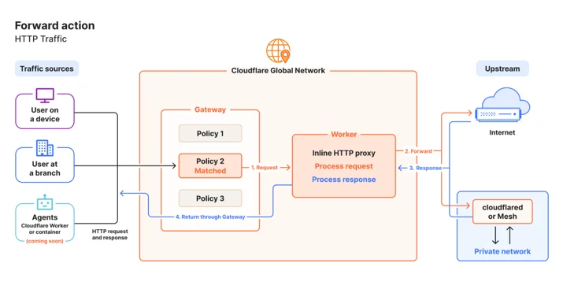
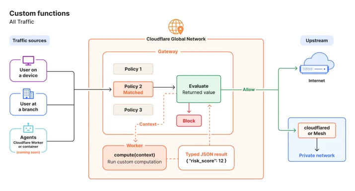

# A fully programmable secure web gateway

> **来源**: [https://blog.cloudflare.com/programmable-gateway-dlp](https://blog.cloudflare.com/programmable-gateway-dlp)  
> **作者**: 未知 | **发布时间**: 2026-10-15T17:11:12.510000+00:00  
> **深度调研**: [查看专题调研报告](research.md)  
> **标签**: 安全Web网关, SASE, 边缘计算, Cloudflare Workers, 零信任, DLP, 策略引擎

---

## AI 导读

文章要解决的是传统安全 Web 网关只能在条件匹配后执行有限终止动作，难以处理企业自定义的请求变换、动态策略、异步通知和针对具体数据实例的 DLP 判断。方案是在 Gateway 策略路径接入 Cloudflare Workers：Forward 将匹配的 HTTP 请求交给 Worker 作为内联中间件，可修改请求和响应或触发异步副作用；Custom Functions 在策略评估时接收请求、身份、设备等上下文，返回字符串、数字或布尔值作为策略选择器；DLP custom validation functions 则调用企业自有逻辑验证检测结果。文章以 JWT 角色注入、审批页、文件检查、Slack/PagerDuty 告警、风险评分和 GitHub 密钥有效性验证为例，结论是借助同机边缘调度可扩展 Gateway 行为而无需自建代理。局限包括 Forward 仍为公开测试版、Custom Functions 预计后续提供，Workers 受执行时间和请求量限制且按标准请求计费；文中没有独立性能数据、完整安全威胁模型、资源配额或故障语义，代码示例也不足以证明生产安全性。

---

## 原文整理

# A fully programmable secure web gateway


Every secure web gateway on the market works the same way: traffic matches a condition. A terminal action fires. Allow, Block, Isolate, Log. This model has been the foundation of network security for nearly 30 years, and it handles the common case well. But it has a ceiling, and customers with complex environments hit that ceiling regularly.

Earlier this year, we shared our vision to build a [<u>truly programmable SASE platform</u>](https://blog.cloudflare.com/programmable-sase/). We also outlined how the term *programmability* has become diluted by the security industry. Most vendors claim programmability because they have public APIs, Terraform providers, webhooks, and alerting. Cloudflare offers all of those things too, but that’s not enough. True programmability means running your own code — arbitrary logic that you wrote for your specific environment — inline in the policy evaluation path, at the moment a security decision is made.

Today, we’re excited to announce Cloudflare is bringing true programmability to Cloudflare Gateway and DLP (Data Loss Prevention) by integrating it with the entirety of our edge computing platform. We are releasing a new type of Gateway action, *Forward*, and custom validation functions, available to all Zero Trust plans. These capabilities allow you to use a Cloudflare Worker to transform and manipulate traffic, or to bring your own data to policy evaluation.

## The trade-off that every security team faces

For as long as firewalls have existed, businesses have faced a binary choice. You can maintain your own security detection engine — your own firewall, your own proxy infrastructure — with high maintenance overhead and low portability, in exchange for maximum customization. Or, you can accept the constraints of a vendor, offloading the considerable maintenance cost, at the expense of flexibility to solve problems specific to your environment.

In six years of building Cloudflare Gateway, we have heard from thousands of customers struggling with this trade-off. A security team migrating access controls for a critical internal application needs to inject HTTP headers based on JSON Web Token (JWT) claims from their identity provider. The data exists in the request context, but Gateway cannot read the JWT and write the header. So the team stands up a pool of NGINX proxies solely to perform this transformation. That infrastructure now must be patched, monitored, and secured... indefinitely.

Another team wants a Slack notification the moment an employee signs up for a new SaaS service. The policy engine can detect the sign-up event, but it can only Allow or Block. So the team builds a Logpush-to-SIEM-to-Slack pipeline with a 5 to 15 minute delay and no guarantee of delivery. And piles on yet another piece of infrastructure.

Dozens of enterprise customers have asked for warning pages that prompt users for justification before allowing access to sensitive destinations. Most then want to customize the ensuing behavior based on additional context about who the user is and the level of access requested. But serving customized, dynamic responses from a policy engine is exceedingly difficult.

We have offered customers many extension points over the years. But along with every other firewall vendor, it is impossible to build features to cover threat vectors as quickly as they can appear. However, we also recognize that the best solutions are those which are infinitely extensible to your environment.

## Why only Cloudflare can solve this problem

Cloudflare is not just a firewall, or a secure web gateway, a content delivery network, or an edge service. Cloudflare is a composable compute platform. Cloudflare Workers already allows customers to run complex logic on our network edge from any of our 330+ locations worldwide. [<u>Cloudflare Gateway</u>](https://www.cloudflare.com/products/gateway/) already evaluates and enforces security policy on user traffic at those same locations, on the same machines, in the same data centers.

Only Cloudflare runs both distributed customer compute and a full-featured secure web gateway and firewall in the same globally distributed network. We have the unique opportunity and ability to combine those functions into the industry’s first *completely* programmable and customizable SASE platform.

Gateway and Workers were built on the same infrastructure from the beginning. When Gateway forwards traffic to a Worker, that dispatch is a local function call. There is no hairpinning. There is no additional latency from crossing a network boundary. This is the first time that customers will have absolute control over how their proxied traffic is processed, without compromise, using code that they can write and execute without maintaining any sort of infrastructure.

Standalone SASE providers without their own compute platform require you to deploy automation in a separate cloud, manually configure webhooks, and accept the round-trip latency and management overhead of stitching together disconnected systems. No other vendor in this space has a programmable edge compute platform co-located with their security gateway. As threats advance at AI-powered speed, this will provide much needed flexibility and agility for security organizations.

## Two Gateway entry points: *Forward* action and *Custom Functions*

A new Gateway action type called *Forward* and a new policy resource called a *Custom Function* are two distinct ways to call a Worker from a Gateway policy. The Forward action is available in public beta today, and Custom Functions will be available before the end of the year.

### *Forward* action: traffic transformation and proxy



You can customize HTTP traffic behavior with a new [<u>policy action</u>](https://developers.cloudflare.com/cloudflare-one/traffic-policies/order-of-enforcement/) called *Forward* that routes the matched HTTP request to a Worker as a proxy. Policies with the *Forward* action are evaluated for traffic allowed by HTTP policies. The first matching *Forward* rule will then be applied to your traffic, and the traffic will be sent to its bound Cloudflare Worker. The Worker acts as inline middleware: it receives the full headers and request body. Your logic can then choose to modify either one (or take another asynchronous action of some kind), forward the request to the origin, receive the response, can modify that too, and return the final response to the user.

```
import { WorkerEntrypoint } from "cloudflare:workers";
import type {
  GatewayMiddlewareContext,
  GatewayMiddlewareNext,
} from "@cloudflare/zt-types";
export class GatewayMiddleware extends WorkerEntrypoint {
  async handle(
    request: Request,
    context: GatewayMiddlewareContext,
    next: GatewayMiddlewareNext,
  ): Promise<Response> {
    // Read a value from the Gateway context
    const clientIP = context.srcIp;
    // Add headers before the request reaches the origin
    request.headers.set("X-Gateway-Client-IP", clientIP);
    // Forward upstream and get the response
    const response = await next(request);
    // Modify the response before it reaches the user
    response.headers.set("X-Processed-By", "gateway-middleware");
    return response;
  }
}
```
Gateway handles the TCP connections, TLS termination and re-encryption, certificate management, and HTTP version negotiation. The Worker is responsible only for the transformation logic. You get a customizable, proxy-like extension point for your existing security stack, with none of the operational cost of hosting a traditional HTTP proxy.

Your Workers also do not have to transform the request. A rule's sole purpose can be to proxy a request to a Worker that receives the full context of the matched request asynchronously: send a Slack message, write to [<u>R2</u>](https://developers.cloudflare.com/r2/), log to an external pipeline, call a webhook, update a [<u>KV</u>](https://developers.cloudflare.com/kv/) store. The traffic can continue to its destination, unbothered.

### Custom functions: inline policy evaluation



A custom function calls out to a Worker inline during Gateway policy evaluation and returns a value. The function is then exposed as a selector in the Gateway policy builder, and the selector is evaluated against its values. The selector is usable in the condition of any network or HTTP Gateway rule, the same way a built-in selector like `Source IP` or `Content Category` works today.

The Worker receives context about the request: source IP, destination, user identity, device posture, HTTP headers, and more, depending on the policy phase. The Worker returns a typed value (string, number, or boolean) that Gateway uses in rule conditions. The contract is simple: data in, value out.

Here is a custom function that parses a JWT `Authorization` header and returns the user's role:

```
export class GatewayCustomSelector extends WorkerEntrypoint {
  async compute(ctx: GatewayContext): Promise<string> {
    const authHeader = ctx.request.headers.get("Authorization");
    if (!authHeader) return "anonymous";
    const token = authHeader.replace("Bearer ", "");
    const payload = JSON.parse(atob(token.split(".")[1]));
    return payload.groups?.[0] ?? "unknown";
  }
}
```
With this function deployed, an administrator can create an HTTP policy rule: **Custom Function "JWT Role" contains "finance\_contractor"** with an action of Allow. The custom function becomes part of the rule condition, evaluated alongside every other selector.

Custom functions are not limited to HTTP traffic. Because they receive identity, device posture, and connection metadata instead of the full HTTP request, you can use them in the Gateway Network policy rule builder with arbitrary Layer 4 port and protocol traffic as well.

The Worker itself can do anything a Worker can already do — call external APIs, read from KV or D1, or invoke Workers AI. But from Gateway's perspective, the function is deterministic: data in, value out.

#### When to use a custom function or a *Forward* action

Custom functions are designed for quick, bounded, stateless evaluations of data which can return a shaped response. You should think of their use similarly to data that can already be evaluated in Gateway selectors; that is, calculations on data that exist within a set of criteria, e.g. “Ports within this range,” or “URL paths that match this regex pattern.” The power comes from being able to extend your structured evaluations with arbitrary or internal sources of data, for which you’ll see some examples below.

The *Forward* action requires a little more planning and preparation. It can be used for powerful transformations inline with users’ live requests, and can manipulate them in complex ways both on the egress and return to the origin service. These should be thought of as transformation functions, something that very few enterprise security proxies even conceptualize today. Workers that use the *Forward* action should be targeted and designed carefully to avoid adverse effects on the end user’s overall experience.

## What you can build

### Purpose justification and interstitial pages

A Worker intercepts a request to a sensitive destination and returns an interstitial page requiring the end user to provide a written justification for access. The Worker calls [<u>Cloudflare KV</u>](https://developers.cloudflare.com/kv/) to write a session with a TTL, so the user is only prompted once per configured period. It writes the user's identity and their stated justification to [<u>Cloudflare D1</u>](https://developers.cloudflare.com/d1/), creating an audit trail. Or, you can use [<u>Hyperdrive</u>](https://developers.cloudflare.com/hyperdrive/) to write that record to any internal database you already operate.

This has been one of our most-requested features for over four years. With a Worker able to process and manipulate HTTP traffic, it's easy to build to your own standards.

### Dynamic HTTP header injection

A custom function parses a JWT from the request's `Authorization` header, extracts the user's role or group membership, and returns it as a selector value. A Gateway rule matches on that value and sets an `X-App-Role` header on the upstream request. No NGINX proxy pool. No additional infrastructure to maintain.

### File inspection and logging

When a file download matches certain criteria, a Worker can send the file to a third-party sandboxing service for detonation and analysis. Or it can write the file in its entirety to [<u>Cloudflare R2</u>](https://developers.cloudflare.com/r2/) as a permanent record for later inspection, without the file ever leaving the Cloudflare network.

### Real-time alerting on policy match

A Worker bound to a Forward policy receives traffic whenever a data loss prevention (DLP) profile matches. The Worker sends a message to a Slack channel or PagerDuty endpoint with the user's email, the rule that fired, and the destination URL.

```
export default {
  async invoke(ctx: GatewayContext, env: Env): Promise<void> {
    await fetch(env.SLACK_WEBHOOK_URL, {
      method: "POST",
      body: JSON.stringify({
        text: `DLP alert: ${ctx.identity.email} triggered "${ctx.rule.name}" accessing ${ctx.request.url}`
      })
    });
  }
}
```
### Complex evaluation logic

Traditional expression builders for firewalls are not designed for the kind of computation some organizations need at evaluation time. If you maintain internal risk scoring systems that perform behavioral analysis across multiple data sources, or if you have complex maps of users, groups, and conditional memberships where multiple criteria must be independently true, you can use a custom function as the computational extension that evaluates all of that logic and returns a single value to Gateway.

## Performance and reliability

Because Gateway and Workers services run on the same machines in the Cloudflare network, dispatching to a Worker does not introduce a network hop. The performance impact is limited to the execution time of your Worker code itself.

When a custom function fails — throws an exception, times out, or returns an unexpected value — you configure the fallback behavior per function. **Default values** are required in the custom function contract, so that it’s easy to determine behavior.

## Availability and pricing

The *Forward* action and its integration with Workers are available in a public beta starting today, with *Custom Functions* expected to be available before the end of the year. At general availability, both will be available for all customers on all plan types.

Traffic dispatched to your Workers is billed as standard Worker requests. The feature works with Workers Free, Workers Paid, and Workers for Enterprise with no restrictions on functionality. Workers Free does have execution time limits and daily request limits, which is worth considering as you scale the volume of Gateway traffic you send to your Workers.

## DLP custom functions for inline detection validation

A [<u>fully programmable SASE platform</u>](https://blog.cloudflare.com/programmable-sase/) extends beyond just Gateway. Our DLP offering — already integrated across Gateway, AI Gateway, Email Security, and more — now supports custom outcomes through integrations with our Compute platform, as well.

Most data security products operate by looking for data that matches known patterns. Customers can typically define regular expressions, word lists, or similar to operate these detections. They can also improve confidence in matching through the use of keywords or context analysis on the request body. But these methods have a core flaw: these types of detections can **only** tell you when something matches the *pattern* of data relevant to your organization, not whether *this specific instance* of data is indicative of data exfiltration or misuse.

As attackers become increasingly advanced, and agents can be used to ruthlessly exploit systems, improving our ability to accurately detect patterns is not enough. To improve accuracy for the data that matters, you need to know whether the data in question is actively relevant to your organization.

To solve this problem, most solutions leverage exact data match, but this comes with its own trade-offs. Customers must prepare, maintain, and transfer reference datasets, then decide how comfortable they are allowing a vendor to manage data from their most sensitive systems.

Custom validation functions for DLP bridges that gap, and they’re available starting today. These custom functions allow customers to define their own validation logic, using their own source of truth, directly inside a Cloudflare Worker… and apply it *everywhere* they use DLP to protect their sensitive data.

### Credential and secret verification

When a DLP detection entry is matched, an outbound Worker can be dispatched to run validation logic prior to a policy enforcement decision. If you have profiles to detect the use of GitHub secrets, but only care about active secrets, you can use a Worker to first look up the status of a detected key, return a response from the appropriate GitHub endpoint, and then decide whether or not the DLP profile should match the traffic.

```
import {
  DlpValidation,
  type DlpValidationInput,
  type DlpValidationResult,
} from "@cloudflare/zt-types";
export class DlpValidationEntrypoint extends DlpValidation {
  async validate({ excerpt, start, end }: DlpValidationInput): Promise<DlpValidationResult> {
    const bytes = Uint8Array.from(atob(excerpt), (c) => c.charCodeAt(0));
    const token = new TextDecoder().decode(bytes.slice(start, end));
    const res = await fetch("https://api.GitHub.com/user", {
      headers: {
        Authorization: `Bearer ${token}`,
        "User-Agent": "dlp-GitHub-validator",
        Accept: "application/vnd.GitHub+json",
      },
    });
    if (res.ok) return { score: 1.0 }; // token is valid and active
    if (res.status === 401) return { score: "veto" }; // token is invalid, discard
    return { score: 0 };
  }
}
```
## What's next

This is just the beginning of the fully programmable SASE platform. We are actively working on increasing the entry points from which you can dispatch custom functionality to the entire Cloudflare One suite, with Email Security coming next. That doesn’t mean we’re done building: this new architecture will make it easier for us to build first-party features into all Cloudflare One services faster, more flexibly, and with improved developer experience.

It’s also getting easier every day to [<u>protect your Workers, agents, and their traffic</u>](https://developers.cloudflare.com/changelog/post/2026-06-05-gateway-egress/) using Cloudflare One. If you are an Enterprise customer who would like a strategy session for implementation, a preview of the coming functionality, or to be notified about the custom functions beta, please reach out to your account team.

Your organizational security can now do anything a Cloudflare Worker can do. We can't wait to see what you build.
