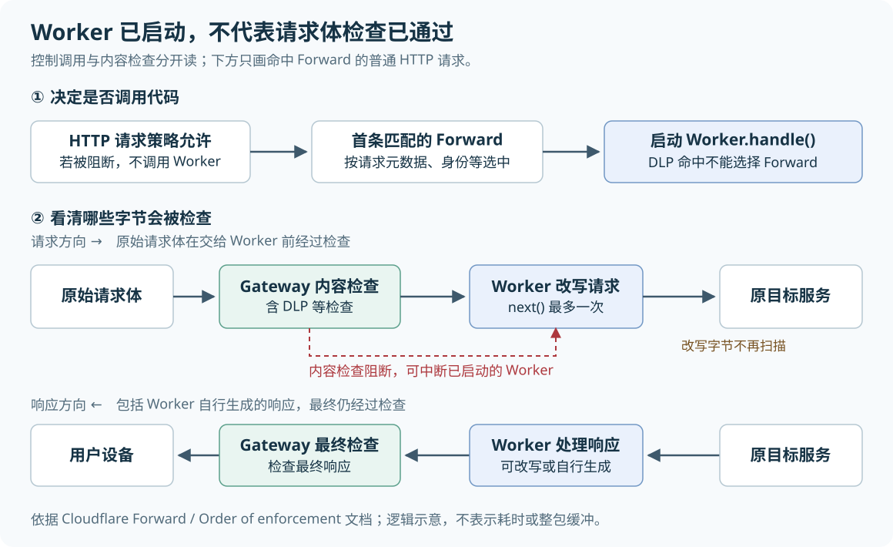
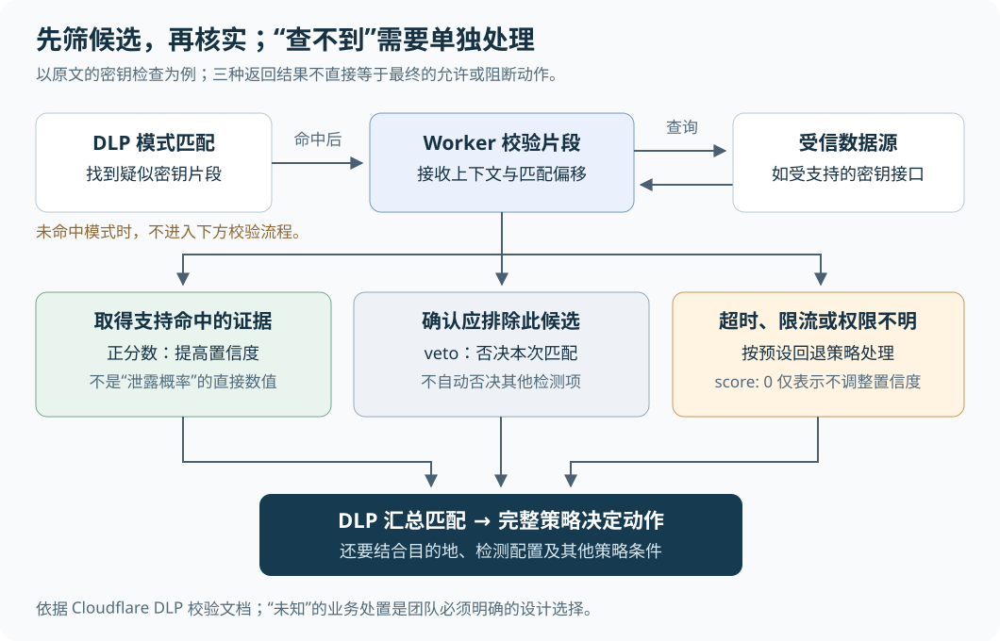

# 可编程安全网关：把定制逻辑放进请求路径，边界在哪里

> 来源：[blog.cloudflare.com](<https://blog.cloudflare.com/programmable-gateway-dlp>)  
> 作者：未知 · 发布时间：2026-10-16 01:11（Asia/Shanghai）  
> 翻译正文：[阅读中文正文](article-zh-CN.md)

企业把员工的网页请求交给安全网关检查后，仍可能需要补一段自己的逻辑：给旧应用补上它认识的身份字段，在访问敏感网站前询问用途，或者核实一串疑似密钥是否仍然有效。过去，这些需求往往要靠额外代理或后台处理程序完成。Cloudflare 的新方案把代码运行入口放进网关，让团队可以处理正在经过的请求；它值得已经使用该网关、又被少量特殊需求卡住的团队关注，但也会让自定义代码的错误直接影响访问。

本文研究的是 Cloudflare 于 **2026 年 10 月 15 日**发布的 [《A fully programmable secure web gateway》](https://blog.cloudflare.com/programmable-gateway-dlp)，以 `input/article.md` 保存的版本为主体，并核对截至 **2026 年 10 月 28 日**可查的官方文档。下文将原文主张、外部核验和分析建议分开说明。本文没有部署实测；延迟、误报改善和总成本都不能据此视为已验证收益。

## 先分清：改配置、改请求和改判断，是三件事

安全 Web 网关（Secure Web Gateway，SWG）负责在员工访问网站和在线应用时检查流量，并按规则允许、阻断或记录。普通规则擅长表达“某个用户组不能访问某类网站”，却不一定能表达“根据我们自己的合同状态和项目编号，生成旧系统需要的角色字段”。

**假设一个小团队**已经把流量接入 Cloudflare Gateway。旧报销系统只认请求头 `X-App-Role`，而团队还要根据内部项目分配表，把已识别的员工映射成该应用的角色。若只提供管理 API（供程序调用的配置接口），程序可以替管理员创建规则，却不会因此在每次请求经过时完成这段映射。团队仍要在应用里实现，或增加一层代理。

原文提出的变化是：Gateway 继续负责代理连接，Cloudflare Workers——一个由平台托管、运行开发者代码的执行环境——接手定制逻辑。代码可以在请求继续前运行，这叫“在线处理”；它与请求结束后再分析日志不同。

不过，原文涉及的入口并不是同一个功能，也没有同时全部开放。其中的数据防泄露（Data Loss Prevention，DLP），是在内容中寻找密钥、个人信息等敏感数据的检查机制。

| 入口 | 代码接收什么、返回什么 | 核验后的状态与边界 |
| --- | --- | --- |
| **Forward 动作** | 接收 HTTP 请求及身份、连接等网关上下文；修改请求、处理响应，或直接返回页面 | 官方公告确认已在所有 Zero Trust 套餐进入公开测试；Workers 使用另计费 |
| **Gateway Custom Functions，自定义策略函数** | 接收当前策略阶段的上下文；返回字符串、数字或布尔值，供规则比较 | 原文预计 2026 年底前开放；本次未找到已公开开放的官方确认，不能作为现成功能安排上线 |
| **DLP 自定义校验函数** | 接收敏感内容的候选匹配片段；调整置信度（对命中可信程度的判断），或否决匹配 | 已有配置文档，但需账户出现相应入口，当前文档说明可附加到自定义模式检测项 |

Forward 的状态见[官方发布记录](https://developers.cloudflare.com/changelog/post/2026-10-15-gateway-workers-public-beta/)，DLP 入口见[自定义校验文档](https://developers.cloudflare.com/cloudflare-one/data-loss-prevention/detection-entries/custom-validation-workers/)。**Forward 对所有套餐开放，不代表完整 DLP 能力也免费开放**；DLP 产品页仍列有企业附加服务及低阶套餐的有限能力范围。[DLP 可用范围](https://developers.cloudflare.com/cloudflare-one/data-loss-prevention/)

按原文规划，自定义策略函数会在规则求值时计算一个值，例如返回业务风险等级，再由规则把这个值与条件比较，决定允许或阻断。它自己不负责改写流量；网络层规则能拿到的也主要是连接、身份与设备信息，不能假定拥有完整网页内容。原文要求函数预设出错时的默认值。由此分析，设计时应把“查不到风险等级”映射到明确的未知状态，而不能随手给一个表示低风险的值。该入口仍属待核实的交付计划，这些说明不能当作可部署接口。

## Forward 怎样处理一次请求

回到报销系统的假设例子。管理员先把 Forward 规则限定到该应用和测试用户，Worker 再读取网关识别的身份，查询必要的映射，覆盖应用所需请求头，然后让请求继续。应用返回结果后，Worker 还可以修改响应。

这里有三个不同职责：**过滤规则决定请求能否进入后续处理；Worker 完成应用特有的变换；Gateway 承担连接与检查工作。** 原文说明，Gateway 负责传输连接、TLS 加密连接的解密与重新加密、证书及 HTTP 版本协商。因此，团队可以省去专门为这段变换运营的代理服务器，但仍要维护代码、依赖和发布过程。

当前文档规定，Gateway 调用名为 `GatewayMiddleware` 的类中的 `handle(request, context, next)`。`request` 是请求，`context` 提供网关元数据，`next(request)` 则让请求通过 Gateway 前往原目标，并返回响应。它是继续原请求的专用入口：最多调用一次，不能借此改变目标地址、重试上游请求或同时访问多个目标。普通 `fetch()` 是另一次独立请求，不能假定它沿用员工请求的网关策略或出口地址。[Forward 接口约定](https://developers.cloudflare.com/cloudflare-one/traffic-controls/integrate-workers/forward-traffic/)

身份也不能从任意请求头里直接相信。文档提供 `await context.identity()` 获取网关会话身份：未识别到用户时返回空值，检索失败时可能抛出错误。原文某些示例把身份写成直接读取的属性，实践时应以当前接口为准。对于能用内置用户组和设备检查规则表达的条件，官方建议直接配置规则，保留代码给确实需要定制计算的部分。[上下文与身份接口](https://developers.cloudflare.com/cloudflare-one/traffic-controls/integrate-workers/available-context/)

### 最容易误读的是内容检查顺序

“先允许，再 Forward”并不意味着所有内容检查已经通过。当前执行顺序是：HTTP 请求策略先处理；允许的请求再匹配首条 Forward 规则并启动 Worker；请求体策略与内容检查随后进行。**原始请求体经检查后才交给 Worker，但内容检查的阻断仍可能中断已启动的 Worker。** 所以，“代码被调用了”不能当作“请求已安全放行”的证据。[策略执行顺序](https://developers.cloudflare.com/cloudflare-one/traffic-controls/order-of-enforcement/)



图的上半部分表示是否启动代码，下半部分表示内容经过哪里，不能把它读成“完整文件检查结束后才开始执行所有代码”。请求体可以按流传递，也就是分段处理而非一次装入内存。

检查位置还带来两个具体后果。第一，Worker 把敏感字段删除，并不能让原本会触发 DLP 阻断的原始上传内容绕过检查。第二，Worker 向原本允许的请求中新增内容后，这些改写字节不会在发往目标前再做一次请求侧扫描；最终响应则会在 Worker 之后接受检查。因此，自定义代码本身必须控制它新增的数据。[DLP 与 Forward 的检查边界](https://developers.cloudflare.com/cloudflare-one/data-loss-prevention/dlp-policies/)

输入材料还称，可以用 DLP 命中触发 Forward，并在通知中读取命中信息。**当前官方文档明确说，DLP 命中不能用于选择 Forward，Worker 上下文也不含 DLP 命中详情。** 在线博客目前的相关触发描述是“某个选择条件匹配”，但通知示例仍不足以证明上述能力可用。需要 DLP 告警时，应按实际支持的日志或事件接口设计，不要照抄输入版本的这段组合。[当前博客](https://blog.cloudflare.com/programmable-gateway-dlp)、[DLP 集成限制](https://developers.cloudflare.com/cloudflare-one/data-loss-prevention/dlp-policies/)

## DLP 校验补的是“这次命中是否有意义”

正则表达式能够找到“长得像密钥”的字符串，却无法单凭外形判断它是否有效、属于谁、是否允许出现在当前位置。DLP 自定义校验在模式匹配之后运行，让代码对候选片段继续核实。

原文以 GitHub 令牌为例：Worker 收到包含候选值的内容片段，提取令牌，再请求 GitHub 的 `/user` 接口；示例把成功响应作为支持命中的证据，把 `401` 响应作为否决匹配的依据。这展示了怎样引入额外信息，但不是完整的数据泄露判断流程。

根据当前文档，校验输入包含检测项编号、匹配位置和经 Base64 编码的片段；Base64 是把字节编码成文本，**不是加密**。片段还可能带有周边内容，用户标识则是可选字段。校验返回的 `score` 在 `-1` 到 `1` 之间，用于降低或提高置信度；`0` 表示不调整，`"veto"` 表示否决这次匹配。不能把 `1` 直接解释成“泄露概率为 100%”，也不能把 `0` 理解成“安全”。[校验输入与返回值](https://developers.cloudflare.com/cloudflare-one/data-loss-prevention/detection-entries/custom-validation-workers/)



**外部核验说明，这个例子至少还缺三层判断。**

首先，接口必须支持被检测的令牌类型。GitHub 的“获取已认证用户”接口列出了支持的用户令牌，不能把一次调用结果推广成所有 GitHub 密钥的通用验证器。请求成功也只表明该令牌能在此接口完成认证，并不证明它属于本组织，或这次传输构成泄露。[GitHub 用户接口](https://docs.github.com/en/rest/users/users#get-the-authenticated-user)

其次，“无效”和“未能核实”必须分开。GitHub 文档说明，无效凭据通常首先得到 `401`；权限问题和短时间内多次认证失败等情况可能得到 `403`，限流还可能得到 `429`。网络超时、限流和权限不足，都不应自动归为无效令牌。[认证失败说明](https://docs.github.com/en/rest/authentication/authenticating-to-the-rest-api)、[限流排障说明](https://docs.github.com/en/rest/using-the-rest-api/troubleshooting-the-rest-api)

最后，过期密钥是否可以忽略，是组织的策略选择。即使某个值已不能登录，它仍可能暴露内部信息，或者说明员工正在传输本不应外发的配置文件。**本文的分析建议是：只在业务规则明确允许排除、且证据可靠时使用 `veto`；外部核实失败时保留“未知”状态，并预先决定后续处置。** 最终允许还是阻断，还要结合其他命中、目的地和完整策略条件。

校验函数也只能处理前面的检测器已经找到的候选。如果敏感内容没有命中模式，它不会因为加上了校验函数就自动被发现。与此同时，Worker 已经能看到敏感片段；若再查询外部接口，候选值可能被发送出去。应限制查询目标、减少发送内容，避免把密钥或完整片段写进普通日志。

原文把这种方式与精确数据匹配（Exact Data Match，EDM）对比。EDM 用预先准备的数据集核对具体值；Cloudflare 文档描述了加密、哈希比较和替换数据集的更新流程，并非简单地长期保存一份明文表。两者的核心差别是：EDM 需要维护参考数据，自定义校验需要承担查询和服务可用性的依赖。数据稳定且适合批量维护时，EDM 仍可能更简单；数据变化快、必须查询业务状态时，在线校验才更有价值。[EDM 工作方式](https://developers.cloudflare.com/cloudflare-one/data-loss-prevention/detection-entries/configure-detection-entries/)

## 原文的 JWT 示例为什么不能直接承担授权

原文另一个例子从 `Authorization` 请求头取出 JWT，再解码其中的用户组。JWT（JSON Web Token）是承载身份等声明的令牌格式；常见的签名 JWT 能让接收方检查内容是否被修改，以及是否由受信方签发。

但示例只拆分字符串、解码并解析 JSON，没有验证签名。**读出“我是财务组”与证明这句话可信，是两件事。** 假设攻击者自行构造一个写着财务组的载荷，只有解码步骤的程序无法识别这份身份声明是伪造的。

若这些字段要参与授权，应使用成熟验证库，并依据令牌用途限制允许的签名算法、验证可信签发者及目标接收方，再检查有效期等必要条件。签发者说明“谁发的”，目标接收方说明“发给谁用”；后一项能防止把给另一个应用的令牌搬来使用。标准还要求防范不同用途令牌之间的混用。[JWT 安全最佳实践 RFC 8725](https://www.rfc-editor.org/rfc/rfc8725.html)、[JWT 声明定义 RFC 7519](https://www.rfc-editor.org/rfc/rfc7519.html)

对于前面的报销系统，优先使用已由 Gateway 识别的身份，再做应用专属映射，通常能少维护一套令牌验证逻辑。**这是分析建议，前提是该会话身份满足应用的信任要求。** 目标应用还应只在可信入口接受注入的角色头，并由入口覆盖客户端同名字段；如果攻击者能绕过网关直连应用，这个请求头本身无法提供身份保证。

## 少运营代理服务器，仍要承担代码与依赖的代价

原文强调 Gateway 和 Workers 同机运行，调用不需要把请求绕到另一朵云再回来。这是厂商对实现的说明，本次没有独立基准或内部实现证据验证其调度开销。合理的理解是少了一段跨网络绕行，而不是新增处理的总耗时为零。

从机制分析，用户仍要等待必要的身份读取、代码计算、数据库访问和外部核实。若这些步骤串行，等待会累积；若只是通知，可以移到响应之后，但不能再依赖它的结果决定本次请求是否放行。原文所谓“输入数据、返回值”的接口也不等于数学上的确定性：外部数据库更新或接口故障，都可能让同样的请求得到不同结果。

选择时应围绕具体需求比较。下表是基于机制的分析，不是性能排名：

| 做法 | 适合解决什么 | 主要代价与协作影响 |
| --- | --- | --- |
| 网关内置规则 | 网站、身份、设备等现成条件足以表达需求 | 自定义能力有限，但发布和排障路径较短，安全管理员通常可以独立维护 |
| Gateway 加 Forward | 少量 HTTP 变换、提示页面、应用专属逻辑 | 省去一层自建代理的主机运维；代码错误会影响请求，安全、开发和应用负责人要共同评审 |
| 自建代理及扩展处理服务 | 必须控制部署位置、协议处理或运行环境 | 自己承担容量、升级、证书、故障处理；也能自主安排资源和发布策略 |
| 日志加后台任务 | 事后审计、通知、无需改变本次请求的动作 | 需要处理延迟、重试和重复事件，但后台服务故障通常不必阻塞用户访问 |

在线修改请求并不是新出现的技术类别。例如，Envoy 代理的 `ext_proc` 外部处理扩展已允许独立服务修改 HTTP 请求与响应，或直接返回响应，并提供超时、失败后继续或报错等配置。它使用 gRPC——一种服务间远程调用协议——与处理服务通信。因此，原文“只有 Cloudflare 能解决”的说法应收窄为其托管网关与计算平台的集成优势，不能推导成其他技术路线做不到。[Envoy 1.40.0 外部处理接口](https://www.envoyproxy.io/docs/envoy/v1.40.0/api-v3/extensions/filters/http/ext_proc/v3/ext_proc.proto)

### 通知不会因为“异步”就自动可靠

当前官方 Slack 模板通过 `this.ctx.waitUntil()` 把通知放到响应返回后的后台工作中，并检查通知接口是否成功。这能减少通知对用户等待的影响，但“某个注册接口被访问”仍未必等于“业务注册成功”；模板也提醒，应按需检查响应结果，避免为页面资源请求逐个通知。[官方通知模板](https://developers.cloudflare.com/cloudflare-one/traffic-controls/integrate-workers/worker-templates/slack-notification/)

`waitUntil()` 只是延长当前执行的生命周期，HTTP 场景下在响应结束或客户端断开后最多继续约 30 秒，不是持久任务队列。需要可靠重试时，可以将事件交给队列；如果要求“先保证事件已接收再放行”，仍需等待入队确认，并承担这段等待。Cloudflare Queues 默认至少投递一次，消费者可能收到重复消息，需要使用稳定事件编号去重。[后台执行约定](https://developers.cloudflare.com/workers/runtime-apis/context/)、[队列投递保证](https://developers.cloudflare.com/queues/reference/delivery-guarantees/)

### 费用要按触发请求计，不能只按员工数计

Workers 按请求和处理器计算时间等项目计费，存储、队列及其他产品还应单独核对。一个网页可能发出许多资源请求，因此把 Forward 配到整个域名，与只配到一个业务接口，调用量可能差很多。[Workers 价格表](https://developers.cloudflare.com/workers/platform/pricing/)

免费 Workers 当前有每天 **10 万次请求、每次 10 毫秒处理器计算时间**等限制；等待网络不计入处理器计算时间，但仍让用户等待。Workers 的隔离执行环境还有 **128 MB 内存**限制，这不是每个请求独享的额度。整份文件读入内存，或同时处理多个较大请求，都需要谨慎。[运行限制](https://developers.cloudflare.com/workers/platform/limits/)

原文没有给出完整的前后对照测试，无法判断节省多少费用、增加多少延迟或降低多少误报。小团队应估计“实际匹配请求数 × 每次处理工作”，再加上依赖服务与维护投入，而不是直接套用厂商的总体收益描述。

## 哪些边界会让方案失效

**流量没有被看见，代码就无从处理。** HTTPS 需要允许网关解密；匹配“不检查”规则的流量不能指望进入 Worker。当前 Forward 还会绕过 WebSocket 连接和 HTTP `CONNECT` 隧道。WebSocket 常用于浏览器与服务之间的持续双向通信，不能因为同一网站的普通 HTTP 请求经过了 Worker，就认为其全部消息也受同样控制。[Forward 支持范围](https://developers.cloudflare.com/cloudflare-one/traffic-controls/integrate-workers/forward-traffic/)

**失败时能否继续，需要逐入口判断。** 当前 Forward 对调用错误、Worker 错误或通信失败采用失败关闭：请求报错，而不是自动绕过代码继续。删除已绑定的 Worker 也不会自动删除规则，匹配请求可能返回 `500`。DLP 校验则提供错误或超时的回退配置，包括 `No fallback`、`Veto`、`Score`；仅凭选项名不足以推断整个策略最终会允许还是阻断，必须在目标账户验证。[Forward 故障行为](https://developers.cloudflare.com/cloudflare-one/traffic-controls/integrate-workers/forward-traffic/)、[DLP 回退选项](https://developers.cloudflare.com/cloudflare-one/data-loss-prevention/detection-entries/custom-validation-workers/)

**读取旧状态可能得到旧授权。** 原文建议用 KV 保存带有效期的访问理由会话。KV 是按键读取值的存储；Cloudflare KV 采用最终一致性，即更新不保证立刻被所有位置读到，文档提示其他位置可能需要 60 秒或更久才能看见变化。因此，用它减少重复提示与用它保证撤权即时生效，要求不同。若不能容忍旧授权，应选择满足一致性要求的状态存储，不能只靠设置过期时间。[KV 一致性说明](https://developers.cloudflare.com/kv/concepts/how-kv-works/)

**“复制一份文件”也有资源代价。** 官方模板提醒，复制请求或响应流后，若保存端比转发端慢，副本仍可能缓冲并占用内存。把保存动作放到后台，并不等于它对吞吐和内存没有影响。[内容捕获模板的限制](https://developers.cloudflare.com/cloudflare-one/traffic-controls/integrate-workers/worker-templates/)

据此分析，这套方案更适合已有 Gateway 接入、主要处理普通 HTTP、需求范围可收窄，并有人负责代码维护的小团队。若需求是长期运行的文件分析、全协议覆盖、必须立即生效的全球授权撤销，或者无法接受托管平台处理相应内容，就不宜把一个 Worker 当作完整答案。缺乏明确维护人与回退权限时，继续使用内置规则或把非必要动作移出请求路径，通常更稳妥。

## 小团队的最小实践：先验证一条无业务副作用的链路

第一轮试验不必接入内部数据库、真实密钥或通知平台。**以下是建议的试验步骤，本文未实际执行。**

1. **限定一个测试入口。** 使用可控测试域名、一组测试用户和普通 HTTP 请求。确认流量确实经过 Gateway，HTTPS 可解密，同时保留原有阻断规则。
2. **只加一个可观察标记。** 按官方流程部署 Worker，返回上游响应时增加一个响应头，再把测试 Forward 规则绑定到它。这样可以先确认调用路径，不改变应用授权。
3. **测成功，也测失败。** 验证正常请求能到达目标；HTTP 请求规则阻断时不调用 Worker；内容检查阻断仍生效；Worker 抛错时请求报错；停用测试 Forward 后恢复普通路径。
4. **只增加一项真实需求。** 请求头变换优先使用可信身份；DLP 校验先使用合成数据和受控查询接口，覆盖“确认命中、应排除、超时、限流”几种结果，不先拿生产密钥试探外部服务。
5. **扩大范围前完成回退演练。** 先停用或重新绑定 Forward，再删除 Worker；记录哪个版本配合哪条策略，以及谁负责处理故障。需要 DLP 检测时，退出应恢复上一版检测或保守规则，不能靠整体关闭 DLP 达成。

下面的 JavaScript 是按当前官方透传示例改写的最小代码，只增加响应标记。它不是身份注入或 DLP 校验器；部署、入口类名和绑定流程仍需遵循[Forward 配置文档](https://developers.cloudflare.com/cloudflare-one/traffic-controls/integrate-workers/forward-traffic/)。

```javascript
import { WorkerEntrypoint } from "cloudflare:workers";

export class GatewayMiddleware extends WorkerEntrypoint {
  async handle(request, context, next) {
    const response = await next(request);
    const headers = new Headers(response.headers);
    headers.set("x-gateway-pilot", "v1");
    return new Response(response.body, {
      status: response.status,
      statusText: response.statusText,
      headers,
    });
  }
}
```

验证时至少记录下面这些指标。门槛应在试验前依据应用容忍度约定，本文没有证据给出通用合格数值。

| 要回答的问题 | 记录什么 | 何时暂停扩大或退出 |
| --- | --- | --- |
| 是否拖慢访问 | 相同请求集、有无 Forward 的端到端耗时；中位数及第 95 百分位，即大约 95% 请求不超过的耗时 | 超过预设等待预算，且无法通过缩小逻辑或移出外部依赖改善 |
| 是否扩大故障 | 新增错误、超时、受影响请求，以及恢复所需时间 | 影响了试验范围外流量，或无法按预案恢复 |
| 检测是否更有用 | 已知样本的正确检出、误报、漏报，以及无法完成核实的比例 | 未知结果被误当安全，或误报下降伴随不可接受的漏报 |
| 是否确实收到通知 | 事件产生、入队、接收及重复记录 | 把“调用成功”误当成“对方已经收到”，且无法核对差额 |
| 成本是否可控 | 每个业务事件触发的 Worker 次数、计算用量、存储与查询量 | 规则范围导致调用量失控，或维护投入超过替代方案 |

这项集成真正改变的是：团队可以在托管网关里补上自己需要的一小段处理逻辑。是否采用，应由这段逻辑能否被限定、验证和维护来决定。只有当它的检查位置、可信输入、失败行为和退出办法都清楚时，省去额外代理才会成为可持续的简化。
