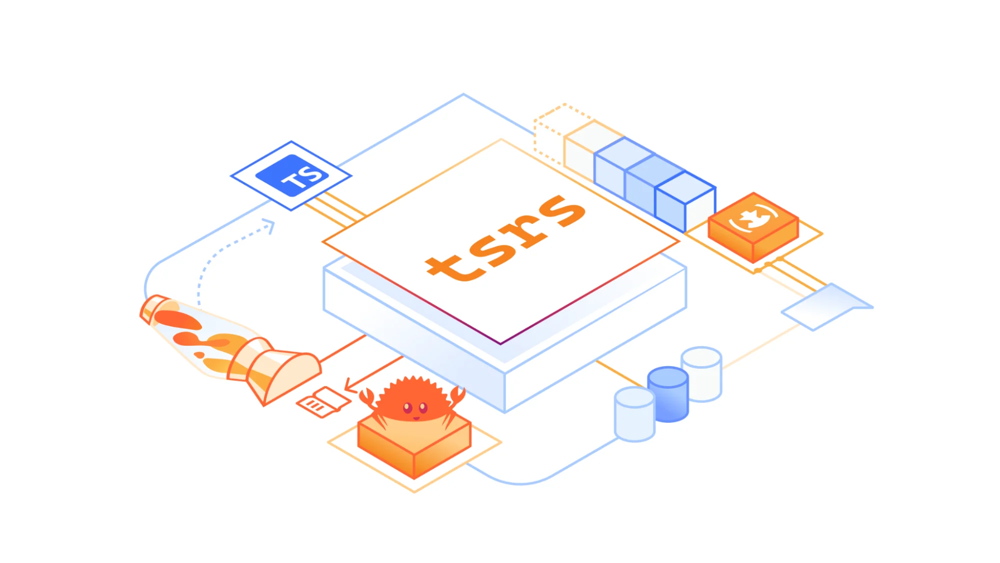
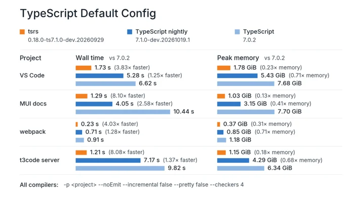
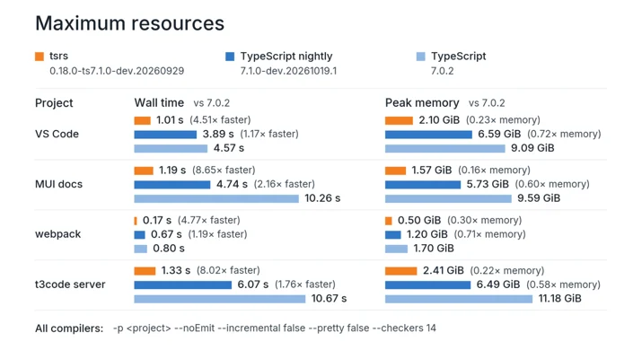

# Introducing tsrs: a Port of TypeScript to Rust

> **来源**: [https://blog.cloudflare.com/typescript-rust-port](https://blog.cloudflare.com/typescript-rust-port)  
> **作者**: 未知 | **发布时间**: 2026-10-20T13:00:00+00:00  
> **深度调研**: [查看专题调研报告](research.md)  
> **标签**: TypeScript, Rust, WebAssembly, 类型检查, 编译器性能优化, 编译器兼容性

---

## AI 导读

TypeScript 项目检查代码需要时间和内存，tsrs 尝试通过将编译器移植到 Rust 来降低这些开销，同时严格跟随原版的语言行为。文章报告，在类型检查工作线程数相同的早期测试中，相比 TypeScript 7.0，tsrs 最高快 8 倍、内存占用约少 70%；它也指出，TypeScript 7.1 测试版本身已有最高 2.5 倍的提速。tsrs 默认还会按机器配置调整运行方式，以更多内存换取速度，因此这些结果不能脱离配置直接比较。
文章选择 Rust 的另一理由是便于编译为 WebAssembly，即可在浏览器等宿主环境中运行的程序格式。作者认为，Rust 的内存管理方式有利于程序与宿主交换内存，适合资源受限的开发环境，但正文未给出这些场景的实际测量结果。
项目已提供实验版本。维护方面，团队计划合并另一项移植工作，并沿用其他项目每天跟踪原版代码变化、运行兼容性测试和提出修复的流程，也希望将性能优化贡献回原版。当前仍有诊断信息输出顺序等差异，完整功能支持和稳定版兼容性属于后续目标。正文没有展开基准测试方法、具体优化实现或完整测试结果，因而目前更能说明项目方向，尚不足以确认不同项目中的普遍收益。

---

## 原文整理

# Introducing tsrs: a Port of TypeScript to Rust



Cloudflare and VoidZero are now working with [<u>Max Schwenk</u>](https://building.owner.com/tsrs) of Owner.com on [<u>tsrs</u>](https://github.com/oxc-project/tsrs), a Rust port of the TypeScript compiler. We are doing this work in close collaboration with the TypeScript team, and incubating tsrs as part of the [<u>Oxc JavaScript compiler toolchain</u>](https://github.com/oxc-project).

Our goal is to help developers spend less time waiting for their code to be checked and more time building. Making TypeScript faster and more memory-efficient also helps bring complete development environments to more places, including right in your browser.

To be clear, we are ***not*** forking TypeScript. We believe the TypeScript team should remain in full control of the language’s design and direction. They have maintained a long-term vision while guiding TypeScript’s adoption across the JavaScript community. We do not want to change that.

The TypeScript team can move quite fast on many things, but for some features they may spend years intentionally exploring options and making prototypes before picking the right implementation. A Rust port has to follow those decisions closely, or it will eventually fall apart and become incompatible. We have to preserve the TypeScript language strictly based on its original implementation – and the TypeScript team should remain solely responsible for deciding what that looks like.

## Performance and memory improvements

Early benchmarks of our Rust port of TypeScript are promising: `tsrs` is up to 8x faster and uses \~70% less memory compared to TypeScript 7.0 when using the same number of type check workers:



As you can see, the next version of TypeScript already brings many performance improvements, making TypeScript 7.1 beta up to 2.5x faster than TypeScript 7.0. Some of these optimizations were upstreamed from `tsrs`, and we’re hoping to find more.

You may have seen recent benchmarks of different TypeScript ports with various performance claims, often due to using larger machine types and different options compared to TypeScript’s defaults. We worked with the TypeScript team to ensure [<u>the above benchmarks</u>](https://github.com/oxc-project/tsrs/tree/main/bench) are comparing the same configuration.

By default, tsrs ships with an adaptive configuration dependent on the machine type that uses more memory but is even faster:



## Try `tsrs`

TypeScript in Rust aims to be a faithful port of TypeScript. You can try an experimental release by installing the [`tsrs`](https://npmx.dev/package/tsrs) package from npm:

```
npm install tsrs
npx tsrs
```
## Why now?

We’ve seen many attempts at porting TypeScript to other languages over the years. Because of the complexity involved, only one of the ports succeeded: the TypeScript team’s port of TypeScript from JavaScript to Go.

However, frontier AI models can now do large-scale ports almost independently in a matter of days. We have now seen slopforks, faithful ports, and completely re-architected versions of TypeScript in Rust or C++. There is clearly a demand for even faster TypeScript.

## Why Rust?

You might be thinking: “TypeScript’s Go port already made TypeScript 10x faster and far more memory efficient than the previous version written in TypeScript. Why isn’t that enough?”

However, it’s not just about speed. Rust offers some unique advantages: [<u>running in WebAssembly</u>](https://www.npmjs.com/package/@tsrs/wasm). The Rust + Wasm story has always been strong, and one of the reasons comes down to the fundamentals of Rust’s language design. When you compile a Go program to Wasm, you have to compile Go’s garbage collector along with it. But Rust’s memory management model enables straightforward memory interactions between a WebAssembly guest and host. This is one of the key things that makes Rust a much better fit for the WebAssembly use-case: memory efficiency.

Cloudflare Workers have supported Wasm for a long time. Just a few weeks ago we announced [<u>supporting native Rust in Workers</u>](https://blog.cloudflare.com/rust-workers-emscripten-target/) with the new Emscripten target for wasm-bindgen. When you run entire software build and deployment systems in tight loops on Workers, the benefits of a small memory footprint pay off quickly. It means you can run these workloads so efficiently that it’s now possible to run fully encapsulated development systems in places where they couldn’t have been run before.

This enables new possibilities when combined with agents: You are now able to run a development toolchain end-to-end in a fully sandboxed environment on Cloudflare. But with Wasm, you can also run those environments safely client-side in your browser, or on an embedded device, or an IoT application.

## How will the `tsrs` port be maintained?

First, we are working with Theo Browne to merge [<u>tsc-rs</u>](https://github.com/pingdotgg/ts-rust) and `tsrs` into a single package that supports all of TypeScript’s features including Language Server Protocol (LSP) and content mappers. Second, we’ve seen a lot of success with how we maintain [<u>Vinext</u>](https://github.com/cloudflare/vinext) in sync with its upstream, Next.js. We explained how we do this in [<u>a recent blog post</u>](https://blog.cloudflare.com/vinext-nextjs-on-vite):

Each morning, an agent reviews the changes, fetches diffs, and opens tracking issues for anything that could affect Vinext. Every night, the compatibility matrix is regenerated as we run the Next.js test suite against Vinext. When one of these tests or issues reveals a gap, agents are now in the position where they can identify the change across both codebases, build a reproduction, port any relevant tests, and propose a fix.

We will apply the same process to TypeScript, taking extreme care that we don’t introduce diverging behaviors from upstream TypeScript. When we come across performance improvements, we’ll attempt to contribute them back to the TypeScript Go codebase so everyone wins.

Finally, we recognize that there are some differences to the upstream version of TypeScript right now, like for example the order in which diagnostics are printed. We aim to reduce those differences to a minimum by the time we publish a stable release.

## What’s next?

Cloudflare is already the home of many free and open source Rust tools that power the JavaScript ecosystem, such as Vite, Rolldown, Oxlint, and Oxfmt. With more than 10 million developers building on Cloudflare, we care a lot about making the underlying developer toolchain faster, more portable, and easier to run in more places. We are excited to experiment with deeper `tsrs` integrations into our stack, for example for type-aware lint rules in Oxlint.

Like with Vinext, our goal is to run `tsrs` as a well-maintained healthy open source project — without getting in the way of TypeScript itself. The Oxc team has already begun refactoring the codebase to make it faster, use less memory, and make it maintainable. We know the TypeScript team is taking this seriously – they are experimenting with memory and performance improvements for `tsc`. We are excited to collaborate with the TypeScript team and the JavaScript community to build the best and fastest implementations of TypeScript together.
