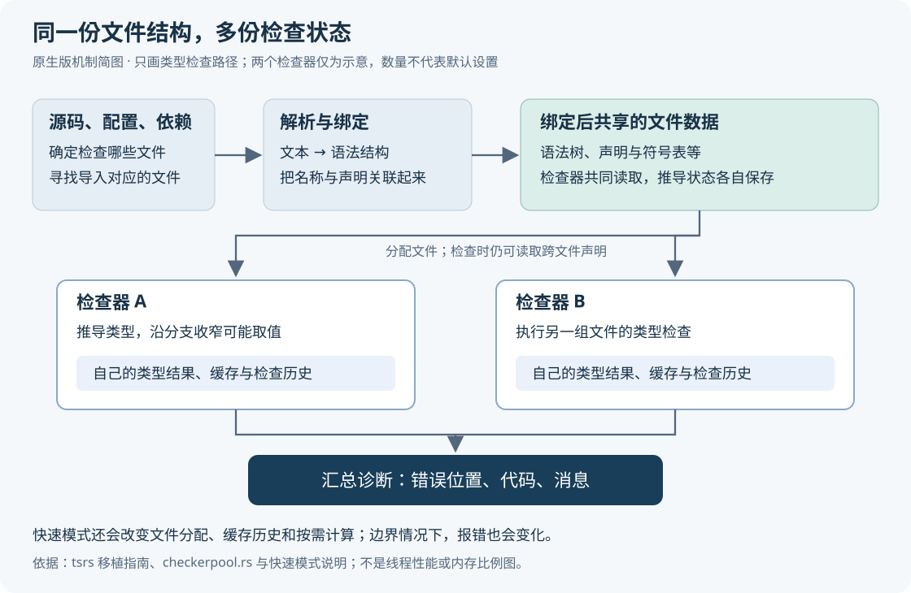
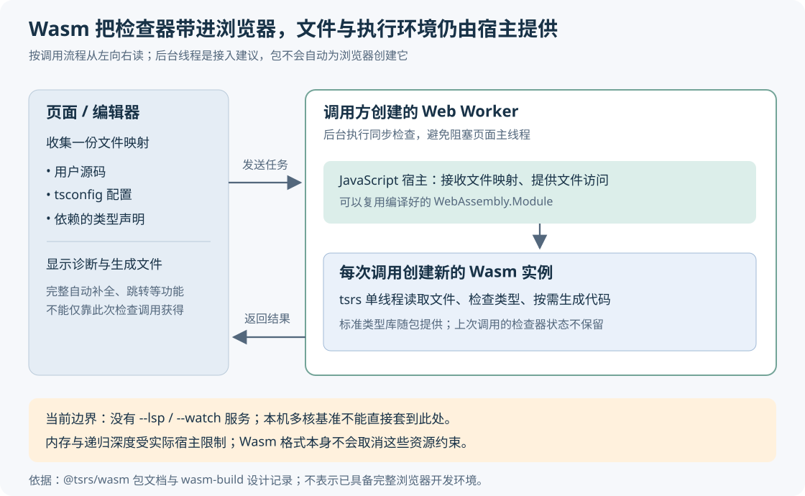

# tsrs 为什么还要把 TypeScript 移植到 Rust：速度、兼容性与浏览器运行的边界

> 来源：[blog.cloudflare.com](<https://blog.cloudflare.com/typescript-rust-port>)  
> 作者：未知 · 发布时间：2026-10-20 21:00（Asia/Shanghai）  
> 翻译正文：[阅读中文正文](article-zh-CN.md)

TypeScript 项目变大后，开发者可能要等类型检查结束，才知道一次修改能不能提交；在线编辑器还得考虑怎样在浏览器里完成检查。tsrs 的做法是把 TypeScript 的实现移植到 Rust，争取缩短等待、降低内存占用，并提供能在浏览器里运行的版本。对于类型检查已经成为瓶颈，或确实需要本地浏览器检查的团队，这值得试验；如果时间主要花在安装依赖、打包或测试上，换检查器未必能明显缩短交付时间。

本文研究的是 Cloudflare 于 2026 年 10 月 20 日发布的 [《Introducing tsrs: a Port of TypeScript to Rust》](https://blog.cloudflare.com/typescript-rust-port/)。核验截至 2026 年 10 月 28 日，外部补充以项目仓库、微软说明和运行平台文档为主。下文会区分原文主张、仓库记录与分析建议；未在本地复跑编译器基准，也不把维护者的数据当作独立测试。

## 1. 官方已经换成 Go，为什么还需要另一个实现？

这里先分清两件事：TypeScript 语言规定代码怎样接受类型检查，编译器则负责执行这些规则。把编译器改用另一种语言实现，并不意味着业务代码要改成那种语言，也不会让最终运行的 JavaScript 自动变快。

微软已经做过一次这样的迁移。TypeScript 7 使用 Go 编写的原生实现，通过直接执行机器码、共享内存多线程等方式加快编译。微软的正式发布说明报告，全量构建通常获得约 8～12 倍加速；这是其测试项目相对于 TypeScript 6 的结果，不能套到任意项目，也不能与另一组测试的倍数直接相乘。[来源：TypeScript 7 发布说明](https://devblogs.microsoft.com/typescript/announcing-typescript-7-0/)

因此，tsrs 要证明的价值，是在已有原生编译器的基础上，是否还能节省实际资源，以及能否更方便地进入浏览器等环境。原文介绍，Cloudflare、VoidZero 与最初移植作者 Max Schwenk 合作，将项目放在 Oxc 工具链中孵化；其目标是跟随 TypeScript 的语言设计，而非另行制定规则。这是项目方向，不等于已经完全兼容，也不代表微软为该实现提供了质量担保。[原文](https://blog.cloudflare.com/typescript-rust-port/)、[仓库说明](https://github.com/oxc-project/tsrs#license)

官方选择 Go 也有具体工程原因。TypeScript 团队解释，编译器中存在大量长期存活、互相引用的对象；Go 能保留接近原实现的代码结构，同时处理内存回收，方便两个代码库同步修改。对于批量编译和这类对象生命周期，垃圾回收的代价未必是主要瓶颈。所谓垃圾回收，就是由运行时找出不再使用的对象并释放内存。不能仅凭 Rust 不需要这套运行时，就断言 Go 的方案选择错误。[来源：TypeScript 团队《Why Go?》](https://github.com/microsoft/typescript-go/discussions/411)

## 2. 从一条错误开始，看检查器究竟做了什么

假设一个项目里有下面的函数。这只是解释机制的自拟例子，不是性能测试：

```ts
function label(user: { id: number } | undefined) {
  if (user) {
    return user.id.toUpperCase();
  }
}
```

检查器要先识别 `user` 可能是对象或 `undefined`，再根据 `if (user)` 判断分支内已经排除了 `undefined`，最后发现 `id` 是数字，没有字符串的 `toUpperCase()` 方法。这里既要理解代码结构，也要沿着执行分支更新类型信息。项目中的导入、第三方声明和泛型——用类型参数表达可复用规则的类型——会让这个过程跨越许多文件。

tsrs 的移植指南保留了与 Go 实现对应的模块。扫描器和解析器把文本变成抽象语法树，也就是记录函数、表达式等结构的树；绑定器把名称与声明关联起来；模块解析部分寻找导入对应的文件；类型检查器据此推导和比较类型。编译程序负责组织这些工作，并收集诊断信息，即错误和警告。需要生成代码时，还会进入转换、打印和声明输出等模块。[来源：移植指南的模块对应表](https://github.com/oxc-project/tsrs/blob/main/docs/PORTING.md#layout)



图中省略了代码生成，重点是类型检查：解析、绑定后的文件结构可以由多个检查器读取，但每个检查器保存自己的类型推导结果和缓存。缓存是把已经算过的结果保存下来，遇到相同问题时复用。它减少重复计算，也使文件怎样分组变得重要：相关文件留在同一个检查器里，可能复用更多结果；分散到多个检查器后，又可能重复计算这些类型。[来源：移植指南的线程约定](https://github.com/oxc-project/tsrs/blob/main/docs/PORTING.md#threading)、[检查器池源码](https://github.com/oxc-project/tsrs/blob/main/crates/tsrs_compiler/src/checkerpool.rs)

这解释了为什么“线程更多”不等于“等比例更快”。多一个检查器可以同时处理另一份工作，也会增加独立状态和重复推导。原生程序的性能，取决于工作分配、数据表示和计算量，不能只归功于实现语言。

## 3. tsrs 如何减少工作，又把哪些成本交给维护者？

### 先减少不必要的计算，再考虑增加并行

截至本次核验，tsrs 0.20.0 测试版（beta）默认沿用所跟随 TypeScript 的四个检查器、文件分配和检查历史设置，文件少时还会限制数量。`--fast` 才启用自适应数量、按目录聚集相关文件，以及“工作窃取”：某个检查器提前完成后，接手其他检查器尚未开始的文件。这样可以减少一边空闲、一边仍在处理重任务的等待。`--build` 构建模式仍按每个项目四个检查器处理，不能把普通检查模式的规则照搬过去。[来源：当前默认设置](https://github.com/oxc-project/tsrs/blob/main/docs/DEFAULTS.md#command-line)

快速模式还会推迟部分类型成员的计算。例如，某个泛型类型有许多属性，程序只需要其中一个时，按需处理可能避免提前生成全部属性的类型。这叫惰性计算，收益来自少做工作；如果后来仍要访问所有属性，省下的工作就会变少。部分声明文件的成员列表也可以推迟解析，但要求项目原本就启用了 `skipLibCheck` 或 `noCheck` 等设置。前者跳过声明文件的完整类型检查，后者关闭完整类型检查；**不要为了得到更好看的时间，临时改变这些检查范围。**[来源：快速模式说明](https://github.com/oxc-project/tsrs#fast-mode)

更多检查器和额外缓存可能增加内存，惰性计算及符合条件的文件释放又可能减少内存，所以快速模式并不保证内存一定上升或下降。结果取决于项目实际用到了哪些类型，以及启用了哪些执行路径。

### 内存更紧凑，需要具体的数据结构设计

在更底层，tsrs 使用 arena，也就是集中分配一批对象、按约定统一管理其生命周期的内存区域。语法节点、类型、符号等对象通过 `P<T>` 句柄关联；句柄可以理解为程序内部定位对象的编号。在适用的 Unix 构建中，它用 32 位偏移表示对象位置，而不是保存完整的 64 位地址。于是，某些引用字段可以从 8 字节缩到 4 字节，装有大量引用的结构也能缩小。这并不意味着整个进程的内存减半，因为文本、表、栈和其他字段仍占空间。[来源：指针实现](https://github.com/oxc-project/tsrs/blob/main/crates/tsrs_core/src/ptr.rs)、[指针压缩设计记录](https://github.com/oxc-project/tsrs/blob/main/notes/mem-pointer-compression.md)

批量检查结束后进程退出，许多对象可以一起回收；编辑器服务却会持续运行，不断产生新文件版本。tsrs 的语言服务器因此为文件版本、程序和检查器维护各自的内存区域，等待仍在使用它们的请求结束后再释放。如果新请求还在读取旧版本，提前释放就会出错；一直保留旧版本，则可能持续增加内存占用。[来源：语言服务器的内存管理](https://github.com/oxc-project/tsrs/blob/main/docs/LSP.md#memory-management)

这也是可靠性边界。维护者的公开问题 #646 记录了生命周期与不安全接口的审查，包括在特定审查版本中，用内存检查工具复现的安全接口缺陷。“用 Rust 实现”并不自动等于所有内部访问都由编译器证明安全。反过来，这些接口级复现也不能直接推导为每个用户项目都会崩溃；部署时应关注实际使用版本的修复状态和长期运行表现。[来源：生命周期审查问题 #646](https://github.com/oxc-project/tsrs/issues/646)

## 4. 为什么一次性能优化可能改变报错？

对普通业务逻辑，调整执行顺序通常不该改变结果。但类型检查并不是无限展开所有类型：遇到递归类型、复杂泛型时，实现会设置深度或工作量限制，避免检查本身失去控制。如果某次计算碰到限制，随后又缓存了中间结果，其他文件复用它时，就可能受到“先检查过谁”的影响。

仓库记录了一个来自 TanStack/router 的案例：先检查测试文件时，求解嵌套类型约束触及递归防护，缓存中留下“没有可用约束”的结果；后检查的文件读取该缓存，于是出现额外的索引类型错误。把文件分给不同检查器，或者改变访问顺序，可能走出不同结果。记录还显示，Go 参考实现本身也存在对分配或顺序敏感的情形。这里概括的是特定版本的已记录机制，不代表当前所有项目都会遇到同一问题。[来源：检查历史依赖的案例与复现](https://github.com/oxc-project/tsrs/blob/main/notes/open-history-dependence.md)

这个案例揭示了一个实际取舍：沿用上游行为，可能需要保留上游已有的顺序敏感性；改变缓存与求解顺序来获得速度或更稳定的输出，又可能与参考实现不同。tsrs 当前把更接近上游设置的默认模式，与主动启用的快速模式分开。快速模式文档明确说明，已知边界情况下，错误可能出现、消失、换位置、改变文本，甚至改变退出状态。退出状态是命令返回给脚本的成功或失败标记，直接影响持续集成系统是否允许提交通过。[来源：快速模式副作用](https://github.com/oxc-project/tsrs/blob/main/docs/USAGE.md#side-effects)

因此，评估兼容性不能只问“错误总数一样吗”。至少应比较错误代码、文件、位置、消息和退出状态；顺序是否重要，则取决于团队是否有脚本依赖输出顺序。遇到差异时，要先确认语言版本、文件集合和检查器设置一致，再判断是移植缺陷、参考实现的既有行为，还是快速模式引入的差异。

## 5. “最高快 8 倍、少用约 70% 内存”能说明什么？

**原文主张**是：在相同类型检查工作者数量下，相对 TypeScript 7.0，tsrs 早期基准最高快 8 倍，内存减少约 70%；同一文章还指出 TypeScript 7.1 beta 相对 7.0 已有显著改善。原文的“最高”描述某些测量结果，不是所有项目的平均收益；其归因于上游回馈的优化，本文未逐一建立提交对应关系。[原文性能部分](https://blog.cloudflare.com/typescript-rust-port/)

**外部补充**是仓库随后公布的另一组结果，不能混作原文那次实验。该报告标注测于 2026 年 10 月 27 日：Apple M3 Max、14 核、36 GB 内存，比较 TypeScript 7.1.0-beta 与 tsrs `0.20.0-ts7.1.0-beta` 的发布二进制；后者跟随上游提交 `3e9236361fa9`。命令只检查类型，不输出代码，关闭增量编译和美化输出，预先运行以预热文件缓存。报告称结果为交错运行的中位数，tsrs 每种模式运行 10 次，TypeScript 运行 5 次。[来源：发布二进制基准](https://github.com/oxc-project/tsrs/blob/main/bench/RESULTS.md)

下面选两项展示如何解读；时间是命令从开始到结束的实际经过时间，GiB 是以 1024 为进位单位的内存容量。

| 项目与指标 | TypeScript 7.1 beta | tsrs 默认模式 | tsrs `--fast` |
| --- | ---: | ---: | ---: |
| vscode：检查耗时 | 5.08 秒 | 1.98 秒 | 0.85 秒 |
| vscode：峰值内存 | 5.48 GiB | 2.36 GiB | 2.00 GiB |
| mikro-orm：检查耗时 | 4.60 秒 | 1.37 秒 | 0.70 秒 |
| mikro-orm：峰值内存 | 4.15 GiB | 1.60 GiB | 1.79 GiB |

表中数值转录自上述报告。它展示了快速模式可能同时降低时间和内存，也可能以更多内存换取时间；不要只拿最快的一列解释全部成本。

阅读这组数据时，还需要保留四个条件：

1. **默认设置比较与同配置比较不同。**这次未显式指定检查器数量，各实现按自身规则选择；快速模式会调整数量和多项机制，无法据此把差距单独归因于 Rust。
2. **检查耗时不等于完整交付耗时。**结果未覆盖依赖安装、打包、测试，也不是浏览器运行或每次编辑后的响应时间。
3. **诊断相符的范围有限。**报告称全部 19 个项目的文件、位置、错误代码相同；这没有证明消息、顺序及所有未测试程序都相同。
4. **数据仍需自行复测。**这些是维护者发布的结果。通用基准文档写的是项目内算术平均值，而这份发布报告写的是中位数，统计说明尚不完全统一；本文按发布报告转录，未复算原始样本。[来源：基准方法](https://github.com/oxc-project/tsrs/blob/main/bench/README.md)

另一个关键变化是：原文描述的自适应默认配置，已经不同于当前 0.20.0 beta 的默认行为。复制原文安装命令得到新版本，再期待原图的性能和内存曲线，并不是可重复的验证方法。

## 6. 浏览器能检查 TypeScript，离完整开发环境还有多远？

WebAssembly，简称 Wasm，是浏览器等宿主能够执行的二进制格式。它允许 Rust 编译出的检查器在浏览器内运行，但文件读取、输入输出等能力仍由宿主提供。Go 本身也支持 Wasm，因此差别不是“Go 做不到、Rust 才能做到”；要比较的是具体实现的启动、内存、宿主接口和维护成本。[来源：Go 官方 Wasm 文档](https://go.dev/wiki/WebAssembly)

tsrs 的 Wasm 构建使用 `wasm32-wasip1` 目标，其中 WASI 是供 Wasm 程序使用的系统接口约定。项目另外通过宿主文件接口对接真实文件或内存中的文件映射。浏览器调用方需要提供源码、配置和依赖声明，检查器才能找到它们。类型声明文件 `.d.ts` 描述依赖向外提供的类型；只有用户写的几个源文件，通常不足以检查真实项目。[来源：Wasm 构建设计](https://github.com/oxc-project/tsrs/blob/main/notes/wasm-build.md)



当前 `@tsrs/wasm` 文档给出的边界是：单线程执行，不支持监听文件变化的 `--watch`、语言服务器 `--lsp` 和面向其他程序调用的 `--api` 服务模式；浏览器调用方应自己创建 Web Worker，也就是与页面主线程分开的后台执行环境，否则同步编译可能阻塞界面。宿主可以缓存编译好的 Wasm 模块，但因为编译器保留进程级状态、线性内存又不会缩小，每次调用都会创建新实例，不会保留上次的检查器状态。线性内存是 Wasm 自己管理的一段连续内存，单实例理论上最多 4 GiB，实际运行时还可能限制得更低，深递归也可能耗尽栈。包返回的 `memoryBytes` 只统计线性内存，不能当作整个页面或进程的内存。[来源：Wasm 包的运行说明与限制](https://github.com/oxc-project/tsrs/blob/main/npm/tsrs-wasm/README.md)

这些条件决定了，本机多核基准不能预测浏览器收益，“能检查并生成代码”也不足以证明完整编辑体验已经具备。语言服务器还要响应自动补全、跳转和重命名；LSP，即语言服务器协议，是编辑器与这种后台服务交换请求的约定。原生版支持 LSP，不代表 Wasm 版也支持它。

Cloudflare Workers 还有更紧的资源约束：本次查阅的官方限制为每个隔离实例 128 MB，包含 JavaScript 堆与 Wasm 分配。前面的 GiB 级本机结果不能直接对应到这个预算，也不能拿它们推算 Wasm 的精确占用。**分析判断是**：小型在线练习、限定依赖的检查任务值得试验；在没有目标平台测量前，不能认定大型仓库能塞进普通 Worker。原文另提到的 Rust Emscripten 支持，也不能替代对 tsrs 自身 WASI 构建的部署验证。[来源：Workers 资源限制](https://developers.cloudflare.com/workers/platform/limits/)、[原文链接的 Emscripten 支持说明](https://blog.cloudflare.com/rust-workers-emscripten-target/)

## 7. 真正难的维护，是持续证明“没有悄悄改变规则”

原文设想借鉴另一个项目 Vinext 的工作流：代理检查上游变更、建立跟踪问题，定期运行兼容性测试，针对差异生成复现与修复建议。这说明维护方向，不能当作 tsrs 已经长期可靠运行同一流程的证据。关于 AI 能在几天内完成大型移植的说法，原文也没有提供完整工时、人工审查量和后续维护成本，因此不能据此承诺小团队能廉价维护另一套编译器。[原文维护计划](https://blog.cloudflare.com/typescript-rust-port/)

仓库中已有更具体的约束：0.20.0 beta 以 TypeScript 7.1 beta 的固定提交为参考，要求默认模式中的诊断、顺序、消息与退出状态追随该实现。兼容性文档记录，按上游完整输出流程验证时，13,700 份错误基线匹配；这里的基线是测试预期输出，不是 13,700 个真实项目。文档也仍记录真实仓库差异和失败，所以“目标 100% 兼容”应与“已证明任意项目完全兼容”分开。[来源：兼容性证据](https://github.com/oxc-project/tsrs/blob/main/docs/COMPATIBILITY.md)

这类项目需要持续执行的流程可以概括为：固定上游提交，识别相关修改，移植代码与测试，在相同输入和设置下比较结果，把每个差异缩成最小复现，再决定修复或记录限制。代理可以帮助搬运代码和生成候选测试，但判断测试是否遗漏关键行为，仍需要维护责任。对于采用者，最有价值的贡献往往是一份可复现差异，而不是只报告“跑得快”或“结果不对”。

对个人或小团队，选型可以先按真实需求收窄：

| 选择 | 值得尝试的条件 | 需要承担的代价与协作影响 |
| --- | --- | --- |
| 官方 TypeScript 7 | 希望沿官方发布节奏，先获得原生实现的收益 | 仍需检查从旧版本迁移的配置与工具兼容性，团队基线较统一 |
| tsrs 默认模式 | 类型检查或内存已成为瓶颈，愿意验证 beta 工具 | 要锁定版本、核对诊断，并处理未实现命令及编辑器配置差异 |
| tsrs `--fast` | 默认模式验证通过，仍需要更多收益 | 要额外验证报错差异、资源波动和增量缓存失效，统一本地与持续集成设置 |
| tsrs Wasm | 需要浏览器本地检查，文件与依赖范围可控 | 要提供文件宿主、后台线程和资源预算，另行解决完整编辑体验 |

这是根据上述机制给出的选型建议，不是通用性能排名。原生 tsrs 目前仍有 `--init`、`--showConfig` 等未支持命令；依赖这些命令或旧版编译器接口的工具链，不能只因 `--noEmit` 成功就整体替换。成本也应包含排查版本差异和维护第二条检查路径的时间，本文没有可据以估算净节省金额的数据。[来源：已知差异](https://github.com/oxc-project/tsrs/blob/main/docs/DEFAULTS.md)

## 8. 小团队的最小实践：先并行观察，再决定是否替换

建议先选一个有代表性的子项目，保留现有检查作为提交门槛，额外运行 tsrs，记录结果而不让它立即决定发布。这里的“并行观察”是两种工具检查同一份代码，不要求团队复制大规模测试基础设施。

**第一步，确认瓶颈并记录版本。**保存项目提交、依赖锁文件、操作系统、处理器、可用内存、编译器版本和完整命令。先看类型检查占整个流程多少时间。假设它只占总耗时的 10%，即便把检查时间完全消除，整体也只能省去约 10%；这是按顺序执行时的理想上限，不是 tsrs 的测量收益。

**第二步，在相同语言版本下对照默认模式。**以下是待执行的建议命令，不是本文的实测记录。示例将两个工具安装到不同目录，用显式路径避免误调用项目原有的 `tsc`；应在临时副本中执行。如果项目仍用旧版 TypeScript，先单独处理升级到参考版本产生的差异，再评价移植本身。

```sh
npm install --prefix .probe-ts --save-exact typescript@7.1.0-beta
npm install --prefix .probe-rs --save-exact tsrs@0.20.0-ts7.1.0-beta

./.probe-ts/node_modules/.bin/tsc --version
./.probe-rs/node_modules/.bin/tsrs --version

./.probe-ts/node_modules/.bin/tsc -p tsconfig.json --noEmit --incremental false --pretty false --checkers 4
./.probe-rs/node_modules/.bin/tsrs -p tsconfig.json --noEmit --incremental false --pretty false --checkers 4 --fast false
```

运行前清除 `TSRS_FAST` 和其他 tsrs 实验配置，保持 `strict`、`skipLibCheck`、文件集合与依赖完全一致。`--fast false` 不会清除单独设置的其他优化开关。比较正常代码，也比较团队刻意放入的错误，例如错误参数、遗漏的空值判断和跨文件类型不匹配。临时安装目录应排除在源文件扫描之外。[版本与开关依据：使用说明](https://github.com/oxc-project/tsrs/blob/main/docs/USAGE.md)

**第三步，同时验证正确性与资源收益。**分别记录诊断、退出状态、实际经过时间和操作系统报告的进程峰值内存。先预热一次，再交错运行几轮，保留原始样本；把文件缓存已预热的测试，与首次冷启动分开。不要直接比较两者 `--diagnostics` 中的“Memory used”：当前文档说明，上游报告回收后的存活堆，而 tsrs 报告进程驻留内存，口径不同。若团队实际依赖增量编译、监听或编辑器服务，应随后单独验证相应路径。[来源：统计口径差异](https://github.com/oxc-project/tsrs/blob/main/docs/DEFAULTS.md#command-line)

**第四步，再试快速模式或浏览器版本。**一次只改一个方向。试 `--fast` 时重新比较诊断，并检查切换模式后的缓存重建成本；试浏览器时从有限文件和依赖开始，测首次加载、后续检查、页面响应与连续多次调用后的内存，而不是引用本机命令行倍数。需要生成 JavaScript 或 `.d.ts` 时，还要补上输出文件和下游构建验证，不能以只检查类型的结果替代。

试验前就约定退出条件：出现无法解释的诊断或退出状态差异，先保持官方实现作为门槛并提交最小复现；出现崩溃、持续内存增长、平台不支持或预算超限，停止扩大接入；如果节约的绝对等待时间不足以覆盖版本管理与排障成本，也可以结束试验。tsrs 的潜在价值，应由项目实际少等了多久、少用了多少资源，以及是否保持所需检查结果来决定。
