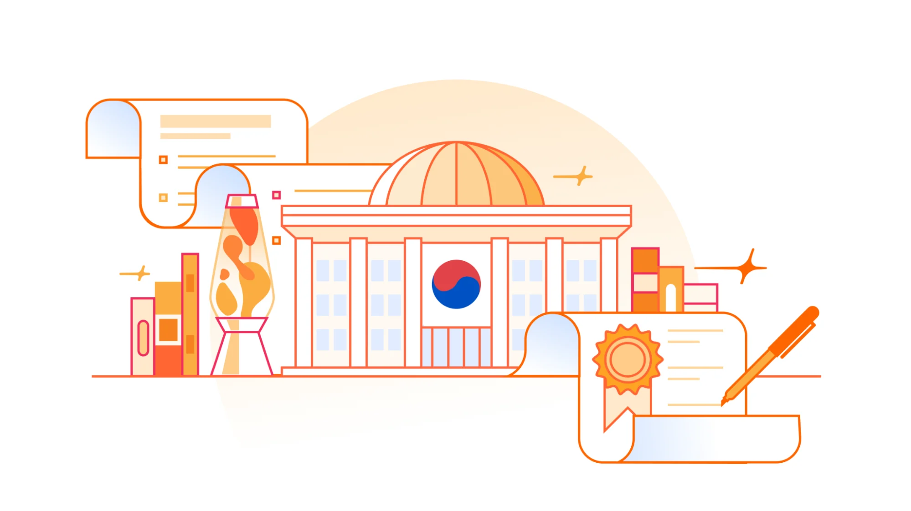

# Localizing compliance at scale: Achieving South Korea’s ISMS certification

> **来源**: [https://blog.cloudflare.com/k-isms](https://blog.cloudflare.com/k-isms)  
> **作者**: 未知 | **发布时间**: 2026-10-22T13:00:00+00:00  
> **深度调研**: [查看专题调研报告](research.md)  
> **标签**: ISMS, 隐私同意管理, IP 地理定位, 第三方身份认证, 数据流审计, 访问控制, 合规本地化

---

## AI 导读

Cloudflare 面临的问题是：全球统一的注册流程和安全管理材料，如何满足韩国对个人信息处理和用户同意的具体要求。文章称，公司经过韩国互联网振兴院（KISA）指定审计人员的检查，获得了信息安全管理体系（ISMS）认证。

产品上的主要改动是拆分注册同意项。服务条款、个人信息收集与使用、有限范围的个人信息跨境转移分别要求用户确认；营销相关的第三方共享则可选，拒绝不影响创建账号。Google、Apple 和 GitHub 等第三方账号注册会跳过自有同意表单，公司因此取消了韩国注册流程中的这些入口。系统先根据 IP 地址估计所在国家，决定默认展示的表单，再以用户注册时选择的国家覆盖该判断，避免把网络位置直接当作居住地。文中代码仅展示这一分支思路，并非实际生产代码。

审计准备还包括绘制个人信息流向图，展示员工访问路径，并检查数据从首次收集到销毁期间的访问控制。准备过程跨越了审计年度，导致政策重新翻译、证据重新收集及页面更新等返工，文章以此解释约一年半的准备周期。对于客户关心的产品覆盖范围，文章强调应看服务是否处于获认证的平台、运营团队和管理体系边界内，不能只按产品名称判断。

文章的主要启示是，本地要求需要改变实际产品行为，也需要对应的审计证据。不过，数据流图和控制测试细节未公开，认证范围文件也未展示，读者无法仅凭本文验证控制有效性或确认某个产品确实在认证范围内。

---

## 原文整理

# Localizing compliance at scale: achieving South Korea’s ISMS certification



For ten days, auditors appointed by the Korea Internet & Security Agency (KISA) sat together with us and worked through 80 controls. That is what it took for a company headquartered in the United States, operating a global network serving Korean users, to be certified in South Korea. Cloudflare has now [<u>obtained</u>](https://isms-p.or.kr/sttus/cert/selectCrtfctIsueList.do) South Korea's Information Security Management System (ISMS) certification under the [<u>ISMS-P framework</u>](https://isms-p.or.kr/sysm/intro/selectSysmCertDetail.do).

For customers in Korea, this is more than a compliance checkbox. It is evidence that Cloudflare's security and privacy program has been examined not only for whether our controls exist, but for how they operate in the context of Korean law, the Korean language, and the particular expectations of Korean regulators.

## What a Korean user sees when they sign up

The most visible result of this work is the Cloudflare account sign-up page. In most parts of the world, the line that sits above the sign-up button reads: "*By continuing, I agree to Cloudflare's terms, privacy policy, and cookie policy.*"

A user signing up from South Korea sees something different. The Korean experience is triggered by the country selected at sign-up and by IP geolocation from within South Korea, and it breaks the same agreement into four separately labeled items, each marked required or optional, each linking to its full text, with an option to agree to all of them at once:

- **모두 동의** *(Agree to all)*
- **\[필수\] 서비스 약관** *(\[Required\] Terms of Service)*
- **\[필수\] 개인정보 수집 및 이용** *(\[Required\] Collection and use of personal information)*
- **\[필수\] 제한된 범위의 개인정보 해외 이전** *(\[Required\] Transfer of a limited amount of personal information overseas)*
- **\[선택\] 제한된 범위의 개인정보 제3자 제공** *(\[Optional\] Sharing a limited amount of personal information with marketing third parties)*

The three required items are hard gates. The sign-up button stays disabled until all three are checked, so there is no path through the form that creates an account without an affirmative action on each one. The optional item governs marketing permission only, and leaving it unchecked has no effect on the account creation (it merely opts the user out of receiving marketing communications).

## The hard part: sign-up paths that never show a form

Itemizing consent on a form we control is straightforward. The difficulty was the sign-up paths that skip that form entirely.

Globally, you can create a Cloudflare account with Google, Apple, or GitHub. Those flows hand the user to an identity provider and return with an authenticated identity, and they never render our own sign-up form, which is precisely where the four consent items live. There is no step in that handoff where we can present three required items, link each to its full Korean text, and require an affirmative action on each before the account exists. The identity provider's screen is not ours to change.

We could either build a separate post-authentication consent gate for one country, or remove the paths that bypass the gate we already had. We chose the second. Social sign-up is not offered in South Korea, so every account created there goes through Cloudflare’s sign-up form, which enforces the required consents.

The country signal is the same one available to any Cloudflare customer. Cloudflare derives a two-letter country code from the client IP address and exposes it on the request, as the `CF-IPCountry` [<u>header</u>](https://developers.cloudflare.com/fundamentals/reference/http-headers/#cf-ipcountry) at the origin and as `request.cf.country` inside a Worker. Reduced to its essentials, the branch is a string comparison:

```
// Illustrative: the shape of the check, not Cloudflare's own dashboard code.
export default {
  async fetch(request) {
    // Two-letter country code derived from the client IP.
    // Same value as the CF-IPCountry request header.
    // Cloudflare's network populates this on the incoming request, so there is
    // no geolocation database, lookup service, or extra round trip of our own.
    const country = request.cf?.country;
    if (country === "KR") {
      return renderSignUp({
        locale: "ko-KR",
        consent: "itemized",  // four separate items, three of them required
        socialLogin: false,   // no path that skips the consent form
      });
    }
    return renderSignUp({ locale: "en-US", consent: "combined", socialLogin: true });
  },
};
```
What that does not show is why the country code is not the whole trigger. We document the limits of IP geolocation: it is an estimate rather than an exact science, addresses rotate and change ownership, and it should not be the only signal where the use case is critical to meeting the objectives of a local requirement. A Korean resident traveling abroad, or behind a VPN or a mobile carrier's NAT, may not arrive with a Korean address. So IP-based geolocation decides which form appears by default, but the country a user selects at sign-up overrides that and carries the decision from there. The IP address tells us where a request came from; only the user can tell us where they reside. Keeping those two apart is what makes the consent meaningful rather than presumed.

It is a small feature. It took a country-level product decision, and a change to the account creation path.

## What ISMS is and why it matters

ISMS is a detailed, localized certification standard. It covers security policy, access control, authentication and permission management, encryption, incident response, risk management, and disaster recovery, all assessed against how personal data actually moves through an organization's systems, and against Korea's Personal Information Protection Act and its associated regulatory guidelines.

Certification requires an independent audit by an auditor appointed by KISA, a governmental institution affiliated with the Ministry of Science and ICT (MSIT), followed by review from a special committee. It is valid for three years, with an annual audit required to maintain it.

The ISMS certification is primarily established under Article 47 of Korea's Act on Promotion of Information and Communications Network Utilization and Information Protection, etc., with the certification criteria and procedure set out in its Enforcement Decree and in the public notification on ISMS certification issued by MSIT.

## What the audit examined

Cloudflare is already certified against ISO/IEC 27001, ISO/IEC 27701, ISO/IEC 27017, ISO/IEC 27018 and many other globally recognized frameworks. ISMS does not replace any of them. It is a localization of the same principles, layered with Korean regulatory requirements, and that changes what auditors look for and how they look for it.

The controls in scope started with the review of data flows. We presented detailed data flow diagrams showing every path by which employees could access personal information that Cloudflare collects, processes, and stores. The flows themselves are not Korea-specific. What was different was the form the evidence had to take: the auditors were not willing to work from a narrative description of how data moves, they wanted diagrams they could read and interrogate. For each one, they examined every access control layer and tested its effectiveness, across our internal systems, our public-facing websites, event pages, and the Cloudflare dashboard, covering the full lifecycle of a user's data from first interaction through to destruction. Those diagrams are not published here due to confidentiality.

The audit also scrutinized the language and terminology of our consent collection: the exact wording at sign-up, the structure of each notification, and whether the items were presented separately and clearly. That is the kind of detail the ISMS framework is designed to surface.

## Why the timeline ran to a year and a half

Part of the answer is how audit cycles work. An ISMS audit covers a single annual period, and all evidence, documentation, and systems must reflect that period. Our preparation ran past one audit year and into the next, which meant retranslating updated policies for the new audit year, re-collecting and reassessing evidence, republishing an updated privacy policy, and absorbing formatting and design changes our marketing and website teams had introduced in the meantime.

## What the certificate covers

KISA defines the certified scope as a service boundary rather than as an enumerated list of in-scope products. The Statement of Scope submitted to KISA describes that boundary in three parts:

- the **organizational and operational perimeter**: the Cloudflare entities, teams, and processes that operate the service;
- the **infrastructure perimeter**: the network and platform the certified service runs on;
- the **information assets and personal information flows** that fall inside the boundary under the ISMS control set.

If a customer-consumed Cloudflare product is delivered through that certified service boundary, meaning it runs on the same certified platform, is operated by the same certified teams, and is governed by the same ISMS, it is covered by the certificate. The certificate is held by Cloudflare, Inc.

That is a different shape from the reports most procurement teams work with. A SOC 2 report or an ISO 27001 certificate describes the system it covers and names the services included, so coverage is confirmed by finding the product in that list. The ISMS certificate carries no such list. Coverage follows the delivery path instead, whether or not a product is named anywhere.

## What this means for customers

For organizations operating in Korea, this gives legal, security, and procurement teams a local assurance benchmark alongside Cloudflare's broader compliance portfolio. ISO/IEC 27001 and SOC 2 demonstrate a general security posture. ISMS reflects Korea-specific legal and regulatory expectations. That distinction matters in third-party risk reviews and in preparing for a team’s own compliance assessments.

Cloudflare’s entry can be found on [<u>KISA's public register of certified organizations</u>](https://isms-p.or.kr/sttus/cert/selectCrtfctIsueList.do), which is the independent, verifiable confirmation to cite in a risk review. Broader privacy and data protection material sits on the Cloudflare [<u>Trust Hub</u>](https://www.cloudflare.com/trust-hub/).

The question that usually stalls a vendor review of Cloudflare is whether a particular product in use is in scope. The certificate does not answer that by name, because it lists no products. It answers by boundary, meaning that the product is in scope if it is delivered through the certified service.

For multinational teams managing security across regions, the certification confirms that Cloudflare's program has been reviewed against local requirements in one of Asia's most important digital markets, not just designed for global scale.

## Building a better Internet, for everyone

ISMS is not a harder certification than the other assurance audits we go through. It is a more nuanced one. It is built around the regulatory needs of one specific region, and it asks for genuine investment in understanding and embedding those needs, rather than mapping them onto a common control framework.

Going through it made Cloudflare more global, not less. It pushed us to think carefully about what it means to serve users in a specific local context, with local language, local consent expectations, and local data protection requirements, and to put that into how the product behaves rather than only into a document.

That is consistent with what we are working toward: helping build a better Internet for everyone, not just in the regions where regulatory requirements are straightforward, but everywhere.

To learn more about Cloudflare's compliance and assurance programs, visit our [<u>Trust Hub</u>](https://www.cloudflare.com/trust-hub/compliance-resources/).
