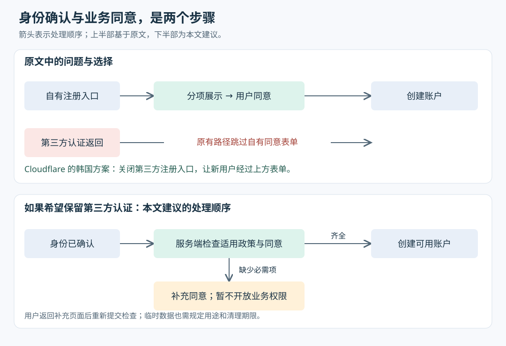

# 从注册按钮到认证边界：Cloudflare 韩国 ISMS 案例中的工程取舍

> 来源：[blog.cloudflare.com](<https://blog.cloudflare.com/k-isms>)  
> 作者：未知 · 发布时间：2026-10-22 21:00（Asia/Shanghai）  
> 翻译正文：[阅读中文正文](article-zh-CN.md)

一个全球服务进入韩国市场，即使已经有安全制度，也可能需要重新安排用户怎样注册、同意哪些数据用途，以及审计人员怎样核查这些动作。Cloudflare 的做法是拆开注册时的同意事项，并在韩国关闭会绕过该表单的第三方注册入口。这个案例值得出海产品团队关注：当地要求会改变账户创建流程，也会改变团队保存证据、确认供应商服务范围的方式。

本文以 Cloudflare 于 2026 年 10 月 22 日发布的[《Localizing compliance at scale: achieving South Korea’s ISMS certification》](https://blog.cloudflare.com/k-isms)为研究主体，并核对韩国官方认证名录、制度说明、相关法条和技术文档。下文用“原文披露”标明企业自述，用“外部核验”标明其他资料支持的事实；实现建议和假设例子会另行说明。核验日期为 2026 年 10 月 29 日，未对 Cloudflare 生产系统做接口测试。

## 一、问题从哪里出现：同意表单覆盖不了所有开户入口

假设一个小团队运营面向多国用户的在线协作服务。普通注册会展示本公司的条款，用户也可以点击“用 Google 注册”。后者确认身份后直接创建账户，省去了填写表单的步骤。

现在团队需要让一部分用户分别确认：接受服务条款、允许必要的信息收集，以及知悉并同意适用的数据跨境安排。如果只给普通注册页增加复选框，第三方注册仍然可以直接开户。页面变了，但账户创建条件没有覆盖全部入口。

原文披露，Cloudflare 遇到的正是这种路径差异。其韩国注册页提供三项必需同意：服务条款、个人信息收集与使用、有限范围的个人信息境外转移；另有一项可选同意，涉及向营销第三方提供有限范围的个人信息。用户必须完成三项必需同意才能注册，拒绝可选项不影响开户。页面也提供“全部同意”，但这不能取代逐项可辨认的呈现。

这里要区分两种动作。**身份认证**确认当前用户是谁；**业务同意**记录用户接受了本服务的哪些处理安排。第三方可能有自己的授权页面，但那里展示的授权内容，不会自动等同于本服务需要告知的全部事项。作为外部技术参照，OpenID Connect 是一种让应用利用身份提供方的验证结果确认用户身份的协议；它本身不能证明用户已接受应用自己的韩国版隐私文本。这也不代表原文提到的每家第三方都采用完全相同的协议。[OpenID Connect 核心规范](https://openid.net/specs/openid-connect-core-1_0.html#Introduction)

**分析：**真正需要检查的是“哪些入口能创建账户，以及这些入口在创建前检查了什么”。原文给出的注册按钮禁用行为，是可见的交互规则；由于没有公开后台源码和接口测试，不能据此独立确认所有服务端路径都已被阻断。

## 二、先核清认证：ISMS 不等于 ISMS-P

ISMS 是信息安全管理体系认证，检查组织如何建立和运行安全措施；这里讨论的是韩国的国家认证制度。ISMS-P 则在安全管理要求之外增加个人信息保护要求。两者出现在同一官方认证网站，不意味着名称可以互换。[KISA 制度介绍](https://isms-p.or.kr/sysm/intro/selectSysmCertDetail.do)

**外部核验：**韩国个人信息保护委员会的制度说明将 ISMS 列为 80 项标准，包括 16 项管理体系建立与运行要求、64 项保护措施要求；该说明中的 ISMS-P 另有个人信息保护要求。本文不把“在 ISMS-P 制度框架下获证”改写成“获得 ISMS-P 认证”。[韩国个人信息保护委员会制度说明](https://pipc.go.kr/np/cop/bbs/selectBoardArticle.do?bbsId=BS074&mCode=C020010000&nttId=10379)

KISA 公共名录可以直接核实本案：

| 核验项目 | 名录记录 |
| --- | --- |
| 持证主体 | Cloudflare, Inc. |
| 证书编号 | ISMS-KISA-2026-136 |
| 有效期 | 2026-09-02 至 2029-09-01 |
| 查询时状态 | 维持有效 |
| 认证范围的中文译意 | 提供 Cloudflare Connectivity Cloud 服务所需的基础设施及运营，排除未经审查的物理基础设施 |

来源为[KISA 公共名录中的 Cloudflare 条目](https://isms-p.or.kr/sttus/cert/selectCrtfctIsueList.do?pageIndex=8)。名录分页会随新增证书移动，复查时应按企业名称或证书编号定位。

这个范围限定非常重要。它证明了具体主体、具体服务范围内的获证情况，不能外推成全球所有设施、所有新产品都已接受相同检查。官方流程还明确，三年有效期内每年至少进行一次后续审查；范围发生重大变化，也可能需要首次审查。因此，证书有截止日期，不意味着到期前无需再核查维持状态。[KISA 认证流程与审查类型](https://isms-p.or.kr/cert/aply/selectCertPrcdDetail.do)

## 三、地区判断怎样变成产品行为

### 1. 用请求位置给默认值，让用户声明补足信息

原文披露，Cloudflare 同时使用 IP 地址推测出的国家和用户注册时选择的国家。IP 是网络连接使用的地址；根据它推测国家，得到的是请求来源线索，并不等于用户居住地。原文说，IP 位置决定初始表单，用户选择的国家覆盖该默认判断。

假设用户常住韩国，旅行时从法国连接服务。请求可能被识别为法国，但用户选择韩国后，应进入相应的注册流程。相反，只看到韩国出口地址，也无法确认用户就是韩国居民。虚拟专用网络（VPN）会让请求通过另一个出口转发，更容易造成这类差异。外部资料同样指出，即使能定位代理服务器，也不代表能定位其最终用户。[MaxMind 对 IP 定位局限的说明](https://support.maxmind.com/knowledge-base/articles/maxmind-geolocation-accuracy)

Cloudflare Workers 是在其网络上运行请求处理代码的环境，其中的 `request.cf.country` 提供两位国家代码，例如韩国为 `KR`；官方文档说明，它与 `CF-IPCountry` 请求头的国家值相同。[Workers 请求对象文档](https://developers.cloudflare.com/workers/runtime-apis/request/#incomingrequestcfproperties)

但原文的 `country === "KR"` 示例只是分支示意，并非其控制台源码，也没有完整表达用户选择覆盖默认值的逻辑。自己实现时还要处理以下边界：

- **数据缺失。**`request.cf.country` 可能为空；请求头还定义了未知位置 `XX` 和 Tor 网络 `T1`。这些情况应要求用户确认国家，而不是默认为无需额外检查。
- **传递条件。**在源站，也就是实际处理业务的后台服务器上，不能假定请求头始终存在。官方文档列有启用位置请求头的配置方式，并指出 Worker 向未受 Cloudflare 代理的源站发请求时会移除此头。
- **输入可信度。**服务端若接受国家请求头，应确认它来自可信代理链路；用户自填的国家也只是声明，不是居住证明。

前两点可由[Cloudflare 请求头文档](https://developers.cloudflare.com/fundamentals/reference/http-headers/#cf-ipcountry)核实，第三点是本文的安全设计建议。若业务需要法律意义上的身份或居住地核实，单靠这两个信号仍然不够。

### 2. 选择关闭旁路，或者让旁路也经过检查

原文披露，Cloudflare 在韩国关闭了 Google、Apple、GitHub 等第三方注册入口，让新账户经过已有的同意表单。它也考虑过在第三方认证后增加同意步骤，但没有选择这条路。

这不是第三方认证技术上无法与当地同意要求共存。应用可以在确认身份后，先展示自己的同意页面，再创建可用业务账户。困难在于，团队必须增加一个中间状态：知道用户是谁，但还不能让他开始使用业务。认证返回处理、页面恢复、权限发放和临时数据清理都要识别这一状态。

图中的下半部是替代方案示意，不代表 Cloudflare 内部实现。即使暂不创建可用账户，身份提供方返回的邮箱等信息也已经进入系统，仍要明确收集依据、用途和清理期限。

| 做法 | 实现与可靠性代价 | 用户和团队影响 |
| --- | --- | --- |
| 当地关闭第三方注册 | 账户创建路径较少，较易检查；仍须防止直接调用后台入口 | 失去一种便捷入口，需要产品接受体验变化 |
| 保留认证，增加同意步骤 | 多出待完成状态，要处理退出、重试、重复返回和过期数据 | 保留入口，但认证、业务和隐私负责人需共同维护流程 |
| 仅修改普通注册页 | 页面改动较小，但第三方开户仍可能绕过检查 | 表面完成需求，实际路径不完整，不适合作为完整方案 |

以上是工程分析，不是性能实测。原文没有披露关闭入口后的注册完成率、客服负担、开发费用或延迟变化，因此无法量化两种完整方案的总成本，也不能声称关闭入口一定更省钱。

### 3. 必需和可选必须在后台继续分开

把可选营销事项画成独立复选框，只完成了一半。**本文建议：**账户创建服务只检查适用的必需项，营销任务则读取独立的营销许可。这样，用户拒绝营销时仍能开户，后续发送系统也能执行这一选择。

需要特别保留法律上的条件。韩国《个人信息保护法》（PIPA）第 22 条要求区分同意事项、清楚告知，并禁止因为拒绝某些可选或营销同意而拒绝提供服务。这为分项呈现提供了外部依据，却不能推出所有服务都必须照搬 Cloudflare 的“三必需、一可选”。[韩国《个人信息保护法》第 22 条](https://www.law.go.kr/lsLinkCommonInfo.do?lsJoLnkSeq=1006184067)

境外转移也不能仅凭界面标签决定是否合法。该法第 28 条之八列有单独同意等不同转移依据，也包括在规定条件下为履行合同所需的处理委托、存储安排。团队需要先确认数据实际怎样转移、依据是什么，再决定告知与交互方式。[国家法令信息中心：个人信息境外转移条款](https://law.go.kr/LSW/lsRvsDocListP.do?chrClsCd=010202&lsId=011357&lsRvsGubun=all)

## 四、审计为什么需要数据流图，也为什么会拖到一年半

注册只是数据生命周期的起点。账户信息之后可能进入客服、分析或营销系统，也可能由员工查阅，最终需要按规则删除。审计人员要判断保护措施是否有效，必须先知道信息经过哪些系统、哪些人可以接触它。

原文披露，Cloudflare 提供了数据流图，展示员工访问个人信息的路径。审计人员沿这些路径检查访问控制，范围涉及内部系统、公开网站、活动页面和控制台，覆盖数据从首次接触到销毁的过程。相关图因保密没有公开，因此外部无法复核图的完整性、抽样方式和具体测试结果。

一个**假设例子**能说明图的用途：注册邮箱先进入账户库，客服工具通过接口读取邮箱，营销系统再按许可接收其中一部分。如果图只画“账户库受保护”，就漏掉了客服工具的读取权限和营销系统的接收条件。沿箭头逐步追问，才能找到“谁读了什么、依据是什么、是否留下记录、何时删除”。图本身不证明安全，它提供了可以继续核验的路径。

这种检查还需要版本对应。假设某次测试证明旧表单不允许跳过同意，随后网站团队调整页面，又重新加入第三方注册按钮；旧测试通过记录便不能证明新流程正确。这解释了为什么文字翻译、产品发布和证据管理需要一起推进。

原文称，准备持续约一年半，其中一项原因是跨越审计年度后，需要重新翻译更新的政策、重新收集证据，并处理隐私政策及网站设计变化。原文还报告了十天审计、80 项控制检查。**这些数字描述这次项目，不是标准工期，也不是安全效果指标。**官方资料能核实审查、整改、委员会审议和持续审查的制度流程，但不能独立核实 Cloudflare 内部各项工作耗时。

**给小团队的建议：**用一张表把“要求—实际行为—证据—负责人”连起来。例如“拒绝营销也能开户”，对应一段注册验证记录、一条营销排除结果和当前政策版本。证据标明采集时间、软件版本和适用服务；流程变化后，由负责人判断哪些证据需要更新。无需一开始购买专门平台，但不能把去年的截图当成今年仍然有效的证明。

## 五、证书覆盖什么：采购需要查交付路径和排除项

原文将认证范围解释为三个边界：哪些组织和团队负责运营、服务运行在哪些平台、哪些信息资产及个人信息流属于审查范围。其意思是，产品是否在范围内，要看它如何交付。

**外部核验与限制：**Cloudflare 的[韩国 ISMS 合规说明](https://www.cloudflare.com/ko-kr/trust-hub/compliance-resources/korea-isms/)重复了这一解释，但仍属于供应商自述。KISA 名录独立确认的是前述服务范围，并明确排除了未经审查的物理基础设施。公开记录不足以逐项确认每个产品、区域和部署选项；本文也没有取得完整范围声明及内部资产清单。

因此，采购人员可以先查主体、编号、有效状态和排除项，再请供应商书面说明拟购产品通过哪些团队、平台与数据路径交付，以及它们如何落在认证边界内。新收购产品、独立运营服务或特殊区域部署，尤其需要逐项确认。原文把这种做法与按产品清单查范围作比较，但不能把这种对比推广成所有 ISO 证书、SOC 2 报告都有同一种清单格式。

另外两条边界也需要分清。供应商获证，可以为客户的第三方风险评估提供材料，却不会替客户完成自己的权限管理、数据用途管理和审计。证书也不自动意味着数据留在韩国；Cloudflare 自己的说明明确，控制数据处理地域的相关产品需要单独授权，并非 ISMS 证书附带的能力。

## 六、个人或小团队怎样做一次最小实践

下面是缩小后的工程试验，目标是验证注册路径与证据能否对应，不是模拟大公司的完整认证项目。

**第一步，圈定一个真实范围。**只选一个产品、一个注册流程和少量确有必要的数据字段。列出普通注册、第三方注册、邀请加入、移动端和后台接口等实际存在的开户入口。与熟悉当地要求的人确认适用人群、处理依据及必需和可选事项；若这些前提还不明确，先不要扩大上线范围。

**第二步，选一条能维护的开户路线。**如果第三方入口对目标用户不关键，可先限制该入口；如果它是主要入口，就实现认证后补充同意。两者都应由服务端统一检查，不能只依赖浏览器按钮是否可点击。记录用户选择的国家及所用政策版本，避免页面、认证返回和账户创建各自作出不同判断。

**第三步，保存足以解释行为的记录。**作为实现建议，可记录内部用户标识、同意事项、同意或拒绝的结果、文本版本、时间和来源入口。不要只保存一个笼统的 `accepted=true`，否则难以说明用户接受的是哪一版、哪一项。也不要为了审计无差别保存完整 IP、身份凭证或长期临时数据；记录本身同样需要访问权限和保留期限。

**第四步，用失败路径验证设计。**至少检查海外 IP 配合韩国声明、位置未知、拒绝营销、缺少任一必需项、直接提交接口，以及保留第三方认证时的中途退出和重复返回。再画出邮箱等字段进入各系统的路线，检查营销拒绝和删除操作是否真正传到下游。

| 验证指标 | 试验中怎样判断 |
| --- | --- |
| 路径覆盖 | 已识别的每个开户入口都有处理决定和验证记录；未检查入口视为未完成 |
| 必需项约束 | 对适用流程，缺少任一必需项均无法创建可用账户；出现一个绕过案例就停止扩大试验 |
| 可选项独立 | 拒绝营销仍可开户，且测试用户不会进入相应营销名单 |
| 证据可追溯 | 每个试验账户都能对应同意事项、文本版本、来源入口和时间 |
| 用户与运维代价 | 与原流程按相同口径观察完成率、放弃位置、错误和人工处理量，不预设收益 |

表中前四项是建议的功能验收条件，不是认证标准或生产成效数据。最后一项需要团队在试验前约定可接受范围，不能事后挑选有利数字。

**退出条件也应事先写明：**发现开户旁路或可选同意被强制绑定时，暂停相关路径；若第三方认证的临时状态长期无法清理，或维护负担超出团队能力，就收缩方案。如果适用依据、数据去向或认证范围仍解释不清，应先解决这些前提，再决定是否上线。这个案例最可迁移的做法，是把当地要求落实成每条路径都能执行、每次变化都能重新核验的产品行为。
