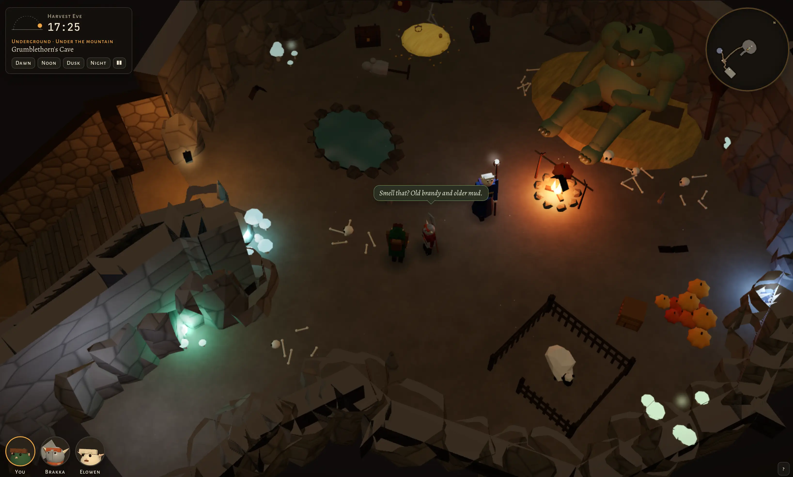
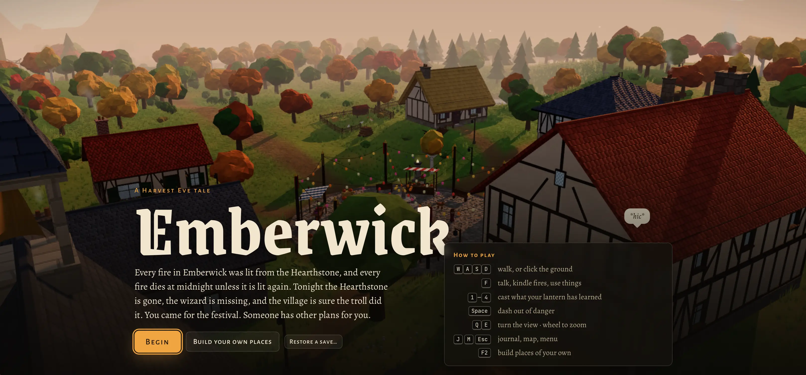
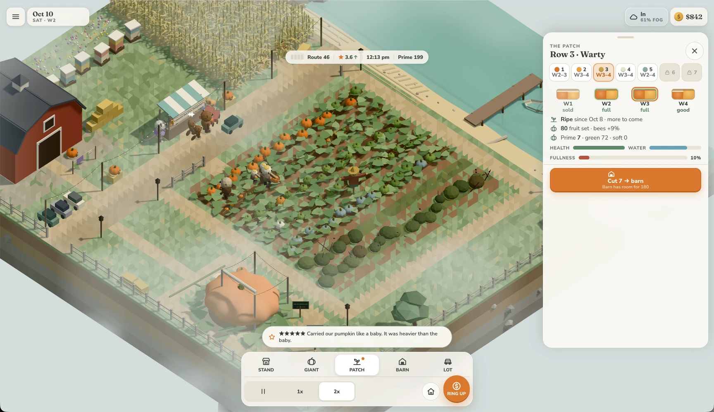

# 凭感觉开发游戏的十月转折点

> **来源**: [https://simonwillison.net/2026/Oct/28/vibe-game-development](https://simonwillison.net/2026/Oct/28/vibe-game-development)  
> **作者**: Simon Willison | **发布时间**: 2026-10-28T00:00:00+00:00  
> **深度调研**: [查看专题调研报告](research.md)  
> **标签**: AI辅助游戏开发, Vibe Coding, three.js, JavaScript, 游戏设计, WebSockets, 大语言模型

---

## AI 导读

作者关注的问题是：模型能否从做出“看起来像游戏”的程序，进一步做出值得反复游玩的作品。他采用不阅读生成代码、主要靠自然语言要求和试玩反馈推进开发的方式，制作了四款使用 HTML 和 JavaScript 的浏览器游戏，常用 three.js 这个用于浏览器三维图形的库生成场景和模型。
树木找不同游戏据称一次生成即可游玩；奇幻角色扮演游戏先搭建村庄和建筑内部，再扩展地形、地下空间、剧情与魔法，经过多轮试玩修正任务人物位置等问题。即时战略游戏则从早期二维版本继续改进玩法并转为三维，增加多人对战、回放和地图生成，还让大语言模型按“推进五秒后暂停决策”的方式互相对战。南瓜农场尝试更个人化的题材，但作者承认种植时机等机制仍复杂，趣味性尚不满意。
作者据此认为，模型已能在较少人工创意投入下生成有趣的游戏，制作重点开始转向提出独特构想和持续打磨。不过，每个项目不超过四小时的说法仅指作者投入，另有大量模型运行时间，其中农场项目消耗数百万词元，即模型处理文本的计量单位，并运行近两天。文章展示了具体案例和可继续核验的链接，但没有系统玩家测试、代码质量或性能评估；对模型能力高低和游戏趣味性的判断仍是个人经验，不能据此推广到其他游戏类型或正式产品开发。

---

## 原文整理

## 凭感觉开发游戏的十月转折点

2026 年 10 月 28 日

我以前写过，2025 年 11 月是[编程智能体的一个转折点](https://simonwillison.net/tags/november-2025-inflection/)：当时，Opus 4.5 和 GPT-5.1 的能力跨过了一个临界点，让各自的编程智能体成了软件工程师日常工作中可靠的工具。我认为，2026 年 10 月，我们又迎来了一个新的转折点，这次是**凭感觉编程来开发电脑游戏**。

尤其是 Claude Opus 5.5，在打造吸引人的游戏所需的几个方面，都有了明显进步：

- 三维建模
- 音乐生成（参见 [Scrimshaw Jukebox](https://simonwillison.net/2026/Oct/6/scrimshaw-jukebox/)）
- 游戏设计（！）

最后一项尤其重要。模型能做出*看起来像游戏*的东西，已经有相当长一段时间了，[我之前的实验](https://simonwillison.net/2026/Aug/7/moonlight-mayhem/)就能说明这一点。难的是做出真正*好玩*的游戏。

游戏设计是一门很深的学问。我不敢说自己精通，只是了解得足够多，知道这门手艺值得尊重。设计出新颖、引人入胜的核心玩法，让玩家面对恰到好处的挑战，又能在逐步掌握玩法的过程中获得满足感，是一门精细的艺术。我原本不认为模型能做到。

后来，我试着对 Claude Opus 5.5 说：“让它好玩得多，多得多”……[它还真做到了](https://simonwillison.net/2026/Oct/20/battledrones/#v4-the-fun-update)。

过去几周，我用凭感觉编程的方式做了四款游戏，而且自己确实玩得很开心。这里说的是[这个词最初的含义](https://simonwillison.net/2025/Mar/19/vibe-coding/)：完全不看代码。

周末，我去伯克利参加了 [Foo Camp](https://en.wikipedia.org/wiki/Foo_Camp)，遇到了几位有类似经历的人。现在，要做出玩起来不错的游戏，已经容易得令人吃惊。新的挑战是想出新颖、讨人喜欢的游戏构想，而且这些游戏如果没有 AI 帮助，就不会诞生。

我没有做过全面研究，但目前的感觉是，GPT-6 Astra 还*差一点*。它绝对能做出游戏，但对“好玩”的把握还比不上 Opus 5.5。我预计 OpenAI 到今年年底就能达到这个水平。

下面这四个游戏项目让我相信，模型现在只需很少的引导，就能做出好玩的游戏。这四款游戏都用 HTML 和 JavaScript 编写，完全在浏览器里运行。

### Tree Appreciator

在让我觉得确实很讨喜的游戏中，规模最小的是 [Tree Appreciator](https://tools.simonwillison.net/tree-appreciator)。我用普通的 Claude 聊天界面就做出来了，连 Claude Code 都没用上。

当时我们正开车沿着 [Skyline Boulevard](https://en.wikipedia.org/wiki/California_State_Route_35) 看树，我一时兴起做了这款游戏。提示词是：

> 做一款名叫“Tree appreciator”的 three.js 游戏。展示两棵由算法生成的树，玩法围绕欣赏它们之间的差异展开。好好想想，怎样才能让它既好玩又漂亮。

我发现，告诉模型使用 [three.js](https://threejs.org/)，效果非常好。Claude 没有自己的图像生成模型，但能构建出视觉效果和整体感觉都很出色的全彩三维模型。

这款游戏完全不需要迭代，也不需要追加提示词，一次就生成了。它给了我一款可爱的小小找不同游戏，在手机上也很好玩。你可以[在这里玩](https://tools.simonwillison.net/tree-appreciator)。这是制作它的[聊天记录](https://claude.ai/share/ee7de555-f85c-4ff0-96cb-d51ed5e479e9)。

玩起来让人很放松。画面很有趣，每完成一棵树的挑战，就能把它收进“植物标本集”，带来一种温馨、惬意的成就感。

### Emberwick

这是一个更有野心的项目，我同样用普通的 Claude 聊天完成。起初，我想为一款俯视角奇幻角色扮演游戏搭建一个实验性的引擎原型：

> 用 three.js 做一个游戏引擎演示：这是一款从上方俯视、但视角有一定倾斜的角色扮演游戏，玩家可以带着一两位同伴在世界中移动。创建一个奇幻村庄场景，展示在室外行走的效果，再展示玩家进入建筑时，玩家与摄像机之间的墙壁如何变透明，让用户看清里面发生的事。

> 加入一些非玩家角色、大量家具和不同类型的建筑，其中一些要有楼上。发挥创意，让画面漂亮起来。

这是[第一个版本](https://simonw.github.io/emberwick/v01/emberwick.html)。效果非常好！

这让我有了更大的想法：

> 别让地形这么平。建筑很棒，但目前地面完全是平的，把这个问题解决一下。

> 给其中两栋建筑加上地下室，再用村庄下方的隧道系统把它们连起来。

> 在村庄一侧加上一段岩石山体，里面有个洞穴，住着一只正在睡觉的巨魔。

这是[那个版本](https://simonw.github.io/emberwick/v02/emberwick.html)。

连*这个*也做得不错，于是我决定干脆放开手脚：

> 现在把它做成一款真正的游戏：把可游玩区域扩大到原来的四倍，加入好玩的游戏机制、不太落俗套的剧情、一些转折，还有魔法系统。把它做得真正出色。

你看，我们又用上了“把它做得真正出色”这种提示词！要求剧情“不太落俗套”似乎也起了作用。虽然还是有点俗套，但新意已经足够让我乐于跟着故事走下去。

与 Tree Appreciator 不同，这款游戏经过了相当多的额外试玩和提示调整，才成为一个完成的版本。主要问题出在游戏流程上。比如，要完成任务时，某个角色却不在该在的地方，因为另一段剧情已经让他去了别处。

这是[最终的游戏](https://simonw.github.io/emberwick/v11/emberwick.html)。它有一条完整的故事线，大约 15 分钟就能通关。

游戏甚至还有一个实验性的关卡编辑器，你可以用它放入自己的房屋、家具和地形元素。

等一切都能正常运行后——我也已经迭代修复了一些玩法上的问题——我从头到尾玩了一遍，竟然被结局打动了！这让我有点不好意思，因为游戏里的*一切*，包括画面、剧情、角色、音乐和对白，都是模型创作的。我的创意投入基本上只有一句：“这是个奇幻村庄，洞穴里睡着一只巨魔。”

这是我制作这款游戏时[分享出来的完整 Claude 聊天记录](https://claude.ai/share/840e0bc0-a68e-4894-8eec-8f83bd6ade26)。

我还把最初那一组提示词原样交给了 ChatGPT GPT-6 Pro。这是[聊天记录](https://chatgpt.com/share/6ae176eb-1eac-83e8-ae54-729281fbdb70)和[完成的游戏](https://lantern-hollow-rpg.simonw.chatgpt.site)，可以对比看看。它看起来很棒，但我觉得玩起来差了不少。

### Battle Drones

这是我迄今为止最成功的项目，我[上周写过一篇文章介绍它](https://simonwillison.net/2026/Oct/20/battledrones/)。它是一款《命令与征服》风格的即时战略游戏，两支机器人军队——[从周六起可以有四支](https://simonwillison.net/2026/Oct/24/battledrones/)——生产单位、收集废料，并争夺地盘。

也是这个项目让我相信，Opus 5.5 知道什么叫“好玩”。

最早的几个版本是在 7 月用 Claude Fable 5 做的。它帮我做出了一款能玩的二维《命令与征服》风格游戏，但玩起来并不出色。

我给 Opus 5.5 的提示是：“让它好玩得多，多得多”，后来又让它“把这款游戏移植到 three.js”，游戏就此大变样了。[我的文章](https://simonwillison.net/2026/Oct/20/battledrones/)里有详细的过程记录，也包括提示词。

如今，Battle Drones 支持 2–4 人联机对战，通过一个凭感觉编程做出的 WebSockets 中继服务器实现。此外，它还有奖章、回放、七张地图、随机地图生成器，以及一组能改变规则玩法的“变异选项”。

它还可以让不同的大语言模型互相对战。在这种模式下，游戏每推进五秒就会暂停，让各个模型有时间理解新的游戏状态，并安排下一组指令。这是一场 [Claude Haiku 5.5 对阵 GPT-6 Luna 的回放](https://simonw.github.io/battledrones/v11/?replay=battles/showcase/2026-10-14-frostbite-42-claude-haiku-5.5-vs-gpt-6-luna.json)：

Battle Drones 尤其能体现 Opus 5.5 创建三维模型的能力。你可以在这个页面[浏览游戏中的全部模型](https://simonw.github.io/battledrones/models.html)。

上周二，我以 Apache 2.0 许可证发布了 Battle Drones。周三，Gabriel Turpin 就发布了它的一个分支 [Panache](https://github.com/menufactory43/panache/)（[截图在这里](https://simonwillison.net/2026/Oct/21/panache/)）。这个版本把游戏重新设定在 1900 年代、法国“美好年代”的蒸汽朋克世界，加入了新的模型、音乐和一段开场动画。开源的力量！

### Pumpkin Farmer，又名 Quarter Sun Cove

我住在[加利福尼亚州半月湾](https://en.wikipedia.org/wiki/Half_Moon_Bay,_California)。这里每年都会举办[半月湾艺术与南瓜节](https://en.wikipedia.org/wiki/Half_Moon_Bay_Art_and_Pumpkin_Festival)，其中有一项巨型南瓜称重比赛。

我决定试着做一款游戏，不再只是粗浅地模仿已有作品。于是，我着手制作一款种南瓜、培育巨型南瓜，并应对十月南瓜旺季忙碌生意的游戏。

我给它起名叫“Quarter Sun Cove”。

这个项目还在迭代中，不过已经越来越像样了。它是一款温馨的农场模拟游戏：一年里，你要照料自己的巨型南瓜，也要种下普通大小的南瓜，准备在十月出售；到了南瓜季，你一边卖南瓜，一边带着自己的巨型南瓜参加称重比赛。

里面的每个角色都是动物，而且都吃素。镇长是一只鹈鹕。你可以扮演鹈鹕、臭鼬、浣熊、负鼠、河狸、郊狼、狐狸、猫头鹰、海獭或港海豹。之后，这些物种都会带着孩子来找你买南瓜。

它可爱得*简直不像话*。

你可以[在这里玩最新版本](https://simonw.github.io/pumpkin-farmer/)。我对游戏机制还不太满意。它其实挺复杂：你得决定什么时候种南瓜，才能让它们赶上十月游客最多的那些周末成熟。

这是[最初的头脑风暴对话](https://claude.ai/code/cshk_01V63sUyETi6UNbGUyjSYbHd13Mq93U6ty824Ha4eAxF4i)，由此形成了[这份规格说明文件](https://github.com/simonw/pumpkin-farmer/blob/cdcf12083f403946b5c2a9e04312bbb42359bf58/SPEC.md)。接着，我让 Opus 5.5 Ultracode 花了近两天、消耗数百万词元，把它做了出来。

我告诉 Claude，要“经常给用户带来惊喜和乐趣”，结果游戏里出现了*特别多*的小细节和彩蛋：有调皮捣蛋的浣熊、主持称重比赛的象海豹、把南瓜滚回海里的港海豹、一只四处游荡的山羊，还有关于培育巨型南瓜的迷信说法，而且这些说法*有时*真会应验。

它还算不上我最好的游戏，玩起来没有 Battle Drones 那么有趣。但它代表了我想看到更多的那类游戏：古怪、好玩、带着独一无二的个人色彩，是以前那个时代不会有人做出来的东西。

### 冒犯程度乘以四

如果 AI 生成的美术、AI 生成的音乐、AI 生成的文字，以及 AI 生成的代码都会让你反感，那我有个坏消息：凭感觉编程做出的游戏，**把这几样一次全凑齐了**。

整个游戏社区已经对游戏中的 AI 生成素材抱有反感。过去几年，随着 Midjourney 等工具让开发者能为项目生成素材，这个问题变得越来越突出。最近一个很好的例子是[这篇 IGN 报道](https://www.ign.com/articles/steam-fans-are-begging-for-a-no-ai-filter-as-steam-next-fest-is-filled-with-slop)，讲的是人们抱怨 Valve 的 Steam 新品节里充斥着低质 AI 内容。

现在，一款游戏里的*一切*，从代码、素材、对白，甚至到游戏设计本身，都可以交给模型来做。而且做出来的结果还真不赖！

过去，开发电脑游戏是整个软件开发领域最具挑战性的项目之一。它需要综合运用各种不同的技能，还要在数月甚至数年里高度专注、投入大量精力。可现在，我在手机上敲敲提示词，就能做出一款可玩的多人即时战略游戏！

我预计，这会像我们已经在编程领域看到的那样，带来分化。有些玩家会拒绝接触任何用这种方式做出的游戏；另一些人可能会欢迎这种变化，因为它让更多人有机会开发游戏。我倾向于后一种态度！

当然，我不会拿自己凭感觉编程做出的游戏去参加传统的游戏创作活动或比赛，我觉得自己还没赢得这种资格。未来很可能会出现新的渠道，让凭感觉开发游戏的人相互比较作品。

### 如果有人真的认真投入，会怎样？

这件事让我既兴奋又惭愧的一点在于：我投入的*创意这么少*，却已经得到了有意思的结果。上面介绍的项目，大致按我投入的精力从少到多排列。没有任何一个项目花了我超过四小时的时间，当然，除此之外，Claude Code 还自行忙活了多得多的小时数。

现在想象一下，如果有人认真对待这件事，投入大量时间做创意，在游戏设计上运用更好的审美和判断，再不断试玩、迭代，直到把结果打磨到自己能做到的最好，会做出什么？

我想看到那些没有这些新工具就不会诞生的游戏。

### 你也该做个游戏！

用这种方式做游戏，*实在太好玩了*。它简直是凭感觉编程的完美用途，因为试错的代价很低：自己凭感觉编程做着玩的游戏里有个 bug，能造成多大损失呢？

（好吧，还是可能造成点损害……我尝试做基于音频的多人联机时，让妻子 Natalie [头疼得够呛](https://simonwillison.net/2026/Oct/20/battledrones/#update-online-multiplayer-support)！）

到目前为止，我的所有游戏都使用 HTML 和 JavaScript，并部署在静态托管服务上，通常是 GitHub Pages 或 Cloudflare Pages。现代浏览器，包括手机浏览器，能力已经强得惊人。前沿模型也早已熟悉 [three.js](https://threejs.org) 和 [Phaser](https://github.com/phaserjs/phaser) 这样的库。我发现，至少对我尝试制作的这几类游戏而言，这些手机网页游戏的体验与原生应用已经没有区别。

我建议从这样的提示词开始：

> 做一款适合在手机上玩的 three.js 游戏，其中……

在 [chatgpt.com](https://chatgpt.com/) 和 [claude.ai](https://claude.ai) 上都可以这样做，甚至不用启动完整的编程智能体。最后再举个例子，提示词是“做一款适合在手机上玩的 three.js 游戏，让一只老鼠躲避猫的追捕”。这是 [Claude Opus 5.5 Extra 做出的版本](https://claude.ai/artifact/RRyEndXLSPQbcig3BgzgCZ)，以及 [GPT-6 Extra High 做出的版本](https://squeak-and-seek-mouse-1027.simonw.chatgpt.site/)。

等项目过了概念验证阶段，再转用 Codex 或 Claude Code。

如果游戏还不够好玩，就再加一句：

> 让它好玩得多，多得多。

## 更多近期文章

- [Battle Drones：一款凭感觉编程做出的即时战略游戏，支持基于音频的多人联机](https://simonwillison.net/2026/Oct/20/battledrones/) — 2026 年 10 月 20 日
- [你好 Python 3.15，再见 3.10，现在我终于能用 3.11 了](https://simonwillison.net/2026/Oct/12/python-3-15/) — 2026 年 10 月 12 日
- [用我的声音为博客做了个新功能](https://simonwillison.net/2026/Oct/9/built-using-my-voice/) — 2026 年 10 月 9 日
- [Claude Haiku 5.5](https://simonwillison.net/2026/Oct/7/claude-haiku-5-5/) — 2026 年 10 月 7 日
