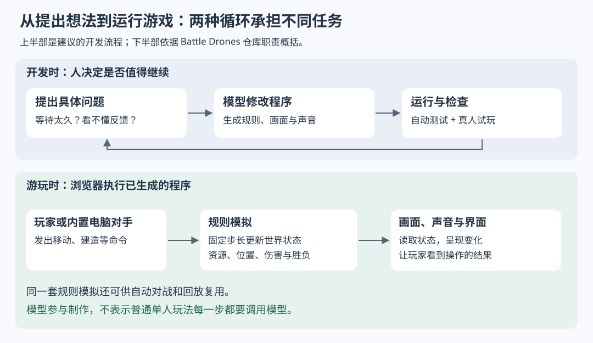
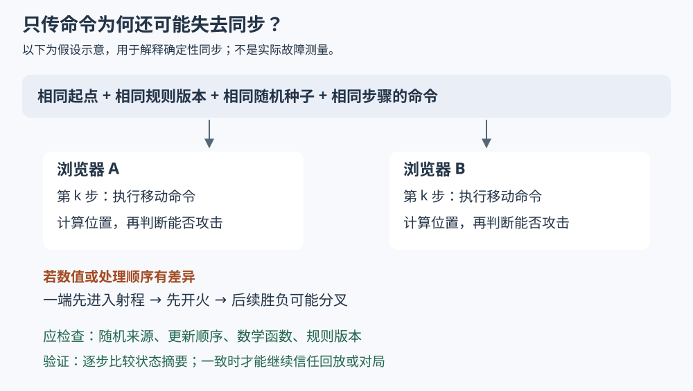

# 用 AI 做出能玩的游戏之后，怎样判断它真的好玩？

> 来源：[simonwillison.net](<https://simonwillison.net/2026/Oct/28/vibe-game-development>)  
> 作者：Simon Willison · 发布时间：2026-10-28 08:00（Asia/Shanghai）  
> 翻译正文：[阅读中文正文](article-zh-CN.md)

一个人想把脑海里的小游戏做出来，往往先遇到几道门槛：不会画角色，不会搭三维场景，也不熟悉输入控制、声音和游戏规则。让 AI 编写浏览器游戏，可以把这些工作放进同一次迭代：先生成一个能运行的版本，再通过试玩找出问题，让模型继续修改。它尤其值得个人和小团队用于验证小而具体的玩法；能否因此稳定做出好玩的游戏，则需要另外证明。

Simon Willison 在 2026 年 10 月 28 日的文章 [《The October inflection point for vibe game development》](https://simonwillison.net/2026/Oct/28/vibe-game-development/) 中认为，这类开发已经出现转折点。他展示了四款浏览器游戏，其中既有一次生成的找不同游戏，也有经过多轮修改的角色扮演和即时战略游戏。他使用的 **vibe coding**，指主要通过自然语言要求模型修改程序、自己几乎不阅读代码的做法。

本文以这篇文章为主体，结合项目仓库、浏览器技术文档和同步机制资料展开分析。文中的“原文报告”代表作者的经历与判断；“外部核验”说明其他资料能够支持到哪一步；“分析”与“建议”则是据此作出的解释和实践选择。本次没有运行这些游戏的完整试玩或性能测试，因此不把作者的体验当成独立实测结果。

## 四个项目说明了什么，又没有说明什么

先看一个具体场景。玩家面对两棵很相似的树，可以同时旋转它们、放大观察，再点出缺少的树枝或只出现在一侧的小鸟。找齐差异后，这对树进入收藏册，玩家继续观察下一对。

这就是 Tree Appreciator。它的动作不多，却已经形成了一个**玩法循环**：观察、发现、得到反馈，然后带着新的目标再玩一次。游戏页面能够核验旋转、缩放、差异查找和收藏机制；作者则报告，自己用一次提示就得到了这个作品。页面存在可以支持“有这些功能”，不能单独证明“一次生成”的过程，也不能证明所有玩家都会喜欢。[游戏页面](https://tools.simonwillison.net/tree-appreciator)

原文另外三个项目，把问题逐步推向更复杂的层次：

| 项目 | 原文报告的做法与结果 | 据此能判断的范围 |
| --- | --- | --- |
| Tree Appreciator | 一次提示生成三维找不同游戏，无后续提示 | 目标集中的小玩法可能很快成形；生成成功率未知 |
| Emberwick | 先做村庄行走和室内显示，再加地形、地下空间、剧情与魔法；多次修复玩法问题 | 场景演示到完整流程之间，仍有任务逻辑和内容联动需要验证 |
| Battle Drones | 从可运行但无趣的版本出发，继续修改规则、反馈、地图和画面 | 玩法改善可能需要持续迭代，不能从画面质量直接推导 |
| Quarter Sun Cove | 生成种南瓜、迎接游客和参加称重比赛的经营游戏；作者仍不满意部分机制 | 内容丰富和风格讨喜，可以与决策过于复杂同时存在 |

这些项目和过程均来自[原文](https://simonwillison.net/2026/Oct/28/vibe-game-development/)。其中 Emberwick 的最终页面确实提供任务日志、地图、存档恢复和场景编辑入口，但这些界面不等于所有剧情路径都能走通。[Emberwick v11 页面](https://simonw.github.io/emberwick/v11/emberwick.html)

**分析：这组案例最有说服力的地方，是把创意变成可交互作品的门槛降低了。** 它尚不足以证明某个模型普遍更懂游戏设计。作者主动挑选了自己喜欢的作品，没有给出全部尝试、失败比例或盲测结果；他对不同模型“趣味感”的比较，也明确属于个人印象。模型名称和档位在本文中仅用于还原原文，不构成选型排名。

## 为什么写程序也能得到画面和音乐

原文强调，模型即使没有配套的图像生成能力，也能做出三维模型。这里需要区分两件事：生成一张树的图片，与写出一套让浏览器绘制树的程序。

**three.js 是帮助网页组织和绘制三维场景的 JavaScript 库。** 程序可以定义几何形状、颜色和材质，把它们放进场景，设置灯光和相机，最后由渲染器把相机看到的部分画到屏幕上。官方文档明确描述了场景、相机和渲染器之间的关系。[three.js 基础文档](https://threejs.org/manual/pages/fundamentals.html)

举一个假设例子：模型用圆柱表示树干，用分叉圆柱表示枝条，用若干绿色几何体表示树冠；改变长度、角度和分布规则，就能得到不同的树。这叫**程序化生成**，即按照规则创建内容，而不是逐个手工制作。这个例子解释一种可行方法，不是对 Tree Appreciator 源码的逐行还原。

这样做的一个实际好处是，外观参数可以直接参与玩法。例如程序知道哪根枝条被移除了，就能把它登记为找不同的答案，而不必再从两张图片中识别差异。但程序仍要处理点击区域、遮挡和相机角度，否则“答案存在”也可能变成“玩家根本看不到答案”。这是机制上的分析，并非已经验证该游戏不存在这些问题。

音乐也可以通过程序产生。**Web Audio API 是浏览器提供的声音处理接口**，允许程序连接声音来源、效果处理和输出节点，并控制声音随时间的变化；浏览器通常要求用户先与页面交互，才允许开始播放。[MDN 使用指南](https://developer.mozilla.org/en-US/docs/Web/API/Web_Audio_API/Using_Web_Audio_API)

Battle Drones 的设计文档说明，其音乐、音效和环境声在运行时合成，不使用音频文件。[项目设计文档](https://github.com/simonw/battledrones/blob/main/DESIGN.md) 这支持“模型能够通过编写音频程序交付声音”的判断，却不能推出它具有专业配乐同等的表现力。风格、耐听程度、手机扬声器上的效果，仍需实际聆听。

## 生成游戏与运行游戏，是两件不同的事

容易产生的误解是：既然 AI 做了游戏，游玩时也必须不断请求 AI。原文这些作品的基本路径是先生成 HTML 和 JavaScript，再由浏览器执行程序。模型参与制作，不代表每次移动、采集和攻击都需要模型判断。

Battle Drones 的仓库提供了一个值得理解的职责划分：`src/sim/` 负责规则模拟，以每秒十次的固定节奏处理命令；`src/game/` 负责三维显示和输入；`src/ui/` 提供菜单和状态界面；其他目录承担联机与模型对战功能。这里的**规则模拟**，就是根据当前资源、位置和命令，计算下一步发生什么。[仓库说明](https://github.com/simonw/battledrones)

图的上半部是本文建议的开发流程，下半部根据仓库说明概括。两者之间的区别决定了怎样测试：模型修改程序时，要检查改动是否解决问题；玩家运行程序时，要检查规则是否正确、操作是否清楚。

假设玩家点下一座工厂，程序先把动作转换成“建造”命令。规则部分检查资源是否够、位置是否允许，再扣除资源并启动建造。画面部分读取建造进度，显示模型、进度和声音。规则按固定步骤更新，而画面可以在步骤之间补出平滑位置；因此每秒十次规则更新不等于画面只有每秒十帧。

这种划分还允许程序不显示画面，直接运行大量对局，检查资源是否异常、比赛是否结束。代价是必须持续维护“规则决定结果，画面表达结果”的边界。若伤害计算依赖某次动画有没有播放完，自动测试、回放和不同设备上的行为就更难保持一致。这是适合小团队借鉴的工程原则，无需照搬项目的全部目录和工具。

## “让它更好玩”怎样变成具体修改

原文最醒目的经历，是作者要求 Battle Drones “Make it a LOT more fun”，随后认为游戏明显改善了。这句话提出的是目标，没有直接给出实现方法。

看项目的“趣味更新”说明，模型交付的不是一个神秘的“趣味参数”，而是一组规则调整：开局选择不同发展路线，加入争夺目标，延长部分交战的反应时间，并改善操作反馈。[更新说明](https://github.com/simonw/battledrones/blob/main/Battle%20Drones%20The%20Fun%20Update%20%E2%80%94%20Release%20Notes.md)

下面是对这些变化的因果分析：

- **开局有路线可选**，玩家才能在早期表达不同意图；如果各种选项最终结果一样，选择仍然没有意义。
- **地图上有值得争夺的目标**，双方才有理由离开基地；但若占领者持续获得更多优势，也可能让落后者更难翻盘。
- **交战留出反应时间**，玩家才有机会撤退、增援或改变攻击目标；若战斗拖得过长，又可能让结果显得迟钝。
- **操作结果清楚可见**，玩家才知道自己做对了什么；更多声音、粒子和提示并不自动等于信息更清楚。

原文还有一个更具体的设计动作：作者发现运输机和步兵缺少战略用途，于是要求地图设置只能运送步兵去占领的岛屿目标。这个要求把“增加一种单位”变成了“创造必须考虑这种单位的局面”。这是把内容变成决策的例子。[原文中的 Battle Drones 介绍](https://simonwillison.net/2026/Oct/28/vibe-game-development/)

### 自动对战能证明节奏变化，不能替玩家评价乐趣

更新说明报告，在普通难度的 1,200 场自动对战测试中，超过 25 分钟仍未分出胜负的比例从 14% 降至 0.9%；胜方曾落后至少 800 单位废料资源的比例从 24% 升至 46%。同一说明也明确承认，这些数据来自自动对战和脚本玩家，发布说明写成时尚无人类试玩。[数据与已知问题](https://github.com/simonw/battledrones/blob/main/Battle%20Drones%20The%20Fun%20Update%20%E2%80%94%20Release%20Notes.md)

因此，合理结论是“项目报告的对局统计发生了变化”。本文没有复跑测试，也未独立核对完整原始记录，无法确认这些比例的可重复性。更不能把“翻盘更多”直接换算成“乐趣增加”：翻盘可能来自更丰富的决策，也可能来自电脑对手犯错。

小团队应把自动测试与真人试玩分别使用。前者检查游戏是否会卡死、资源是否越算越多；后者观察玩家是否理解目标、是否感到操作有效、是否愿意主动再玩。二者回答的问题不同。

## 复杂游戏首先会暴露在哪里

### 剧情写出来了，任务却不一定做得完

原文报告，Emberwick 的一个问题是：角色因为另一段剧情去了别处，导致当前任务无法完成。这里出错的不是文字是否流畅，而是角色位置与任务条件之间的关系。

假设任务要求玩家向铁匠交钥匙，但节庆事件把铁匠移到广场，而交付逻辑仍只检查铁匠铺。玩家已经完成了找钥匙的动作，却无法推进剧情。继续添加对白和房屋不会修复这个条件冲突。

**建议：** 为每项任务写清开始条件、完成动作和失败后的去向，并用**状态机**管理它——状态机就是限定任务有哪些阶段、允许怎样进入下一阶段。对上述假设，可以让交付跟随角色身份而非固定坐标，或者在角色移动时同步更新任务目标。需要验证的是“不同触发顺序下，玩家仍有办法完成任务”，而不仅是正常路线能通关。

### 回放与联机要求两台设备算出同一个世界

单机游戏算错一次，可能只影响这一局。若两名玩家各自在浏览器里运行同一套规则，仅通过网络传递命令，双方就必须从相同起点得到完全相同的后续状态。这种方式叫**确定性同步**；其中按步骤收齐双方输入再前进的做法，通常称为锁步同步。

它可以减少传输每个单位位置的需要，但缺少某一步输入时必须等待，网络延迟也会影响响应。[Glenn Fiedler 对锁步同步的机制说明](https://gafferongames.com/post/deterministic_lockstep/)

Battle Drones 的 `v12` 数学模块注释记录了跨浏览器计算差异导致回放偏离的问题，并实现了自己的部分数学函数。[版本化源码 fmath.ts](https://github.com/simonw/battledrones/blob/v12/src/sim/fmath.ts) JavaScript 语言规范也将 `Math.sin()` 的一般结果规定为依实现近似计算，不能据此假设所有浏览器都返回逐位相同的数值。[ECMAScript 规范](https://tc39.es/ecma262/multipage/numbers-and-dates.html#sec-math.sin)

替换几个函数仍不足以自动保证同步。随机数来源、单位处理顺序和规则版本都必须一致。检查方法是让不同浏览器重放同一组命令，逐步比较**状态摘要**，即根据世界状态算出的简短校验值；一旦不同，就寻找最早分叉的位置。

这里还要区分文档与实现：仓库的联机设计文档包含方案比较和未来计划，不能把其中所有重连、存储或服务端能力都当成已上线功能。当前 README 能支持的是浏览器运行模拟、通过 WebSocket 转发命令的总体描述。**WebSocket 是浏览器与服务器保持双向连接的一种接口**；转发服务器传递消息，不等于它负责裁定胜负。[仓库说明](https://github.com/simonw/battledrones)、[联机设计与计划](https://github.com/simonw/battledrones/blob/main/MULTIPLAYER.md)

## 小团队怎样选择复杂度

下面是根据这些机制作出的选型建议，并非性能基准排名：

| 选择 | 适合解决的问题 | 成本与边界 |
| --- | --- | --- |
| 单机浏览器原型 | 尽快判断一个操作和目标是否值得继续 | 部署简单；仍须验证手机操作、性能和存档 |
| 程序生成简单三维物体 | 快速获得可修改、风格相近的场景 | 适合规则明确的造型；精细角色、复杂动画仍可能需要专门制作流程 |
| 使用现成游戏引擎与美术工具 | 项目越来越依赖编辑器、动画和内容制作 | 要学习工具和发布流程，但多人制作内容时可能更容易管理 |
| 客户端模拟、服务器转发命令 | 熟人之间的小规模联机 | 服务器职责较少；客户端计算、同步和作弊问题更突出 |
| 服务器负责计算并裁定结果 | 对抗公平性成为产品要求 | 需要承担持续计算、运维以及更复杂的客户端配合工作 |

不要把前端静态托管与完整系统无服务端混为一谈。原文这些游戏的页面可以静态发布，但 Battle Drones 的网络联机引入了转发服务。进入公开竞技、账号、付费和长期存档场景后，成本边界会继续改变。

团队协作也会改变“不看代码”的适用性。一个人丢弃原型很容易；多人同时改规则、界面和内容时，就需要知道数据格式由谁维护、改动会影响哪些路径。建议给模块写简短的输入输出约定，保留可运行版本，由人检查任务状态、存档格式和联网边界。模型写得快，并不会替团队自动达成这些约定。

原文的成本描述同样应拆开理解。作者说每个项目个人投入不超过四小时，同时明确排除了代理自行运行的许多小时；南瓜游戏还消耗了数百万 token、接近两天的构建时间。**token 是模型处理和生成文本时使用的计量单位。** 人的操作时间、等待时间、模型使用量与后续修复成本，不能合并成一句“四小时完成”。原文没有给出足够账单，无法据此估算普遍适用的制作价格。[原文成本描述](https://simonwillison.net/2026/Oct/28/vibe-game-development/)

适合优先尝试的是：目标设备明确、内容量有限、允许失败和重做的个人作品。不宜直接推广到大型多人世界、复杂长篇剧情、严格竞技或无人维护的商业产品。程序越依赖大量内容之间的关系，单次看起来成功的生成就越难覆盖全部失败路径。

## 最小实践：先做一局，再决定是否扩展

以下是一套建议实验，时间、人数和验收值都应按自身条件设定，不是行业标准。

**第一步，选一个能讲清的循环。** 假设做“老鼠躲猫”：玩家观察猫的巡逻，选择时机穿过房间，拿到食物后返回洞口。先限定一张地图、一种敌人、一个成功条件，不增加联机、装备和长剧情。

可以这样描述第一版需求：

> 做一个适合手机的浏览器小游戏：老鼠躲开猫，拿到食物后返回洞口。先用简单形状，支持重开和静音。请先说明玩家会反复做什么、怎样成功和失败，再实现一张地图。标出尚未验证的设备和行为。

**第二步，保留运行基线，再改一个问题。** 保存第一版。若玩家总在被发现后立刻失败，就先检验“是否缺少反应时间”，调整警告到追击之间的间隔。不要同时换地图、增加技能并改速度，否则即使体验改变，也难判断原因。

**第三步，让没有参与制作的人试玩。** 找几位愿意尝试的人，不先解释全部规则。记录他们首次做出有效操作需要多久、在哪里停住、能否说清失败原因，以及是否主动再玩。这些指标用于定位困惑，不适合用小样本推算市场留存率。

**第四步，补能阻止继续验证的工程问题。** 在目标手机上检查点击、横竖屏、声音开关、重开和页面恢复。若预设目标是每秒三十帧，平均每帧约有 33 毫秒可用，但还应观察持续卡顿和操作响应；这只是自定预算，不是本文测得的性能。加入剧情后查不同任务顺序，加入回放后查重放结果，加入联机后再查断线与同步。

**第五步，预先写下退出条件。** 例如约定最多进行三轮玩法修改，并限制模型花费和人工排查时间。如果试玩者仍不理解目标、没有继续玩的意愿，或新增内容只会增加说明负担，就缩小范围、换一个循环或停止。若最小版本已经让人愿意重玩，再投入更精细的画面和内容。

这些案例给个人开发者的启发，是可以更早拿到一个真实可玩的对象，并据此作判断。“模型能做出来”回答了制作是否可行；“玩家为什么愿意继续”仍要靠具体规则、清楚反馈和真人试玩来回答。把两种证据分开，才知道下一轮应该继续生成内容，还是先修正玩法。
