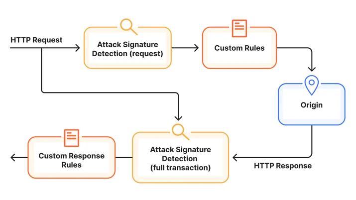
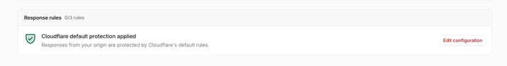
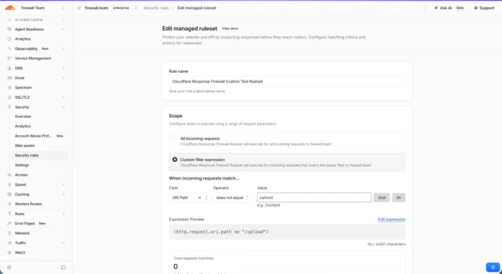
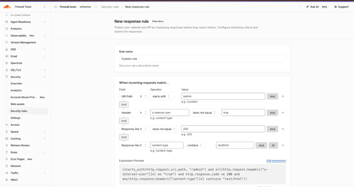

# Introducing full transaction detection for Cloudflare WAF

> **来源**: [https://blog.cloudflare.com/full-transaction-waf](https://blog.cloudflare.com/full-transaction-waf)  
> **作者**: 未知 | **发布时间**: 2026-10-21T14:10:42.412000+00:00  
> **深度调研**: [查看专题调研报告](research.md)  
> **标签**: Web应用防火墙, HTTP事务检测, 响应规则, 攻击检测, 目录穿越, 数据泄露防护

---

## AI 导读

文章要解决的是：仅看进入 WAF 的请求，无法确认一次可疑操作是否真的成功，过宽的请求规则又可能误拦正常流量。Cloudflare 的做法是把请求属性与源站返回的状态码、响应头和检测结果关联起来，用“完整事务检测”判断是否出现利用成功或敏感信息暴露的迹象，再由响应规则在返回给请求者之前替换源站响应。文中以目录穿越读取配置文件为例，说明单独的可疑路径不足以证明泄露，而请求与响应内容同时匹配时可以提高判断依据。平台提供托管规则和最多三个支持 Log、Block 的自定义响应规则，并将检测结果写入可供策略使用的字段。该方案只能阻止响应外泄，不能撤销源站已经执行的操作；当前不能按响应体内容创建规则，部分响应字段仍在逐步开放，文章也没有给出误报率、延迟或覆盖率数据。

---

## 原文整理

# Introducing full transaction detection for Cloudflare WAF


Today, we are expanding our web application firewall (WAF) by adding two new capabilities: full transaction detections and response rules. Full transaction detections evaluate each HTTP request alongside its response to identify evidence of exploitation. It helps answer both "Does this request look malicious?" and "What happened when the application handled it?" Response rules can then block the origin’s response before it reaches the requester.

These are valuable protections because the latest frontier models are uncovering vulnerabilities buried deep in widely used software, giving defenders clarity on what to fix — and attackers new paths to exploit. The recent [<u>php2shell</u>](http://blog.cloudflare.com/php-vulnerabilities-waf-protection/) vulnerability shows the stakes: a flaw in a common software component can put applications across the Internet at risk. AI agents scanning for vulnerabilities can be extremely persistent, adapting payloads using feedback, and chaining vulnerabilities, credentials, and permissions. An application's response can reveal whether an attempt worked and give an attacker information that helps them go deeper.

Inspecting incoming requests remains essential for stopping recognizable attacks before they reach an application. But some threats become clear only when the request is considered alongside what the origin returns. A suspicious input followed by a response exposing sensitive information tells a different story from the same input followed by a rejection or an error.

With these new capabilities, customers can use Cloudflare-managed protections or build their own policies combining request and response properties. This extends our always-on application security framework, with detection results available in Security Analytics to support investigation. Our first managed protections using this capability address the recently disclosed php2shell vulnerability.

And the best part? We are making these new capabilities generally available to all Cloudflare customers, including Free plans.

## Request inspection is not enough

[<u>Cloudflare WAF</u>](https://developers.cloudflare.com/waf/) protects websites and APIs with managed rules, custom rules, and rate limiting. Managed rules provide protection for known attack techniques and vulnerabilities while custom rules let teams create their own policies using parameters such as an IP address, URL path, headers, and request body. These controls operate at the request level to stop exploits or unwanted traffic from reaching the origin.

For many threats, this is the right place to act. However, treating every suspicious request as a confirmed exploit creates a difficult choice. Broad request signatures can catch more potential attacks, but they can also show “false positives”, such as matching legitimate traffic — which then breaks the applications. Deploying only rules that do not trigger false positives reduces that risk, but can leave more room for more ambiguous traffic to reach the server.

The response provides the missing evidence. Cloudflare can now correlate it with the request that produced it, so detections can account for the outcome of the entire HTTP transaction.

As an illustrative example, consider an application that lets users download files. An attacker manipulates the file parameter to request a private configuration file outside the permitted directory:

`GET /download?file=../../config/database.ini`
Request inspection can recognize this path traversal attempt and block it before it reaches the application. The request alone, however, cannot establish whether the application would expose the file. It might reject the request, ignore the traversal, or return an error. If the request reaches the origin, a response like this provides additional evidence:

```
200 OK
Content-Type: text/plain
[database]
username=app_service
password=EXAMPLE_SECRET
```
**Full transaction detection** provides a missing piece: it can correlate the attempted file access with response content characteristic of a private configuration file. Configuration-like text can legitimately appear in documentation or example downloads; combining it with a traversal attempt provides stronger evidence of sensitive data exposure than either signal alone. **A response rule** can then replace the origin response with a Cloudflare WAF block page and HTTP 403 before it reaches the requester, effectively blocking the exploit by preventing sensitive information from reaching the attacker.

## Detection and mitigation are separate by design

Full transaction detection extends the [<u>always-on detection framework</u>](https://blog.cloudflare.com/attack-signature-detection/) we introduced earlier this year. Detections analyze traffic and attach metadata to the request and response, rules then decide what to do with those results.



Separating those jobs gives customers visibility before they design a policy. Security teams can inspect detections in their own traffic, understand which endpoints and signatures are involved, and choose the response that fits their application. Similar to the approach for the request-based [<u>Attack Signature Detection</u>](https://developers.cloudflare.com/waf/detections/attack-signature-detection/), the outcome of the detections are stored in fields that can be accessed in the response custom rules or used in managed detections to block traffic.

Mirroring the request detection fields, the following new fields are added to our platform:

| Field | Description | 
| cf.waf.signature.response.confidence | Confidence values associated with matching signatures | 
| cf.waf.signature.response.categories | Categories associated with matching signatures | 
| cf.waf.signature.response.ref | Signature reference IDs, up to 10 | 

The first full transaction detections focus on exploit confirmation for high profile vulnerability. It correlates suspicious input with response signals that indicate an exploit may have succeeded.

We will expand coverage over time by supporting other use cases, including detecting data exposure and exfiltration signals. This is important for the Internet beyond any one application: defenses can distinguish probing from evidence of impact, while detection of exposed data and services can reach customers that do not have a dedicated security team tuning every WAF rule.

## Create rules on the response

Detecting evidence of exploitation is most useful if you can act on it in real time. Response custom rules turn full transaction detections into inline protection by blocking a matching origin response before it reaches the requester, although it cannot undo actions already performed at the origin.

Security teams can now combine request and response properties with detection results to decide which responses to block. When a blocking rule matches, Cloudflare replaces the origin response with a WAF block page or a custom response.

Response phase controls are available in the Cloudflare dashboard at the bottom of the *Security > Security Rules* page, with both managed protections and custom rules.

We have released both managed and custom rules to all plans, including Free plans. Over time, we will follow the same approach we use for request detections, where managed detections for free plans [<u>focus on high-profile vulnerabilities</u>](https://blog.cloudflare.com/waf-for-everyone/), while paying customers get a richer catalog of detections.

## Managed detections

All customers get the protection of the full array of transaction detections through the *Cloudflare Managed Response Firewall Default* ruleset, which is designed for a simple one-click deploy and simplified configurability. When a signature matches, the managed detection will block the response and return a standard WAF block page.



You can edit the *Cloudflare Managed Response Firewall Default* scope to run detections only on a portion of their applications, for example by excluding or restricting the detection to a specific path. Paying customers can use detection fields in custom response rules to create more tailored policies.



## Custom rules

Custom response rules are designed to give customers full control of the rule logic. A useful rule can stop an administration interface from being exposed when an authentication gateway has not marked the request as internal. For example:

`http.request.uri.path starts_with "/admin" and not http.request.headers["x-internal-user"][0] eq "true" and http.response.code eq 200 and http.response.headers["content-type"][0] contains "text/html"` 

This blocks only when an unauthenticated request targets \`/admin\` and the origin actually returns a successful HTML administration page. It does not block ordinary authentication failures, redirects, or non-administration traffic.



All customers can create up to three custom response rules supporting *Log* and *Block* actions. The fields and functions available in response to custom rules mirrors what your plan gives you access to in [<u>request custom rules</u>](https://developers.cloudflare.com/waf/custom-rules/) already. Creating rules on the response body is not yet available.

Following the [<u>Attack Signature Detection</u>](https://blog.cloudflare.com/attack-signature-detection/) approach, paying customers also have access to the outcome of attack detections through the `cf.waf.signature.response.*`  fields listed above. These fields can be combined with other parameters (such as a hostname, URL path, source IP, request header) to enable protection on a single path, or limit the policy to application-specific context. We are currently rolling out the response fields to all our accounts. If you don’t have access to them yet, please contact your account team.

## Investigating matching requests

When a managed or custom response rule logs or blocks a transaction, the event is available in Security Events. This means responders can trace any detection back to the full context of the request and the specific rule that took action.

At the moment, both request-only rules and full-transaction rules are shown together in the same analytics page. In Security Events, the events generated by response rules are part of the Managed Rules or Custom Rules service. You can filter events belonging to a specific rule ID in the relative rule list section.

## Get started today

Full transaction detection is generally available for all zones proxying traffic through Cloudflare. To verify that you’re protected, go to **Security > Security Rules** in the Cloudflare dashboard. If you want to customize your policy, start by reviewing full transaction detections in Security Analytics, then create the response phase policy that fits your application.
