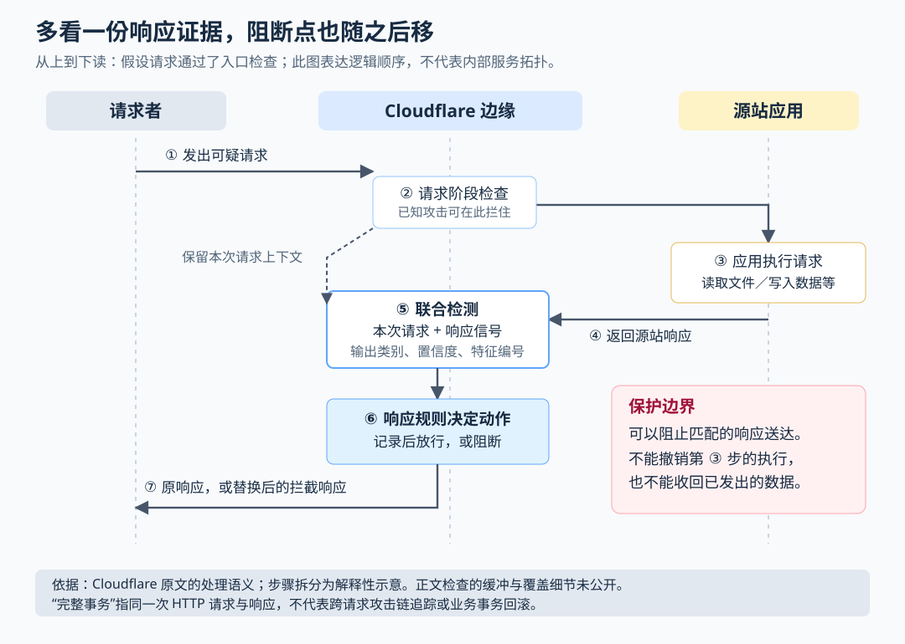

# Cloudflare 如何把请求和响应一起检查：能拦住什么，又拦不住什么

> 来源：[blog.cloudflare.com](<https://blog.cloudflare.com/full-transaction-waf>)  
> 作者：未知 · 发布时间：2026-10-21 22:10（Asia/Shanghai）  
> 翻译正文：[阅读中文正文](article-zh-CN.md)

一个下载接口收到可疑路径后，可能拒绝访问，也可能真的把配置文件交出去。只检查请求，能判断有人在尝试攻击，却未必知道应用返回了什么。Cloudflare 新增的做法是把同一次请求与响应放在一起检查，再由响应规则决定是否把服务器的回复交给请求者。对于“请求本身有歧义、返回内容更能说明问题”的漏洞，这是一层值得关注的补充防护。

但它有一个决定性的时间边界：检查响应时，应用已经处理过请求。它可以阻止某些信息通过这次响应泄露，却无法撤销数据库写入、文件修改或已经执行的命令。

本文以 Cloudflare 于 **2026 年 10 月 21 日**发布的 [Introducing full transaction detection for Cloudflare WAF](https://blog.cloudflare.com/full-transaction-waf/) 为研究主体，结合官方文档与开源项目资料核验。下文把产品声明称为“原文说明”，把其他资料称为“外部补充”，把据此得到的判断标为“分析”或“建议”。核验截至 2026 年 10 月 30 日；未在真实账户上部署，也未进行性能实测。

## 从一个下载请求看，为什么入口检查不够

WAF，即 Web 应用防火墙，是部署在网站或接口前面的流量检查层。它根据路径、请求头、正文等信息识别攻击，必要时阻止请求到达实际处理业务的服务器，也就是“源站”。

原文给出的**说明性例子，并非真实事故记录**是：有人向下载接口发送如下请求，试图通过 `../` 跳出允许访问的目录。这种访问本不应开放的上级目录的行为叫“路径穿越”。

```http
GET /download?file=../../config/database.ini
```

入口规则可以识别这个动作，并在请求进入应用前阻断。但假设请求通过了检查，应用可能返回三种不同结果：

| 应用返回的结果 | 能说明什么 | 不能说明什么 |
| --- | --- | --- |
| 拒绝访问或报错 | 这次响应没有明显交出目标文件 | 不能仅凭错误页认定源站没有受到其他影响 |
| 正常文档或公开示例 | 返回内容可能属于合法业务 | 不能因为出现配置格式就认定泄露 |
| 含数据库账户信息的配置内容 | 与越界读取请求结合后，形成更强的泄露迹象 | 仍需判断是否为真实秘密、示例数据或诱饵 |

原文用下面的响应说明最后一种情况：

```http
200 OK
Content-Type: text/plain

[database]
username=app_service
password=EXAMPLE_SECRET
```

单看请求，是一次越界读取尝试；单看响应，配置格式也可能来自教学文档。两者来自同一次访问，才更有理由判断“应用可能交出了不该交出的内容”。响应规则随后可以用拦截页面和 HTTP 403 状态码替换源站回复，阻止该内容送达请求者。[原文说明](https://blog.cloudflare.com/full-transaction-waf/)

**分析：更多证据不等于自动证明攻击成功。** `200` 只表示应用按自己的逻辑返回了成功状态，并不证明内容敏感；错误状态也不证明攻击失败。联合检测提供的是更有上下文的判断依据，实际准确度仍取决于检测特征和业务语义。

## 核心机制：先产生检测结果，再决定是否阻断

原文把这次能力拆成两部分。**完整事务检测**（full transaction detection）把同一次 HTTP 请求及其响应作为检查对象；这里的“事务”就是这一来一回，不是数据库事务，也没有自动回滚业务操作的含义。**响应规则**则在回复送达请求者前决定动作。

下面按逻辑顺序说明各部分职责。这是依据原文绘制的处理示意，不代表 Cloudflare 内部服务的真实部署拓扑。



首先，请求阶段检查仍然存在。能够明确识别的攻击可以直接在入口拦住，既保护源站，也减少不必要的处理。新能力不要求为了观察结果而主动放行已知攻击。

如果请求继续到达源站，源站会执行应用逻辑并返回响应。检测器把响应信号与本次请求的上下文联系起来，寻找符合攻击特征的组合。原文没有公开具体的上下文存储方式、内部检测算法或匹配实现，因此不能进一步断言它采用了某种模型、缓存结构或跨请求追踪机制。

检测器接着产生附加字段，也就是供规则读取的检测结果。原文列出了三个字段：

| 字段 | 原文给出的用途 |
| --- | --- |
| `cf.waf.signature.response.confidence` | 匹配特征对应的置信度信息 |
| `cf.waf.signature.response.categories` | 匹配特征所属的类别 |
| `cf.waf.signature.response.ref` | 匹配特征的参考编号，最多 10 个 |

这里的“特征”是用来识别某类攻击的匹配条件；“置信度”是产品对这些条件可靠程度的描述，不能自行换算成“攻击成功概率为多少”。作为外部补充，Cloudflare 较早的[请求攻击特征检测说明](https://blog.cloudflare.com/attack-signature-detection/)也把置信度与特征的误报风险联系起来，但不能由此推定响应字段的所有取值和结构都完全相同。

最后，托管规则或用户自定义规则读取这些结果，以及可用的请求、响应属性，选择记录或阻断。托管意味着检测特征和规则由厂商维护；自定义意味着团队自行组合条件。命中阻断动作时，Cloudflare 替换源站响应；规则记录或阻断的事件可在 Security Events 中调查。原文说明，请求规则和响应规则的事件当时仍混合展示，可通过规则编号筛选。[原文说明](https://blog.cloudflare.com/full-transaction-waf/)

**分析：把检测与动作分开，有助于逐步部署。** 团队可以先看某个条件会命中哪些业务，再决定是否阻断。但记录本身不提供阻断效果，团队仍需有人审阅事件、处理例外并推进源站修复。

## 产品开放到哪里，不能只看“所有套餐可用”

按照原文发布时的说明，需要区分三种权限：

- **托管保护：**所有套餐，包括免费套餐，都可使用 `Cloudflare Managed Response Firewall Default` 规则集；命中时阻断响应，可以调整其作用范围。
- **自定义响应规则：**所有客户最多可创建三条，支持 `Log`（记录）和 `Block`（阻断）；能用哪些字段和函数仍受套餐约束。
- **把托管检测结果用于自定义条件：**付费客户可使用上述 `cf.waf.signature.response.*` 字段；原文同时提醒这些字段仍在向账户逐步开放。

最容易误读的一点是：**原文明确说，当时还不能创建检查响应正文的自定义规则。** 托管检测可以利用响应内容信号，不代表用户能自行写“正文包含某个数据库密码格式就拦截”。因此，上面的配置文件例子说明的是检测思路，不能当作已公开、可自行配置的通用配置文件泄露规则。[原文说明](https://blog.cloudflare.com/full-transaction-waf/)

原文称首批托管检测针对 php2shell，其他数据暴露和外传检测是后续扩展方向。其配套的 [php2shell 防护公告](https://blog.cloudflare.com/php-vulnerabilities-waf-protection/)说明，相关响应规则集已向所有套餐自动部署，并继续要求用户修补 PHP。两篇文章都来自同一厂商：它们能支持“产品提供了这类保护”的说法，不能充当独立的拦截效果评测。

本次检索未找到能够独立核对这些新响应字段完整语义的专门文档。因此，上述数量、权限和开放进度按原文发布口径陈述，实际使用前仍要在账户中验证，不能把它理解为全部检测能力永久免费或已对所有账户完全开放。

## 管理页面示例：规则成立之前，身份标记必须可信

原文还给出一个自定义场景：请求访问 `/admin`，没有内部用户标记，而源站却返回 `200` 且内容类型为 `text/html`，就阻断响应。

这个例子说明，可以把“谁来访问”“访问哪个路径”和“应用返回什么”写进同一个条件。但它不能单靠几个字段识别出真实的鉴权失效。

**分析：首先要确认标记是谁写的、何时写的。** 如果外部请求者可以自行发送 `x-internal-user: true`，这个请求头就不能证明身份。即使网关会设置它，也必须确保网关先移除外部同名值，再在完成认证后写入，并且响应规则确实能读取到该可信值。如果标记由 WAF 之后的系统才添加，不能假定 WAF 会看到它。

其次，`200 + text/html` 不等于“返回了管理页面”。登录页也可能以 `200` 返回；而 `/admin` 前缀还会匹配 `/administrator`。这些都是要由应用负责人确认的业务条件，不是防火墙自动知道的事实。

原文的表达式还有一处值得修正：它把 `starts_with` 写在字段与字符串之间，而官方[函数文档](https://developers.cloudflare.com/ruleset-engine/rules-language/functions/#starts_with)使用 `starts_with(字段, 前缀)` 形式。下面仅给出一个**用于测试环境验证的改写示例**，把路径范围收紧为 `/admin` 及其子路径，并明确括号；它尚未经过真实账户编译和运行验证：

```text
(http.request.uri.path eq "/admin"
 or starts_with(http.request.uri.path, "/admin/"))
and not (http.request.headers["x-internal-user"][0] eq "true")
and http.response.code eq 200
and (http.response.headers["content-type"][0] contains "text/html")
```

其中 `[0]` 只取请求头或响应头的第一个值。官方[值类型文档](https://developers.cloudflare.com/ruleset-engine/rules-language/values/#missing-values)说明，缺失的头或越界下标产生缺失值，而不是空字符串。缺失标记、重复标记、大小写变化都应加入测试。更关键的是，只有在可信标记和页面返回约定得到确认后，才值得把这类规则从记录改为阻断。

## 与现有方案相比，真正的代价在哪里

响应检查并非 WAF 领域的新概念。作为外部补充，OWASP 核心规则集（CRS，一套可供兼容防火墙引擎执行的开源攻击检测规则）的[异常评分文档](https://coreruleset.org/docs/2-how-crs-works/2-1-anomaly_scoring/)已经描述了请求和响应分别检测、累积分数后再决定阻断的流程，也明确提醒：响应被拦时，后端已经处理过请求。

因此，更准确的定位是：Cloudflare 在自己的托管平台上增加了请求与响应联合检测及响应阶段策略能力，降低用户自行部署这类链路的工作量。不能据此宣称它首次发明了响应防护。

下表是基于处理位置的**分析比较**，不是同环境性能测试结果。这些做法可以组合使用。

| 做法 | 能提供的保护 | 复杂度、可靠性与团队代价 |
| --- | --- | --- |
| 请求阶段拦截 | 在源站执行前阻止可识别攻击 | 不必等源站响应；规则过宽可能误伤，过窄可能漏过变体 |
| Cloudflare 响应阶段保护 | 增加返回结果这一份证据，可阻断匹配的响应 | 使用托管特征较省维护，但依赖代理链路、厂商覆盖和套餐权限；业务团队仍需确认误报 |
| 自建兼容引擎与 CRS 等规则 | 自行控制检测位置、规则和响应处理配置 | 团队承担升级、容量、缓冲、规则调优与故障排查，开源并不等于没有运维成本 |
| 修补源站代码或运行时、补齐鉴权 | 从原因上阻止越权读取、错误执行等行为 | 需要开发、回归与发布，但能处理响应拦截无法撤销的源站影响 |

性能方面，应先理解等待从哪里来。如果规则依赖尚未收到的正文内容，检查层就需要等待相关数据，不能在作出判断前无条件把它全部发走。Cloudflare 的[响应正文检查文档](https://developers.cloudflare.com/rules/configuration-rules/response-body-inspection/)确认，一些正文检查功能会在边缘保留部分数据，可能增加首字节时间（TTFB，即从发起请求到收到第一个响应字节的等待时间）或延迟逐段交付。该文档是一般性说明，并非这次 WAF 新能力的基准测试。

自建方案也有同类取舍。ModSecurity 的 [v2.x 官方手册](https://github.com/owasp-modsecurity/ModSecurity/wiki/Reference-Manual-%28v2.x%29#secresponsebodylimitaction)提供响应缓冲上限，并允许超限时拒绝或只检查部分内容。前者可能影响正常大响应，后者留下未检查部分。这里仅借其说明设计约束，不能把这些配置或限制套到 Cloudflare 上。

原文没有给出该新能力的延迟增量、吞吐变化、误报率、漏报率、正文检查上限，也没有交代压缩、流式响应及超时情况下的完整处理细节。因此，“更强证据有机会减少误报”是合理机制解释；“误报降低多少”“是否几乎没有性能代价”目前未知。

## 适用条件与失败边界

这类保护适合已经通过 Cloudflare 代理流量、返回结果中存在可识别异常信号的应用，尤其是下载接口、意外暴露的后台入口或厂商已有针对性托管特征的漏洞。团队不必达到大厂流量规模，但至少要有人理解接口语义，能够确认正常返回、审阅事件并快速撤销误伤规则。

以下边界决定了它不能被当成最后一道万能保证：

**源站动作已经发生。** 假设某个有漏洞的接口先修改权限，再返回成功信息，拦下成功页面也不会恢复权限。这个假设用于说明时序；它不是原文报告的事故。对写操作或远程代码执行风险，优先级仍应是入口拦截、权限限制和漏洞修补。

**证据必须经过可见的响应链路。** 假设攻击让服务器把数据发往另一个地址，阻断面向原请求者的响应不等于阻断那次外发。能够直连源站或经其他入口访问的流量，也不受这条代理链路保护。这些是依据部署位置得到的分析结论。

**有异常结果，不代表一定能识别。** 如果泄露内容与正常数据难以区分，或攻击者改变输出形式，现有特征可能没有足够证据。自定义正文规则当时尚未开放，也限制了用户自行补充检测的空间。

**“完整事务”不承诺追踪完整攻击链。** 一次请求和一次响应的联合判断，不自动等于关联多个账户、多个请求或后续命令执行。未命中只能说明当前可用检测没有触发，不能证明源站安全。

**持续流式输出需要单独验证。** 流式输出是服务器不断分段发送内容的交付方式。如果业务要求数据立即送达，而检测又必须等待后面的内容，两者就存在冲突。已发出的数据无法收回；本次资料不足以说明新能力对各种流式协议的具体保证。

## 小团队可以怎样做一次最小验证

建议把第一次实践限定在**一个测试域名、一个无真实秘密的接口、一条自定义响应规则**。先验证规则能否按预期读取字段、区分返回结果，再决定是否扩大范围。不要为了展示检测效果在生产环境部署真实漏洞。

**第一步，确认链路与目标。** 检查测试域名确实经过 Cloudflare 代理，确认托管响应规则的状态，以及账户是否具备需要的字段和动作。为测试接口关闭缓存，以便先验证源站响应路径；正式业务使用缓存时，再补测缓存命中等实际路径。写清目标，例如“测试接口在不满足访问条件却返回 HTML 成功页时应触发规则”，不要写成“验证系统不会被攻破”。

**第二步，建立可重复的返回样本。** 用一个受控测试接口返回预设的 `200 HTML`、拒绝状态、重定向和非 HTML 内容。如果使用内部用户标记，先验证其可信来源与可见顺序。以下均为建议测试用例，不是实测结果：

| 测试输入与返回 | 要验证的行为 |
| --- | --- |
| 范围内路径、无可信标记、`200 HTML` | 记录阶段应命中；阻断阶段应收到替换响应 |
| 范围内路径、有可信标记、`200 HTML` | 这条规则不应阻断 |
| 范围内路径、无可信标记、拒绝状态或重定向 | 这条规则不应命中 |
| 范围内路径、无可信标记、`200` 非 HTML | 这条规则不应命中 |
| 范围外路径，以及缺失、重复、伪造的标记 | 路径边界正确；伪造值不能变成可信身份 |

这些样本验证的是自定义规则逻辑，**不能验证 php2shell 托管特征的检出率**。随意返回一段形似配置的文本，也不能证明托管检测应当命中。

**第三步，先记录，再小范围阻断。** 对新增自定义规则先使用 `Log`，由应用负责人复核命中样本；确认条件后，才在测试范围改为 `Block`。核对客户端实际收到的状态、响应头和正文，并按规则编号在 Security Events 查找事件。源站同时记录一次无敏感信息的测试动作，可以直观看到：响应虽然被阻断，源站动作仍可能已经完成。

**第四步，用明确指标决定是否保留。** 至少记录测试用例通过数与总数、已复核命中中的误报比例、接口成功率，以及启用前后的首字节时间和总响应时间。比较延迟时保持响应大小、缓存状态和网络条件尽量一致；同时保留样本量，避免用少量结果声称“零误报”。没有已知攻击样本集，就不能估算真实漏报率。

退出条件应在启用前写好：关键正常用例被阻断且无法快速收紧条件、身份标记的可信链路无法建立、响应交付超过业务已有预算，或目标必须依赖当时不支持的自定义正文检查，都应暂停扩大范围。撤销时只回退本次新增规则，并保留原有防护；同时把问题转向源站鉴权、代码修复或更适合的检查位置。

这项能力最有价值的使用方式，是让“看起来像攻击”与“应用返回了异常结果”相互印证，并在可能时截住返回内容。是否值得部署，最终取决于你的接口能否提供可靠证据、团队能否处理误报，以及你是否清楚：响应被拦住，并不意味着源站没有受影响。
