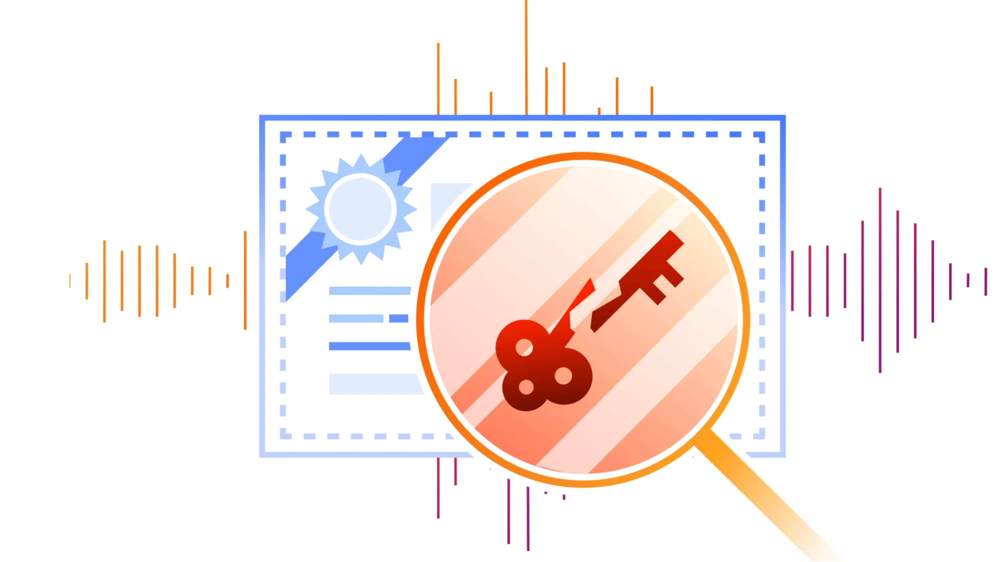

# 8 张 eMudhra 证书已遭攻破。以下是你需要了解的信息

> **来源**: [https://blog.cloudflare.com/emudhra-certificate-compromise](https://blog.cloudflare.com/emudhra-certificate-compromise)  
> **作者**: 未知 | **发布时间**: 2026-10-20T22:20:16.524000+00:00  
> **深度调研**: [查看专题调研报告](research.md)  
> **标签**: TLS, WebPKI, 证书信任库, 证书撤销, Cloudflare, 容器安全

---

## AI 导读

文章称，八张 eMudhra 中间证书关联的私钥存在安全问题，攻击者可能据此伪造任意域名的证书，冒充服务器并截取或修改流量。问题涉及证书对服务器身份的认证，而非传输层安全协议（TLS）加密算法本身。Cloudflare 表示已更新关键服务、共享信任库和基础镜像，并通过重载、重启或重新部署使更新生效；应用自带或自行配置的信任库则需要单独处理。这里的信任库是软件用于判断哪些证书签发机构可信的配置集合。

客户侧需要按产品升级客户端和隧道程序，检查用于校验客户端身份的证书配置、源站证书，以及容器镜像和应用依赖。开发者还应确认应用究竟由网络请求库、语言运行环境还是操作系统执行证书校验；只升级软件开发工具包（SDK），未必能改变底层校验规则。更新后出现证书错误时，文章提醒不要通过关闭校验来消除错误。

修复应沿应用实际建立安全连接时使用的校验机制进行验证，浏览器或 curl 命令行工具测试成功，不能证明使用其他校验机制的后台服务也已受到保护。Cloudflare 的安全审查尚未在自身服务中发现正在发生的利用行为，但这不代表其他环境没有受到攻击。正文未给出八张证书的具体标识、密钥薄弱的技术原因及可复现的测试结果，因而更适合作为更新和排查指南，不能替代完整的事件根因分析。

---

## 原文整理

# 8 张 eMudhra 证书已遭攻破。以下是你需要了解的信息

2026 年 10 月 19 日约 17:00 UTC，Cloudflare 获悉，与八张 eMudhra 中间证书关联的私钥已遭攻破。这些证书受到浏览器、操作系统以及 Cloudflare 内部系统的广泛信任。由于密钥本身薄弱，攻击者可以为任意域名伪造证书，并用它冒充服务器，截取或修改流量。这是一起影响遍及互联网的严重安全事件。如需参考， [<u>可访问此链接</u>](https://www.cloudflare.com/learning/ssl/what-is-an-ssl-certificate/) ，进一步了解 SSL 证书如何工作，以及它们为何对互联网的运行如此关键。

我们立即优先为 Cloudflare 各处的关键服务修补漏洞，以便在漏洞公开披露前保护客户。我们的安全审查尚未发现有人正在 Cloudflare 服务上利用这一问题。

我们已为 Cloudflare One Clients（也称为 WARP 或 1\.1\.1\.1 应用）和 Cloudflare Tunnel（也称为 cloudflared）发布更新。我们还在 CDN、Developer 和 Zero Trust 产品中部署了缓解措施。如果你使用的是配备 Gateway 的 Cloudflare Zero Trust，并且客户端已更新至最新版本（见下文），你就已自动受到保护。

## 我们的应对措施

我们优先更新了使用公共证书验证远端身份的服务，包括连接源站的代理和调用外部 API 的应用。同时，我们更新了共享信任库、基础镜像及其他共享基础组件，让从这些来源继承证书信任配置的服务能够通过统一的方式缓解风险。我们还配合这些更新进行了必要的重新加载、重启和镜像部署，使更新生效。对于自带信任库或使用自定义信任库的应用，我们另行进行了评估和更新。这些工作解决的是基于证书的身份认证问题，而非 TLS 加密算法的弱点。

Cloudflare 各团队目前正在进一步开展修复工作。我们正在取得进展，但仍有大量工作要做。 **部分客户需要调整自己运维的软件或信任配置，尤其是源站服务器上的软件或配置。** 建议采取的措施汇总如下。

## 客户应采取的措施

| **以下软件或服务的用户** | **客户应采取的措施** Cloudflare One/WARP：Cloudflare One Client：升级至 v2\.5\.6（Android）、v1\.12\.16（iOS）、 [Windows 桌面版（2026\.8\.2115\.0）](https://downloads.cloudflareclient.com/v1/download/windows/version/2026.8.2115.0)、 [macOS（2026\.8\.2115\.0）](https://downloads.cloudflareclient.com/v1/download/macos/version/2026.8.2115.0)、 [Linux（2026\.8\.2115\.0）](https://downloads.cloudflareclient.com/v1/download/almalinux10-arm/version/2026.8.2115.0) 1\.1\.1\.1 应用：升级至 v6\.38\.10（Android）、v6\.31\.7（iOS）、 [Windows 桌面版（2026\.8\.2115\.0）](https://1111-releases.cloudflareclient.com/win/latest)、 [macOS（2026\.8\.2115\.0）](https://1111-releases.cloudflareclient.com/mac/latest)、 [Linux（2026\.8\.2115\.0）](https://pkg.cloudflareclient.com/) Cloudflare Tunnel（cloudflared）： [升级至 2026\.10\.2](https://github.com/cloudflare/cloudflared/releases)。对于容器部署，请更新并重新部署已修复的镜像。客户配置的 TLS 客户端身份认证：检查并更新用于验证客户端证书的双向 TLS 信任库或已上传的 CA。客户的源站 TLS 服务器配置：请检查自定义源站证书和服务器配置，适用于使用 [完全（严格）](https://developers.cloudflare.com/ssl/origin-configuration/ssl-modes/full-strict/) 加密模式或 [严格](https://developers.cloudflare.com/ssl/origin-configuration/ssl-modes/ssl-only-origin-pull/) 模式的情况。我们正在更新 [Automatic SSL/TLS](https://blog.cloudflare.com/introducing-automatic-ssl-tls-securing-and-simplifying-origin-connectivity/) ，以便在你仍使用这些已不受信任、会导致服务故障的证书时自动发出通知。Cloudflare Containers：使用 Cloudflare Containers（包括 Sandboxes）的客户应检查容器镜像和应用依赖中是否存在受影响的证书信任库，并根据已部署的镜像应用更新。客户还可以启用 [HTTPS 出站流量拦截](https://developers.cloudflare.com/containers/configuration/outbound-traffic/#https-traffic) ，让出站 HTTPS 请求经过 Cloudflare，将远程服务器证书的验证工作从应用转移到 Cloudflare 管理的基础设施。这样，Cloudflare 对信任库采取的缓解措施就能保护被拦截的连接。已启用此功能的容器已经受到保护。 

## 开发者指南

开发者需要检查 SDK 底层的机制。

API 客户端可能会将证书验证交给 HTTP 库、语言运行时、操作系统，或通过自定义信任配置来完成。仅更新 SDK，可能不会改变底层的验证策略。

应用补丁后，你可能会在仪表板中看到证书错误。 **务必不要通过禁用验证来消除这些错误。** 那样会移除这些更新旨在恢复的身份认证保护。

这起事件影响了许多依赖 WebPKI 进行身份认证的软件栈。Mozilla 的 Dennis Jackson 通过众人协作整理了 [<u>一份常用软件包清单</u>](https://emudhra.we-have-a-problem.com/) ，其中的软件包均已修补。我们建议读者尽快升级。（注意，其中一些软件包可能是你的软件栈的间接依赖，因此请检查依赖树。）更新相关依赖，重新构建受影响的镜像，并确认应用是否需要重新加载、重启或重新部署。

Dennis Jackson 的 [<u>测试网站</u>](https://emudhra.we-have-a-problem.com/) 提供浏览器检查、非浏览器测试说明和软件包更新信息。测试结果仅适用于所测试的验证路径，不能代表设备上的所有应用。请通过应用实际使用的 TLS 路径进行验证。浏览器测试成功，并不能证明后台服务受到保护。如果应用使用了不同的证书验证组件，curl 测试成功同样不能证明这一点。

## 时间线

截至目前的事件时间线如下。

日期和时间；事件。10 月 19 日约 17:00 UTC：Cloudflare 获悉证书遭到攻破，并开始评估。10 月 20 日 02:00 UTC：面向各平台的 Cloudflare One Client 和 WARP 应用安全更新发布（iOS 上的 Cloudflare One Agent 除外，其应用审核仍未完成）。10 月 20 日 09:15 UTC：Cloudflare Tunnel（cloudflared）安全更新发布。10 月 20 日 19:20 UTC：CDN 和服务端 Zero Trust 的缓解措施全部部署完毕。 

## 展望未来

这起事件给各方带来的影响并不相同。浏览器维护者只需切换一个开关，就能修复问题。当然，他们只需更新 *一个* 应用，而不是数百个，但他们确实还有一个巧妙的办法：大多数浏览器都使用快速撤销机制（如 Chrome CRLSets）。在 Cloudflare，我们也在部分产品中使用了这样的机制。为了让 Cloudflare 及整个行业的更多系统都能用上这种机制，我们很期待 [<u>upki</u>](https://discourse.ubuntu.com/t/an-update-on-upki/77063) 这类项目的发展。这些项目认识到，信任库不能只是一份静态的根证书颁发机构列表，而需要能够快速更新，纳入撤销信息和证书透明度密钥等内容。
