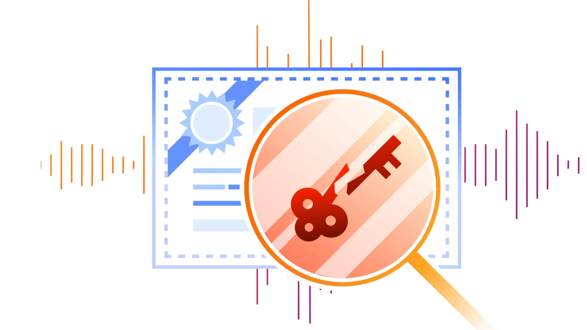

# 8 eMudhra certificates are compromised. Here's what you need to know

> **来源**: [https://blog.cloudflare.com/emudhra-certificate-compromise](https://blog.cloudflare.com/emudhra-certificate-compromise)  
> **作者**: 未知 | **发布时间**: 2026-10-20T22:20:16.524000+00:00  
> **深度调研**: [查看专题调研报告](research.md)  
> **标签**: TLS, WebPKI, 证书信任库, 证书撤销, Cloudflare, 容器安全

---

## AI 导读

文章称，八张 eMudhra 中间证书关联的私钥存在安全问题，攻击者可能据此伪造任意域名的证书，冒充服务器并截取或修改流量。问题涉及证书对服务器身份的认证，而非传输层安全协议（TLS）加密算法本身。Cloudflare 表示已更新关键服务、共享信任库和基础镜像，并通过重载、重启或重新部署使更新生效；应用自带或自行配置的信任库则需要单独处理。这里的信任库是软件用于判断哪些证书签发机构可信的配置集合。

客户侧需要按产品升级客户端和隧道程序，检查用于校验客户端身份的证书配置、源站证书，以及容器镜像和应用依赖。开发者还应确认应用究竟由网络请求库、语言运行环境还是操作系统执行证书校验；只升级软件开发工具包（SDK），未必能改变底层校验规则。更新后出现证书错误时，文章提醒不要通过关闭校验来消除错误。

修复应沿应用实际建立安全连接时使用的校验机制进行验证，浏览器或 curl 命令行工具测试成功，不能证明使用其他校验机制的后台服务也已受到保护。Cloudflare 的安全审查尚未在自身服务中发现正在发生的利用行为，但这不代表其他环境没有受到攻击。正文未给出八张证书的具体标识、密钥薄弱的技术原因及可复现的测试结果，因而更适合作为更新和排查指南，不能替代完整的事件根因分析。

---

## 原文整理

# 8 eMudhra certificates are compromised. Here's what you need to know

On October 19, 2026, at approximately 17:00 UTC, Cloudflare became aware that private keys associated with eight eMudhra intermediate certificates were compromised. These certificates were widely trusted by browsers, operating systems, and also within Cloudflare. Because the keys themselves are weak, an attacker can create a forged certificate for any domain and use it to impersonate servers to intercept or modify traffic. This is a serious security incident with implications across the Internet. For reference, [<u>here is a link</u>](https://www.cloudflare.com/learning/ssl/what-is-an-ssl-certificate/) to more information about how SSL certificates work and why they are so critical to the operation of the Internet.

We immediately prioritized patching critical services across Cloudflare to protect our customers ahead of the public disclosure of the vulnerability. Our security review has not identified active exploitation of this issue on Cloudflare services.

We have released updates for the Cloudflare One Clients, also known as WARP or the 1.1.1.1 app, and Cloudflare Tunnel, also known as cloudflared. We have also deployed mitigations across our CDN, Developer, and Zero Trust products. If you are using Cloudflare Zero Trust with Gateway and an up-to-date client (see below), you are automatically protected.

## Our response

We prioritized updating services that use public certificates to authenticate remote endpoints, including proxies connecting to origins and applications calling external APIs. In parallel, we updated shared trust stores, base images, and other shared foundations, providing a common mitigation path for services that inherit their certificate trust from those sources. We paired these updates with reloads, restarts, and image deployments needed to activate them. Applications with bundled or custom trust stores received separate assessment and updates. This work addresses certificate-based authentication, not a weakness in TLS’s encryption algorithms.

Teams across Cloudflare are presently working on further remediation. We are making progress, but there's much work still to be done. **Some customers will need to take action on software or trust configurations that they operate, especially on their origin servers.** The recommended actions are summarized below.

## What customers should do

| **Users of these software or services** | **Action the customer should take** | 
| Cloudflare One/WARP | Cloudflare One Client: Upgrade to: v2.5.6 (Android), v1.12.16 (iOS), [Windows Desktop (2026.8.2115.0)](https://downloads.cloudflareclient.com/v1/download/windows/version/2026.8.2115.0), [macOS (2026.8.2115.0)](https://downloads.cloudflareclient.com/v1/download/macos/version/2026.8.2115.0), [Linux (2026.8.2115.0)](https://downloads.cloudflareclient.com/v1/download/almalinux10-arm/version/2026.8.2115.0) 1.1.1.1 app: Upgrade to: v6.38.10 (Android), v6.31.7 (iOS), [Windows Desktop (2026.8.2115.0)](https://1111-releases.cloudflareclient.com/win/latest), [macOS (2026.8.2115.0)](https://1111-releases.cloudflareclient.com/mac/latest), [Linux (2026.8.2115.0)](https://pkg.cloudflareclient.com/) | 
| Cloudflare Tunnel (cloudflared) | [Upgrade to 2026.10.2](https://github.com/cloudflare/cloudflared/releases). For container deployments, update and redeploy the fixed image | 
| Customer-configured TLS client authentication | Review and update your mutual TLS trust store/uploaded CAs used to verify client certificates | 
| Customer Origin TLS Servers configuration | Review your custom origin certificates and server configurations if using [Full (strict)](https://developers.cloudflare.com/ssl/origin-configuration/ssl-modes/full-strict/) encryption mode or [Strict](https://developers.cloudflare.com/ssl/origin-configuration/ssl-modes/ssl-only-origin-pull/) mode. We are updating [Automatic SSL/TLS](https://blog.cloudflare.com/introducing-automatic-ssl-tls-securing-and-simplifying-origin-connectivity/) to automatically notify you if you still use these distrusted certificates, which would cause breakages. | 
| Cloudflare Containers | Customers using Cloudflare Containers, including Sandboxes, should review their container images and application dependencies for affected certificate trust stores and apply updates based on your deployed image. Customers can also enable [HTTPS egress interception](https://developers.cloudflare.com/containers/configuration/outbound-traffic/#https-traffic) to route outbound HTTPS requests through Cloudflare, moving remote-server certificate validation from the application to Cloudflare-managed infrastructure. This allows Cloudflare’s trust-store mitigations to protect intercepted connections. Containers that have this enabled are already protected. | 

## Developer guidance

For developers, look beneath the SDK.

An API client may delegate certificate verification to an HTTP library, a language runtime, the operating system, or a custom trust configuration. Updating the SDK alone may not change the underlying policy.

Once you patch, you may notice certificate errors in your dashboards. **It's important to not resolve these errors by disabling verification.** That would remove the authentication protection these updates are intended to restore.

This incident affects many software stacks that rely on the WebPKI for authentication. Mozilla’s Dennis Jackson has crowdsourced [<u>a list of commonly used packages</u>](https://emudhra.we-have-a-problem.com/) that have been patched. We advise readers to upgrade as soon as possible. (Note that some of these may be indirect dependencies of your software stack, so look at the dependency tree.) Apply the relevant dependency updates, rebuild affected images, and confirm whether applications require a reload, restart, or redeployment.

Dennis Jackson’s [<u>test site</u>](https://emudhra.we-have-a-problem.com/) provides browser checks, non-browser testing instructions, and package update information. Results apply to the verification path being tested, not every application on the device. Validate through the application’s actual TLS path. A successful browser test does not prove that a background service is protected. Neither does a curl test if the application uses a different verifier.

## Timeline

The timeline of events so far is below.

| Date and Time | Event | 
| October 19, approximately 17:00 UTC | Cloudflare becomes aware of the compromise and begins assessment. | 
| October 20, 02:00 UTC | Cloudflare One Client and WARP app security updates published across platforms (except Cloudflare One Agent on iOS, for which app review is still pending). | 
| October 20 09:15 UTC | Cloudflare Tunnel (cloudflared) security update published. | 
| October 20 19:20 UTC | CDN and server-side Zero Trust mitigations fully deployed. | 

## Looking forward

The impact of this incident is not felt equally. Browser maintainers were able to remediate the issue with a flip of a switch. They of course have just *one* application to update, instead of hundreds, but they do have a neat trick up their sleeves: most browsers use quick-revocation mechanisms (like Chrome CRLSets). At Cloudflare we also use such a mechanism for some of our products. To bring it to more systems at Cloudflare and industry, we’re excited about projects like [<u>upki</u>](https://discourse.ubuntu.com/t/an-update-on-upki/77063) that understand a trust store can’t be a static list of root certificate authorities, but needs the ability to be quickly updated with information like revocation and certificate transparency keys.
