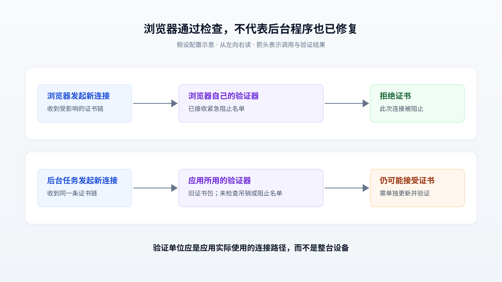

# eMudhra 证书事件：为什么浏览器修好了，后台程序仍可能信错服务器

一台电脑上的浏览器已经拒绝危险证书，后台程序却仍可能把攻击者当成真正的服务器。eMudhra 事件暴露的正是这种差异：停止信任一把已经不安全的证书签名密钥，需要把新规则送到每个实际验证连接的程序里。对运行容器、调用外部接口，或通过代理连接源站的团队，这件事值得单独检查，不能只以“操作系统已更新”结案。

本文以 Cloudflare 的[原文《8 eMudhra certificates are compromised. Here's what you need to know》](https://blog.cloudflare.com/emudhra-certificate-compromise)为主体，结合浏览器维护方披露、协议标准和项目文档核验。资料查阅截至 **2026 年 10 月 31 日**。下文将厂商自己的处置描述标为“原文披露”，将其他资料标为“外部证据”；场景假设、机制分析和实践建议分别说明。本文未开展生产环境测试，也不把厂商声明视为独立审计结论。

## 1. 出问题的是谁有资格证明服务器身份

访问一个 HTTPS 地址时，客户端要同时解决两件事：让传输内容难以被旁观者读取，以及确认连接对面的确是目标服务器。TLS，即保护网络连接的传输层安全协议，负责这些工作；证书主要参与第二件事。

证书把域名和一把公开密钥绑定起来，由证书颁发机构（CA）签名确认。客户端通常不直接认识每个网站，而是预先信任少数根 CA，再沿着“根 CA → 中间 CA → 网站证书”的签名关系验证身份。中间 CA 是获准继续签发证书的机构或签发层级。因此，网站私钥出问题和中间 CA 私钥出问题，影响范围很不一样：后者可能被用来为许多不属于攻击者的域名签发证书。

**原文披露：**Cloudflare 在 10 月 19 日约 17:00 UTC 得知八张 eMudhra 中间证书关联的私钥失陷，随后更新服务和客户端。其安全审查当时没有发现 Cloudflare 服务遭到主动利用。这句话只说明其调查范围内的发现，不能扩展成“整个互联网都没有遭到攻击”。

**外部证据补充了两个重要限定：**Mozilla 的[事件记录](https://bugzilla.mozilla.org/show_bug.cgi?id=2083449#c0)确认，八张中间证书中六张用于 TLS，两张用于代码签名；因此，不能把八张都说成浏览器用来验证网站的证书。Mozilla 还独立恢复了受影响私钥，说明风险并不依赖某个研究者继续保密。

这也解释了为什么“我们的域名没有使用 eMudhra 证书”不足以排除风险。客户端若仍信任受影响签发路径，攻击者可以拿伪造证书冒充别家的域名。风险来自**客户端愿意相信谁的签名**，并不限于服务器原来向谁购买了证书。

## 2. 一个后台任务为什么会漏掉修复

假设一个小团队有一个容器中的 Python 定时任务，每晚向供应商接口提交订单；开发者用浏览器检查过安全测试页，结果显示连接已被阻止，于是认为问题已经解决。

但容器中的任务可能通过 Requests——一个 Python HTTP 请求库——发送请求。Requests 的[官方文档](https://requests.readthedocs.io/en/latest/user/advanced/#ca-certificates)说明，它使用 certifi 提供的 CA 证书集合，也允许通过参数或环境变量指定另一份证书文件。开发者的浏览器、容器内的 Requests 和自定义证书文件，可能根本没有采用同一套规则。

在这个**假设场景**中，攻击还需要其他条件：攻击者必须有办法把该任务的连接引向自己，例如控制网络路径或域名解析结果；客户端必须接受伪造证书的签发路径，而且没有其他机制将其拒绝。满足这些条件时，过程才会继续：

1. 攻击者生成自己控制的网站密钥，并用失陷的中间 CA 密钥为目标域名签发证书。
2. 后台任务连接到攻击者的服务器，收到这张证书及其中间证书。
3. 旧验证规则认为签名链有效，域名也匹配，于是接受连接。
4. 任务与攻击者建立加密连接，再把订单或接口凭据发送给攻击者。

这时连接仍然“加密”，只是加密连接的另一端认错了人。攻击者不需要破解传输加密算法。

下图从左向右阅读，箭头表示应用调用验证器及其结果；它展示的是上述假设配置，不是对所有浏览器或 Python 部署的统一判断。



另一个容易混淆的问题是历史流量。中间 CA 私钥失陷，不等于拿到了所有网站的私钥，更不等于能够解密所有已经录下来的连接。对正确使用临时密钥交换的 TLS 1.3 连接，前向保密——长期身份密钥后来泄露也不应暴露过去的会话密钥——提供了相应保护。它不能阻止攻击者在客户端仍信任危险证书时冒充服务器建立新连接。[TLS 1.3 标准的安全分析](https://www.rfc-editor.org/rfc/rfc8446.html#appendix-E.1)明确区分了这些保证及其条件。

## 3. 真正的修复要改变验证决定

### 证书签名有效，不代表现在仍应信任

客户端验证证书时，需要沿签名关系找到本地接受的信任起点，检查有效期、签发权限和相关约束；网站连接还要匹配请求的主机名。这种沿证书链检查的过程称为“证书路径验证”。[RFC 5280](https://www.rfc-editor.org/rfc/rfc5280.html#section-6)规定了路径验证及吊销列表处理的基础规则。

这里有一个关键因果：密钥失陷后，攻击者签出的证书可以在数学上通过签名检查。要拒绝它，客户端必须获得额外信息，例如“这把签发密钥已不再可信”，并在验证时执行这条规则。

吊销就是在原定到期时间之前撤销证书的可信状态。CA 可以发布证书吊销列表（CRL），也可以通过在线证书状态协议（OCSP）提供查询。但“发布了吊销”与“客户端执行了吊销检查”是两步。客户端可能根本不查询，也可能在查询失败时继续连接；后一种行为保住了可用性，却无法在攻击者阻断查询时保证拒绝危险证书。

### 浏览器的优势是另一条更新通道

Chrome 的 CRLSets 是一套可快速分发的证书阻止数据。[Chromium 官方说明](https://www.chromium.org/Home/chromium-security/crlsets/)指出，它主要用于紧急阻止证书，并不代表收录了全球全部吊销记录；Chrome 通常也不逐次执行在线 OCSP 或 CRL 查询。

因此，原文所说浏览器可以迅速处置，不能理解成“所有 TLS 程序天然具备同样能力”。浏览器维护方控制验证器，也控制阻止数据的分发；只拿到根证书集合的下游程序，可能完全没有继承这条更新通道。

还有一个细节会影响修复是否完整：**交叉签名**，即不同 CA 为同一个中间 CA 公钥签发证书，让它能连接到不同信任根。同一把危险密钥可能因此拥有不止一条可接受路径。

**外部证据：**Chrome 根证书项目在[公开处置说明](https://groups.google.com/a/mozilla.org/g/dev-security-policy/c/0R3XLJL6FuE)中表示，它按 SPKI 哈希阻止六把受影响的 TLS 签发公钥。SPKI 是证书中表示公钥及其算法的结构；按它识别密钥，可以同时覆盖共享该密钥的原证书和交叉签名证书。

由此可得一个工程判断：若只删除某一张中间证书文件，却没有检查其他签发路径，不能据此认定风险已经消失。普通应用应优先使用维护方提供的完整修复，不宜自己凭证书名称拼凑黑名单。

### 证书透明度增加了发现机会，不能替代停止信任

证书透明度（CT）要求公开可信的网站证书进入可审计日志；执行相应政策的客户端会要求证书提供符合规则的日志证明。这让伪造证书更难在无人知晓的情况下被使用。

上述 Chrome 说明称，在 10 月 17 日阻止这些密钥前，没有通过相关中间 CA 签发的网站证书进入其依赖的 CT 日志，因此默认执行该政策的 Chrome 不会信任这些证书。这个结论有明确范围：不能外推到没有执行 CT 的后台客户端，也不能推断所有部署历史上都安全。

机制上，CT 解决的是公开可见性和日志准入问题。攻击者若能取得符合客户端政策的日志证明，仍需靠吊销或阻止规则拒绝已失陷的签发密钥。

## 4. Cloudflare 的处置为什么既要更新，又要重启

**原文披露的处置分成三层。**服务团队先修复那些需要验证远端证书的连接，例如代理回源和应用调用外部接口；平台团队更新共享信任库与基础镜像；自带证书库或自定义信任配置的应用另行检查。随后通过重载、重启或重新部署，让新规则真正生效。

这几层的职责不能互相替代。基础镜像只影响从它重新构建出来的镜像；镜像已经发布，也不代表旧容器已经被替换；磁盘文件已经替换，也不代表长期运行的进程已经重新载入。具体是否必须重启取决于实现，但必须确认生效方式。

对小团队，最值得借鉴的是责任划分：平台维护者负责提供修复后的公共基础，应用维护者负责确认实际采用的验证器和覆盖配置，服务负责人负责验证合法业务连接。团队规模小时，一个人可以兼任这些角色，检查项仍应分别完成。

原文中的客户动作也各有范围：

| 使用位置 | 原文要求及其含义 |
| --- | --- |
| Cloudflare One、WARP、1.1.1.1 客户端 | 按产品和平台安装包含修复的版本；不能用一个产品的版本号判断另一个产品 |
| Cloudflare Tunnel，即 cloudflared | 原文要求升级到 2026.10.2；容器部署还要更新镜像并重新部署 |
| Cloudflare 到源站的严格验证连接 | 检查源站证书链；若依赖被停止信任的路径，应更换合法证书链 |
| 双向 TLS（mTLS，即双方都用证书证明身份） | 检查用来验证客户端证书的信任配置，不能只检查网站服务器证书 |
| 自行运行的容器和应用 | 检查镜像、运行时、依赖及自定义证书库，确认更新到达实际进程 |

[cloudflared 2026.10.2 发布页](https://github.com/cloudflare/cloudflared/releases/tag/2026.10.2)可以核对该版本及下载校验信息；发布页存在本身不能证明某个部署已完成修复。原文给出的是事件处置版本，实际升级应继续核对对应平台的官方公告和后续受支持版本。

## 5. 几种修复方式付出的代价不同

下面是依据验证机制作出的**设计分析**，不是各方案的性能测试。现有资料没有给出可以横向排名的延迟、吞吐或运维成本数据。

| 方式 | 为什么有效 | 主要代价与失败边界 |
| --- | --- | --- |
| 精确阻止危险公钥或中间证书 | 保留其他合法路径，只拒绝已知危险对象 | 验证器必须支持并执行阻止规则；按证书阻止时要覆盖交叉签名版本 |
| 从信任库移除相关根 | 让依赖该根的路径无法通过验证，适合缺少精确阻止能力的客户端 | 可能连带拒绝正常网站；若还有另一条受信路径，仍需另行处置 |
| 在线检查吊销状态 | 在验证时读取最新状态 | 增加外部依赖；查询失败就拒绝会影响可用性，失败后放行则留下安全缺口 |
| 后台同步吊销或阻止数据，本地查询 | 不必每次连接都访问状态服务 | 要维护更新来源、数据新鲜度和同步失败策略，并接入每个相关验证器 |
| 由出口代理统一验证远端证书 | 把部分更新工作集中到代理 | 只覆盖经过它的连接；终止并重建 HTTPS 时，代理成为可见明文的信任点，增加隐私、兼容性和故障集中风险 |

原文提到的容器 HTTPS 出口拦截属于最后一类。它可以把远端证书验证交给 Cloudflare 管理，但保护范围取决于流量是否实际经过该路径，不能顺带覆盖直连出口。

原文还看好 upki。其[项目文档](https://github.com/rustls/upki#revocation)描述的方向是：定期同步基于 CRLite 的吊销数据，再由命令行、C 接口或 TLS 库集成进行查询。CRLite 是把大规模吊销信息组织成紧凑、可分发数据的技术。这里的重要步骤是“集成”：装上工具或运行一次检查，不会自动改变其他应用的连接决定。

[Ubuntu 的项目进展文章](https://discourse.ubuntu.com/t/an-update-on-upki/77063)在 2026 年 2 月介绍了早期架构，也把性能测试和生态集成列为后续工作。因此，不能把其中计划当成所有 Linux 发行版已经默认启用的事实。当前项目文档同样把 CT 执行列为后续目标。对小团队，更稳妥的顺序是先完成已发布的修复，再在测试环境评估新验证基础设施。

## 6. 深入一点：384 位密钥为什么仍然可能轻易失守

不需要掌握椭圆曲线密码学也能理解核心问题：密钥的安全性既取决于算法，也取决于生成时到底选了什么秘密值。

**外部证据：**Mozilla 在[初步调查的第 5 条评论](https://bugzilla.mozilla.org/show_bug.cgi?id=2083449#c5)中指出，受影响的 P-384 私钥整数都小于 256。P-384 是一种使用约 384 位参数的椭圆曲线算法；这些密钥虽然装在正常格式里，实际可选秘密值却极少。

椭圆曲线公钥满足 `Q = dG`：`d` 是私钥整数，`G` 是公开固定点，`Q` 是证书里的公钥。正常生成时，`d` 应从巨大范围中随机选择，从 `Q` 反求 `d` 很困难；如果已经知道 `d` 只有极少数候选值，就能计算这些候选对应的公钥并比较。找到匹配项便恢复了私钥。

这说明，检查“证书写着 P-384”“签名能够验证”并不能证明密钥生成正确。事件涉及的是具体生成结果的严重缺陷，不能推论为 P-384 算法普遍失效。

密钥为何在组织流程中被生成为这些值、哪些审计环节未发现问题，需要进一步的调查材料。本文核验到的证据足以说明弱密钥可被恢复，不能据此编造完整的内部根因链，也不能把持钥证明误称为实际攻击证明。

## 7. 个人或小团队怎样做最小验证

以下是**实践建议**。先选择一个会访问外部 HTTPS 服务的真实后台应用，完成一条路径的盘点、更新和验证，再扩展到其他服务；无须先建设大型证书管理平台。

### 先查清谁在做验证

记录应用版本、运行时、HTTP 库、TLS 实现、信任库来源、自定义覆盖和出口代理，以及最终负责更新的人。SDK，即封装接口调用的软件开发包，通常还会把连接交给下层库；更新 SDK 是否足够，取决于它是否带来了真正的验证规则更新。

可以从官方提供的诊断入口开始：

```bash
# 查看 curl 使用的 TLS 后端；不代表其他应用也使用它
curl -V

# 查看当前 Python 标准 ssl 模块的实现与默认路径
python -c 'import ssl; print(ssl.OPENSSL_VERSION); print(ssl.get_default_verify_paths())'

# 使用 Requests 时，检查当前安装所暴露的证书包路径
python -c 'import requests; print(requests.certs.where())'
```

Python 的[ssl 文档](https://docs.python.org/3/library/ssl.html#ssl.get_default_verify_paths)说明了默认路径查询接口，但应用仍可能显式载入另一份信任配置；Requests 的证书路径输出也不反映所有参数或环境变量覆盖。[curl 官方文档](https://curl.se/docs/sslcerts.html)则表明，其系统信任库和文件证书库的使用方式取决于构建后端及配置。因此，上述输出只是定位线索。

### 更新后，用同一套客户端建立新连接

按维护方公告更新相关包，重新构建镜像并部署，确认运行实例确实替换。随后让应用使用原有 HTTP 库、信任配置和代理路径，在不携带业务凭据的测试中访问事件维护者提供的[测试站点及测试链](https://emudhra.we-have-a-problem.com/)。应建立全新连接，避免只观察旧连接池中已经建立的会话。

测试必须同时包含两组对象：受影响证书链应被证书验证明确拒绝；团队实际依赖的合法接口应继续通过验证。测试站点提供的不同签发路径都应纳入适用客户端的检查，单测一个地址不能覆盖交叉签名等差异。

这里有两个验收陷阱。其一，超时或连接失败只能说明未连通，不能证明证书被拒绝；需要读取证书验证错误。其二，若代理终止了 TLS，结果主要体现代理对外部证书的判断，仍需确认应用没有可绕开的直连路径。测试站点也明确说明了这些解释边界。

### 用少量指标决定何时结束、何时暂停

建议记录以下指标，它们是检查口径，不是承诺收益：

- **覆盖情况：**已盘点、已更新且已验证的实际连接路径，占已识别路径的比例。未盘点对象不应计作安全。
- **拒绝结果：**适用的受影响测试链是否全部以证书错误被拒绝；网络不通记为“待查”。
- **业务兼容性：**关键合法接口的成功率与证书错误，是否超出团队已有的服务目标或正常波动范围。
- **生效证据：**运行版本、镜像标识、信任配置来源，以及需要时的数据更新时间，而不只是构建流水线显示成功。

当已识别路径完成验证、危险测试链被明确拒绝、合法业务仍满足既有目标，且有人负责后续更新时，可以结束这轮处置。这个结论限定于已经覆盖的路径。

若升级导致关键接口证书错误，应暂停扩大部署，检查对端是否仍提供被停止信任的链，或是否遗漏合法的内部 CA 配置；通过更换合法证书链、修正配置或隔离受影响任务恢复服务。不要用 `verify=False`、`--insecure` 或同类开关消除错误，因为这会把本来要恢复的身份检查一起关掉。

这套方法尤其适合维护少量容器、脚本和外部接口的小团队。离线设备、无法更新的旧程序和大量自定义信任配置需要另外安排处置；仅靠一次浏览器检查或一次操作系统升级，无法给这些场景提供同样保证。eMudhra 事件留下的具体要求，是让“我们已经不再信任它”真正成为每个相关应用建立新连接时会执行的决定。
