# 我们如何将 DNS 构建延迟减半，并将内存占用降低 85%

> **来源**: [https://blog.cloudflare.com/dns-targeted-zone-builds](https://blog.cloudflare.com/dns-targeted-zone-builds)  
> **作者**: 未知 | **发布时间**: 2026-11-02T14:00:00+00:00  
> **深度调研**: [查看专题调研报告](research.md)  
> **标签**: DNS, 增量构建, Kafka, 分布式系统, 任务调度, 一致性测试, Quicksilver

---

## AI 导读

Cloudflare 的 DNS Zone Builder 原先对许多区域变更执行全量构建：读取并编码整个区域的记录，再与边缘存储中的键比较。随着单个区域达到数千万条记录，这种做法造成高内存占用、Kafka 分区阻塞和较长的更新尾延迟。文章描述了新的定向构建规划器：事件携带变更字段，规划器把变更映射到资源、资源加元数据、顶点加元数据、清理或全量构建；无法证明安全时仍执行全量构建。统一调度器合并同一区域的待处理工作，执行前从数据库副本读取新快照，重新核验发布状态和同名区域元数据；软提交则保证乱序完成不会推进 Kafka 提交点越过未完成消息。发布前通过全量与定向构建的逐键等价性测试、生产流量镜像和差异比较验证结果。24 小时数据中，92.95% 的构建避开了全量区域重建，最大 p99 尾延迟从 14.6 分钟降至 1.21 分钟，峰值工作集内存从 79 GiB 降至 12 GiB，中位完成延迟从约 7.7 秒降至约 3.3 秒。结果不包含 Quicksilver 在网络中的分发时间，延迟数据混合了所有构建类型和客户计划，也不能作为单个区域的保证；全量构建仍用于首次发布、可能影响整个区域的变更和信息不足的事件。

---

## 原文整理

# 我们如何将 DNS 构建延迟减半，并将内存占用降低 85%

当我 [<u>在 2022 年上次撰写 DNS 传播流水线的文章</u>](https://blog.cloudflare.com/dns-build-improvement/)时，Zone Builder 每秒接收约 250 次 DNS 记录变更。如今，它每秒接收约 700 次，接近原来的三倍，此外还有约 100 个其他事件，例如 [<u>区域</u>](https://developers.cloudflare.com/fundamentals/concepts/accounts-and-zones/) 设置变更。不过，事件数量从来不是问题本身。问题在于其中一些事件所需的工作类型，以及这类工作会如何随着区域规模扩大而增加。有些区域现在包含超过 2,000 万条记录，我们预计它们还会继续增长到数亿条。

每个事件都会启动一个计时器，用来衡量我们将这项变更转换为权威 DNS 服务器可用数据所需的时间。我们把这项工作称为构建。构建会读取当前数据库状态，将其转换为边缘使用的格式，并把变更写入 [<u>Quicksilver</u>](https://blog.cloudflare.com/introducing-quicksilver-configuration-distribution-at-internet-scale/)。

2022 年，按记录构建的平均速度是全量构建的 150 倍。在一个包含 100 万条记录的测试区域中，按记录构建的速度是全量构建的 4,250 倍。那篇文章最后指出了显而易见的下一步：对区域设置做同样的处理。

*Zone Builder 为什么不直接重建发生变化的设置？*

它本来就应该这样做，而我们最终也实现了这一点。不过，证明什么时候这样做是安全的，占去了大部分工作。记录事件会指出发生了什么变化。区域事件可能来自许多 Cloudflare 产品，可能不会说明区域为何发生变化，还可能修改由多个同名区域共享的数据。选择过多工作会浪费容量，选择过少则可能让过时或错误的 DNS 数据留在边缘。

我们构建了一个定向构建规划器，用来选择我们能够证明安全的最小构建范围；同时还构建了一个新的调度器，用来合并同一区域的工作。区域设置变更不再触发对数千万条记录的区域进行重建。两者合计将峰值内存降低了 85%，多出的余量让我们能够安全缩短流水线一直为应对故障而需要的等待时间，使 DNS 变更到其数据写入 Quicksilver 的时间减半。

## DNS 变更如何到达边缘

DNS 区域是某个域名的记录和设置集合。Cloudflare 使用多阶段流水线，将对该区域的变更转换为可在我们的 [<u>全球网络</u>](https://www.cloudflare.com/network/)中使用的数据。

1. 客户通过 [<u>DNS Records API</u>](https://developers.cloudflare.com/api/resources/dns/subresources/records/) 或控制面板修改 DNS 记录，或者其他 Cloudflare 服务修改区域设置。
2. 变更会存储在数据库中。
3. 数据库变更或其他系统会生成一条 [<u>Kafka</u>](https://kafka.apache.org/) 事件。
4. DNS Kafka Aggregator 会合并来自多个 Kafka 主题的事件，并将它们发送给 Zone Builder。
5. Zone Builder 读取所需的区域数据，并将其转换为我们的权威 DNS 服务器能够理解的键。
6. Zone Builder 会将这些键与 [<u>Quicksilver</u>](https://blog.cloudflare.com/introducing-quicksilver-configuration-distribution-at-internet-scale/)（我们的分布式键值存储）进行比较。它只写入发生变化的内容，Quicksilver 会在 Cloudflare 的网络中传播这些变化。

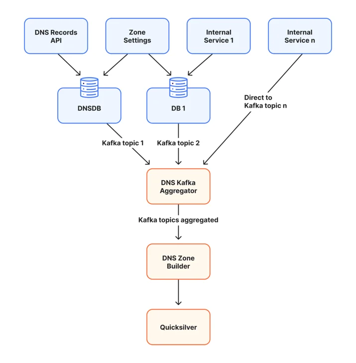

这是一个简化视图。Zone Builder 不会直接把数据库行复制到边缘，而是将记录与区域设置合并，应用 DNS 服务规则，并整理结果，以便我们的权威 DNS 服务器快速读取。

## 全量构建为何不再具备扩展性

原来的 Zone Builder 有一个优点：它不需要知道区域为何发生变化，而是根据当前数据库状态重建期望状态。

1. 读取当前区域及其设置。
2. 读取区域中的每条 DNS 记录。
3. 将这些记录转换为 Quicksilver 键。
4. 将新键与已经存储的键进行比较。
5. 移除过时的键，写入发生变化的键，并更新区域元数据。

最终写入的只有发生变化的键。不过，全量构建仍然要读取、编码并比较每条记录，而且在此过程中会将整个区域保存在内存中。对于小型区域，这样做成本很低。但对于包含数千万条记录的最大型区域，整个区域根本无法装入内存。下面会解释我们如何处理这一问题。

区域设置让定向构建更难。 [<u>Universal SSL</u>](https://developers.cloudflare.com/ssl/edge-certificates/universal-ssl/) 就是一个例子。启用或停用它会更新元数据，还可能更改区域顶点的证书颁发机构授权（CAA）记录。区域顶点是指裸域名，例如 `example.com`。 [<u>CAA 记录</u>](https://developers.cloudflare.com/ssl/edge-certificates/caa-records/) 会告诉证书颁发机构是否可以为该域名签发证书。

全量构建只需要知道区域发生了变化。定向构建则必须回答三个问题：

1. 哪些 DNS 名称可能发生变化？
2. 共享元数据或已发布区域列表是否可能发生变化？
3. 必须从 Quicksilver 中移除哪些之前的状态？

要安全地回答这些问题，就必须解决五个问题，本文接下来将依次介绍：

1. 事件必须说明发生了什么变化。
2. 每项变更都必须映射到仍然正确的最小构建。
3. 构建必须考虑所有同名区域共享的数据。
4. 事件产生后到构建执行前，数据库可能发生变化。
5. 合并工作时不能丢失 Kafka 消息。

## 让事件说明发生了什么变化

我们修改了事件生产者，使其包含发生变化的区域字段和设置；如果有可用信息，还会包含变更前后的值。随后，我们沿着生成 DNS 输出的代码追踪每项设置，并对它可能影响的内容进行分类。

并非每个事件都如此具体。有些数据库函数只更新时间戳，实际上是在表示“该区域的某些内容发生了变化”。有时这只是无害的记账操作，有时则意味着其他地方的数据发生了变化，必须重新读取。

这些情况在事件中看起来完全相同。在我们能够识别调用方及其目的之前，仅更新时间戳仍会触发全量构建。缺少详细信息、未知事件，或任何可能影响区域中任意位置记录的变更，也都遵循同一规则。规划器绝不会因为不确定而减少工作量。

## 选择最小的安全构建

这里需要关注 Quicksilver 输出的两个部分。记录键包含某个区域和名称对应的 DNS 应答。一个更小的共享元数据键会告诉我们的权威 DNS 服务器如何使用该区域，包括在哪里查找名称服务器和通配符等特殊记录。有些事件只会改变记录键，另一些则必须同时更新两者。

有了这一划分，规划器可以选择五种构建类型之一：

1. **仅资源：** 重建特定 DNS 名称处的记录；我们把这些名称称为资源，同时不改变区域元数据。普通的 A、AAAA、TXT 和 CNAME 变更通常走这条路径。
2. **资源和元数据：** 重建特定名称和共享元数据。名称服务器和通配符变更走这条路径。
3. **区域顶点和元数据：** 重建区域顶点和元数据。Universal SSL 等设置可以走这条路径。
4. **清理：** 移除不应再发布的区域。
5. **全量区域：** 当无法证明较小范围的工作是安全的时，重建每条记录。

规则很简单：定向构建写入的每个键，都必须与全量构建会写入的内容逐字节一致。如果无法证明这一点，就执行全量构建。

移除旧状态的方式与 2022 年按记录构建时相同。记录事件包含已删除的记录，以及已更新记录的旧版本。随后，Zone Builder 会扫描 Quicksilver，查找每个待重建名称下现有的键，并移除新构建没有写入的键。

当某项变更可能影响区域中的任意记录，或某个区域可能需要首次发布时，全量构建仍然不可或缺。

这里有一个经过刻意设计的例外。全量构建会同时把数据库中的每条记录和该区域现有的每个 Quicksilver 键保存在内存中，而最大的区域装不下这些内容。当记录数超过固定阈值时，Zone Builder 绝不会升级为全量构建，而是重建区域顶点、元数据，以及排队事件所标识的每个名称。我们接受这一取舍，是因为这些区域的全量构建无法完成；而在反复重试期间，它会阻塞其 Kafka 分区上的其他所有变更。原本需要全量构建的许多情况都涉及多个共享同一名称的区域，而 [<u>区域保留</u>](https://developers.cloudflare.com/fundamentals/account/account-security/zone-holds/) 可以通过阻止同一名称被添加到另一个账户来降低这种风险。对于剩下的少数情况，例如在另一个网络上启用区域，我们可以手动重建该区域中的单个名称。

## 一个名称为何对应多个区域

Quicksilver 会分别存储每个区域的记录键，同时还会存储一个由所有具有该域名的 Cloudflare 区域共享的元数据键。这个共享键就像一个目录：它告诉我们的权威 DNS 服务器，在回答查询时可以使用哪些内部区域 ID。

为什么同一个名称会有多个区域 ID？在客户接入、移除和其他 [<u>生命周期</u>](https://developers.cloudflare.com/dns/zone-setups/reference/domain-status/) 变更期间，多个 Cloudflare 区域对象可能会短暂地同时存在于同一个公共域名下。我们使用优先级策略，选择一组规模较小且有上限的区域进行发布。

请考虑以下域名的四个内部区域 `example.com`：区域 101、区域 202、区域 303 和区域 404。元数据键当前列出了区域 101、202 和 303。区域 404 虽然存在，但没有被选中。这些数字代表不同的 Cloudflare 区域对象；客户看到的仍然是一个域名。

在 `www.example.com` 处，区域 202 中的一条 TXT 记录发生变化，只会影响区域 202 的记录键，因此元数据键不会变化。名称服务器和通配符变更则不同，因为元数据键会记录与它们有关的信息。这些构建必须同时更新区域记录和元数据键。

执行时，Zone Builder 会再次读取当前列表。如果要写入元数据键，它会根据最新读取的状态重建整个键，而不是修改旧副本。它会先写入触发事件的区域记录，再写入引用这些记录的元数据。

## 根据事件规划，并在写入前验证

事件描述的是过去发生的事情。构建可能需要等待，在此期间会有更多事件到达，数据库也会发生变化，因此规划会进行两次。事件首先生成一份保守的工作列表。就在执行前，Zone Builder 会读取一份新的发布快照：当前区域设置、该 Zone Builder 是否应将区域发布到其网络，以及哪些同名区域 ID 应包含在元数据键中。这里的网络，是某个环境中独立且隔离的 Quicksilver 副本。每个 Zone Builder 部署都会写入一个网络，而区域可以在某些网络上启用、在另一些网络上不启用。例如，一个区域可以由 Cloudflare 的全球网络提供服务，也可以由 [<u>中国网络</u>](https://www.cloudflare.com/products/china-network/)提供服务。

最新状态可能通过四种方式改变结果：

1. 如果区域现在具有需要完整区域处理的功能，定向构建可能会变成全量构建。
2. 如果区域不应再发布到此网络，构建可能会变成清理。
3. 如果触发事件的区域不再属于元数据键，构建可能会被跳过。
4. 元数据构建可以根据当前候选集合重建共享键。

最新数据来自数据库的只读副本，因此构建不会与客户写入争用资源。Kafka 投递和数据库复制是独立进行的：事件可能先到达，而对应的数据库变更还未在副本上可见。DNS Kafka Aggregator 会延迟事件，等待足够长的时间以覆盖正常延迟；最后的数据库检查会在副本仍然落后时拒绝这次读取。

## 在一个调度器中合并变更

过去，记录工作和全区域工作使用不同的调度器。每个调度器都能合并自己的工作，却不能合并另一个调度器的工作。我们将它们替换为一个统一调度器。规划器决定必须构建什么，调度器决定何时可以运行。

当同一区域的多个事件在构建开始前到达时，调度器会合并它们的工作：

1. 位于 `www.example.com`的 A 记录发生变化，需要处理该名称。
2. 位于 `*.example.com`的通配符发生变化，需要处理该名称和共享元数据。
3. 调度器会把两个名称和元数据更新合并到一次构建中。

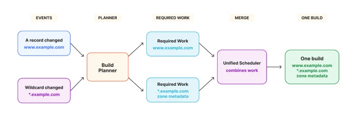

合并只会增加工作量。如果任一事件要求处理完整区域，合并后的构建就会变成全量构建。清理会覆盖所有重建，因为它的目标结果是让该区域不再发布。

调度器分别跟踪两件事：必须执行的 DNS 工作，以及等待确认的 Kafka 消息。重试会同时保留这两者。即使全量构建或清理已经不再需要单独的记录名称，这些消息仍会保持关联，直到结果被安全写入。

## 让 Kafka 持续推进

即使有可用的工作线程，一次缓慢的构建也可能拖延无关客户的变更。Kafka 会将消息划分到有序分区中。每个分区都有一个已提交偏移量，表示在此之前的每条消息都已确认完成。将该偏移量推进到未完成的工作之后，可能会在重启后丢失客户变更。

我们使用软提交，我之前在我的 [<u>Secondary DNS 深入解析</u>](https://blog.cloudflare.com/secondary-dns-deep-dive/)中介绍过这种方式。构建可以乱序完成，并在内存中标记为已完成，但 Kafka 的已提交位置只有在所有更早的消息也完成后才会推进。

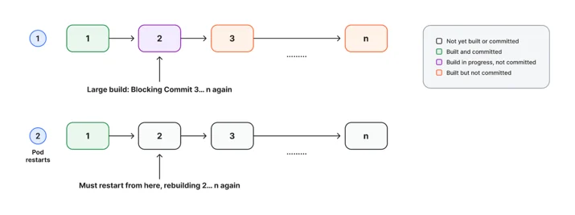

在图中，消息 2 仍在运行，因此消息 3 到 n 不能提交。如果 Zone Builder 重启，这些内存中的完成状态会消失，Kafka 会重放消息 2 到 n。我们有意选择重复工作，而不是丢失变更。

定向规划会缩短最早消息处于未完成状态的时间。调度器还会防止某个繁忙区域占用所有工作线程。区域完成一次构建后，下一次构建会等待该区域专属的重建间隔；这个间隔因 Cloudflare 计划而异。期间到达的变更会合并到下一次构建中。调度器通常会强制执行这个间隔，但在它可能让 Kafka 分区阻塞过久之前，会先让排队已久的工作运行。区域锁和重试延迟仍然有效，因此失败的构建不会不停地快速重试。

## 安全发布

只有在较小的构建生成相同 DNS 数据时，它才有价值。我们为名称服务器、通配符和区域顶点路径增加了等价性测试。每项测试都从相同的数据库状态分别运行全量构建和定向构建，固定依赖时间的值，并逐字节比较定向规划所涉及的每个 Quicksilver 键。规划器和调度器测试涵盖分类、同名区域、合并、清理和升级。

在发布过程中，我们还在每次定向构建旁边运行一次全量构建并比较输出。这是有意设置的高成本操作，因为每次都要读取完整区域；我们一直这样做，直到下面的镜像比较带来了同等信心。

测试无法复现所有客户组合，因此每次发布还会经过一个镜像 Zone Builder。它消费生产环境的 Kafka 流并读取生产数据库状态，但会写入一个独立的 Quicksilver 环境，该环境不承载任何客户流量。

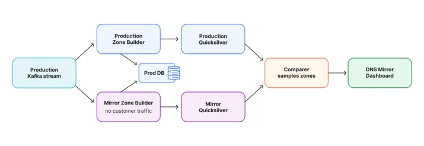

比较器会抽取 20% 的区域样本，检查缺失的键、多出的键和不同的值。两个环境不一定在同一时刻构建某个区域，因此临时不一致不一定是回归问题。我们会寻找两条流水线都追赶上来后仍然存在的新型差异。这样我们就能确信，定向构建生成的输出与生产环境相同。

我们构建了 DNS Mirror Dashboard，用于对这些差异分组并保留示例供调查。它自然运行在 [<u>Cloudflare Developer Platform</u>](https://developers.cloudflare.com/)上：一个 [<u>Worker</u>](https://developers.cloudflare.com/workers/) 接收结果， [<u>Durable Objects</u>](https://developers.cloudflare.com/durable-objects/) 维护状态， [<u>Cloudflare Access</u>](https://www.cloudflare.com/zero-trust/products/access/) 负责保护它。下方截图中的关键分组都在发布前经过检查，并确认是安全的。差异率是指在比较时，生产环境与镜像环境至少有一个键不一致的区域占所有比较区域的比例。其中大多数是两条流水线追上进度后就会消失的时序差异，因此我们关注两点：差异率保持较低，以及不出现新类型的差异。

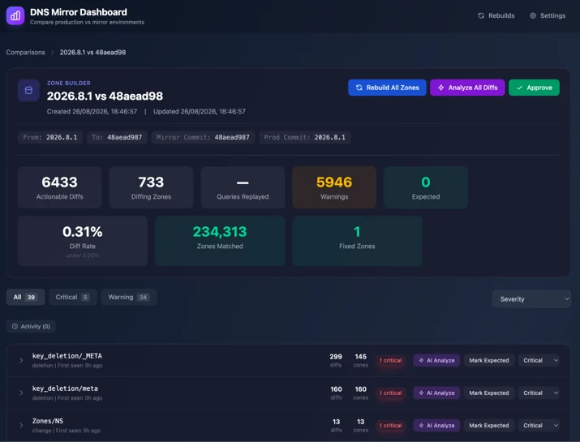

镜像结果持续健康后，我们按照区域名称的哈希值逐步推出调度器。对名称而不是区域 ID 进行哈希，可以让所有同名区域使用同一个调度器，从而避免两个调度器写入同一个元数据键。我们先提高免费区域的覆盖比例，然后对付费区域重复这一过程。

## 结果

在 24 小时内，我们测得仅资源构建占 86\.81%，资源和元数据构建占 2\.54%，区域顶点和元数据构建占 2\.30%，清理占 1\.30%。合计有 92\.95% 的构建避免了重建完整区域。剩余 7\.04% 是全量构建。

在此之前，即使对于大型区域，这两种元数据构建也都是全量构建。它们合计占构建的 4\.84%。再加上仍然是全量构建的 7\.04%，总计为 11\.88%，因此全量构建减少了约 40%。按数量计算的占比还低估了避免的工作量，因为其中包括最大的区域。剩余全量构建的平均耗时为 0\.35 秒，这是因为仍会触发它们的事件（例如区域首次发布）主要影响记录很少的新区域。

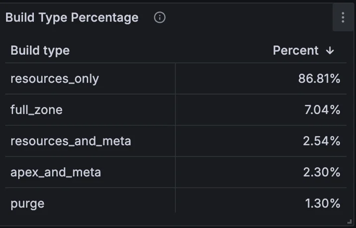

2022 年，我们还计划过一个批处理系统。统一调度器让它变得没有必要：它不会等待形成批次，只会在同一区域已经有工作排队时合并事件。过去，耗时很长的全量构建会阻滞其分区的已提交偏移量。现在全量构建变少了，我们可以按照事件到达的速率消费 Kafka，而不必落后后再以每秒最多 1,550 条消息的突发速度追赶。

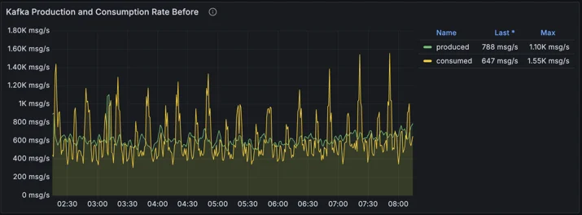

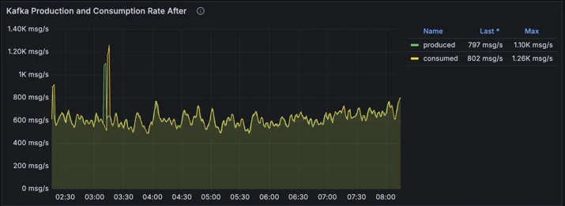

我们还测量了构建完成延迟：从 DNS 记录或区域设置发生变化，到 Zone Builder 完成向 Quicksilver 写入的时间。这不包括 Quicksilver 在我们网络中的分发时间；该时间因位置而异，也不受这项工作的影响。生产环境运行旧调度器，镜像环境则在相同的 24 小时内、针对相同事件运行统一调度器。除了代码不同，两个环境完全相同：它们消费相同的 Kafka 事件，从同一个数据库读取，并向 Quicksilver 写入等价数据。因此，这是一项受控的并排比较。图中数据合并了所有构建类型和客户计划，因此不能作为单个区域的延迟保证。其中很大一部分时间来自前面介绍的重建间隔，而不是构建工作。在每个测量点，p99 表示 99% 的事件在多长时间内完成。这里典型延迟几乎没有变化，因为大多数构建原本就很小。差异体现在尾部：最大的 p99 峰值从 14\.6 分钟降至 1\.21 分钟，降至原来的约 1/12。图表使用对数刻度。

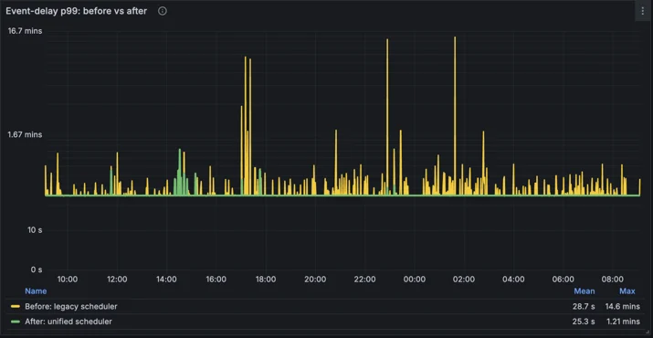

定向构建也大幅减少了完整加载大型区域的次数。总体工作集内存（即部署主动使用的内存）从平均 49 GiB 降至 7 GiB，减少了 86%。峰值则从 79 GiB 降至 12 GiB，减少了 85%。

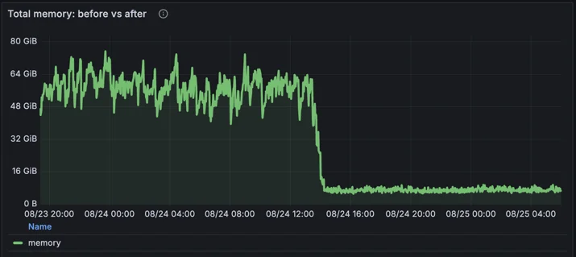

这些是新调度器带来的直接结果。它们还让我们能够重新审视两项保护措施。第一项是重建间隔，它可以阻止某个繁忙区域不断重建、占用其他区域的容量。由于构建现在成本更低，而且读取完整区域的构建少了很多，我们可以安全地缩短大多数计划的这一间隔。第二项是 DNS Kafka Aggregator 保留每个事件的时间，这样数据库副本就能在我们读取前追上进度。数据库开始拒绝从落后的副本读取后，这个缓冲时间也可以安全缩短。两者合计将构建完成延迟的中位数从约 7\.7 秒减半至约 3\.3 秒。下图中，第一处下降来自 DNS Kafka Aggregator 的变更。红色带状区域标出了采用更短重建间隔的 Zone Builder 发布版本。该版本逐步部署到各台服务器，因此延迟不是一次性下降，而是又分两步下降。

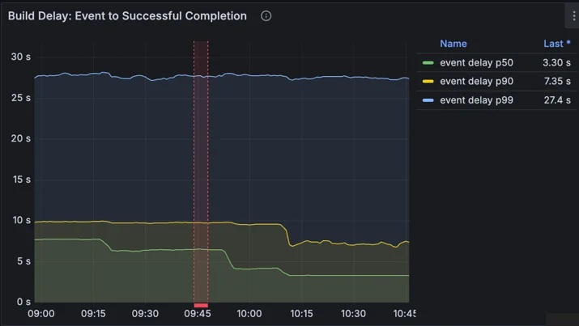

图中的 p90 和 p99 曲线看起来比实际更精确。直方图的桶边界为 1、5、10 和 30 秒，落在两个边界之间的百分位数会假定延迟在该范围内均匀分布来估算。大多数延迟都接近各自范围的下限，因此这些估计值偏高：p99 接近 30 秒，p90 超过 7 秒。不依赖桶边界的精确平均值证实了延迟确实减半。此后我们改用 [<u>原生直方图</u>](https://prometheus.io/docs/specs/native_histograms/)，它会自动选择细粒度的桶。测得的 p90 约为 5\.5 秒，p99 约为 12 秒。

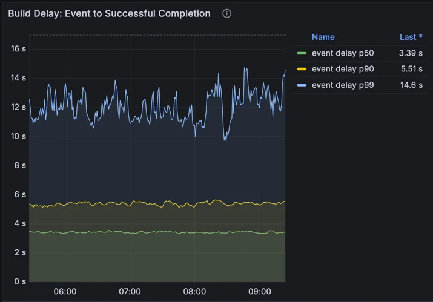

## 全量构建为何仍然存在

2022 年，我们曾表示计划彻底消除全量构建。现在我们知道，这既不现实，也没有用。区域首次发布时，需要写入每条记录。可能影响区域中任意记录的变更，需要检查每条记录。没有说明发生了什么变化的事件仍会执行全量构建，因为规划器绝不会因为不确定而减少工作量。对于小型区域，全量构建的成本也很低。

随着我们了解更多事件会改变哪些内容，我们会继续将它们迁移到定向构建。不过，最大的收益已经实现：过去会重建最大区域的那些事件如今不再这样做，剩余的全量构建大多由首次发布等事件触发，而这些事件影响的主要是记录较少的新区域。

想知道 Zone Builder 写入变更后会发生什么？请了解 [<u>Quicksilver 如何分发配置</u>](https://blog.cloudflare.com/introducing-quicksilver-configuration-distribution-at-internet-scale/) ，在几秒内送达每个 Cloudflare 数据中心。
