# How we halved DNS build delay and cut memory use by 85%

> **来源**: [https://blog.cloudflare.com/dns-targeted-zone-builds](https://blog.cloudflare.com/dns-targeted-zone-builds)  
> **作者**: 未知 | **发布时间**: 2026-11-02T14:00:00+00:00  
> **深度调研**: [查看专题调研报告](research.md)  
> **标签**: DNS, 增量构建, Kafka, 分布式系统, 任务调度, 一致性测试, Quicksilver

---

## AI 导读

Cloudflare 的 DNS Zone Builder 原先对许多区域变更执行全量构建：读取并编码整个区域的记录，再与边缘存储中的键比较。随着单个区域达到数千万条记录，这种做法造成高内存占用、Kafka 分区阻塞和较长的更新尾延迟。文章描述了新的定向构建规划器：事件携带变更字段，规划器把变更映射到资源、资源加元数据、顶点加元数据、清理或全量构建；无法证明安全时仍执行全量构建。统一调度器合并同一区域的待处理工作，执行前从数据库副本读取新快照，重新核验发布状态和同名区域元数据；软提交则保证乱序完成不会推进 Kafka 提交点越过未完成消息。发布前通过全量与定向构建的逐键等价性测试、生产流量镜像和差异比较验证结果。24 小时数据中，92.95% 的构建避开了全量区域重建，最大 p99 尾延迟从 14.6 分钟降至 1.21 分钟，峰值工作集内存从 79 GiB 降至 12 GiB，中位完成延迟从约 7.7 秒降至约 3.3 秒。结果不包含 Quicksilver 在网络中的分发时间，延迟数据混合了所有构建类型和客户计划，也不能作为单个区域的保证；全量构建仍用于首次发布、可能影响整个区域的变更和信息不足的事件。

---

## 原文整理

# How we halved DNS build delay and cut memory use by 85%

When I [<u>last wrote about our DNS propagation pipeline in 2022</u>](https://blog.cloudflare.com/dns-build-improvement/), the Zone Builder received about 250 DNS record changes per second. Today it receives about 700, nearly three times as many, plus about 100 other events, such as [<u>zone</u>](https://developers.cloudflare.com/fundamentals/concepts/accounts-and-zones/) setting changes. However, the number of events was never the real problem. The problem was the kind of work some of those events needed, and how that work grows with the size of a zone. Some zones now hold more than 20 million records, and we expect them to keep growing toward hundreds of millions.

Each event starts a clock that measures how long it takes us to turn that change into data our authoritative DNS servers can use. We call that work a build. A build reads the current database state, converts it into the format used at the edge, and writes any changes to [<u>Quicksilver</u>](https://blog.cloudflare.com/introducing-quicksilver-configuration-distribution-at-internet-scale/).

In 2022, per-record builds were 150 times faster than full builds on average. On a test zone with one million records, per-record builds were 4,250 times faster. We ended that post with the obvious next step: do the same thing for zone settings.

*Why doesn't the Zone Builder just rebuild the setting that changed?*

It should, and that is where we ended up. However, proving when it was safe took most of the work. A record event identifies what changed. A zone event can come from many Cloudflare products, may not say why the zone changed, and can alter data shared by several zones with the same name. Choosing too much work wastes capacity. Choosing too little can leave stale or incorrect DNS data at the edge.

We built a targeted build planner that chooses the smallest build we can prove is safe, and a new scheduler that combines work for the same zone. Zone setting changes no longer rebuild zones with tens of millions of records. Together, they cut peak memory by 85%, and the extra headroom let us safely shorten waits the pipeline has always needed for resilience, halving the time from a DNS change to its data being written to Quicksilver.

## How DNS changes reach the edge

A DNS zone is the collection of records and settings for a domain. Cloudflare uses a multi-stage pipeline to turn a change to that zone into data available across our [<u>global network</u>](https://www.cloudflare.com/network/).

1. A customer changes a DNS record through the [<u>DNS Records API</u>](https://developers.cloudflare.com/api/resources/dns/subresources/records/) or dashboard, or another Cloudflare service changes a zone setting.
2. The change is stored in a database.
3. The database change or another system produces a [<u>Kafka</u>](https://kafka.apache.org/) event.
4. The DNS Kafka Aggregator combines events from several Kafka topics and sends them to the Zone Builder.
5. The Zone Builder reads the required zone data and converts it into keys understood by our authoritative DNS servers.
6. The Zone Builder compares those keys with [<u>Quicksilver</u>](https://blog.cloudflare.com/introducing-quicksilver-configuration-distribution-at-internet-scale/), our distributed key-value store. It writes only what changed, and Quicksilver propagates those changes across Cloudflare's network.

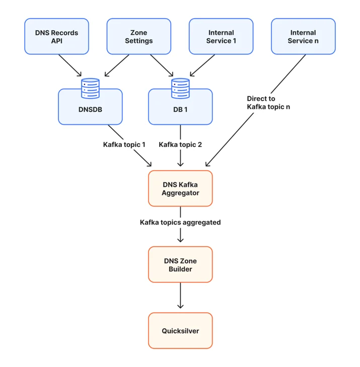

This is a simplified view. The Zone Builder does not copy database rows directly to the edge. It combines records with zone settings, applies DNS serving rules, and organizes the result so our authoritative DNS servers can read it quickly.

## Why full builds stopped scaling

The original Zone Builder had one useful property: it did not need to know why a zone changed. It rebuilt the desired state from the current database state.

1. Read the current zone and its settings.
2. Read every DNS record in the zone.
3. Convert those records into Quicksilver keys.
4. Compare the new keys with those already stored.
5. Remove stale keys, write changed keys, and update zone metadata.

The final write contains only changed keys. However, a full build still reads, encodes, and compares every record, and holds the whole zone in memory while it does so. That is cheap for a small zone. For our largest zones, with tens of millions of records, the zone does not fit in memory at all. I explain how we handle that below.

Zone settings made targeting harder. [<u>Universal SSL</u>](https://developers.cloudflare.com/ssl/edge-certificates/universal-ssl/) is one example. Enabling or disabling it updates metadata and can change Certification Authority Authorization (CAA) records at the zone apex, the bare domain, such as `example.com`. [<u>CAA records</u>](https://developers.cloudflare.com/ssl/edge-certificates/caa-records/) tell certificate authorities whether they may issue a certificate for the domain.

A full build only needed to know that the zone changed. A targeted build must answer three questions:

1. Which DNS names can change?
2. Can shared metadata or the list of published zones change?
3. What previous state must be removed from Quicksilver?

Answering those questions safely meant solving five problems, which the rest of this post covers in order:

1. Events had to say what changed.
2. Each change had to map to the smallest build that is still correct.
3. Builds had to account for data shared by every zone with the same name.
4. The database could change between the event and the build.
5. Combining work could not lose a Kafka message.

## Making events say what changed

We changed the event producer to include changed zone fields and settings, with previous and new values when available. We then traced each setting through the code that generates DNS output and classified what it could affect.

Not every event was that specific. Some database functions only update a timestamp to say, in effect, "something about this zone changed." Sometimes that is harmless bookkeeping. Sometimes it means data changed elsewhere and must be read again.

Those cases look identical in the event. Until we can identify the caller and its purpose, a timestamp-only update still causes a full build. The same rule applies to missing details, unknown events, or any change that may affect records anywhere in the zone. The planner never turns uncertainty into less work.

## Choosing the smallest safe build

Quicksilver output has two parts that matter here. Record keys contain the DNS answers for one zone and name. A smaller shared metadata key tells our authoritative DNS servers how to use that zone, including where to find special records such as nameservers and wildcards. Some events change only record keys; others must update both.

With that distinction, the planner can choose one of five build types:

1. **Resources only:** Rebuild the records at specific DNS names, which we call resources, without changing zone metadata. Ordinary A, AAAA, TXT, and CNAME changes usually take this path.
2. **Resources and metadata:** Rebuild specific names and shared metadata. Nameserver and wildcard changes use this path.
3. **Apex and metadata:** Rebuild the zone apex and metadata. Settings such as Universal SSL can use this path.
4. **Purge:** Remove a zone that should no longer be published.
5. **Full zone:** Rebuild every record when smaller work cannot be proven safe.

The rule is simple: every key a targeted build writes must be byte-for-byte identical to what a full build would write. If we cannot prove that, we do a full build.

Removing old state works as it did for per-record builds in 2022. Record events include deleted records and the previous version of updated ones. The Zone Builder then scans Quicksilver for the existing keys under each name it rebuilds, removing any that the new build did not write.

Full builds remain necessary when a change can affect records anywhere in the zone or when a zone may need to be published for the first time.

There is one deliberate exception. A full build holds every record from the database and every existing Quicksilver key for the zone in memory at once, and our largest zones do not fit. Above a fixed record-count threshold, the Zone Builder never escalates to a full build. It rebuilds the apex, the metadata, and every name identified by the queued events instead. We accept this tradeoff because a full build of those zones cannot finish, and, while it retries, it holds back every other change on its Kafka partition. Many of the cases that would otherwise need a full build involve several zones sharing one name, and [<u>zone holds</u>](https://developers.cloudflare.com/fundamentals/account/account-security/zone-holds/) reduce that risk by stopping the same name from being added to another account. For the rare cases that remain, such as enabling a zone on another network, we can manually rebuild individual names in the zone.

## When one name means more than one zone

Quicksilver stores each zone's record keys separately. It also stores one metadata key shared by every Cloudflare zone with that domain name. This shared key acts like a directory: it tells our authoritative DNS servers which internal zone IDs they may use when answering a query.

Why can one name have several zone IDs? During customer onboarding, offboarding, and other [<u>lifecycle</u>](https://developers.cloudflare.com/dns/zone-setups/reference/domain-status/) changes, multiple Cloudflare zone objects can briefly exist for the same public domain. We use a priority policy to choose a small, bounded set to publish.

Consider four internal zones for `example.com`: Zone 101, Zone 202, Zone 303, and Zone 404. The metadata key currently lists Zones 101, 202, and 303. Zone 404 exists, but it is not selected. The numbers identify separate Cloudflare zone objects; customers still see one domain name.

A TXT record change at `www.example.com` in Zone 202 affects only Zone 202's record keys, so the metadata key does not change. Nameserver and wildcard changes are different because the metadata key records information about them. Those builds must update both the zone's records and the metadata key.

At execution time, the Zone Builder reads the current list again. If it writes the metadata key, it rebuilds the whole key from that fresh view rather than patching an older copy. It writes the triggering zone's records before the metadata that refers to them.

## Planning from the event, verifying before writing

An event describes what happened in the past. A build may wait while more events arrive and the database changes, so planning happens twice. The event first creates a conservative work list. Immediately before execution, the Zone Builder reads a fresh publication snapshot: the current zone settings, whether this Zone Builder should publish the zone to its network, and which same-name zone IDs belong in the metadata key. Here, a network is a separate, isolated copy of Quicksilver for one environment. Each Zone Builder deployment writes to one network, and a zone can be enabled on some networks but not others. For example, a zone can be served from Cloudflare's global network and also from the [<u>China Network</u>](https://www.cloudflare.com/products/china-network/).

Fresh state can change the result in four ways:

1. A targeted build can become a full build if the zone now has a feature that requires complete-zone work.
2. A build can become a purge if the zone should no longer be published to this network.
3. A build can be skipped if the triggering zone no longer belongs in the metadata key.
4. A metadata build can reconstruct the shared key from the current candidate set.

The fresh read comes from read-only copies of the database, called replicas, so builds do not compete with customer writes. Kafka delivery and database replication move independently: an event can arrive before its database change is visible on a replica. The DNS Kafka Aggregator delays events long enough to cover normal lag, and a final database check rejects the read if that replica is still behind.

## Combining changes in one scheduler

Record work and full-zone work previously used different schedulers. Each could combine its own work, but not work from the other scheduler. We replaced them with one unified scheduler. The planner decides what must be built, and the scheduler decides when it can run.

When several events for one zone arrive before a build starts, the scheduler combines their work:

1. An A record changes at `www.example.com`, requiring that name.
2. A wildcard changes at `*.example.com`, requiring that name and shared metadata.
3. The scheduler combines both names and the metadata update into one build.

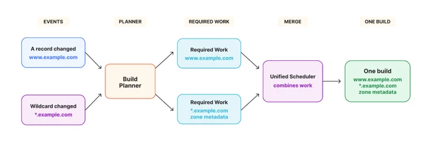

Merging only adds work. If any event requires the complete zone, the combined build becomes a full build. A purge overrides every rebuild because its desired result is that the zone is no longer published.

The scheduler tracks two things separately: the DNS work that must be performed and the Kafka messages waiting to be acknowledged. A retry preserves both. Even when a full build or purge no longer needs the individual record names, the messages stay attached until the result is safely written.

## Keeping Kafka moving

One slow build can delay unrelated customers even when workers are available. Kafka divides messages into ordered partitions. For each partition, it stores one committed offset: the point before which every message is known to be complete. Moving that offset past unfinished work could lose a customer change after a restart.

We use soft committing, which I previously described in my [<u>Secondary DNS deep dive</u>](https://blog.cloudflare.com/secondary-dns-deep-dive/). A build can finish out of order and be marked complete in memory, but Kafka's committed position advances only after every earlier message has also finished.

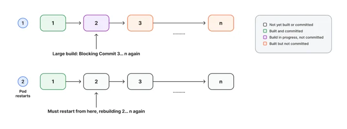

In the diagram, message 2 is still running, so messages 3 through n cannot be committed. If the Zone Builder restarts, those in-memory completions disappear and Kafka replays messages 2 through n. We deliberately choose repeated work over losing a change.

Targeted plans reduce how long the oldest message stays unfinished. The scheduler also prevents one busy zone from taking every worker. After a zone builds, its next build waits for a per-zone rebuild interval, which differs by Cloudflare plan. Changes that arrive in the meantime are merged into that next build. The scheduler normally enforces this interval, but lets old queued work run before it blocks a Kafka partition for too long. Zone locks and retry delays still apply, so a failing build cannot run in a tight loop.

## Releasing safely

A smaller build is useful only if it produces the same DNS data. We added equivalence tests for nameserver, wildcard, and apex paths. Each test runs a full build and a targeted build from the same database state, pins time-dependent values, and compares every Quicksilver key owned by the targeted plan byte for byte. Planner and scheduler tests cover classification, same-name zones, merging, purges, and escalation.

During rollout, we also ran a full build next to every targeted build and compared the output. It was expensive by design, reading the complete zone every time, so we used it only until the mirror comparison below gave us the same confidence.

Tests cannot reproduce every customer combination, so every release also runs through a mirror Zone Builder. It consumes the production Kafka stream and reads production database state, but writes to a separate Quicksilver environment that serves no customer traffic.

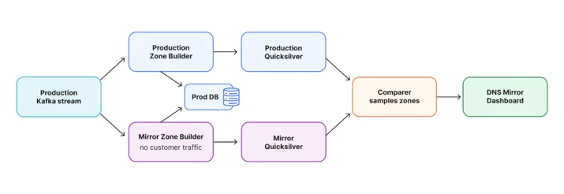

A comparer checks a 20% sample of zones for missing keys, extra keys, and different values. The two environments do not always build a zone at the same instant, so a temporary mismatch is not automatically a regression. We look for new types of differences that remain after both pipelines catch up. That gives us confidence that targeted builds produce the same output as production.

We built the DNS Mirror Dashboard to group those differences and keep examples for investigation. Naturally, it runs on the [<u>Cloudflare Developer Platform</u>](https://developers.cloudflare.com/): a [<u>Worker</u>](https://developers.cloudflare.com/workers/) receives results, [<u>Durable Objects</u>](https://developers.cloudflare.com/durable-objects/) maintain state, and [<u>Cloudflare Access</u>](https://www.cloudflare.com/zero-trust/products/access/) protects it. The critical groups in the screenshot below were each checked and confirmed safe before release. The diff rate is the share of compared zones where production and mirror disagreed on at least one key at the moment of comparison. Most of those are timing differences that disappear once both pipelines catch up, so we watch two things: that the rate stays low, and that no new kind of difference appears.

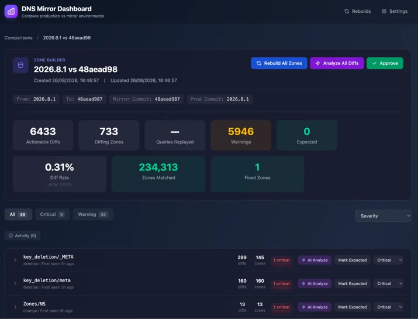

After the mirror results remained healthy, we rolled the scheduler out by a hash of the zone name. Hashing the name rather than the zone ID kept every zone sharing a name on the same scheduler, so two schedulers never wrote the same metadata key. We increased the percentage for free zones, then repeated the process for paid zones.

## Results

Over 24 hours, we measured 86.81% of builds as resources only, 2.54% as resources and metadata, 2.30% as apex and metadata, and 1.30% as purges. Together, 92.95% of builds avoided rebuilding the complete zone. Full builds were the remaining 7.04%.

The two metadata build types were full builds before, even for large zones. Together, they account for 4.84% of builds. Combined with the 7.04% that are still full builds, that is 11.88%, so full builds fell by about 40%. Their share of the count also understates the work avoided, because they include the largest zones. The full builds that remain average 0.35 seconds, because the events that still trigger them, such as a zone being published for the first time, mostly affect new zones with few records.

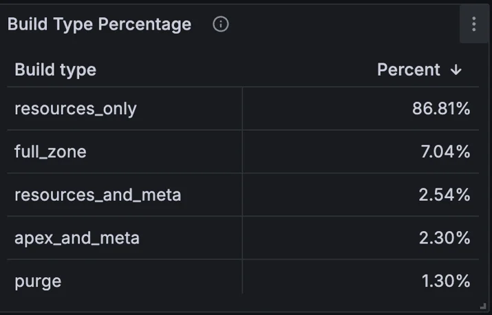

In 2022, we also planned a batching system. The unified scheduler makes it unnecessary: it does not wait to form batches, and it merges events only when work is already queued for the same zone. Before, long full builds held back the committed offset for their partition. With fewer of them, we now consume Kafka at the rate events arrive, instead of falling behind and catching up in bursts of up to 1,550 messages per second.

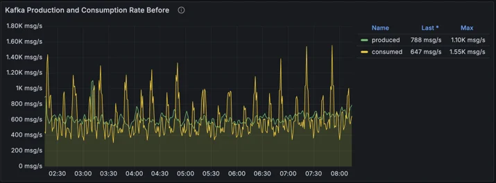

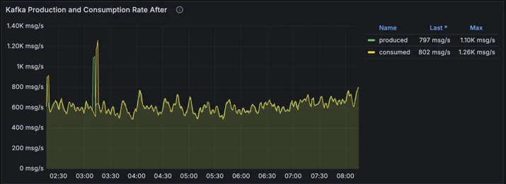

We also measured build completion delay: the time from a DNS record or zone setting change until the Zone Builder finished writing to Quicksilver. It does not include Quicksilver's distribution across our network, which varies by location and is unaffected by this work. Production ran the old schedulers, and the mirror ran the unified scheduler on the same events over the same 24 hours. The two environments are identical apart from the code: they consume the same Kafka events, read from the same database, and write equivalent data to Quicksilver. That makes this a controlled, side-by-side comparison. The figures combine every build type and customer plan, so they are not a latency guarantee for an individual zone. A large share of this time is the rebuild interval described earlier, not build work. At each measurement point, p99 is the time within which 99% of events finished. Typical delays barely changed here, because most builds were already small. The difference is in the tail: the largest p99 spike fell from 14.6 minutes to 1.21 minutes, a 12-fold reduction. The chart uses a logarithmic scale.

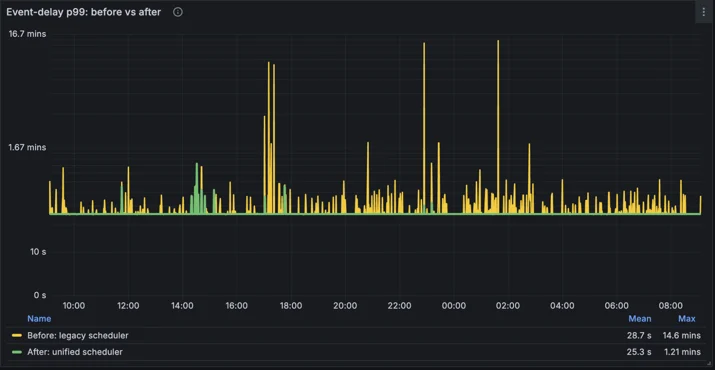

Targeted builds also load complete large zones far less often. Aggregate working-set memory, the memory actively used by the deployment, fell from an average of 49 GiB to 7 GiB, an 86% reduction. Peaks fell from 79 GiB to 12 GiB, an 85% reduction.

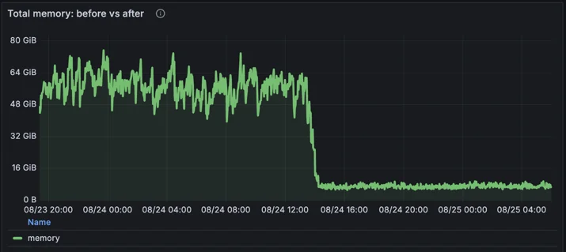

Those were the immediate results of the new scheduler. They also let us revisit two safeguards. The first is the rebuild interval, which stops one busy zone from rebuilding constantly and taking capacity from everyone else. With builds now cheaper, and far fewer of them reading complete zones, we could safely shorten that interval on most plans. The second is how long the DNS Kafka Aggregator holds each event, to make sure database replicas have caught up before we read from them. Once our databases began rejecting reads from replicas that had fallen behind, that buffer could safely be smaller. Together, these halved the median build completion delay, from about 7.7 seconds to about 3.3 seconds. In the chart below, the first step down is the DNS Kafka Aggregator change. The red band marks the Zone Builder release with shorter rebuild intervals. That release rolled out gradually across our servers, so the delay falls in two further steps rather than all at once.

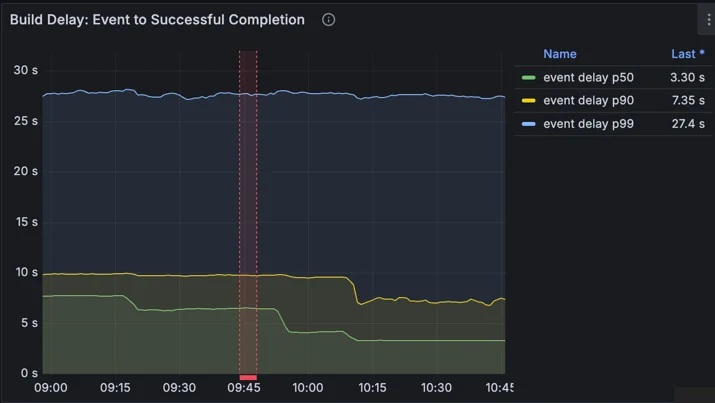

The p90 and p99 lines in that chart are less precise than they look. The histogram had buckets at 1, 5, 10, and 30 seconds, and a percentile that falls between two edges is estimated as if delays were spread evenly across that range. Most delays sit near the bottom of their range, so those estimates come out high: p99 reads close to 30 seconds, and p90 above 7 seconds. The exact average, which does not depend on buckets, confirms the halving. We have since switched to a [<u>native histogram</u>](https://prometheus.io/docs/specs/native_histograms/), which chooses fine-grained buckets automatically. It puts p90 at about 5.5 seconds and p99 at about 12 seconds.

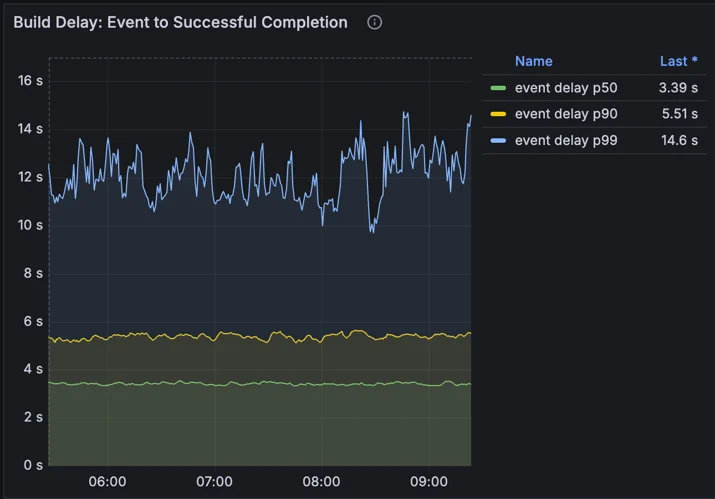

## Why full builds still exist

In 2022, we said we planned to eliminate full builds entirely. We now know that is neither realistic nor useful. A zone being published for the first time needs every record written. A change that can affect records anywhere in the zone needs every record checked. An event that does not say what changed still gets a full build, because the planner never turns uncertainty into less work. For a small zone, a full build is also cheap.

As we learn what more events change, we will keep moving them to targeted builds. However, the biggest gain has already landed: the events that used to rebuild our largest zones no longer do, and the full builds that remain are mostly triggered by events, such as first publication, that affect new, small zones.

Want to know what happens after the Zone Builder writes a change? Read how [<u>Quicksilver distributes configuration</u>](https://blog.cloudflare.com/introducing-quicksilver-configuration-distribution-at-internet-scale/) to every Cloudflare data center in seconds.
