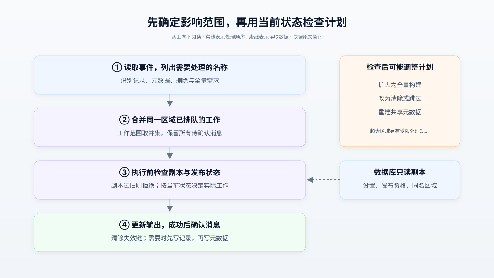

# Cloudflare 如何减少 DNS 重复构建：机制、收益与正确性边界

> 来源：[blog.cloudflare.com](<https://blog.cloudflare.com/dns-targeted-zone-builds>)  
> 作者：未知 · 发布时间：2026-11-02 22:00（Asia/Shanghai）  
> 翻译正文：[阅读中文正文](article-zh-CN.md)

修改一条域名记录，为什么有时要读取数千万条记录才能发布？Cloudflare 遇到的瓶颈正是如此：部分区域设置虽然只影响少量输出，旧流程仍然重建整个区域。它的改进是先判断变更会影响哪些数据，只重建能够确认需要更新的部分，再把同一区域已经排队的工作合并处理。

这套做法首先降低了内存占用和长时间排队，之后才为缩短等待时间创造条件。如果你维护的配置发布、搜索索引或缓存更新系统，也经常为了一个小改动重新计算整个大对象，这个案例值得参考；如果全量处理本来就便宜，额外的判断规则未必划算。

本文以 Cloudflare 的 [《How we halved DNS build delay and cut memory use by 85%》](https://blog.cloudflare.com/dns-targeted-zone-builds) 为研究主体。下文的生产架构与效果数字均为**原文报告**；官方文档核验的机制标为**外部补充**，迁移到其他系统的判断与实践方案标为**分析或建议**。这些材料不等于独立复现实验。

## 1. 问题出在每次变更要做多少工作

DNS，即域名系统，用记录描述域名对应的地址等信息。DNS 区域（zone）管理一组域名记录和相关设置；权威 DNS 服务器负责提供这组数据的正式回答。

客户保存设置后，Cloudflare 不会把数据库行直接复制给权威服务器。它先由 Zone Builder，也就是区域构建器，把记录与设置结合，生成服务器能够快速读取的键值数据。键相当于查找地址，值保存相应内容。这些数据写入 Quicksilver——Cloudflare 用于分发配置的分布式键值存储——再传播到各地服务器。

原文给出的处理链路是：变更写入数据库，随后产生 Kafka 事件；Kafka 是保存并传递事件的消息系统。聚合器收集多个来源的事件，区域构建器读取所需数据、生成输出、比较新旧内容，最后只把变化写入 Quicksilver。[原文](https://blog.cloudflare.com/dns-targeted-zone-builds)

问题是，**只写入变化，不代表只计算变化。**旧的全量构建仍然读取区域的所有记录，编码全部输出，再与存量键比较。它还同时在内存中保存数据库记录和 Quicksilver 旧键。即使最终只改一个键，前面的读取、计算和内存成本也已经发生。

原文称，记录变更从 2022 年的约每秒 250 次增至约 700 次，另有约 100 次其他事件；部分区域已经超过两千万条记录。每秒事件数只是一个维度，一个事件会不会触发巨量工作同样重要。未来上亿条记录是作者的增长预期，不能当作已经验证的处理能力。

**外部补充：**Cloudflare 在 [2022 年的前作](https://blog.cloudflare.com/dns-build-improvement/) 中，已把普通记录变更改成局部构建。其百万条记录测试中，五次局部构建各耗时 6—8 毫秒，五次全量构建约 34 秒。这解释了减少读取范围为何有效，但它是当时特定测试区域的构建耗时，不能用来推算本次改造的整体发布速度。

## 2. 一个设置开关为什么会改变 DNS 记录

先看一个**假设例子**：`example.com` 有大量记录，客户只调整证书设置。若这个设置只改变根域名 `example.com` 的输出，重新读取 `shop.example.com` 等所有名称就很浪费。

原文使用的实际机制是 Universal SSL，即 Cloudflare 自动提供和管理证书的服务。启用或禁用它可能改变区域顶点的 CAA 记录。区域顶点（apex）就是不带额外子域名前缀的 `example.com`；CAA 是证书颁发机构授权记录，用来说明哪些机构可以为域名签发证书。

**外部补充：**[Cloudflare 的 CAA 文档](https://developers.cloudflare.com/ssl/edge-certificates/caa-records/) 明确说明，在使用 Universal SSL 且区域中添加了 CAA 记录时，平台会自动补充记录以支持签发证书；这些自动记录不会出现在控制台中，但可以通过 DNS 查询看到。这支持原文的重要前提：最终 DNS 输出还取决于产品设置，不能只看客户手工填写的记录。它不意味着每次证书设置变更都会改变 CAA，也不适用于文档排除的高级证书管理情形。

因此，局部更新不能简单理解成“哪张表改了一行，就复制哪一行”。系统必须沿着生成输出的代码，查清设置会影响哪些名称、哪些共享信息，以及哪些旧内容需要删除。

## 3. 怎样选出足够小、又不会漏改的范围

### 让事件说明发生了什么

原文首先改造事件生产端，让事件携带变化的字段或设置，并尽可能包含旧值与新值。区域构建器随后按这些信息选择工作范围。

这需要生产端和消费端共同维护含义。一些数据库函数只更新时间戳，表达“这个区域有变化”，却没有说明原因。它可能只是记账，也可能代表其他数据已变。原文的默认处理是全量构建：信息不足时，不把不确定性解释为“可以少做”。

### 区分记录内容与共享目录

原文将输出分成两类。记录键保存某个区域、某个 DNS 名称的回答；元数据键保存权威服务器解释这些记录时需要的信息，例如特殊记录的位置，以及哪些内部区域允许用于回答。

元数据可以理解成目录，但它并非无关紧要的附属说明。记录正确而目录过旧，服务器仍可能选择错误的数据。

| 构建类型 | 实际处理范围 | 原文给出的典型触发条件 |
| --- | --- | --- |
| 仅记录 | 指定 DNS 名称下的记录键 | 普通地址、文本或别名记录变更 |
| 记录与元数据 | 指定名称，加共享元数据 | 名称服务器或通配符变更 |
| 顶点与元数据 | 区域顶点，加共享元数据 | Universal SSL 等设置变更 |
| 清除 | 删除不应再发布的区域数据 | 区域退出当前发布环境 |
| 全量区域 | 检查整个区域的记录 | 首次发布、全局影响或事件信息不足 |

通配符如 `*.example.com` 用于在 DNS 规则允许的情况下匹配名称；名称服务器记录说明由哪些服务器负责提供解析。它们会影响元数据，因此不能照搬普通记录的更新路径。[原文](https://blog.cloudflare.com/dns-targeted-zone-builds)

原文的判断标准是：定向构建写出的每个键，必须与全量构建产生的对应结果逐字节相同。

**分析：**这还需要另一个条件才能成立：所有本应变化的键都进入了处理范围。即使选中的键全部正确，漏选一个受影响名称也会留下错误。因此要分别验证“范围选对了”和“选中范围算对了”，不能只比较几个新值。

### 删除旧内容也是工作的一部分

假设把一条记录从 `old.example.com` 改到 `new.example.com`，只生成新名称的数据会留下旧名称。原文因此在记录事件中保留被删除记录和更新前的版本。构建器检查所处理名称下的现有键，删除新结果不再包含的键。

这里的“资源”通常指一个 DNS 名称，而非孤立的一行记录。按名称重新生成结果，才能覆盖同一名称下记录的组合与编码变化。局部更新既要生成正确的新状态，也要移除失效的旧状态。

## 4. 为什么执行前还要重新检查数据库

事件记录的是过去发生的变化，任务执行时数据库可能已经继续变化。若仅按事件中的旧信息写入，系统可能重新发布一个刚被停用的区域。

原文因此分两次决定工作：收到事件时先形成保守计划，真正执行前再读取当前设置、当前网络的发布资格，以及同名区域的候选列表。这里的“网络”是隔离的 Quicksilver 环境，一个区域可能只允许发布到其中部分环境。检查后，任务可能扩大为全量、改为清除、直接跳过，或者按当前候选列表重建元数据。

下图从上往下读，实线表示处理顺序，虚线表示从数据库获取当前状态。图中省略了锁、重试和消息分区等细节。

### 同一个域名可能对应多个内部区域

在接入、退出等生命周期变化中，同一个公开域名可能暂时有多个内部区域对象。它们的记录键各自保存，但共享一个按域名组织的元数据键；这个键列出服务器允许选择的内部区域编号。

原文的处理方式是：需要改元数据时，重新读取当前候选集合，重建整个共享键，而不是在旧目录上局部打补丁；先写触发区域的记录，再写引用这些记录的元数据。上线分流也按域名而非区域编号进行，确保同名区域落到同一套调度器，避免新旧调度器同时改同一个共享键。

**分析：**这说明并发控制的边界应跟着共享输出走。数据库中的两个区域编号不同，不代表它们的构建任务互不影响。不过，原文没有完整公开锁协议与底层写入事务，不能仅凭“先写记录、后写目录”推导出跨区域、跨机房的原子可见性保证。

### “刚读到的数据”仍可能落后

构建器读取数据库的只读副本，减少与客户写入争抢资源。但 Kafka 事件传递和数据库副本同步是两条独立路径：事件可能先到，数据变化稍后才在副本可见。

原文使用两层措施：聚合器先等待一段时间覆盖正常同步延迟；读取前再检查，副本仍落后就拒绝这次读取。第二层保证使它能够缩短第一层等待。

**分析与建议：**“重新查询”本身不能证明数据够新。小团队若要借鉴，应让读取能够验证某个数据库提交位置或应用版本是否已经可见，验证失败就重试。这是可选实现方向，并非原文公开的协议；原文没有给出检查字段和阈值，不能臆测其细节。

## 5. 合并任务为什么还要保留每一条消息

旧系统分别调度记录构建和全量构建，双方不能合并工作。新系统用一个规划器决定做什么，再由统一调度器决定什么时候执行。

举一个**假设例子**：一个区域的 `www.example.com` 地址发生变化，紧接着 `*.example.com` 通配符也变化。若两个事件都在任务开始前到达，调度器把两个名称和元数据更新放入同一次构建。它不专门等候凑批，只合并已经排队的同区域任务。

合并只能扩大所需工作：名称集合取并集，需要更新元数据的标记保留；任一事件要求全量，合并后就做全量。清除任务则覆盖重建意图，因为此时期望结果是不再发布；执行前仍需检查当前发布状态。

但工作合并不等于消息可以丢掉。即使全量构建不再需要保存每个名称，原事件仍然必须挂在任务上，等结果安全写入后再确认。重试同样要保留工作和消息。

### 完成顺序可以不同，提交进度不能越过缺口

Kafka 把消息放进有序分区，并保存消费者的已提交位置，称为偏移量（offset）。这里记录的是恢复时从哪里继续读取，而非每条消息各自的完成标记。

假设同一分区的消息 1 已完成，消息 2 正在慢速构建，消息 3、4 已完成。原文的“软提交”先在内存中记住 3、4 的完成状态，但不把持久进度推进到消息 2 之后。若此时重启，2、3、4 会重新读取；它接受重复处理，以避免跳过尚未完成的 2。

**外部补充：**[Kafka 消费者官方文档](https://kafka.apache.org/41/javadoc/org/apache/kafka/clients/consumer/KafkaConsumer.html) 确认了读取位置与已提交位置的区别，也说明处理完成后、提交之前崩溃可能造成重复。这属于“至少一次”处理：消息可能重复，而非自动保证业务效果只发生一次。该文档用于核验语义，不代表 Cloudflare 使用此版本或 Java 客户端。

**分析：**输出端必须能承受重放，例如重复计算期望状态不会叠加业务效果。原文描述的重新生成、比较和写入有利于这一点，但不能据此宣称整个链路具有“恰好一次”语义。

统一调度器还保留同一区域的重建间隔，防止活跃区域持续占用工作线程。原文允许等待过久的任务在阻塞分区前提前执行，但仍受区域锁和重试延迟约束。减少大任务时长能缓解分区进度受阻；软提交本身并不能消除这种阻塞。

## 6. 哪些效果可以确认，哪些不能外推

原文使用生产与镜像环境比较：二者消费相同事件、读取相同数据库，镜像写入隔离的 Quicksilver，不服务客户。文中的 24 小时比较合并了所有构建类型和客户套餐，并非某一个区域的延迟承诺。

| 原文指标 | 报告结果 | 正确理解 |
| --- | --- | --- |
| 非全量构建占比 | 92.95% | 包含原有局部构建与清除，不能全算作新增收益 |
| 全量构建数量 | 约减少 40% | 按类型占比推算，非总工作量减少 40% |
| 部署整体活跃内存均值 | 49 GiB → 7 GiB | 约下降 86%，不是单个任务的内存 |
| 部署整体活跃内存峰值 | 79 GiB → 12 GiB | 约下降 85%，不等于账单下降 85% |
| 对照期间最大的 P99 尖峰 | 14.6 分钟 → 1.21 分钟 | 比较的是尖峰，不是全天所有事件都快约 12 倍 |
| 后续缩短等待后的中位延迟 | 约 7.7 秒 → 3.3 秒 | 包含等待参数调整，不是构建代码单独带来的收益 |

以上数字均来自[原文结果部分](https://blog.cloudflare.com/dns-targeted-zone-builds)。GiB 是以 1024 为进位单位的内存容量；P50、P90、P99 分别表示相应统计窗口中约 50%、90%、99% 的事件耗时不超过该值，P50 也就是中位数。

40% 的来源尤其值得核对：两类此前需要全量的元数据构建合计占 4.84%，加上仍为全量的 7.04%，得到旧路径对应的约 11.88%；减少的比例约为 `4.84 / 11.88 = 40.7%`。这是按新分类回推的数量比例，不是独立测量的运算量比例。各类型百分数还存在四舍五入误差。

更重要的是效果发生的顺序。原文称，仅换调度器时，典型延迟几乎没变，因为多数任务原本就小；明显改善的是长尾和内存。随后，团队缩短多数套餐的重建间隔，并在副本检查的支持下缩短聚合器等待，才得到中位延迟从约 7.7 秒降到 3.3 秒的结果。

这些延迟的终点都是**区域构建器完成写入 Quicksilver**。它不包含 Quicksilver 向各地分发的时间，也不包含后续解析缓存的影响，因此不能改写为“用户在 3.3 秒内一定看到新 DNS”。

### 高分位曲线也有测量误差

原文还主动披露：旧直方图只在 1、5、10、30 秒等边界计数。直方图把耗时分段统计，分位值落在段内时需要估算。如果多数样本靠近段的下端，假设样本均匀分布就可能高估耗时。

**外部补充：**[Prometheus 查询函数文档](https://prometheus.io/docs/prometheus/latest/querying/functions/#histogram_quantile) 确认，传统直方图通常在桶内做线性插值；[原生直方图规范](https://prometheus.io/docs/specs/native_histograms/) 说明，其标准分桶可在较宽范围提供更细粒度统计，但仍不是逐个样本的精确分位数。

原文换用原生直方图后报告 P90 约 5.5 秒、P99 约 12 秒。这些值不能与旧图读数直接相减，再宣称发生了一次同等幅度的性能提升。原文另用不依赖桶内插值的均值支持延迟减半的判断，但没有提供原始事件样本供独立重算。

## 7. 正确性保护也有明确边界

### 超大区域放弃了无法完成的全量回退

原文最重要的例外是：超过固定记录数阈值后，系统不再升级为全量构建，因为这些区域放不进内存。它只重建顶点、元数据，以及排队事件明确指出的名称。

这优先保证系统继续处理变更，避免无法完成的任务反复重试、拖住同分区其他客户。但若某次变化确实影响了事件没有指出的名称，这条路径并不自动覆盖全部影响。

原文用限制同名区域跨账户新增的 zone hold 机制减少部分风险；对少数剩余情况，例如在另一网络启用区域，可以人工逐名称补建。文章未公布阈值、遗漏概率、补建耗时或完整恢复规程，不能把这一例外描述为无条件的全量等价保证。

**建议：**没有这些限制措施和人工恢复能力的小团队，不宜照搬“太大就不全量”的规则。可先考虑流式读取、分块构建或隔离大任务；若采用分块方案，还要处理构建期间数据变化与最终切换问题，其复杂度并不会消失。

### 验证要同时检查漏键、多键和错值

原文安排了多层验证：在同一数据库状态下分别运行全量和定向构建，固定随时间变化的值，逐字节比较所选范围；再测试分类、合并、清除、同名区域和升级逻辑。上线初期还并行运行全量构建作为校验。

生产镜像则抽样比较 20% 的区域，查找缺少的键、多出的键与值差异。新旧系统执行时刻不同，瞬时差异不一定是错误；团队关注两边追上进度后仍存在的差异，以及新出现的差异类型。[原文](https://blog.cloudflare.com/dns-targeted-zone-builds)

**分析：**镜像能暴露单元测试遗漏的真实组合，但抽样没有发现问题不等于证明不存在问题。尤其要关注持续差异，不能只盯总体差异率；罕见但严重的错误可能被大量正常区域稀释。

## 8. 小团队该保留什么，又可以省掉什么

下面是基于原文机制的**分析比较**，没有可直接套用的性能排名或成本测量。

| 做法 | 复杂度与可靠性 | 性能、成本与协作影响 |
| --- | --- | --- |
| 继续全量构建 | 无须维护完整的字段影响表，容易覆盖未知变化 | 数据小时通常合理；大对象反复读取会消耗数据库和内存资源 |
| 定向构建加全量回退 | 必须维护影响范围、旧键清理、事件兼容与等价测试 | 适合少量变更只影响少量输出；生产端新增设置时需要同步评审消费端 |
| 为全量任务扩容或分块 | 保留全量计算思路；扩容有容量上限，分块需解决跨批次状态问题 | 可先缓解瓶颈，但总读取量通常仍随对象大小增长；应测量后决定是否值得 |

定向方案更适合这些条件：已有明确的期望状态生成逻辑；变更事件能携带足够信息；主要负担来自少量大型对象的重复读取；团队愿意持续维护“设置影响哪些输出”的规则。

反过来，如果配置频繁产生全局影响，事件只能提供“发生了变化”，或者全量构建尚未造成资源压力，先保留简单方案往往更合适。若业务要求每个中间操作都必须逐次执行，也不能照搬合并当前状态的做法；这里适用的是发布最新状态，而非逐条保留操作效果。

### 一条可以停止、可以回退的最小实践路径

以下步骤是**建议**，可以在单进程程序、现有任务队列和隔离输出表中完成，不必先引入 Kafka 或自建全球配置存储。

1. **先证明瓶颈在哪里。**记录变更到入队、开始处理、完成读取、完成写入的时间，统计每次读取记录数、内存峰值和最老待处理任务年龄。若主要时间花在下游分发，而非构建或排队，应先处理真正的瓶颈。
2. **只选一种范围明确的变更。**例如某个名称的普通文本记录。事件保存对象编号、旧名称与新名称；未知类型继续全量。复用原有编码逻辑，减少全量与局部路径各自演进的机会。
3. **在隔离输出中做差异比较。**让全量与局部处理读取同一个固定状态，检查新增、修改、删除和改名；既比较局部结果，也检查范围之外是否存在应变而未变的键。任何无法解释的持续差异都应阻止上线。
4. **验证失败后的恢复。**模拟写入失败、写成功后未确认就退出、副本尚未追上、多个事件被合并。确认重放不会漏更新，旧键能消失，任务不会在错误时被提前标为完成。暂不实现无法可靠验证的副本等待缩短。
5. **小范围启用，再看是否扩展。**按实际共享输出的对象分流，保留全量入口。比较读取量、构建时间、P50/P99、内存和数据库负载；等待间隔先保持原值，确认改造有效后再单独调整。

退出条件应在试验前写清：出现不可解释的键差异、旧状态无法清理、重启后漏更新，立即退回全量；收益不足以抵消规则维护成本，则停止扩大定向范围。全量无法处理的对象应单独隔离和恢复，不能把禁用全量当作已经修复问题。

这个案例可以迁移的核心经验是：减少计算范围之前，先证明哪些输出依赖这次变化，并把删除、并发和重试一起纳入验证。只有这些条件成立，少做工作才会成为可靠的优化。

## 资料与核验范围

- **研究主体：**[Cloudflare：How we halved DNS build delay and cut memory use by 85%](https://blog.cloudflare.com/dns-targeted-zone-builds)。本文依据任务提供的完整正文；调研时在线原文页面抓取失败，因此生产数字仍按原文自报处理，未声称完成独立复测。
- **历史实现与测试：**[Cloudflare：How we improved DNS record build speed by more than 4,000x](https://blog.cloudflare.com/dns-build-improvement/)。用于核对早期局部构建、全量构建成本及测试条件。
- **产品行为：**[Cloudflare：Add CAA records](https://developers.cloudflare.com/ssl/edge-certificates/caa-records/)。用于核对证书设置与自动 DNS 记录之间的依赖。
- **消息恢复语义：**[Apache Kafka：KafkaConsumer 文档](https://kafka.apache.org/41/javadoc/org/apache/kafka/clients/consumer/KafkaConsumer.html)。用于核对偏移量、手动提交与重复处理。
- **监控统计：**[Prometheus：histogram_quantile](https://prometheus.io/docs/prometheus/latest/querying/functions/#histogram_quantile) 与[原生直方图规范](https://prometheus.io/docs/specs/native_histograms/)。用于核对分位值插值及精度边界。
- **分发系统背景：**[Cloudflare：Introducing Quicksilver](https://blog.cloudflare.com/introducing-quicksilver-configuration-distribution-at-internet-scale/)。用于理解配置分发职责，不作为本次发布延迟的独立测量依据。

核验截至 2026 年 11 月 3 日。所查资料没有提供本次规划器与调度器的完整可复现源码、生产原始样本或成本账单，因此具体并发协议、超大区域风险率和经济收益仍然未知。
