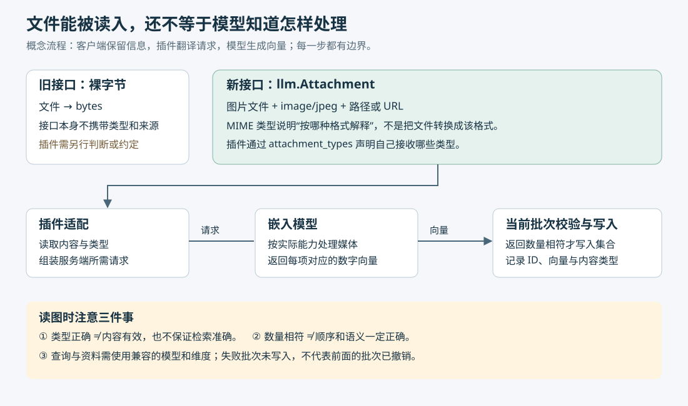

# LLM 0.37：接入模型更方便之后，哪些问题仍要自己验证

> 来源：[simonwillison.net](<https://simonwillison.net/2026/Nov/2/llm>)  
> 作者：Simon Willison · 发布时间：2026-11-02 08:00（Asia/Shanghai）  
> 翻译正文：[阅读中文正文](article-zh-CN.md)

把一个模型接进脚本，往往只需要一次请求；把几个模型、图片和录音接进同一套日常工具，就会遇到配置不统一、输入格式不清楚、出错后难以核对结果的问题。Simon Willison 的 LLM 工具尝试把这些重复工作放到统一的命令和 Python 接口里。0.37 版值得关注的地方，是它让模型配置更容易维护，也让多媒体输入携带更完整的信息；真正的模型能力、检索质量和团队收益，仍需要另外验证。

本文以 2026 年 11 月 2 日的 [《Release: llm 0.37》](https://simonwillison.net/2026/Nov/2/llm/) 为研究主体。这里的 **LLM 是项目名称**，指一个命令行工具和 Python 库；不是泛指所有大语言模型。以下把作者的发布说明称为“原文陈述”，把官方文档、发布记录和代码变更称为“外部核验”；自拟场景与实践建议会明确标出。核验截至 2026 年 11 月 4 日，未进行付费模型调用或性能实测。

## 先看一个小团队会遇到的问题

**假设**一个三人团队维护产品帮助中心：文字说明放在 Markdown 文件里，操作截图和演示录音散落在目录中。他们希望先用模型整理资料，再让同事通过一句话找到相关截图或录音。

这实际上包含两项不同任务。整理资料需要模型生成文字；查找资料则可以先把每份内容转换成一串数字，再按相似程度排序。这串数字叫作**嵌入向量（embedding）**，用于表达内容的某些语义特征。向量相似只是检索线索，并不证明两份内容表达了相同事实。

团队原本可以分别写服务商请求脚本、图片处理脚本和录音处理脚本，但每换一个服务，就要重新维护地址、密钥、参数和结果处理。LLM 提供共同入口，减少上层脚本的差异；遇到特殊服务时，则由**插件**负责把统一调用转换成该服务理解的请求。官方的[模型插件教程](https://llm.datasette.io/en/stable/plugins/tutorial-model-plugin.html)展示了这种注册模型、实现调用的方式。

0.37 的两项主要变化分别对应这里的两个障碍：用命令保存模型接入配置，以及在生成向量时保留文件的类型信息。它们没有把整理和检索变成同一件事，也没有让任意模型都能处理图片和录音。

## 配置命令解决的是重复接线，兼容性仍要逐项检查

原文提到新增 `llm openai endpoint add`。这里的 **endpoint，即服务端点**，就是客户端发送请求的地址；“OpenAI 兼容”表示该服务实现了类似的应用程序接口（API），不表示它由 OpenAI 托管，也不保证支持所有功能。

外部核验显示，这组命令实际管理的是 `extra-openai-models.yaml`：一种保存结构化配置的文本文件。`add` 写入记录，`list` 查看记录，`remove` 删除记录，`path` 显示文件位置。它没有启动模型服务器，也没有安装模型权重。[对应变更 #1838](https://github.com/simonw/llm/pull/1838)与[官方配置文档](https://llm.datasette.io/en/stable/other-models.html#configure-an-openai-compatible-model)均可交叉核对。

一条配置里，有三个容易混淆的名字：

| 配置项 | 负责什么 | 为什么需要区分 |
| --- | --- | --- |
| `model_id` | 本地脚本用来选模型的名称 | 可以给模型取一个稳定、易记的名字 |
| `model_name` | 发给服务端的模型名称 | 必须符合远端实际接受的名称 |
| `api_base` | 请求发送到的基础地址 | 决定访问哪个服务，而非模型叫什么 |

调用时，LLM 根据本地名称找到配置，适配层再把远端模型名和输入组装成请求，发送到指定地址。需要认证时，可以引用单独保存的密钥名称；配置文件不必直接包含密钥值。官方文档还明确：设置自定义 `api_base` 后，已有的 OpenAI 密钥不会默认发送过去。[配置与密钥说明](https://llm.datasette.io/en/stable/other-models.html#configure-an-openai-compatible-model)

**分析：**这种分工方便多人约定同一个本地名称，但名称相同不保证环境相同。两个人都运行 `llm -m helpdesk`，可能实际访问不同服务器或不同模型版本。因此，共享脚本时还应记录远端模型、地址、工具版本和所需能力。

更重要的是，普通文字请求成功，只能证明最基本的路径可用。流式输出，也就是边生成边返回内容；工具调用，也就是让模型请求执行外部函数；以及按指定结构返回结果，都需要分别测试。配置中的能力开关是客户端声明，不能给服务器增加能力。遇到服务商专有功能，直接使用它的开发工具包，或编写专用插件，可能比继续增加兼容配置更清楚。

配置工具自身也会出错。11 月 3 日发布的 **0.37.1** 修复了一个具体问题：当配置文件使用方括号列表形式，例如删除最后一个端点后留下 `[]`，0.37 的新增命令可能写出无效配置，导致全部模型加载失败。这说明一个本地配置错误也可能扩大成整个工具不可用；尝试本次新功能时，应至少避开这个已知问题。[0.37.1 发布记录](https://github.com/simonw/llm/releases/tag/0.37.1)

## 为什么图片和录音不能只作为“一堆字节”传递

文件最终都是字节，但模型服务需要知道怎样解释它们。JPEG 图片和 WAV 录音的处理方式不同；仅有一个 `bytes` 对象，接口本身没有说明它是什么，也没有保留它来自哪个路径或网址。旧插件可以自行识别格式或依赖约定，这对单一输入足够，却给多种媒体共用接口带来负担。

0.37 为嵌入模型增加了**带类型的附件**。其中的 MIME 类型是描述内容格式的标准标识，例如 `image/jpeg` 和 `audio/wav`。它告诉接收方应按什么格式解释内容；把标签改成 `audio/wav` 并不会把任意文件转换成 WAV。

官方插件文档给出的处理过程是：插件通过 `attachment_types` 声明支持的类型；匹配的输入以 `llm.Attachment` 对象交给插件；插件读取类型、内容和来源信息，再完成实际调用。旧式二进制插件仍有兼容路径，因此升级客户端并不要求所有旧插件立即重写。[嵌入插件文档](https://llm.datasette.io/en/stable/embeddings/writing-plugins.html#embedding-typed-attachments)



图中从上到下展示概念流程，依据官方插件文档、附件变更和批次校验变更绘制；它不表示所有服务端内部都按同样架构运行。

类型信息还会进入存储：相关变更说明，附件哈希会包含 MIME 类型，集合新增可为空的 `content_type` 字段。**哈希**是根据输入计算出的摘要，常用于识别重复内容；把类型纳入摘要，可以区分“字节相同、解释类型不同”的输入。但这不能替代文件有效性检查，也不能证明类型标注正确。[附件支持变更 #1741](https://github.com/simonw/llm/pull/1741)

回到帮助中心的假设场景，一张截图可以作为图片附件进入支持图片的插件，一段录音可以携带音频类型进入支持音频的插件。它们是否能被同一句文字查询找到，还取决于模型是否把文字、图片和声音映射到可比较的向量空间。

Google 的官方资料确认，Gemini Embedding 2 提供这种跨媒体表示能力，可以将文字、图片、音频、视频和文档映射到共同空间。这支持原文所说的使用动机，但不能据此认定安装 LLM 0.37 就已经获得完整的 Gemini 接入；还需要支持该模型和相应媒体类型的插件。[Gemini Embedding 2 官方说明](https://deepmind.google/models/gemini/embedding/)

另一个边界是输入组织方式。Google 文档指出，把多个媒体片段直接组合到一次输入中，可能得到一个合并向量；将它们包装为独立的 `Content` 对象，才会得到各项对应的向量。LLM 的单条 `embed` 命令则一次接收一个带类型附件。模型支持图文联合输入，不代表客户端的每个入口都表达了相同能力。[Google 输入组织说明](https://ai.google.dev/gemini-api/docs/embeddings#embedding-aggregation)、[LLM 附件命令说明](https://llm.datasette.io/en/stable/embeddings/cli.html#llm-embed)

## 更深入一点：数量检查为什么影响检索可靠性

除了原文着重介绍的功能，0.37 还有一项值得小团队理解的修复：批量生成向量时，检查返回数量是否与输入数量一致。

**假设**一个批次包含资料 A、B、C，但插件只返回两个向量。Python 的 `zip()` 会把两个序列按位置配对，并在较短的一边结束时停止；如果直接用它组装数据库记录，第三条资料可能消失而没有报错。返回数量过多时，多余结果也可能被丢弃。

在 [#1726 的代码差异](https://github.com/simonw/llm/pull/1726/files)中，可以看到写入事务前增加了数量比较，不相等就抛出 `ValueError`。**事务**用于让一组数据库操作共同成功或共同撤销；这里的边界是当前批次。配套测试覆盖了返回过少、返回过多，以及前一批已完成、后一批失败的情况。本文核对了代码与测试内容，没有在本地重跑测试。

这带来两个实际结论。第一，异常批次不会继续被当成完整结果写入，但前面成功的批次仍然保留；不能把整项导入任务理解成全部成功或全部撤销。第二，数量相符只排除了一种错误：插件即使返回相同数量，也可能顺序颠倒、向量内容错误。因此，失败后应核对已写入的资料编号；成功后也需要抽样检查“编号—原文件—检索结果”是否对应。[变更说明与批次边界](https://github.com/simonw/llm/pull/1726)

## 选哪条路，取决于你需要保留什么信息

以下比较是基于上述机制的分析，不是同环境性能测试。

| 做法 | 复杂度与可靠性 | 性能、成本及协作影响 |
| --- | --- | --- |
| 直接调用服务商接口 | 特有功能表达直接；团队自行维护请求、错误处理与记录 | 少一层通用适配，但不保证端到端更快；换服务时通常要改调用代码 |
| 使用 LLM 统一入口 | 常用脚本较一致；配置和插件也成为需要验证的依赖 | 适合个人试验和小团队脚本；模型费用仍取决于实际调用，需共享配置约定 |
| 先提取文字，再做文字检索 | 便于检查识别文字、转录内容是否出错 | 多一个提取步骤；可能丢失布局、声音和视觉细节，但纯文字需求未必需要多媒体模型 |
| 直接做多媒体嵌入 | 可保留更多媒体线索；依赖模型对目标资料的实际表现 | 需处理文件限制、切分、上传和重建向量的成本；没有本项目的统一收益数据 |

长资料尤其需要额外设计。Google Cloud 当前的模型说明列出了输入长度、PDF 页数以及音视频时长等限制，例如单份 PDF 最多六页。长录音或长文档需要切分，并保留片段对应的原文位置；否则即使检索到文件，也未必能定位到有用内容。具体限制应以实际使用的平台和模型版本为准。[Google Cloud 模型限制](https://docs.cloud.google.com/gemini-enterprise-agent-platform/models/gemini/embedding-2)

换嵌入模型还可能意味着重新处理全部资料。Google 明确说明，`gemini-embedding-001` 与 `gemini-embedding-2` 的向量空间不兼容，不能直接比较。**分析：**新旧向量即使维度相同，也不应被视为可以混用；迁移应保留旧集合，新建集合并重新评估查询效果。[官方迁移说明](https://ai.google.dev/gemini-api/docs/embeddings#migration)

对于只有少量文字、关键词就能准确定位的资料库，这些额外环节未必值得。对于需要集中权限、多人服务、明确延迟承诺的生产检索系统，也不能仅凭一个命令行工具完成整体设计。现有资料没有给出 LLM 在这类场景下可承诺的规模上限。

## 便宜的默认模型与轻松的审查，都不能直接推广

原文说，未自行设置默认模型的用户会切换到 `gpt-6-luna`，并称其价格是此前 `gpt-5.6-luna` 的一半。模型切换可由发布记录核对；“一半价格”在本文中保留为作者陈述，没有据此推导实际账单。原文没有给出输入、输出、缓存等计费口径，也没有提供同一任务的质量、重试次数和总费用比较。[原文](https://simonwillison.net/2026/Nov/2/llm/)、[0.37 发布记录](https://github.com/simonw/llm/releases/tag/0.37)

**建议：**自动化脚本应明确指定模型，并记录版本与参数。评价成本时，应看完成一项合格任务用了多少次请求、多少人工修订，而不只看单次标价。默认值适合降低初次使用门槛，却不能替代团队的选择记录。

原文还说，本次有 12 位作者贡献修复，几乎都使用了 AI 辅助；作者借助模型筛选更有价值的修改，把提交看成“附有示例的错误报告”，有时合并，有时自己重新实现。这是维护者的经验自述，原文没有提供审查耗时、遗漏缺陷或后续回归的数据，不能据此承诺其他项目也会减少工作量。[作者的协作经验](https://simonwillison.net/2026/Nov/2/llm/)

值得尝试的是它背后的判断方式：先确认问题是否真实，再决定如何修复。以向量数量检查为例，贡献的价值可以通过可复现输入、失败表现和回归测试来判断，维护者不必因为补丁已写好就接受其实现。**分析：**AI 可以辅助归纳变更和寻找检查点，但最终仍需有人理解行为边界。没有明确维护者、缺少测试条件，或涉及复杂兼容承诺的项目，不能仅靠增加一个 AI 审查步骤补足这些前提。

## 最小实践：先验证接入，再决定是否扩大

以下是建议的试验路径，命令按官方文档整理，未在本次调研环境执行。无需一开始建立完整知识库，也不必同时替换所有模型。

**第一步，选一个可撤回的文字任务。**例如给公开帮助文档生成摘要。使用至少包含上述修复的版本，备份端点配置，并在脚本中显式选择模型。准备一组事先写好验收要点的样本，保留原有做法作为对照。

**第二步，注册一个已能工作的服务。**下面假设本机已经运行了兼容服务；地址和远端模型名均为示例，执行 `add` 不会启动服务：

```sh
llm openai endpoint add http://localhost:8080/v1 \
  -m remote-model-id --id helpdesk-trial
llm models --options -m helpdesk-trial
llm -m helpdesk-trial '请将这段公开说明概括成三句话：……'
llm openai endpoint list
```

先确认普通请求，再只测试任务实际需要的流式输出、附件或结构化输出。记录工具与插件版本、远端模型名称和能力测试结果，供同事复现。[命令依据](https://llm.datasette.io/en/stable/other-models.html)

**第三步，确有检索需求时才加入媒体。**先挑少量可以人工判定相关性的图片或录音，确认插件支持其类型。`multimodal-embedding-model` 在官方示例中是占位名称，必须换成已安装插件实际注册的模型：

```sh
llm embed -m multimodal-embedding-model -a sample.jpg
llm embed -m multimodal-embedding-model \
  --at recording.data audio/wav
```

这两条命令只验证向量能否生成。不要把“返回了一串数字”作为检索验收标准；后续还要将资料写入独立试验集合，保留编号与来源，再使用兼容模型生成查询向量并检查排序。[附件命令依据](https://llm.datasette.io/en/stable/embeddings/cli.html)

**第四步，用少量明确指标决定继续还是退出。**下面是建议指标，不是原文报告的结果；阈值应在试验前按实际任务约定。

| 要验证的事情 | 怎么观察 | 何时停止扩大 |
| --- | --- | --- |
| 接入是否可靠 | 成功率、错误类型、同事能否复现配置 | 核心能力不兼容，需大量特殊分支 |
| 结果是否有用 | 摘要必需事实的保留情况；查询前五项中是否有人工标注的目标资料 | 持续漏掉关键内容，或无关结果过多 |
| 成本是否值得 | 每项合格任务的调用费用、重试与人工修订时间；响应时间中位数和第 95 百分位 | 比原有做法更费钱费时，且质量没有改善 |
| 数据是否完整 | 应有编号与实际写入编号逐项核对，检查失败批次 | 出现缺项、错配或无法确认来源 |

第 95 百分位表示约 95% 的请求耗时不超过该值，用于观察较慢请求；小样本下容易波动，只能作为试验线索。若收益不足，停止切换脚本，移除试验端点并保留旧集合即可；若有效，再逐步增加资料类型和任务量。

LLM 0.37 提供的是更方便的接入和更明确的输入信息。对个人与小团队，合理的采用条件是：共同入口确实减少了重复代码，插件能表达所需能力，而且小规模验证证明结果和总成本可以接受。模型换得快、文件能读入、补丁能生成，都只是开始；能够核对实际结果并在失败时清楚退出，才值得把试验变成日常流程。
