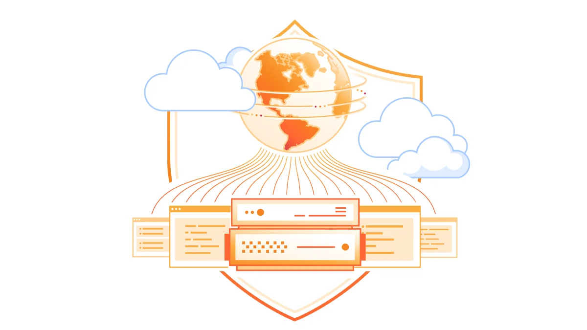
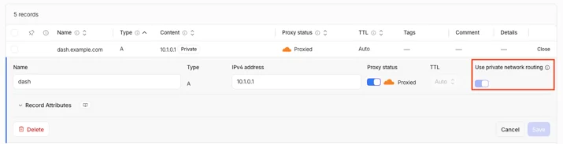
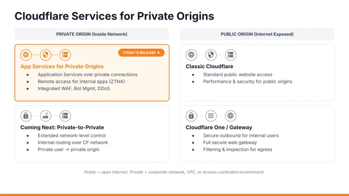

# Cloudflare 的私有源站服务现已全面可用

> **来源**: [https://blog.cloudflare.com/private-origins-public-to-private](https://blog.cloudflare.com/private-origins-public-to-private)  
> **作者**: 未知 | **发布时间**: 2026-10-30T14:23:43.668000+00:00  
> **深度调研**: [查看专题调研报告](research.md)  
> **标签**: Cloudflare Private Origins, 私有网络路由, DNS, WAF, Cloudflare One, Cloudflare Tunnel

---

## AI 导读

内部接口和业务工具可能需要接收合作方、客户或自动化程序的互联网请求，但不希望为后端服务器配置公网入口。文章介绍的做法是：创建由 Cloudflare 代理的域名系统（DNS）地址记录，将其指向后端私有地址，再通过已有的 Cloudflare One 网络连接转发请求。请求仍先经过 Cloudflare 的加密连接终止、Web 应用防火墙（WAF）、规则处理和缓存，再进入私有网络。

文章给出创建记录的接口示例，并说明 private_routing 字段会指示代理使用私有网络路径。指定的私有及共享地址范围会自动启用此设置，且不能关闭；仅能通过私有网络访问的公网地址则可手动启用。接入仍需要账号功能授权和受支持的网络连接；除 Cloudflare Tunnel 外，还需启用统一路由。使用 Cloudflare WAN 或 Mesh 时，必须配置返回 Cloudflare 源地址范围的回程路由，文章称缺少该路由是测试期间最常见的配置故障。

当前版本支持互联网请求到达私有后端，后端无需增加入站防火墙例外；是否需要连接器取决于接入方式。部分功能仍不支持，包括 Argo Smart Routing 和 Dedicated CDN Egress IPs，源站健康检查需要负载均衡功能。私有网络之间的访问仍在开发中，2027 年初封闭测试只是计划。文章提供了接入路径和注意事项，但没有给出性能测量、部署测试结果或完整的底层路由说明。

---

## 原文整理

# Cloudflare 的私有源站服务现已全面可用



今天，Cloudflare 面向私有源站的服务已全面可用。将代理 DNS 记录指向私有 IP，Cloudflare 就会通过现有的 [<u>Cloudflare One 网络连接</u>](https://developers.cloudflare.com/cloudflare-one/networks/connectivity-options/)。源站仍保持私有，同时 Web 应用防火墙（[<u>WAF</u>](https://www.cloudflare.com/products/waf/)）、 [<u>缓存</u>](https://developers.cloudflare.com/cache/)、 [<u>机器人管理</u>](https://developers.cloudflare.com/bots/get-started/bot-management/)和 [<u>Workers</u>](https://developers.cloudflare.com/workers/) 的工作方式与面向公网的源站完全相同。

6 月， [<u>我们以封闭 Beta 形式推出了这项功能</u>](https://blog.cloudflare.com/private-origins-dns-routing/) 以解决客户反复提出的一个问题：他们的内部 API、AI 代理后端、MCP 服务器和运营工具并不是为暴露在互联网中而构建的，但这些服务仍需要通过互联网接受合作方、客户或代理的请求。在 Beta 版之前，要让 Cloudflare 位于这些服务前面，就意味着暴露公网 IP、开放防火墙端口，或运行 `cloudflared` 在源站旁边。

这些要求往往使私有应用无法获得与公网应用相同的防护和控制能力，包括 WAF、机器人管理、速率限制、缓存、流量加速、重写和 Workers。

### 今天全面可用的内容

在封闭 Beta 期间，符合条件的客户通过其客户团队申请访问权限。如今，我们向这一 Beta 群体之外的用户开放访问。

将代理 A 或 AAAA 记录指向私有 IP 后，Cloudflare 的应用服务将像对待公网源站一样工作：

- WAF 和托管规则
- 机器人管理
- 速率限制
- 缓存
- 转换和重写规则
- Workers

仍有一些限制。 [<u>Argo Smart Routing</u>](https://developers.cloudflare.com/argo-smart-routing/) 和 [<u>Dedicated CDN Egress IPs</u>](https://developers.cloudflare.com/smart-shield/configuration/dedicated-egress-ips/) 不受支持，源站健康检查需要 [<u>Load Balancing</u>](https://developers.cloudflare.com/load-balancing/)。请参阅 [<u>开发者文档</u>](https://developers.cloudflare.com/dns/private-origins/) 了解当前限制的完整列表。

源站保留其私有 IP，无需增加入站防火墙例外。使用 [<u>Cloudflare WAN</u>](https://developers.cloudflare.com/cloudflare-wan/)时，无需在源站运行连接器软件。使用 [<u>Cloudflare Mesh</u>](https://developers.cloudflare.com/cloudflare-one/networks/connectors/cloudflare-mesh/)时，连接器会在你的私有网络中运行，并可服务多个源站。

### 工作原理

创建一个指向源站的代理 A 或 AAAA 记录。对于受支持的私有 IP 地址范围， **使用私有网络路由** 会自动启用。如果源站使用的公网 IP 只能通过你的私有网络访问，则可以手动启用此设置。

其余请求流程保持不变：TLS 终止、WAF、规则和缓存继续在 Cloudflare 网络上运行。



对于 RFC 1918 私有 IPv4 地址、RFC 6598 CGNAT 地址（100\.64\.0\.0/10）以及 RFC 4193 唯一本地 IPv6 地址（fc00::/7），该设置会自动开启。这些范围无法关闭该设置；通过 API 尝试禁用时会返回错误。

### API 示例如下

对于通过 API 自动化部署的客户，私有路由只是标准 DNS 记录上的一个附加属性。

```
POST /zones/{zone_id}/dns_records
{
 "type": "A",
 "name": "app.example.com",
 "content": "10.0.0.50",
 "ttl": 300,
 "proxied": true,
 "private_routing": true
}
```
在后台，Cloudflare 的代理平台会确定发往 `app.example.com` 的流量目标，方法是查询 Cloudflare 的 Origin API。响应中包含元数据，指出应通过私有网络路径到达该目标：

```
{
 "zone_name": "example.com",
 "ipv4_addresses": ["10.0.0.50"],
 "private_routing": true
}
```
该 `private_routing` 标志是关键信号。代理看到该标志后，不会尝试通过公网直接连接私有 IP 地址，而是将请求交给 Cloudflare 的私有网络层；随后，私有网络层会利用客户现有的私有网络连接来路由该连接，无论连接方式是 [<u>IPsec</u>](https://www.cloudflare.com/learning/network-layer/what-is-ipsec/)、 [<u>GRE</u>](https://www.cloudflare.com/learning/network-layer/what-is-gre-tunneling/)、 [<u>Cloudflare Tunnel</u>](https://developers.cloudflare.com/tunnel/)、 [<u>CNI</u>](https://developers.cloudflare.com/network-interconnect/)还是 Cloudflare Mesh。

这篇 [<u>Beta 版文章</u>](https://blog.cloudflare.com/private-origins-dns-routing/) 对路由层有更详细的介绍。

### 开始使用

开始之前，你需要：

1. 账号已获得 Private Origins 权限。请让你的客户团队启用该权限。
2. [<u>Cloudflare One 网络连接</u>](https://developers.cloudflare.com/cloudflare-one/networks/connectivity-options/) 使用 IPsec、GRE、CNI、Cloudflare Tunnel 或 [<u>Cloudflare Mesh</u>](https://developers.cloudflare.com/cloudflare-one/networks/connectors/cloudflare-mesh/)。
3. 账号已启用 Unified Routing，除非你通过 Cloudflare Tunnel 连接（Tunnel 不需要该功能）。新账号和现有账号都可以通过客户团队升级。
4. 如果通过 Cloudflare WAN 或 Cloudflare Mesh 连接，请为 Cloudflare 的源地址范围配置回程路由：IPv4 使用 100\.64\.0\.0/12，IPv6 使用 2606:4700:cf1:5000::/64。然后，为私有 IP 创建代理 A 或 AAAA 记录，并确认 **使用私有网络路由** 已启用。现有的 WAF、缓存和机器人管理配置会应用于该主机名，无需进一步修改。

然后，为私有 IP 创建代理 A 或 AAAA 记录，并确认 **使用私有网络路由** 已启用。现有的 WAF、缓存和机器人管理配置会应用于该主机名，无需进一步修改。

Beta 期间有一个注意事项：如果请求超时且源站没有收到任何请求，请先检查回程路由。我们发现，缺少针对 Cloudflare 源地址范围的路由是最常见的配置故障。

请参阅我们的 [<u>开发者文档</u>](https://developers.cloudflare.com/dns/private-origins/)，其中介绍完整的设置流程。

### 后续计划

今天的发布覆盖了到达私有源站的公网流量。接下来，我们正在开发私有网络之间的流量能力：让私有网络中的用户、服务和 AI 代理通过 Cloudflare 的应用服务访问其他私有网络上的应用。



工程工作正在进行中，我们计划在 2027 年初启动封闭 Beta。如果你希望参与，请联系你的客户团队。

员工打开 `wiki.company.internal`，例如，可以受益于 WAF、速率限制和机器人管理。云和数据中心之间的服务到服务流量也可以使用这些控制，即使双方都不接触公网。

目前，这次发布让你用于公网应用的 WAF、缓存、机器人管理和 Workers，能够通过你已经运营的连接应用于私有源站。

有问题或反馈？欢迎加入我们的 [<u>社区论坛</u>](https://community.cloudflare.com/) ，或联系你的客户团队。
